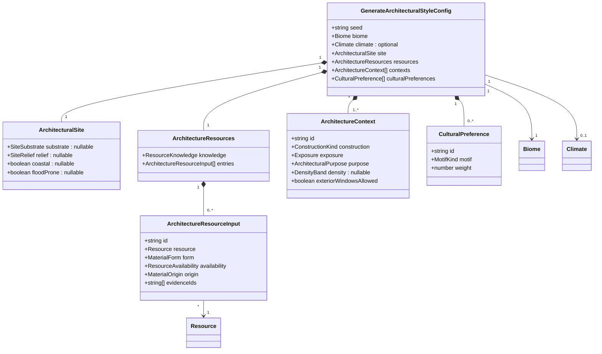
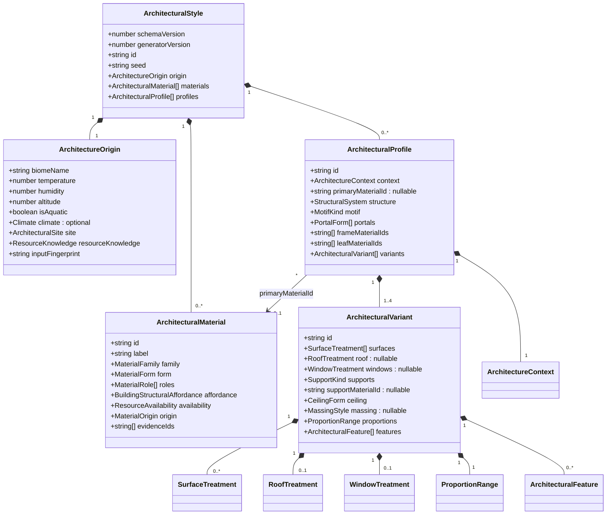
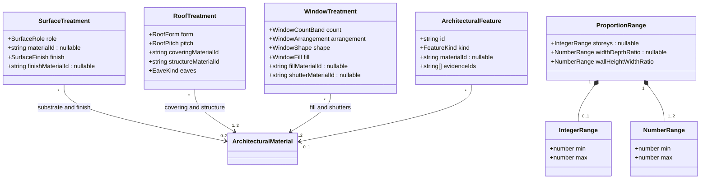
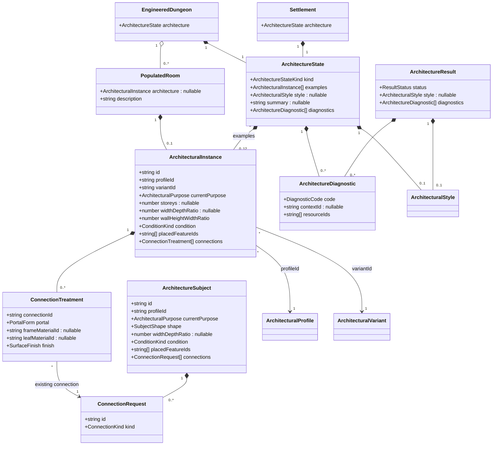

# Shared architectural styles

**Status:** implemented — domain model approved by Ben on 2026-10-31.

**Issue:** [#467](https://github.com/ironarachne/ironarachne/issues/467), Regions milestone 2.
This design is a prerequisite for the architectural data consumed by
[#250](https://github.com/ironarachne/ironarachne/issues/250). It does not approve that issue's
illustration composition or art direction.

## Problem

A settlement's description and illustration must agree about what its buildings look like. Dungeons
need the same vocabulary for built interiors, excavated spaces, and worked additions inside caves.
The origin biome and available resources must constrain those choices. Neither prose nor a renderer
should infer construction from English material names or independently invent architectural facts.

The existing `architecture` library is a useful starting point, but its model assumes exterior
buildings. It cannot represent a windowless crypt without also assigning a roof and facade windows,
and it does not connect shared local character to particular buildings or rooms.

## Decisions

1. Evolve `$lib/architecture`; do not introduce a competing style library. It owns architectural
   semantics, compatibility rules, deterministic generation, validation, and narrative candidates.
2. Require an existing `Biome` and an explicit resource context. Unknown resource knowledge is a
   distinct input, not an empty palette interpreted as permission to invent timber.
3. Separate a shared style, bounded compatible variants, and instances of those variants. Persist
   shared data once per owning settlement or dungeon and reference it from buildings and rooms.
4. Separate construction method, exposure, interior ceiling, exterior roof shape, and covering.
   Inapplicable features are explicitly absent. Natural caves have a natural-space profile rather
   than a fabricated building style.
5. Materials have stable local IDs and typed forms/capabilities. Eligibility precedes weighting;
   climate, purpose, density, and cultural preferences cannot authorize unavailable resources.
6. Dungeons own geometry and traversal. Architecture can dress an existing door, stair, room, or
   passage; it cannot place another one or change a lock or key relationship.
7. Generate facts before wording. Use `$lib/narrative` to compose concise descriptions from those
   facts; persist final prose and reuse it for display and export.
8. Save semantic architecture, not SVG, scene graphs, or pixel data. Reopening and rendering perform
   no architectural generation and do not reinterpret saved materials through a newer catalog.

## Existing-library audit

Inspected the public entry point, types, main generator, windowing and addition helpers, description
fragments, material affordances, tests, the architectural CLI, and the dungeon generation/snapshot
path. The architecture suite has 38 tests across four files, all passing during the issue audit.

| Existing behavior                                         | Decision                                                                                            |
| --------------------------------------------------------- | --------------------------------------------------------------------------------------------------- |
| Seeded style generation and plain output                  | Retain, with an explicit versioned seed contract.                                                   |
| Separate prose formatter and reusable helpers             | Retain the separation; replace checklist prose with narrative candidates.                           |
| Resource affordance scoring                               | Reuse physical affordances; add hard role/form eligibility before scoring.                          |
| `availableResources: Resource[]`                          | Preserve access to actual resource records, adding stable IDs, supply evidence, and material forms. |
| No biome input; coarse `site` flags                       | Require `Biome`; accept optional actual climate and structured site evidence.                       |
| String material names and name-based roof decisions       | Replace with material IDs and typed form/capability data.                                           |
| `RoofStyle` mixes shape, covering, and ceiling-like forms | Split these concepts. A vault inside rock is not an exterior roof.                                  |
| Mandatory roof, windows, and settlement massing           | Replace with context-specific profiles and nullable exterior features.                              |
| Building additions and decoration catalogs                | Retain eligible entries; give them exposure, support, and material requirements.                    |
| Optional storey/courtyard hints                           | Replace with explicit bounded proportions and variant/instance selection.                           |
| Dedicated windowing/addition seeds                        | Retain intentional isolation under documented derived operation seeds.                              |
| Empty palette yields timber framing                       | Remove; return insufficient-resource diagnostics.                                                   |
| Roof/window choices can imply absent materials            | Remove; every selected manufactured material must be supported.                                     |

The source search found no imports of the architecture API elsewhere in `src`, but
`scripts/generate_architectural_style_cli.ts` is an existing consumer and must migrate. Site rock/soil
lists are currently unused. Equal material scores currently retain incoming array order; the new
contract canonicalizes resource IDs before selection. No clock-based or unseeded randomness was
found in the library generation path. The CLI currently uses `Date.now()` only to choose its default
root seed when none is supplied; that is a new run, not same-seed nondeterminism. The revised CLI
requires an explicit seed for reproducible output. This is not an audit of every generator in the app.

The dungeon currently combines room dimensions/shape, blueprint flavor sentences, biome features,
and placed-door descriptions. It has no architecture reference. Its four blueprints are Tomb,
Stronghold, Arcane Library, and Natural Caverns. `DungeonLayout` stores boolean grid topology;
architectural floor/ceiling heights and passage widths are not currently modeled there.

## Scope and ownership

Architecture describes material, construction, proportions, surface treatment, openings, ornament,
and architectural adaptations. It supports surface buildings, built underground chambers, rock-cut
complexes, and natural spaces with separately identified worked additions.

It does not simulate structural engineering, discover resources, prove an economy can manufacture a
product, classify biomes again, generate floorplans, or decide encounters and furnishings. It does
not infer ancient builders, ethnicity, wealth, age, damage, or imported goods from decorative style.
Supernatural construction, underwater engineering, new dungeon topology, and a general architectural
editor are outside this proposal. Unsupported contexts produce an explicit result.

Consumer responsibilities:

| Owner                                   | Responsibilities                                                                                    |
| --------------------------------------- | --------------------------------------------------------------------------------------------------- |
| `resources`                             | Resource records, physical affordances, existing processing/product evidence.                       |
| `environment`                           | Biome/climate/geology facts and their units.                                                        |
| `regions`                               | Resolve local biome and supported construction materials from current spatial/supply evidence.      |
| `architecture`                          | Normalize materials, generate compatible styles/instances, validate, supply narrative candidates.   |
| `settlements`                           | Own settlement architecture and its generated summary; choose density/category adapters.            |
| `dungeon`                               | Assign contexts to zones/rooms; own geometry, connections, interactive state, room text, snapshots. |
| Settlement illustration consumer (#250) | Buildings' scene placement, skyline/count, landscape, vegetation, camera, sepia line work.          |

Architecture imports external libraries through their public entry points and never imports regions,
settlements, dungeon, renderers, or Svelte. Consumer adapters live with those consumers. This avoids
cycles and keeps listing stored artifacts from loading generation/rendering dependencies.

## Domain model

The following diagrams declare the proposed TypeScript data shape. Types live in flat
`*_types.ts` files in their owning library. Literal vocabularies and discriminants below are part of
the model, not unspecified strings. Existing `Biome`, `Climate`, `Resource`, `ResourceAvailability`,
and narrative types remain owned by their current libraries; architecture does not duplicate their
full definitions.

### Origin, resources, and requested contexts

`ResourceKnowledge = 'known' | 'unknown'`. Unknown contexts require an empty `entries` list; known
contexts may be empty. `ResourceAvailability` reuses the region vocabulary `'available' | 'limited' |
'not-observed' | 'unknown'` through a public export. Only available/limited entries are eligible.
The architecture library must not depend on `regions` just to name this union: move the shared type
to `resources` and re-export it from regions without changing existing serialized values.
`MaterialOrigin = 'local' | 'imported' | 'salvaged' | 'native'`; native means in-situ host material,
not blocks already quarried. Imports and salvage require explicit evidence or caller-authored input.

`ConstructionKind = 'built' | 'rock_cut' | 'natural'`.
`Exposure = 'exposed' | 'sheltered' | 'buried'`.
`ArchitecturalPurpose = 'residential' | 'defensive' | 'civic' | 'religious' | 'storage' |
'commercial' | 'funerary' | 'scholarly' | 'industrial' | 'circulation' | 'natural'`.
`DensityBand = 'low' | 'medium' | 'high'`. Density is nullable for non-settlement contexts; absence
never silently becomes medium density. `SiteSubstrate` and `SiteRelief` retain existing unions.

A mixed surface/subterranean site supplies multiple contexts in one generation request. Construction
and exposure are independent: a buried masonry tomb is built; a cliff dwelling can be rock-cut and
exposed. Natural contexts must use purpose `natural`, and cannot request architectural windows.
No requested contexts, duplicate IDs, contradictory flags, or non-finite values are valid inputs.

### Generated style, materials, and variants

`MaterialFamily = 'wood' | 'stone' | 'earth' | 'ceramic' | 'plant' | 'metal' | 'mineral' |
'glass' | 'fabric' | 'other'`.
`MaterialForm = 'timber' | 'pole' | 'block' | 'brick' | 'compacted_earth' | 'tile' | 'slab' |
'board' | 'thatch' | 'plaster' | 'sheet' | 'pane' | 'woven' | 'bar' | 'native_rock' | 'unknown'`.
`MaterialRole = 'structure' | 'enclosure' | 'roof_covering' | 'floor' | 'finish' | 'window_fill' |
'door_leaf' | 'ornament'`.

`StructuralSystem` retains the four existing built values (`post_and_beam`, `load_bearing_masonry`,
`cob_or_adobe`, `hybrid_timber_and_masonry`) and adds `excavated_rock` and `unworked`. Natural profiles
have `unworked`, no primary manufactured material, no motif, and no built features. Native host rock
may appear as a material for natural or rock-cut surfaces, but cannot be used as quarried masonry
without a separate supported block/slab entry.

`MotifKind = 'none' | 'geometric' | 'interlace' | 'floral' | 'figurative'`.
Existing decorative techniques such as carving and tile inlay become features; motifs describe their
pattern. Cultural preferences weight motifs only. They never claim cultural membership or authorize
new techniques, resources, or construction methods.

`MassingStyle` retains `compact_blocks`, `courtyard_clusters`, `linear_spread`, `terraced_steps`.
It is null for buried interiors and natural spaces. Existing `OpeningStyle` is removed as a second
source of window density; purpose influences `WindowTreatment` directly.

### Surfaces, enclosure, and architectural features

`SurfaceRole = 'outer_wall' | 'inner_wall' | 'floor' | 'ceiling'` with at most one treatment per role.
`SurfaceFinish = 'unworked' | 'rough_cut' | 'dressed' | 'smooth' | 'plastered' | 'painted' | 'tiled'`.
A finish requiring an added material must have an eligible `finishMaterialId`; paint is not generated
until an explicit pigment/paint resource mapping supports it. Null material means unknown natural
substrate only, never a material-free manufactured wall.

`RoofForm = 'flat' | 'shed' | 'gable' | 'hip' | 'gambrel' | 'mansard' | 'cross_gable' | 'dome' |
'barrel'`; `RoofPitch = 'low' | 'moderate' | 'steep'`; `EaveKind = 'none' | 'short' | 'deep'`.
Pitch/eave compatibility is catalog-validated (a dome does not acquire gable eaves).
`CeilingForm = 'flat' | 'beamed' | 'barrel_vault' | 'groin_vault' | 'dome' | 'carved_flat' |
'carved_vault' | 'natural'`. `SupportKind = 'none' | 'timber_posts' | 'piers' | 'columns' |
'rock_pillars'`. Ceiling shape is independent of an exterior roof, with combinations validated. Non-natural supports
require `supportMaterialId`; rock pillars reference native rock. A roof records both its load-bearing
material and its covering (which may reference the same material). No support or roof frame is
allowed to borrow an unspecified material from the palette.

Window arrangement and shape retain the existing unions. `WindowCountBand` retains sparse/moderate/
rich; zero windows is `windows: null`, not sparse. `WindowFill = 'open' | 'shuttered' | 'lattice' |
'glazed' | 'membrane' | 'grille'`; each manufactured fill requires its specific material form.

`FeatureKind` retains all existing `BuildingAdditionKind` values and adds `stone_carving`,
`wood_carving`, `tile_inlay`, `metal_fittings`, `ventilation_shaft`, `drain_channel`,
`raised_plinth`, `terraced_foundation`, and `deep_reveal`. Weather adaptation tags become typed features
or explicit roof/window choices. Features describe architectural intent; shafts/drains do not promise
an accessible connection. Exterior additions require eligible exposure and supported construction.

Ranges are finite, positive, and inclusive; storeys are integers from 1 to 6. Natural and buried
profiles have null storeys/width-depth ranges. These are fantasy vernacular bounds, not engineering
calculations. Ratios are dimensionless. Dungeons use actual room shape and width/depth; the library
never substitutes its preferred footprint for their grid. Height ratios are indicative where no
vertical geometry exists, and never presented as measured metres.

### Instances, connections, results, and consumer storage

`SubjectShape = 'free' | 'rectangular' | 'circular' | 'angled' | 'irregular'`.
`ConditionKind = 'unspecified' | 'intact' | 'worn' | 'ruined'`; unspecified is the default and does not
assert age or abandonment. Condition is caller-supplied; it never deletes a traversable door or
collapses a mapped room. `ConnectionKind = 'door' | 'passage' | 'stair'`.
`PortalForm = 'rectangular' | 'round_arch' | 'pointed_arch' | 'rough_cut' | 'natural'`.
Door leaves apply only to actual doors, frames may be null for unframed openings, and stairs/passages
never get a leaf. Existing lock, secret, open/closed state, coordinates, and key linkage remain only
on dungeon records. A missing leaf material means unspecified appearance, not absence of the door.

`ResultStatus = 'complete' | 'partial' | 'unavailable' | 'invalid'`.
`DiagnosticCode = 'invalid_input' | 'unknown_resources' | 'insufficient_resources' |
'unknown_material_form' | 'unsupported_context' | 'unsupported_feature'`.
Invalid/unavailable results have null style; partial results contain only fully valid profiles and
may contain none. Complete requires a valid profile for every requested context. Diagnostics carry
stable codes/IDs; consumers supply readable explanations outside narrative text. Invalid input aborts
the generation request without replacing saved results. Complete/partial/unavailable map to
generated/partial/unavailable consumer states; instance failures append diagnostics to the owning
state and leave only the affected instance absent.

`ArchitectureStateKind = 'legacy' | 'generated' | 'partial' | 'unavailable'`. Generated requires a
non-null style and no missing requested profiles. Partial requires a style; unavailable and legacy
have null style. Legacy has null summary, empty examples, and empty diagnostics. Unavailable states also have empty
examples. Settlement generation stores up to twelve examples; dungeon states use an empty examples
list because room records already hold their instances. Other summaries may be null if no
architectural facts justify prose. These invariants form discriminated unions in TypeScript;
`ArchitectureResult` and `ArchitectureState` must not allow arbitrary field combinations merely
because the diagrams display their shared field sets.

Instances reference one local variant, and connections reference only the subject's supplied IDs.
Room purpose and condition do not mutate shared variants. `placedFeatureIds` names only features
actually placed by the consumer; the reserved ID `supports` refers to the variant's support system.
Validate these IDs against the selected variant, preserve them on the instance, and otherwise use an
empty list. Style summaries may describe typical features, but room prose selects placed-feature
claims only from this evidence. This carries no new coordinates or traversal authority. Two rooms can reuse a variant while
sampling different allowed proportions and connection treatments. Individual material substitutions
require another compatible variant; there is no unvalidated generic override object.

## Inputs and environmental reasoning

### Biome and climate

Use the existing `Biome` directly. Temperature is Celsius; humidity is 0–1; altitude uses the existing
normalized biome scale, not metres. Validate finite values and humidity range. Biome name is retained
for provenance, never used as a substitute for numeric conditions or parsed for weather claims.

The initial versioned scoring policy uses cold below 10°C, hot at/above 30°C, humid at/above 0.7,
and dry below 0.3. These affect preference weights: cold favors compactness and smaller openings;
hot conditions favor shade/deep reveals where supported; humidity disfavors unprotected earthen
exteriors. They are broad construction heuristics, not guarantees of comfort or safety.

Actual `Climate`, when supplied for this site, provides precipitation and seasonal extremes.
Frequent rain is `precipitationFrequency >= 0.6` or amount `>= 0.6`; a coldest-month mean below 0°C
allows a freezing-season preference. Rain shedding and seasonal thermal adaptations require that
evidence. Humidity alone does not prove rain, snow, flood, or groundwater. Biome temperature is the
origin mean; supplied site climate contributes seasonal/precipitation evidence rather than silently
replacing it. A caller must resolve contradictory sources before generation.

Nullable site fields mean unknown. Do not assume rocky substrate, a coastal site, or flood risk from
biome labels. Explicit flood risk favors raised plinths for exposed built structures; mountainous
relief favors terracing where relevant. Altitude alone never proves snowfall or wind exposure.

Exposure gates rules before scoring. Buried contexts requesting exterior windows are invalid. Buried profiles have no exterior roof/windows
or wind/rain adaptations; ambient surface heat/cold does not become a claim about chamber temperature. Sheltered
rock-cut profiles can have openings where explicitly permitted. Aquatic biomes return
unsupported-context in this first version, including a request that fails to specify a terrestrial
site rather than silently constructing underwater buildings.

### Resources and eligibility

`ArchitectureResourceInput` contains an actual existing `Resource`, not only its name. The caller
supplies a stable ID and form. Provide a pure `architectureResourcesFromCatalog` helper accepting
`Resource[]` plus explicit ID/form mappings, for CLI and standalone use. It does not make the entire
curated catalog locally available. Recognized catalog entries have a versioned exact mapping;
unrecognized resources use major/minor types and caller forms, never prose substring guesses.
Unknown form cannot satisfy a manufactured element until the caller supplies supported semantics.

Normalize eligible inputs into `ArchitecturalMaterial` once. Copy label, family, form, affordances,
availability, origin, and evidence into the saved style so later catalog renames cannot change its
meaning. IDs are opaque caller IDs, unique within a style. Reject collisions rather than making IDs
from array positions. Region fact/product IDs and namespaced catalog keys are appropriate IDs.

Hard compatibility examples:

| Element                        | Required evidence                                                                      |
| ------------------------------ | -------------------------------------------------------------------------------------- |
| Timber frame or post           | Timber/pole with suitable tensile affordance.                                          |
| Masonry wall, pier, or vault   | Block/brick and suitable compressive/span affordances.                                 |
| Earthen wall                   | Compacted earth or adobe-compatible brick; exposed humidity/rain protection supported. |
| Carved ceiling/wall            | Native host rock and rock-cut context.                                                 |
| Thatch roof                    | Thatch resource, compatible pitched roof.                                              |
| Board, tile, or sheet covering | Matching form; stone blocks are not tiles and metal ore is not sheet metal.            |
| Glazed window or metal grille  | Pane or bar form, respectively; no automatic glass in masonry.                         |
| Plaster/tile finish            | Plaster/tile resource in addition to substrate.                                        |
| Painted finish                 | Explicit supported paint mapping; otherwise omit.                                      |

A finite versioned compatibility catalog owns form/affordance requirements, supported roof/ceiling
pairs, motifs/techniques, exposure rules, and proportion ranges. Reuse `inferStructuralAffordance`
for physics-like weights, not as permission to treat any stone as every stone product. Limited
materials receive half the availability weight of available materials and cannot become a dominant
material where an otherwise compatible available alternative exists. This is qualitative selection,
not a quantity budget. Cultural weights are bounded 0–2 and multiply eligible ornament weights only.

Unknown knowledge yields partial data only where facts remain supportable (for example an unknown
natural substrate); it does not yield manufactured material choices. A known empty built palette is
unavailable. A partially adequate palette may support a rock-cut interior while failing its requested
surface annex. Omit unsupported profiles and return diagnostics rather than mixing invalid defaults
into a nominally successful style. A natural profile can be complete without a known host material
because it asserts only unworked form, not a stone species.

The library never executes refining recipes, converts ore to metal fittings, or assumes imports.
Consumer adapters supply evidenced finished products as additional resource entries. No amount of
style scoring can turn absent glass or fired tile into local supply.

## Generation and public API

Proposed exports from `$lib/architecture`:

- `generateArchitecturalStyle(config): ArchitectureResult` validates, normalizes, filters, selects,
  and returns a shared style. Expected domain failures are values, not exceptions.
- `instantiateArchitecture(style, subject, seed)` returns a discriminated success/failure result:
  success carries `ArchitecturalInstance`; failure carries `ArchitectureDiagnostic[]`. It selects a
  compatible variant and concrete proportions, and dresses only supplied connections.
- `architectureNarrativeSubject(style, instanceOrNull, subjectId): NarrativeSubject` produces transient
  factual candidates for the shared composer. Null instance describes the shared style.
- `validateArchitecturalStyle` and `validateArchitecturalInstance` return structured validation
  results, checking all cross-references and invariants. Validation consumes no RNG.
- `architectureResourcesFromCatalog` normalizes caller-selected catalog resources as described above.

Generation order is fixed: validate origin/context; canonicalize IDs; normalize resources; filter
construction systems; choose primary material/system per context; select motif; build up to four
compatible variants; validate every candidate; retain unique variants; emit diagnostics. Construction,
primary material, and motif stay fixed within a profile. Context profiles share material normalization
and eligible motif preferences, but underground contexts need not inherit a village's timber walls.
No exhaustive search or unbounded retry loop: enumerate compatible finite templates, score, then
select. If none fit, report the context failure.

Each profile has at least one and at most four complete variants, with exact surface/roof/window
choices. Variants vary supported secondary materials, finish, roof form, window rhythm, and proportions
without contradicting the profile's identity. Deduplicate canonical variants. No seed promises a
different result where only one compatible choice exists. Profiles also save eligible portal forms
and frame/leaf material ID pools, filtered by construction and purpose. Instantiation chooses only
from those saved pools; empty material pools yield unspecified appearance. Keep every material used
by a variant or a connection pool in the style, and prune other normalized inputs. This preserves
the connection vocabulary without embedding the full available-resource catalog.

Instance selection filters for the supplied shape and actual width/depth before selection. A dungeon
never receives a courtyard footprint or a forced rectangular shape. If no variant fits, leave that
room's architecture null with a diagnostic and preserve its existing geometry. Actual stairs remain
stairs whether or not a decorative treatment can be supplied.

### Reproducibility and RNG ownership

Use `@ironarachne/rng` exclusively. Define a versioned operation seed as
`JSON.stringify(['architecture', generatorVersion, rootSeed, operation, stableId])`; encoding the
tuple prevents separator collisions. Each public operation creates one RNG and threads it through
its helpers. Independent profile and instance operations are explicit child operations with their
own derived seeds; helpers do not reseed themselves. Connection and door-leaf operations use the stable connection ID independently of a room ID, so
opposite faces cannot reroll the material of the same door. Named style, instance, and prose operations
are intentionally isolated and deterministic from the caller's seed, not from clocks or draw counts.

Sort resources, contexts, variants, features, connections, and eligible catalog entries by stable ID
using code-point comparison, not locale-dependent collation. Scores tie-break by ID. Canonical input
fingerprints include normalized semantic inputs, policy/catalog version, explicit supply evidence,
and selected cultural preferences; exclude biome prose, display labels, runtime metadata, and array
ordering. Changes in evidence may invalidate provenance even when the selected visual style stays
unchanged. Resource IDs and typed properties are semantic; a label rename alone is not a new choice.

A region/dungeon adapter derives an architecture root from its existing root seed and stable subject
ID without drawing from the existing layout/population RNG. Adding a room must not reroll other rooms;
rendering in panorama versus thumbnail must not reroll architecture. Consumers without an explicit
seed must receive one from their generation owner; snapshot reads never manufacture one.

Identical semantic inputs, seed, and generator/catalog version produce identical IDs and architectural
choices. Input labels may change copied display text, so byte-for-byte output equality additionally
requires identical labels. Generator changes increment `generatorVersion`; schema changes increment
`schemaVersion`. Neither version automatically regenerates an existing saved style.

## Consumer contracts

### Settlements and regions

Add required `architecture: ArchitectureState` to new settlement records and snapshots. The settlement
owns one shared style, up to twelve saved building examples, and a short saved architectural summary.
Generate examples once with stable IDs `building-0` through `building-11`, retaining only successfully
instantiated examples. Twelve is a bounded vocabulary of appearances, not the settlement population.
Both textual summaries and illustration consumers may inspect these same saved examples. Keep the existing settlement
`description` and compose its architectural candidate(s) with existing identity material under a
short shared narrative budget; avoid repeating the separately stored summary verbatim in the same
view. Exact presentation placement remains with the settlement consumer.

Map categories to a documented default density: hamlet/village low, town/borough medium,
city/metropolis high. Explicit density overrides that default. Density influences built massing and
storeys, not materials magically available to a city. Residential is the default surface context;
additional civic/religious profiles require a consumer request, not inferred institutions.

Region adapters must use a settlement's resolved local `Environment`, not a separate presentation-time
map-cell lookup. Current `randomSettlements` still initially supplies the region overview environment;
this proposal does not silently fix that unrelated path. Until spatial environment resolution is
available, both prose and art use the settlement's stored biome consistently. Record the source
fingerprint, and treat improvement to local evidence as an explicit regenerate action.

Current `describeRegionMaterials` returns prose projections, not generation inputs. Do not parse
`buildingMaterials: string[]`. Add a pure structured adapter in regions over current resource,
product, and daily-life evidence. Only current attributable available/limited resources and supported
products enter the palette. A stale `RegionalMaterialLink` yields unknown context and diagnostics,
not a guessed palette; exporting a detached settlement retains its copied style.

Standalone generation accepts the same explicit biome and resources. With no regional material
source, use unknown resource knowledge by default. A caller may deliberately supply a curated palette;
label that selection as caller input rather than assert that a forest contains every wood product.
No data lookup or network access occurs inside architecture generation.

### Settlement illustrations (#250)

The illustration library consumes saved category/population/biome, architecture, and the settlement's
bounded saved building examples. Both panorama and thumbnail reuse that same pool, repeating examples
when a scene shows more than twelve buildings. Scene slot IDs and composition seeds may determine
which example appears where, but cannot choose new architectural traits. Repetition may change scale
and projection without changing storey count, materials, or roof/window form. Persisting scene
coordinates or every depicted building is unnecessary; the small example pool fixes the architectural
choices before rendering and requires no old generation algorithm during snapshot reads.

A scene may choose how many buildings to show and how to project them. It must use saved forms,
coverings, proportions, openings, and ornament. It cannot turn a low timber village into a stone city
or add a religious landmark from a generic skyline template. Simplification may omit tiny features;
it cannot contradict the defining visible construction. Text need not mention every visible fact.

#250 owns the 10:3 panorama, nearly square regional composition, sepia line art, and landscape layers.
Its forest L-systems, possible desert/plain vegetation systems, and mountain backgrounds consume biome
facts, not architecture's material names. Roofs/rooms are semantic outputs here, not drawing commands.
An unavailable/legacy style has no material-specific building illustration: show only a supported
landscape or omit the decorative image. Partial styles render only supported profiles. Agreeing prose
and art is preferable to a detailed invented fallback.

### Dungeons

Add `architecture: ArchitectureState` to `EngineeredDungeon`; add nullable `architecture` instances to
`PopulatedRoom`. Dungeon-wide profiles serve as zones through explicit room-to-profile assignment;
this proposal adds no geographic zone model. A mixed stronghold requests surface and buried profiles,
then the dungeon adapter assigns them using known placement/context. Never infer buried/exposed from
a blueprint name alone.

Default purpose mapping is explicit: Tomb → funerary; Stronghold → defensive; Arcane Library →
scholarly; Natural Caverns → natural. Room-purpose overrides map known room purposes such as storage,
religious ritual, industrial workshop, or circulation. Unrecognized room purposes retain the
blueprint-level intent and their original display text, never fall back to residential. Construction
and exposure must also be supplied by the adapter; current dungeon geometry does not prove them.

A rock-cut tomb requests native rock and a rock-cut profile. A natural cave has an unworked profile;
a worked shrine inside it references a separate built/rock-cut profile assigned to that room. Mixed
work within one geometric room is represented as separate named architectural subjects associated
with that room only when the dungeon has explicit subspace facts; this version otherwise treats the
room as one dominant context and does not invent subroom geometry.

Pass actual room IDs, shape, width/depth ratio, and existing visible doors/passages/stairs to
instantiation. Exclude concealed secret doors from visible architectural treatment; the dungeon
consumer renders their surrounding wall and separately exposes secret-door information only in its
authoritative referee presentation. Changing door secrecy requires the consumer to update or remove
its treatment atomically; a prominent arch must not disclose a concealed door.
Dress only connections for which the dungeon provides stable IDs. Current doors have IDs; future
passage/stair treatment requires adapter-owned stable IDs, not coordinate-derived IDs that change on
render. Until those exist, omit their treatments. Passage wall/floor/ceiling style may inherit the
profile without claiming a width, shaft, or route absent from the grid.

Refactor room text so candidates are collected from geometry, architectural instance, explicit
condition, contents, and actual door state before composition. Remove hard-coded stone-floor/wall
claims when not supported. Biome flavor must pass interior/exposure eligibility; no snow blowing into
a sealed crypt merely because its origin is cold. Architecture supplies no open/locked/secret wording;
existing interactive records remain authoritative. Existing descriptions and user edits survive reads.

Original purpose remains on the profile; current purpose is on the instance. A reused tomb chamber
can be storage without erasing its funerary construction. Damage must be explicit input and its
wording cannot claim a structural collapse inconsistent with traversable geometry.

## Prose contract

Use `$lib/narrative` as required by `docs/narrative-prose.md`. Architectural facts supply stable
candidate IDs, source material/profile IDs, compatible wording pools, and defining/distinctive/
supporting importance. Use at most two architecture sentences in a standalone summary and at most
one in the default room/settlement composite budget. Fewer useful facts produce less text.

Shared-style summaries emphasize a defining material/form combination and one supported adaptation
or motif. Interior candidates discuss walls, floors, ceiling, portals, and worked detail; they cannot
select exterior roof language. Relative claims such as unusually high ceilings require a documented
same-context reference, not comparison of a cavern to a cottage. Diagnostics and raw evidence IDs are
not narrative. Wording never invents history, climate, material, or current condition.

Consumers own the RNG and explicit batch context passed to `composeNarrative`; architecture's subject
builder is pure. Store final text once. Inspection/export reuse it. A user editing a summary does not
change geometry or material facts; image-affecting edits must change structured data and pass
validation. Where authored prose intentionally disagrees, preserve it and let an explicit edit/rebuild
workflow reconcile the facts; never silently reinterpret text as architectural input.

## Representative examples

These are illustrative compatible choices, not promised outputs for arbitrary seeds. Resource lists
refer to explicit supplied forms; none are assumed from the biome name alone.

| Context and inputs                                                         | Shared/instance facts                                                                                       | Example prose and visible consequences                                                                                                                   |
| -------------------------------------------------------------------------- | ----------------------------------------------------------------------------------------------------------- | -------------------------------------------------------------------------------------------------------------------------------------------------------- |
| Cool forest village; timber, boards, reed thatch; actual rainy climate     | Timber frame, compact one/two-storey variants, steep thatched gables, shutters, deep eaves                  | “Timber houses cluster beneath steep reed roofs, their deep eaves sheltering shuttered windows.” Art uses the same frames, gables, thatch, and openings. |
| Hot dry town; adobe, poles, boards; no glass or tile                       | Earthen walls, low roofs only where supplied supports/covering fit, deep reveals, open/shuttered openings   | “Thick earthen walls frame deeply recessed openings.” Art cannot introduce glazed windows or fired tiles.                                                |
| Built buried tomb; sandstone blocks/slabs, no timber/glass                 | Masonry, slab or compatible vaulted ceiling, dressed walls, no roof/windows, funerary motif where supported | “Dressed sandstone walls rise into a barrel vault.” Room geometry and actual doors remain unchanged.                                                     |
| Rock-cut scholarly complex; native workable rock                           | Excavated rock, carved-flat/vaulted ceilings, rock pillars, no masonry units assumed                        | “The chambers are carved straight into the native rock.” Pillars are only described in a room when the consumer supplies placement evidence.             |
| Mixed stronghold; blocks, timber, boards, both surface and buried contexts | Shared motif/palette, surface pitched roof, underground flat/beamed ceilings, room-specific variants        | The gatehouse may have a roof and shutters; the buried store does not inherit either.                                                                    |
| Natural caverns; host rock unknown                                         | Natural ceiling, unworked surfaces with null material, no manufactured elements                             | “An irregular chamber opens beneath an uneven natural ceiling.” No invented limestone species, roof, or window.                                          |
| Natural cavern with a built shrine; native rock plus supplied blocks       | Cave profile plus distinct religious built profile for the shrine room                                      | Worked masonry belongs only to the shrine context; the cave as a whole does not become masonry.                                                          |
| Same biome, stone blocks only versus timber/boards/thatch                  | Resource eligibility changes the feasible structural/roof families                                          | Stone-only output cannot acquire sheet-metal coverings; an unsupported complete building profile returns diagnostics.                                    |
| Same full palette, cold versus hot biome                                   | Compatible variant weighting/proportion/opening preferences differ                                          | Seed-corpus tests verify distributions and compatible adaptations, rather than requiring every paired seed to differ.                                    |

Supports, ornament, and additions in a style express a vocabulary for instances. Text may describe
those as typical of the shared style, but a particular room cannot claim a placed central column,
balcony, or stair without consumer placement evidence. Renderers may place nonblocking detail within
constraints; they cannot add traversability obstacles to a dungeon's authoritative grid.

## Persistence and compatibility

The style uses `schemaVersion: 1` and `generatorVersion: 1` for the new contract. These do not reuse
the unversioned legacy `ArchitecturalStyle` shape. No architecture artifact kind or tool route is
introduced; style data belongs to its consumer's result.

At inspection time settlement payload version is 4, dungeon is 2, and region is 20. Adoption bumps each
owner's then-current payload version by one (recheck at implementation time). Regions must compose
settlement migration for embedded snapshots and preserve artifact references to external settlements.
Do not merely change TypeScript types: update snapshot writers, validators, rehydrators, migration
chains, editors, roll/provenance paths, and exports together for each owner.

Older saves migrate to `architecture: { kind: 'legacy', style: null, examples: [], summary: null, diagnostics: [] }`;
old dungeon rooms gain `architecture: null`. Preserve all descriptions, seeds, topology, encounters,
keys, and user edits. Migration does not generate architecture from the current catalog. Legacy data
can acquire architecture through an explicit regeneration action using supplied biome/resources;
that is an intentional new result, not a side effect of opening the vault.

New style records embed only selected normalized materials and bounded variants, not full resource
catalogs, species, processing chains, maps, functions, or image data. Dungeon room records store
variant references, selected scalar proportions, and treatments only for their connections. External
evidence IDs are provenance; copied semantic material data remains usable if the source artifact is
removed. No per-room copy of `ArchitecturalStyle` is allowed.

Validate schema/version support, discriminants, finite/ranged numbers, material roles, exposure,
compatibility, unique IDs, local variant references, and connection references. Unsupported future
schemas produce the usual readable unsupported-version result, not silent regeneration. Optional
provenance checks mark evidence stale without changing saved style/prose. Architecture validation
is available without importing generation tables or renderers, preserving artifact listing behavior.

Changing origin resources/biome does not mutate old architecture automatically. An explicit regenerate
operation replaces the style, settlement examples, and affected room instances atomically, regenerates only opted-in generated
text, preserves authored text, and never rerolls dungeon topology/encounters. Full seed replay uses
recorded input policy/version; if unavailable, report that replay is unsupported rather than claim
exact reproduction from a seed alone.

The architectural CLI migrates to the new config/result and requires an explicit seed and biome input or an
explicitly selected biome fixture plus a selected resource palette (the seed remains required in either case). Update its examples with the
library README. Existing `describeArchitecturalStyle`/fragment helpers can remain deprecated adapters
for legacy objects during consumer migration, but cannot pretend that old name strings form a valid
new style. New generation uses the new result signature. Search all callers again before removal.

## Verification contract

Implementation must satisfy these checks; no implementation tasks are created before model approval.

- **Input and supply:** required biome/resources; invalid finite/range values; duplicate IDs; known
  empty versus unknown palettes; unsupported forms; limited supply; explicit imports/salvage/native
  rock; unsupported aquatic context; partial multi-context results.
- **Hard compatibility:** generated material references exist and match roles/forms; no block-to-tile,
  ore-to-sheet, implicit glass, roof-without-covering, or manufactured wall-without-material fallback.
  Test complete combinations against catalog invariants, not only description substrings.
- **Environment:** fixed palette across cold/hot and dry/humid biomes; fixed biome across different
  palettes; seasonal/rain evidence changes only justified adaptations; buried spaces omit exterior
  adaptations even under extreme surface conditions. Pin threshold boundaries and representative
  corpus distributions; do not require a different style for every possible seed/input change.
- **Variation:** one-to-four deduplicated variants; profile identity is retained; actual room shape
  wins; compatible purposes; mixed exposure; natural and worked contexts; existing door/stair IDs
  only; no new topology, door state, locks, keys, or walkability changes.
- **Determinism:** repeated same inputs/seed; different seeds where alternatives exist; shuffled
  resources/contexts/connections; tied scores; unique derived seed tuple encoding; isolated prose,
  architecture, and existing dungeon streams; no clock/UUID/global-counter influence.
- **Narrative:** concise budgets, correct interior/exterior eligibility, factual omission, supported
  materials, explicit condition, no unplaced support claims, compatible wording pools, existing
  content preservation, and stable saved text across reopen/export.
- **Storage:** round-trip JSON/IndexedDB, local reference validation, old consumer payload migration,
  external evidence disappearance, future version rejection, edited descriptions preserved, no full
  catalogs in payloads. Check a maximum-size dungeon to prevent per-room style duplication.
- **Consumer agreement:** one saved fixture feeds both prose and an image-semantic projection; assert
  the selected materials, forms, and openings agree in both compositions. Browser review remains
  necessary for #250's actual artwork and mobile presentation.

Keep unit tests alongside source, maintain the per-library coverage gate without new exclusions or
baseline reductions, and run `npm run verify` for implementation. Rendering/component/route changes
must run `npm run verify:all` before merge. Use the existing architectural CLI for semantic previews
and `scripts/render_dungeon.ts` for dungeon integration; #250's visual preview entry point belongs to
its own design. Mutation testing remains human-run and scoped per repository policy.

## Approval and implementation record

Ben approved the domain model and decisions on 2026-10-31, including explicit unknown/unavailable
outputs, shared variants and references, required biome/resources, independent construction/exposure,
and consumer payload migrations. The initial versioned environment heuristics and vernacular
proportion bounds implement that approved policy.

Implementation followed the dependency order below:

1. Shared architecture types, resource normalization and compatibility, deterministic profiles and
   instances, runtime validation, and factual narrative candidates.
2. Settlement and structured regional-evidence adapters, bounded saved building examples, dungeon
   profiles and room/connection treatments, and isolated generation/prose operations.
3. Settlement payload 5, dungeon payload 3, and region payload 21 migrations, snapshot validation,
   rehydration, provenance replay, and preservation of authored descriptions.
4. CLI/README adoption, focused invariants and integration tests, library coverage, and browser
   workflow verification.

The synchronous validation entry is separate from generation so artifact listing does not import
resource catalogs. Dungeon door descriptions no longer independently invent materials; stable
connection/door-leaf operations keep opposite rooms consistent. Root layout, doors, keys, encounters,
and treasure retain their existing generation streams.

The material/profile/instance contracts and saved building examples are available for #250's
illustration consumer. Its scene grammar, plant L-systems, image ratio, drawing code, and mobile image
layout remain that issue's work. Aquatic/supernatural construction and geometric subzones remain
separate future designs. Standalone consumers without a selected material source retain explicit
unknown knowledge rather than receiving a guessed construction palette.
