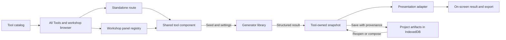

# Vastways architecture

Vastways is Iron Arachne's browser-based worldbuilding workshop. SvelteKit builds it as a static
site. The browser runs generators, renders results, and stores projects and artifacts locally.
The [static hosting guide](static-hosting.md) covers prerendering and the fallback page.

## Application layers

| Where                                                                                          | Responsibility                                                                                                                       |
| ---------------------------------------------------------------------------------------------- | ------------------------------------------------------------------------------------------------------------------------------------ |
| [`src/routes/`](../src/routes)                                                                 | Route metadata and composition. The root layout hosts the app shell and its navigation.                                              |
| [`src/components/`](../src/components)                                                         | Svelte controls, tool panels, result views, and artifact editors. Standalone routes and the workshop mount the same tool components. |
| [`src/lib/`](../src/lib)                                                                       | Generator models, data, algorithms, and shared application logic. Each library exposes a public API through its entry point.         |
| [`static/`](../static) and [`src/lib/assets/`](../src/lib/assets)                              | Assets served directly or imported into the build. Follow the [brand asset workflow](brand-assets.md) for vendored files.            |
| [`e2e/`](../e2e) and [`scripts/`](../scripts)                                                  | Browser specs, maintenance tasks, and command-line generator and renderer previews. Unit tests live beside library source.           |
| [`deploy/`](../deploy), [`infra/`](../infra), and [`.github/workflows/`](../.github/workflows) | Environment versions, infrastructure, verification, and release automation. See [deployment](deployment.md).                         |

Routes depend on components, and components use library APIs. Generator libraries work with plain
TypeScript values and have no dependency on routes or Svelte components. Keep a tool's data,
algorithm, snapshot conversion, and presentation adapter in its owning library. Put browser
interaction and UI state in components. The workshop layer is the integration point that can
load Svelte panels and editors. See [code conventions](code-conventions.md) for import boundaries.

## From a tool to a result

The [tool catalog](../src/lib/tools/tool_catalog.ts) owns the path, label, domain, maturity, and
filter metadata. A standalone route imports its tool component. The
[panel registry](../src/lib/workshop/tool_panels.ts) maps the same path to a lazy import of that
component. [Navigation](../src/lib/navigation/README.md) defines the shell's six destinations,
including All Tools, which lists catalog tools. See the [shell design](app-shell.md).

The tool component collects settings, supplies a seed, and calls the owning generator library.
The roll produces structured facts. A tool can turn those facts into a plain snapshot and project
the snapshot into a document, SVG, scene, or other presentation. For example, the
[Potion Generator](../src/components/objects/PotionGenerator.svelte) uses a single presentation
document for the screen and its Markdown and PDF exports. The
[guided tour](contributor-guide.md#follow-the-potion-generator) traces that path in code.

Savable tools hand the snapshot to the workshop with the actual seed and settings used to make it.
[Projects](../src/lib/projects/README.md) group [artifacts](../src/lib/artifacts/README.md), and
[`vault_db`](../src/lib/vault_db/README.md) persists them in IndexedDB. The
[workshop kind catalog](../src/lib/workshop/artifact_kind_catalog.ts) assembles the payload
validators and lazy codecs declared by owning libraries. The
[editor registry](../src/lib/workshop/artifact_editors.ts) connects kinds to editing components
and optional reroll functions. Reopen and export read the stored result. An explicit reroll can
use its provenance to create a fresh result. See the [workshop design](workshop.md) and
[storage decision](decisions/0001-local-workshop-storage.md).

## Shared generation infrastructure

- `@ironarachne/rng` supplies seeded randomness. Use the caller's RNG for internal draws or pass a
  deterministic child seed to a generator with its own public seed-based entry point.
- [Dice](../src/lib/dice/README.md), [names](../src/lib/names/README.md),
  [languages](../src/lib/languages/README.md), and [narrative](../src/lib/narrative/README.md)
  provide reusable primitives for rolls, naming, and prose.
- [Rulesets](../src/lib/rulesets/README.md) own ruleset-qualified mechanics. Common model fields
  describe the generated entity and support reuse across systems. See the
  [rules system design](rules-system.md).
- [Tags](../src/lib/tags/README.md) supply the shared filter mechanism for tools and other tagged
  data. Catalog genre and system tags drive discovery and compatibility filtering.
- [Geometry](../src/lib/geometry/README.md), [map](../src/lib/map/README.md), and
  [renderers](../src/lib/renderers/README.md) support spatial generation and output.
  The [renderer guide](renderers.md) explains the scene and output backends.

## Where to start a change

| To change                                      | Start here                                                                                                              |
| ---------------------------------------------- | ----------------------------------------------------------------------------------------------------------------------- |
| What a generator produces                      | Its `src/lib/<concept>/index.ts`, implementation, data tables, and tests.                                               |
| A control or result layout                     | The tool in `src/components/<domain>/`. Check the route and workshop entry points.                                      |
| A tool's title in discovery, tags, or maturity | [`tool_catalog.ts`](../src/lib/tools/tool_catalog.ts).                                                                  |
| The six destinations or global layout          | [`navigation`](../src/lib/navigation/README.md) and [`+layout.svelte`](../src/routes/+layout.svelte).                   |
| A saved payload or its editor                  | The owning library's snapshot and artifact kind, then the [workshop integration](../src/lib/workshop/README.md).        |
| Region generation rules or content             | The [regional authoring guide](region-authoring.md).                                                                    |
| A rendered map, image, or preview              | The owning renderer and [preview scripts](../scripts). Check [visual verification](testing.md#visual-regression-tests). |

Continue with [generator development](generator-development.md), [testing](testing.md), or the
[architecture decision records](decisions/README.md).
