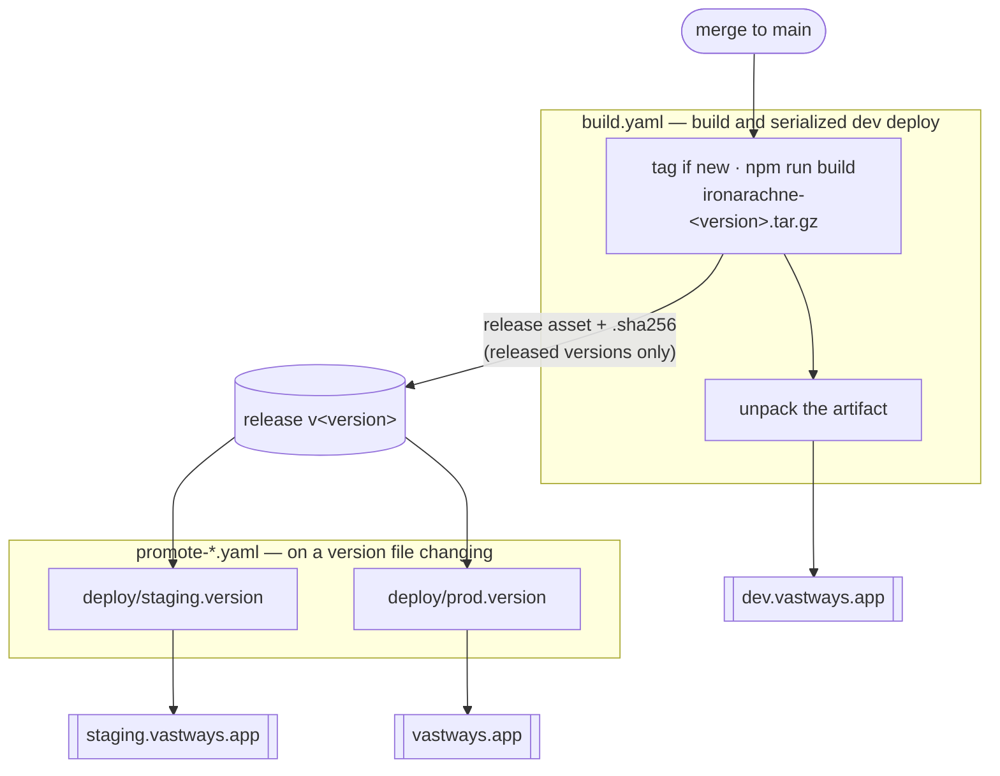

# Deployment

How a build reaches a bucket. The infrastructure it targets is described in `docs/infrastructure.md`;
the version scheme in `docs/versioning.md`.

Vastways publishes to `vastways.app`. Existing browser-local projects on the old hostname can be
exported from `app.ironarachne.com/recover/` during the cutover. The Iron Arachne studio site is
served at `www.ironarachne.com`. See the [domain rollout](vastways-domain-rollout.md).

**Status:** implemented. A merge to `main` tags the version, builds a versioned artifact, publishes it
as a release asset with a checksum, and deploys it to dev — all confirmed on real runs. Promotion by
committed version file replaces an earlier `workflow_dispatch` design that could not work here; the
publish half of it is proven, since staging was promoted to 2.3.2 by running the same two commands
by hand.

Some of the shape below was worked out against a previous host whose Actions implementation was
missing several things GitHub provides. Where a choice looks defensive, [Actions
notes](#actions-notes) says whether it was forced or chosen — worth reading before you change a
workflow on the assumption that it is arbitrary.

## The shape



|         | Trigger                          | Deploys                                  |
| ------- | -------------------------------- | ---------------------------------------- |
| dev     | every merge to `main`            | the artifact built in that run, unpacked |
| staging | `deploy/staging.version` changes | the release asset for that version       |
| prod    | `deploy/prod.version` changes    | the release asset for that version       |

Promotion fetches a published artifact rather than rebuilding, so the bytes reaching prod are the
bytes that were built and tested — not a rebuild that happens to start from the same commit.

The [Studio Website repository](https://github.com/ironarachne/studio-website) builds and publishes
`www.ironarachne.com` to the `iron-arachne-web` Bunny storage zone. The pull zone's connection to
Bunny Storage and the apex redirect are managed by `infra/environments/landing`.

The build job hands the archive and checksum to a separate dev deployment job. This serializes
publishes without interrupting release creation. A superseded job checks `main` before publishing.
The dev job verifies the checksum and publishes the unpacked archive, so packaging bugs surface
before the same bytes are promoted to staging or production.

## Publishing

Dev, staging, and production publish to separate Bunny Storage zones.
`scripts/publish_bunny_site.py` validates the zone ID and name, obtains the zone upload credential
with `BUNNYNET_API_KEY`, and checks the public CDN after publishing. To restore a checked archive
by hand, stop other dev publishes, unpack it, and run:

```bash
python3 scripts/publish_bunny_site.py dev dist
```

The staging and production workflows can also be run manually on `main` to republish the
committed version pin. `scripts/publish_site.sh` remains available for the former Scaleway origins
during recovery and rollback.

### Upload order and cache policy

Browser cache policy comes from Bunny edge rules and from upload headers on the former Scaleway origins.

| Files               | Header                                | Reason                                                                                    |
| ------------------- | ------------------------------------- | ----------------------------------------------------------------------------------------- |
| `_app/immutable/**` | `public, max-age=31536000, immutable` | Vite content-hashes these, so a given URL's bytes never change                            |
| everything else     | `public, max-age=0, must-revalidate`  | HTML shells at stable URLs; serving these stale would pin visitors to the previous deploy |

Both publishers upload hashed assets before pages can reference them and retain previous hashes.
They then publish mutable files and remove stale mutable files only after the upload succeeds.
Bunny compares SHA-256 checksums. The Scaleway publisher uses `rclone copy` for hashed files and
`rclone sync --checksum` for the rest.

Old hashed assets therefore accumulate. That is deliberate — they are small, and deleting them is how
you break the pages still referencing them. Prune with a bucket lifecycle rule if it ever matters.

### The cache purge

The edge holds the previous HTML until told otherwise, so the script finishes by purging the pull
zone. Without it a deploy is invisible for as long as the edge copy lives. Hashed assets are
unaffected — their URLs changed, so nothing stale is reachable.

## Promoting to staging or prod

**Promotion is a commit.** Each environment has a file naming the version it should be running:

```
deploy/staging.version
deploy/prod.version
```

Change the file, open a PR, merge it. `promote-staging.yaml` and `promote-prod.yaml` watch their
respective file and, when it changes on `main`, fetch that version's release asset and publish it.

```bash
echo 2.3.3 > deploy/prod.version   # then PR and merge
```

**Rolling back is the same operation**: put the older version in the file and merge. Nothing special,
nothing to remember under pressure.

A version must have been released to be promotable — bump `package.json` to cut one — and the file
holds bare digits, `2.3.2`, with no leading `v`.

Doing it by hand is still supported and is exactly what the workflows run:

```bash
scripts/fetch_release_artifact.sh 2.3.2 build
scripts/publish_site.sh prod build
```

### Why a commit rather than a button

Originally because a button did not work: the previous host collected `workflow_dispatch` inputs in
its web UI and never delivered them to the runner, and three failed promotion attempts were all that,
wearing different masks. See [the history note](#history-what-the-previous-host-could-not-do).

`workflow_dispatch` inputs work on GitHub, so this is now a choice rather than a workaround — and it
is the better design regardless: the repository states what each environment is meant to be running,
promotion is reviewable before it happens, and rollback needs no new mechanism.

## Required setup

Three repository secrets are needed: `SCW_ACCESS_KEY`, `SCW_SECRET_KEY` and `BUNNYNET_API_KEY`,
named to match the local environment variables. Every workflow that touches a bucket reads all three.

There is no fourth. Pushing the version tag and cutting the release used to need a personal access
token; on GitHub the workflow's built-in `GITHUB_TOKEN` does both, given `permissions: contents:
write` on the job. Nothing needs minting for that.

All three are set on the GitHub repository as of 2026-08-19. One thing still needs doing:

**Point the Scaleway secrets at the deploy identity.** They currently hold a user-scoped API key,
which can do anything the account can. `infra/shared` exists to provide a narrower one: an IAM
application whose policy allows only object-storage reads and writes within the site project. Mint a
key against it and replace the secret values — the names do not change, so nothing here needs
editing. `infra/README.md` has the command.

## Why bucket names live in the publish script

`scripts/publish_site.sh` maps environment to bucket and pull zone in a `case` statement, duplicating
what `tofu output` knows. That is on purpose: reading it from OpenTofu state would mean giving the
deploy job credentials for the state bucket, and the whole point of the scoped deploy identity is
that it can touch objects and nothing else. The values are stable; the comment in the script points
at the source of truth.

## Actions notes

The publish path is verified: `scripts/publish_site.sh` has published a real build to dev, and the
result was checked end to end — correct `Cache-Control` at the origin, the year-long header surviving
through the CDN, a cache `HIT` on a second asset request, deep links resolving, an unknown route
returning the error document, and pages rendering in a browser with no failed requests.

**Tag pushing works, and needs no personal token.** A protected branch does not block a tag, so
`build.yaml` cuts `v<version>` on a merge to `main` and pushes it as the workflow's own
`GITHUB_TOKEN`. That token gets write access from `permissions: contents: write`, declared on the
job rather than granted repository-wide.

**Releases are cut with `gh release create`, not with an action.** `gh` is preinstalled on
GitHub-hosted runners and authenticates from `GH_TOKEN`, so there is no third-party action in the
release path and nothing to keep pinned. The step creates the release when it does not exist and
uploads into it when it does, which is what makes it self-healing — see below. It attaches the build
artifact and a `.sha256` computed in the packaging step, and `scripts/fetch_release_artifact.sh`
verifies that checksum before unpacking, so promotion moves bytes that are checked rather than
merely assumed.

### History: what the previous host could not do

This repository ran on Worktree.ca, a hard fork of Gitea, before moving back to GitHub. Several
things in these workflows look defensive because they were written against that host's limits — none
of which apply here:

- **Workflow artifacts did not exist there at all**; the runner never set `ACTIONS_RUNTIME_TOKEN`.
  That is why `build.yaml` is a single job and why `goldens.yaml` pushes a branch instead of
  uploading files. Both keep their shape on their own merits, argued in the workflow files, rather
  than because the constraint still binds.
- **`workflow_dispatch` inputs were never delivered to the runner** by any route — the form
  collected them and the job saw an empty map. That cost three failed prod deploys and is the origin
  of promotion-by-committed-file, which was then kept deliberately; see
  [Why a commit rather than a button](#why-a-commit-rather-than-a-button).
- **`timeout-minutes:` on a job made the runner reject that job outright**, and a job that stopped
  producing output was reaped after about fifteen minutes with nothing inside it able to pre-empt
  that. Four such stalls in twenty-four hours are why the browser suite stopped gating pull
  requests. Developers now run the browser suite locally.
- **Most of the `GITHUB_*` context was empty**, `GITHUB_REF` excepted. Workflows here read
  `github.event_name`, `GITHUB_BASE_REF` and the rest as documented.

This is recorded because the shapes it produced are still visible in the files, and someone reading
them deserves to know which choices were forced and which were made. It constrains nothing new.

### The self-healing release step, and its limit

The release step fires whenever HEAD is exactly at the version tag, rather than only when the tag was
just created. So a build that cuts a tag but dies before attaching the artifact is repaired by the
next run **on that same commit**.

Its limit is worth understanding, because the first attempt ran into it. Once `main` moves past the
tag, the version no longer matches and the step is skipped — correctly, since a later commit is not
that release. A version whose build failed _and_ whose commit has been built over is therefore
stranded: it has a tag and no artifact, and nothing will ever give it one.

That is what happened to `v2.3.0`, which is why it is a tag with no release. The fix is not to
resurrect it but to cut the next version, which is why `2.3.1` exists. If it happens again, bump the
version rather than deleting and re-pushing a published tag.

One earlier unknown is now closed. Scaleway **does** implement the S3 directory redirect: a request
for `/heraldry` returns `302` to `/heraldry/`, so the trailing-slash fallback described in
`docs/static-hosting.md` is not needed in practice.
