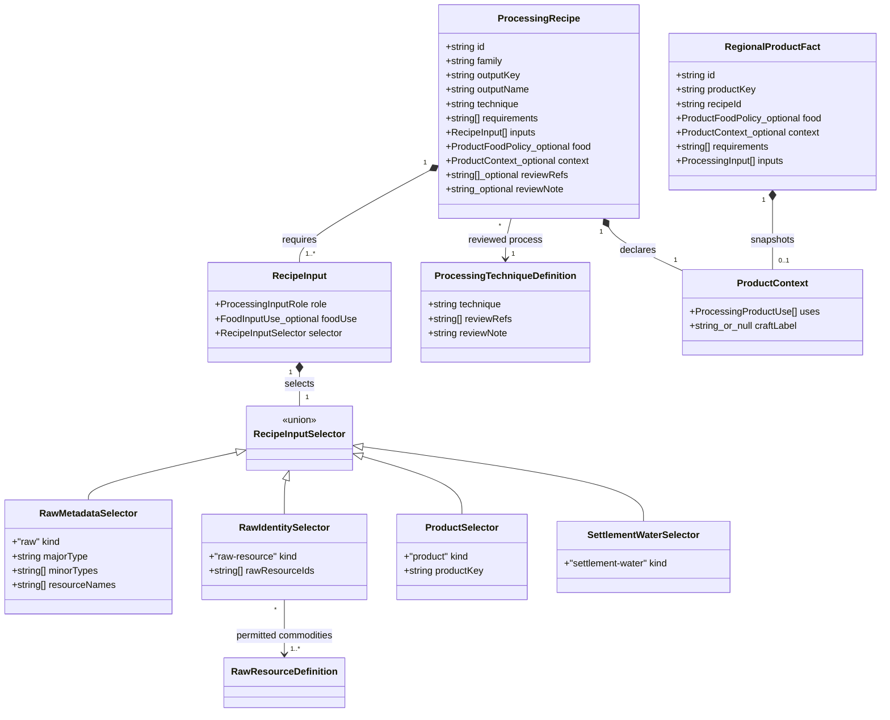
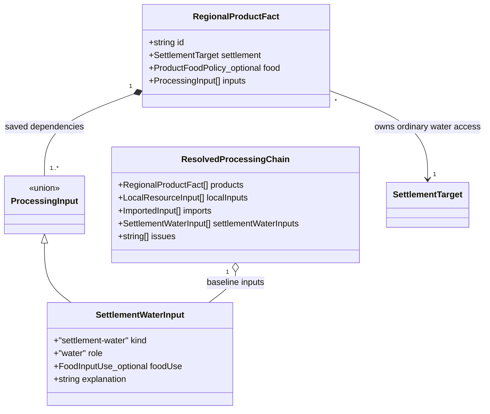
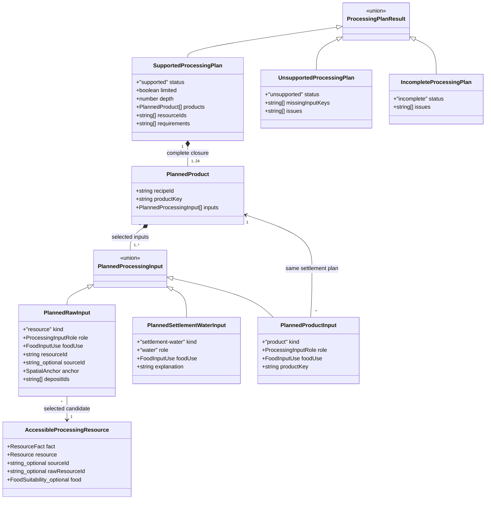

# Fantasy finished goods and complete processing recipes

**Status:** implemented for [#365](https://github.com/ironarachne/ironarachne/issues/365).
The user approved implementation of the revised domain model on 2026-10-15, including the
settlement clean-freshwater baseline.

## Problem and boundary

The twelve representative recipes from [#339](region-processing.md) establish processing chains,
but leave most of the [#364 raw-source catalog](fantasy-raw-resource-sources.md) unused. Regions
can explain flax cloth and iron tools, but cannot yet explain ordinary wool clothing, clay pots,
bread or local ornaments. Adding recipe rows alone would miss technique filtering, food policy,
selection limits, supply assessment and livelihood/context integration.

Expand the qualitative catalog in `$lib/resources` and its existing `$lib/regions` consumers.
Keep products as **possible outputs under explicit acquisition and craft assumptions**. A saved
product does not prove that a workshop exists. Tools, facilities, clean handling and appropriate
process control remain named requirements; they are not recursively manufactured prerequisites.
Materials, fuel and water are dependency edges. No scientific yields, quantities, prices, workshop
inventory, technology tree, nutrition, shelf life, travel trade or industrial simulation is added.

Preserve the existing twelve recipes, their stable output keys and historical saved chains.
Use [the raw-source ledger](fantasy-raw-resource-ledger.md) for commodity identity and source gaps.
This proposal intentionally records blocked goods instead of fabricating missing ingredients.
The existing saved settlement material link remains the integration boundary; this does not add
an equipment generator or a new artifact kind.

## Decisions

### 1. Review recipes individually and match new raw inputs by identity

Each new recipe has a versioned ID, one unique output key, an explicit food policy, exact input
roles/uses, requirements, downstream uses, a craft label where applicable, and review references
with a short explanation of the supported process and exclusions. Family names organize selection;
they grant no material compatibility or food permission.

Add a `raw-resource` selector with a nonempty, unique `rawResourceIds` list. It is an OR of reviewed
commodities for one input slot; separate slots are AND requirements. New matching uses the selected
source's `RawResourceSnapshot.id`, never editable names, anatomical tags or incidental prose.
Keep existing `raw` metadata selectors and `product` selectors for baseline and historical APIs.
Add an identity-aware matcher instead of silently treating a bare `Resource` as a qualified source.
A `raw-resource` selector cannot match a legacy resource lacking its reviewed source snapshot.
The transient `AccessibleProcessingResource` gains optional `rawResourceId: string`, copied from
that selected snapshot; legacy resource candidates leave it absent.

Product selectors retain one exact key. Distinct material routes use distinct keys: `wool-clothing`
and `linen-clothing`, for example. There is one recipe per output key; this avoids the existing
output map silently choosing between different recipes. Variant output keys and food permissions
must agree, rather than relying on a mutable display name.

Use a shared process-definition catalog for the technique allowlist and review metadata. It
contains stable `technique` strings, `reviewRefs: string[]` and `reviewNote: string`. Individual
recipes still declare all tools/facilities and consumables; the process entry is not a shortcut
past those checks. Existing technique strings remain valid. Proposed additional technique strings are `wool preparation`,
`cotton preparation`, `thread making`, `sewing`, `cordage making`, `thatching`, `wood splitting`,
`clay preparation`, `pottery firing`, `brick firing`, `tile firing`, `lime burning`, `lime slaking`,
`mortar mixing`, `papyrus sheet making`, `wax rendering`, `fat rendering`, `candle making`,
`copper smelting`, `tin smelting`, `bronze alloying`, `metal casting`, `bone carving`,
`lapidary polishing`, `pigment preparation`, `grain milling`,
`grain preparation`, `dough preparation`, `baking`, `cooking`, `fruit drying`, `vegetable drying`,
`honey separation`, `fruit pressing`, `fermentation`, `acetification` and `fresh cheese making`.
Reuse existing woodworking, weaving, spinning, fiber preparation and forging where appropriate.
A process string is enabled only with an enabled reviewed recipe; blocked routes do not expand
the allowlist on their own.

### 2. Food policy is explicit; clean freshwater is a settlement baseline

The recipe builder must accept `ProductFoodPolicy` and input `foodUse` explicitly. It must not
infer either from `family === 'food'`. Flour, dough, juice and extracted honey can be ingredient
outputs; bread and particular prepared foods are provisions. Pending raw-source preparation
permissions follow every ingredient branch until an explicitly permitted provision satisfies them.
A new provision key needs a matching source permission review; do not broaden wheat to every
cereal dish or let malting clear barley's existing porridge/bread restriction.

**User decision, 2026-10-15:** every settlement has access to a reasonable amount of clean
freshwater. Ordinary household food preparation and the settlement-scale craft opportunities in
this catalog may rely on that baseline, whether or not a river, lake or freshwater resource fact
is present on the map. No treatment recipe, water-purity simulation, extra fuel requirement or
local water-source qualification is needed to establish that access.

Water remains explicit in recipes. Add a `settlement-water` selector and corresponding saved
`ProcessingInput` variant, with `role: 'water'` and a nonempty `explanation` recording the clean
freshwater baseline. The enclosing product identifies the settlement; no duplicate settlement
identifier, fabricated resource fact, mapped water anchor or import is created. Food recipes mark
consumed water `ingredient` and washing water `process-water`; nonfood recipes use `support`.
The planner supplies this leaf for any valid settlement and snapshots its explanation on save.
Food evaluation accepts its ingredient use as eligible with no pending preparation restriction;
process-water use contributes no ingredient restriction. This does not make water a standalone
product or staple. `ProductFoodPolicy` itself needs no new water-treatment field.

The baseline establishes reasonable ordinary access, not a quantified surplus, irrigation network,
water-powered mill or industrial-scale throughput. Existing mapped water evidence and #364's
cultivation/husbandry support rules continue to describe those separate opportunities; do not
synthesize new hydrology, managed production or exportable water resources from the assumption.
All other ingredients, fuel, ownership and access gates still apply. Explicitly authored imported
water keeps its import explanation and descriptor; automatic imports remain prohibited.

New generation uses the settlement-water variant wherever these recipes need ordinary water,
including flax preparation. Preserve existing output keys and issue a new versioned recipe ID
when an existing recipe's water selector changes. Historical resource-linked water edges retain
their saved meaning and evidence rules; migration does not replace them with the new assumption.
The revised baseline supersedes #364's consumed-water restriction for new explicit settlement-water
edges, without treating unknown raw food descriptors as edible.

Industrial `salt-ore` remains not-food. Salted food can only be authored with a separately reviewed,
explicit imported food-salt descriptor until a local food-grade source/process is designed.
Neither generic mineral washing nor a recipe name establishes that qualification.

### 3. Consumables and equipment have different roles

Thread, fastening material, alloy constituents, dye feedstocks, mordants when required, flux when
required, fuel and water are explicit inputs. Needles, molds, looms, crucibles, kilns, storage
vessels and ordinary reusable process equipment are requirements. This keeps a forge from
requiring the very iron tools it would produce. A container sold as the product is material;
a reusable container holding a process is equipment. No food-contact safety inference comes from
having generated an arbitrary pot or wooden container.

Use named coarse routes that do not require unmodeled additives. Basic joinery can use wooden
pegs instead of hidden iron nails; undyed cloth needs no dye; an unglazed vessel is not glazed
ware. If a particular route needs flux, temper, lubricant, abrasive, mordant, culture, coagulant
or preservative, record it as an input or block that route. Ambient air and sunlight are stated
process conditions, not invented harvested commodities. No quantitative coproduct accounting is
implied: separate wax and honey opportunities do not assert independent yields from one colony.

### 4. Concrete catalog boundary

The following is the proposed deliverable catalog, not a claim that every process has already
passed review. Each listed route needs its own input/requirement/review row before it can be
enabled. A failed review moves that route to the explicit gap ledger; it must not quietly drop
an ingredient. The existing twelve recipes stay available independently.

Notation: `W` is ordinary clean freshwater supplied by the settlement baseline;
`F` is explicitly selected supported wood fuel, or charcoal only where the route specifies it.
Alternatives separated by `/` become separate stable recipes unless a raw-ID OR slot is stated.
Every arrow is a recipe step. Outputs named below are exact proposed keys; prefix lists expand
mechanically, with no runtime name construction for source matching.

#### Textiles and leather

| Outputs                                                       | Complete modeled inputs and route                                                                | Required capability/equipment                                                |
| ------------------------------------------------------------- | ------------------------------------------------------------------------------------------------ | ---------------------------------------------------------------------------- |
| `clean-wool`, `wool-yarn`, `wool-cloth`                       | `sheep-fleece` + W → washed/prepared wool → yarn → cloth; washing is a reviewed water-only route | Washing/drying area, fiber preparation tools, spindle, loom                  |
| `prepared-cotton`, `cotton-yarn`, `cotton-cloth`              | `cotton-seed-fiber` → cleaned/ginned fiber → yarn → cloth                                        | Gin/hand separation and cleaning tools, spindle, loom                        |
| `prepared-hemp`, `hemp-yarn`, `hemp-cloth`                    | `hemp-stems` + W → prepared bast fiber → yarn → cloth                                            | Retting/breaking tools, spindle, loom                                        |
| `linen-thread`, `wool-thread`, `cotton-thread`, `hemp-thread` | Corresponding existing/new yarn → sewing thread                                                  | Thread preparation/twisting tools                                            |
| `{linen,wool,cotton,hemp}-clothing`                           | Exact cloth + corresponding thread                                                               | Cutting tools and needles; plain sewn clothing                               |
| `{linen,hemp}-sack`, `{linen,hemp}-tent-cover`                | Exact cloth + corresponding thread                                                               | Cutting/sewing tools; covers only, no implied poles or complete pitched tent |
| `hemp-cordage`, `reed-cordage`                                | Prepared hemp fiber / `reed-stems` → twisted cordage                                             | Twisting tools; source-specific suitability review                           |
| `reed-thatch`, `wood-shingles`, `slate-roofing`               | `reed-stems` + reed cordage / sawn timber / raw slate                                            | Binding, splitting or stoneworking tools respectively                        |

Linen's existing flax preparation/yarn/cloth chain stays intact. New animal-fiber sources are
not inferred from generic mammals. Nettle cloth, leather, belts, shoes, leather armor parts and
parchment remain blocked until a complete source-specific cleaning/dehairing/tanning or skin
preparation route is reviewed. Oak bark and hide alone do not establish finished leather.

#### Building and household goods

| Outputs                                               | Complete modeled inputs and route                                                                   | Required capability/equipment                                                                     |
| ----------------------------------------------------- | --------------------------------------------------------------------------------------------------- | ------------------------------------------------------------------------------------------------- |
| `prepared-clay`                                       | Raw `clay` + W → prepared clay                                                                      | Sorting/levigation and working equipment; qualified clay suitability required                     |
| `unglazed-pottery`, `fired-bricks`, `clay-roof-tiles` | Prepared clay + F → shaped/fired goods                                                              | Suitable kiln and shaping/molding tools; separate vessel, brick and roofing reviews               |
| `quicklime`, `slaked-lime`, `lime-mortar`             | `limestone` + F → quicklime; quicklime + W → slaked lime; slaked lime + `generic-sand` + W → mortar | Lime kiln, slaking/mixing equipment; aggregate suitability assumption                             |
| `wood-furniture`, `wood-box`                          | Sawn timber + sawn timber for fitted pegs/joints                                                    | Woodworking/joinery tools; plain furniture/box, no upholstery, metal fittings or waterproof claim |
| `papyrus-sheet`                                       | `papyrus-stems` + W → pressed writing sheet                                                         | Strip preparation, pressing and drying equipment; not rag paper                                   |
| `rendered-beeswax`, `beeswax-candle`                  | `wax-bearing-comb` + W + F → rendered wax; wax + linen thread → candle                              | Rendering/separation equipment, candle forming tools; thread is a wick input                      |
| `industrial-tallow`, `tallow-candle`                  | OR(`cow-fat`, `sheep-fat`) + F → rendered industrial tallow; tallow + linen thread → candle         | Rendering equipment and candle forming tools; never food tallow                                   |

[Lime-burning evidence](https://historicengland.org.uk/images-books/publications/iha-preindustrial-lime-kilns/)
supports the lime intermediate rather than limestone becoming mortar directly. Clay temper and
firing suitability must be settled per route; absent suitable material means omission, not all
clay being suitable. Rag paper, soap and glass stay on the gap list below.

#### Metalwork and ornament

| Outputs                                                                                | Complete modeled inputs and route                                                                | Required capability/equipment                                                                                   |
| -------------------------------------------------------------------------------------- | ------------------------------------------------------------------------------------------------ | --------------------------------------------------------------------------------------------------------------- |
| `copper-metal`, `tin-metal`, `bronze-metal`                                            | Appropriate exact copper/tin ore source + charcoal → each metal; both metals + charcoal → bronze | Separate ore/process compatibility reviews, smelting furnaces/bellows, crucible and alloying capability         |
| `copper-awl`, `copper-fittings`, `bronze-tool-head`, `bronze-blade`, `bronze-fittings` | Exact metal + charcoal → cast/worked component                                                   | Source-specific casting/working tools and molds; components do not imply handles or complete weapons            |
| `iron-knife`, `iron-fittings`, `iron-cookpot`, `iron-armor-plates`                     | Existing bloomery iron + charcoal, plus wood for the knife handle                                | Forge/hammer/anvil and product-specific tooling; no steel, assembled armor or suitability claim for acidic food |
| `polished-garnet`, `polished-amethyst`                                                 | Exact gemstone + W + reviewed suitable abrasive → polished stone                                 | Lapidary tools; blocked until abrasive suitability is reviewed; no diamond-cutting inference                    |
| `copper-ornament`, `bronze-ornament`, `bone-ornament`                                  | Exact metal + charcoal / OR(`cow-bone`, `goat-bone`, `sheep-bone`) + W                           | Metalworking / cleaning/carving tools; no automatic precious metal refining                                     |
| `red-ochre-pigment`, `yellow-ochre-pigment`                                            | Exact ochre earth + W → washed/ground pigment                                                    | Washing, grinding and drying equipment; pigment is not paint without a binder                                   |

The broad ore names currently saved by #364 are not mineral assays. Copper/tin routes cannot be
enabled until a review establishes a conservative ore/process suitability gate; if that needs a
new persisted ore descriptor, it returns to model review. Do not turn all copper ore into a
particular oxide ore by changing its label. Metal/gem entries with this qualification unresolved
are explicit blocked rows, not part of a promised locally generatable minimum.

#### Food and beverages

| Outputs                                              | Complete modeled inputs and route                                                            | Food policy and equipment                                                                                                                                                                                        |
| ---------------------------------------------------- | -------------------------------------------------------------------------------------------- | ---------------------------------------------------------------------------------------------------------------------------------------------------------------------------------------------------------------- |
| `wheat-flour`, `wheat-dough`, `wheat-bread`          | `wheat-grain` → flour; flour + W → dough; dough + F → unleavened bread                       | Flour/dough ingredient; bread provision; mill/quern, mixing tools, baking hearth; no hidden yeast/salt                                                                                                           |
| `rye-flour`, `rye-dough`, `rye-bread`                | `rye-grain` → flour; flour + W → dough; dough + F → unleavened bread                         | Same policy with rye's own permission keys                                                                                                                                                                       |
| `prepared-oats`, `oat-porridge`, `barley-porridge`   | `oat-grain` → cleaned/dehulled oats; oats / `barley-grain` + W + F → porridge                | Prepared oats ingredient, porridge provision; barley preparation included and reviewed explicitly                                                                                                                |
| `cooked-lentils`, `cooked-peas`                      | Exact `lentil-seed` / `pea-seed` + W + F → prepared pulses                                   | Provision with exact source permission; cleaning, cooking and handling assumptions                                                                                                                               |
| `dried-apple`, `dried-pear`, `dried-plum`, `raisins` | Exact `apple-fruit` / `pear-fruit` / `plum-fruit` / `grape-fruit` + W → prepared/dried fruit | Provision; washing water is process water, not consumed ingredient; preparation and controlled drying/storage equipment                                                                                          |
| `dried-carrot`, `dried-onion`                        | Exact root/bulb + W → prepared/dried vegetable                                               | Provision; source-specific preparation/drying/storage review; no generic dried cabbage claim                                                                                                                     |
| `extracted-honey`                                    | `honeycomb` → separated honey                                                                | Ingredient; separation equipment and handling; no invented refined sugar                                                                                                                                         |
| `grape-must`, `grape-wine`, `wine-vinegar`           | `grape-fruit` → must; must → wine; wine → vinegar                                            | Must ingredient, wine provision, vinegar ingredient; explicit controlled fermentation/acetification assumptions and vessels; spontaneous cultures are stated process conditions, not a generated yeast commodity |
| `fresh-acid-cheese`                                  | OR(`cow-milk`, `goat-milk`, `sheep-milk`) + wine vinegar + F → fresh cheese                  | Provision; heat/acid coagulation, reusable straining cloth and handling equipment; not aged/stored cheese or automatic rennet                                                                                    |

An output can be a provision and still serve as an ingredient in a later reviewed step. Fresh
cheese is described as prepared food, never as preserved provisions. The
[FAO acid-coagulated cheese account](https://www.fao.org/4/t0251e/T0251E12.htm) supports a route
with a modeled coagulant rather than milk becoming cheese without one. The
[FAO fruit/vegetable processing guidance](https://www.fao.org/4/t0073e/T0073E06.htm) motivates
source-specific preparation and storage assumptions rather than treating all drying alike.
Detailed review must settle whether a spontaneous fermentation route is appropriate; if an
acquired starter is required for that route, it becomes an explicit input and the row is blocked
until that source exists. No alcoholic drink is labeled a dietary staple.

### 5. Keep an explicit missing-requirements ledger

These are deliberate deferrals within the #365 design, not successful recipes or automatic imports:

| Goods                                             | Missing requirement or decision                                                                                                                                                              |
| ------------------------------------------------- | -------------------------------------------------------------------------------------------------------------------------------------------------------------------------------------------- |
| Salted meat/fish, brined vegetables, cured olives | Qualified food salt; retained/discarded brine semantics and specific preservation review. Existing industrial salt cannot qualify food.                                                      |
| Beer, grain spirits and other distillates         | Exact malting/mashing/fermentation chain, grain permission review, cultures where needed, distillation capability and full water/fuel chain. A still requirement alone is insufficient.      |
| Leather goods, parchment                          | Complete hide preparation/cleaning/dehairing route, chemical inputs and reviewed tannin/preparation process; parchment is not tanned leather.                                                |
| Soda-lime glass and glass containers              | Reviewed silica/alkali/lime preparation, material suitability, furnace/crucible process and every required additive. Trona ore is not ready soda ash and potassium salt ore is not wood ash. |
| Soap                                              | Reviewed industrial-fat/alkali/water chain, actual alkali source/preparation and process requirements. Wood used as fuel does not silently supply measured usable lye.                       |
| Rag paper                                         | Pulp preparation, suitable fiber/rags, water and any required sizing; papyrus sheet is a separate product.                                                                                   |
| Woad/madder/weld dyes and dyed textiles           | Exact extraction, vat chemistry, mordant/reducing-agent and fixation requirements for the selected process. Raw dye plant is not ready dye.                                                  |
| Cut gems and mounted jewelry                      | Source-specific abrasive/cutting capability and setting material; polishing is not faceting. Precious-metal ore requires its own refining review.                                            |
| Complete weapons and armor                        | Every handle, haft, binding, lining, fastener or assembly component for the selected design; component availability does not imply a finished suit.                                          |

For glass, [Corning's soda-lime definition](https://allaboutglass.cmog.org/definition/soda-lime-glass)
identifies the distinct silica, soda and lime roles. It does not qualify this project's raw deposits
as suitable glass feedstock. Source references are evidence for a boundary, not approval of a whole
recipe. New raw-source needs link back to #364's ledger; no geological or biological source is
invented in this change. The gap ledger is documentation, not persisted simulated scarcity.

### 6. One product-use policy feeds livelihoods, supply and saved context

Add `ProductContext` to recipes and snapshot it onto new products. It contains
`uses: ProcessingProductUse[]` and `craftLabel: string | null`. Uses are classification, not proof
of supply or food suitability. The closed use vocabulary is:

`cloth | thread | cordage | leather | wood-construction | masonry | roofing | container |
furniture | fuel | hand-tool | weapon-component | armor-component | cookware | writing-material |
lighting | cleaning | pigment | dye | ornament | preserved-food | prepared-food | beverage |
food-ingredient`.

Intermediate products may have an empty uses list and null craft label. Food-related uses must
agree with the explicit food policy; only food assessment can establish eligibility. A beverage
never becomes a staple merely because it is provision-purpose. Equipment use remains descriptive,
not an item-stat modifier.

Update livelihood classification to use saved context after existing source/evidence checks.
Craft labels describe the supported process; building materials admit wood-construction, masonry
and roofing; fuels admit fuel. Eligible prepared/preserved foods can become food assertions with
appropriate wording; intermediate ingredients and beverages cannot become staples. Replace the
current universal "preserved food" phrasing for eligible products with use-appropriate language.

Supply needs select exact keys or reviewed uses. The existing woven-cloth need accepts cloth
(linen, wool, cotton or hemp), but not cordage, raw fiber or thread. Preserve explicitly iron-specific
needs; a copper awl does not satisfy an iron-tools need. Evaluate full possible chains before
representative display selection. Missing catalog support, missing source and selection omission
remain distinct; an unselected cloth chain cannot cause an import suggestion.

Keep the saved regional material link and artifact reference-by-ID behavior from #342/#379.
`describeRegionMaterials` still projects current saved building materials, fuel and crafts.
Inspectors/exports expose each selected product's complete chain and settlement-water/acquisition
assumptions through existing presentation paths. Do not duplicate an editable region inside a
settlement. No new food or equipment context field is required on settlement artifacts.

### 7. Plan complete chains deterministically within revised limits

Keep at most three representative families per region. Raise the maximum generated dependency
depth from four to **eight**, and saved generated products from twelve to **twenty-four**, including
all intermediates. Use shared constants in generation and capability assessment. These are
fresh-generation limits, not grounds for deleting larger valid authored/historical graphs.

Compile and validate the finite catalog first: unique IDs/output keys, known process IDs,
nonempty inputs, well-formed policies, resolvable product references and an acyclic graph. Require
each enabled terminal's dependency closure to fit both limits. Reject invalid catalog definitions
with actionable errors; do not silently filter unknown techniques or overwrite duplicate outputs.

Build one deterministic, side-effect-free chain plan per candidate before selecting representatives.
Food assessment and supply capability use the same selected-source/food rules as generation.
For each slot, sort eligible sources by stable source/resource IDs and prefer fully available
alternatives over limited ones. Reject ineligible food candidates before random choice; do not
pick one bad leaf and conclude that no compatible food exists. Ingredient intermediates may carry
pending permissions; assess them against the eventual provision, including every sibling branch.
A supported source combination must not be lost because the first explored alternative fails.

The planner returns complete plain-data candidates, requirements, limit/food failures and exact
local leaves; it creates no saved facts or imports. Deduplicate equivalent candidate source states
and memoize by output, settlement and relevant pending permissions. Limit source alternatives to
the already bounded regional inventory. Do not enumerate an unbounded Cartesian product. A
planner search budget may fail explicitly as "assessment incomplete"; it must never report
"missing local materials" or invent imports on budget exhaustion. The exact search strategy is an
implementation choice subject to these observable rules and tests.

Use stable recipe/source ordering and caller-owned `RNG` for representative selection and any
remaining equivalent source choice. Capability assessment performs no random draws. A fixed
seed/catalog produces identical output; expanding a catalog may change newly generated results,
but opening an existing save does not regenerate anything. Select an entire closure or skip it;
never save a truncated preparation chain. A plan contains at most one step per output key and
must use consistent selected sources for shared intermediates; separately valid but incompatible
branch plans cannot be merged by overwriting a product key.

Any eligible output with nonempty context uses may be a selection candidate, including useful
intermediates such as cloth or thread. Being consumed by a different recipe does not remove it
from consideration. Keep original terminal eligibility for the baseline twelve recipes. This
prevents adding clothing from making cloth vanish when the clothing's extra thread input is absent.
Use documented families `timber`, `fiber`, `textile`, `iron`, `food`, `stone`, `ceramics`, `lime`,
`lighting`, `copper`, `bronze`, `ornament` and `pigment`. Settlement water is a leaf, not a family
or processing intermediate.
Do not create a family per garment, species, dye color or individual recipe. Family selection
remains capped at three even when many eligible variants exist within one family.

## Domain model

These diagrams specify the proposed changed types; existing fact identity, evidence, locality,
import and source fields remain as defined in the earlier accepted models. Optional fields on
saved products allow historical facts without retrospective catalog lookup.

### Shared recipe definitions and saved product context

`string_or_null` means `string | null`; `_optional` means an optional property. Shared types belong
in the existing `$lib/resources/*_types.ts` modules. The shared types retain optional metadata/input-use fields for compatibility with older injected
catalogs; all new default recipes provide those fields explicitly. The catalog technique definition
and recipe review references are not consulted when resolving old saved chains.

### Saved settlement-water inputs

`FoodInputUse` remains `ingredient | process-water | support`. Existing resource, intermediate and
import input variants remain intact. New settlement-water inputs have role `water`; food-purpose
products permit `ingredient` or `process-water`, and nonfood products use `support`. Their saved
explanation must be nonempty and their enclosing product must name a valid settlement. They need
no resource/source ID, deposit list, spatial anchor or food descriptor. Validators reject other
roles and misleading source/import fields on this variant. Saved resolution and exports list these
as settlement baseline inputs, separately from extracted local resources and explicit imports.
`ResolvedProcessingChain.settlementWaterInputs` collects these leaves while preserving its existing
products, localInputs, imports and issues fields. No lookup of today's recipe catalog or mapped
water evidence is needed to read the saved baseline.

### Transient complete-chain plans

Plans are scoped to one settlement and output candidate; their stable product keys become saved
product IDs only after selection. Plans contain no imports. Settlement-water leaves add no processing depth or intermediate
product and consume no random draw. Types live in `$lib/regions`, not the
shared catalog. Existing `ProcessingCapability` can remain a compatibility projection for callers,
but supply code must preserve `incomplete` as an assessment notice and omit an unsupported-supply
assertion rather than collapsing it to `supported: false`.

## Persistence, validation and editing

At writing, `RegionFacts.version` is 10 and region payload version is 15. Reserve next versions
**11/16** for the optional saved product context and settlement-water input variant; recheck the actual
current versions when implementation begins. Migration adds no products, qualifications, context,
imports, craft labels or food permissions. It preserves IDs, edited prose, unknown historical
recipe keys, input links, source snapshots, managed ownership, maps and artifact references.

For historical product classification only, retain a small frozen mapping of the original twelve
product keys to their original livelihood/supply meanings. It is compatibility logic, not a live
recipe lookup or migration that rewrites saved facts. Unknown historical products remain readable
and contribute no newly inferred uses. Historical food-policy absence stays unknown. Migration adds no settlement-water edges and never
reinterprets an old raw-water input or a product named water as the new baseline variant.

Validate optional context vocabularies, duplicate uses and food/context consistency when context
exists. Require new catalog rows to supply all metadata, while saved historical rows may omit it.
Persist recipe requirements, food policy and context at creation. Historical rule IDs need not
exist in today's catalog. Structural validators do not reapply current ingredient compatibility
or the new generation caps to authored/historical graphs.

Reuse existing edit/removal traversal. Editing any selected source, intermediate or saved baseline
explanation stales all dependent explanations; deleting generated prerequisites removes generated
dependents while protecting authored inbound dependencies. No read, export or migration reruns
recipes or replaces an edited chain. Imported ingredients retain their explicit explanations and
food descriptors; imports are never synthesized by the planner or gap ledger.

## Acceptance and verification

Before enabling any new row, its recipe ledger records exact source/product selectors, roles,
food uses, requirements, food/context policy, versioned review ID, references, and supported versus
blocked decision. No recipe is enabled solely because this proposal names it. The initial useful
minimum is the complete supported textile/clothing/cordage, pottery/building/lighting and
food routes above using the accepted clean freshwater baseline; blocked metallurgy, gem and other rows are reported explicitly.
If process review invalidates a minimum route, revise this proposal's scope for human review
instead of silently declaring #365 complete with that route omitted.

Verify these observable cases:

- Every enabled terminal has a positive controlled fixture and an inspectable full input closure.
  Removing each required material/fuel input independently blocks it; omitting a required explicit
  settlement-water recipe slot is a catalog error. Removing mapped water does not block baseline
  water access. OR-source alternatives
  work without conflating distinct cloth, ore, producer or food identities.
- Cotton and wool satisfy woven-cloth supply; cordage, raw fleece and thread do not. Building and
  craft facts reflect new uses; copper components do not satisfy an iron-specific need.
- A settlement without mapped freshwater can produce water-dependent goods when its other inputs
  are supported. Saved chains show explicit clean settlement-water leaves; washing and consumed
  water retain distinct food uses. No treatment intermediate or extra treatment fuel is introduced.
  Wrong roles, missing explanations and invalid enclosing settlements fail validation. The baseline
  creates no raw-water resource, import, water-powered facility or managed production assertion.
- Wheat → flour → dough → bread retains restrictions until bread. A second restricted ingredient
  remains pending independently. Settlement water creates no pending food restriction. Industrial salt and
  industrial tallow cannot become food; fresh cheese and wine cannot become preserved staples.
- Capability, source selection and actual generation agree when eligible and ineligible raw
  alternatives coexist. Food ingredient intermediates do not fail merely because the provision
  permission belongs downstream. Every requirement survives chain resolution and export.
- No inaccessible/deep/trace deposit, foreign-owned managed source, missing prerequisite, stale
  evidence or unqualified import rescues a chain. Selection caps cause no false scarcity/import.
- Enabled recipe graph has unique IDs/keys, no cycles/unknown dependencies and maximum depth eight.
  Branching closures fit twenty-four facts; oversized candidates are diagnosed without truncation.
  Budget exhaustion yields incomplete assessment, not an unsupported local-supply claim.
- Same seed and catalog reproduce output. A bounded seed corpus demonstrates multiple materially
  different families; fixtures cover each enabled row without depending on rare random selection.
- Every supported historical payload migration round-trips edited products and unknown historical
  IDs. Original twelve chains retain their saved meaning. New metadata never grants old food
  permission. New product/context/settlement-water edits and removals preserve authored protections.
- One saved region linked by ID into an existing settlement shows a new supported craft/building
  material; stale evidence is visible and standalone settlement generation still works.

Run relevant catalog, processing, food, supply, livelihood, snapshot/editing and material-context
unit tests while implementing, then `npm run verify`. Rendering/inspector/export changes also need
relevant browser/mobile coverage; run `npm run verify:all` before merging any such change. Keep
coverage gates intact. The original documentation-only proposal required formatting/link/model inspection; implementation
requires the application checks above.

## Approval record

The user established the clean freshwater baseline for all settlements, then approved implementation
of the revised model on 2026-10-15. That approval covers the settlement-water input representation,
the supported/deferred catalog boundary, saved product-use metadata and the generation limits.
New persisted source variants, chemical processing-aid semantics or ore suitability descriptors
remain outside this implementation and need their own model review.

## Implementation record

The implemented catalog has 81 recipes: the twelve representative chains plus 69 additions.
The recipe rows in `src/lib/resources/processing_finished_goods.ts` are the enabled review ledger,
with explicit selectors, roles, policies, equipment assumptions and references. Blocked rows in
this document remain deliberately absent from that catalog.

Process review tightened three routes without changing their data model: the coarse wool output
is rinsed/sorted fleece retaining natural grease, not detergent-scoured wool; prepared clay includes
explicit sand temper; and candle forming includes fuel for melting. Natural grape fermentation
uses the grape's own yeasts under explicit controlled-process assumptions, with no invented
purchased yeast or sugar. Corresponding food and process references are stored with the definitions.
The planner collects shared downstream food constraints before choosing sources, avoiding a
Cartesian search and requiring no search-budget fallback in this finite catalog.
