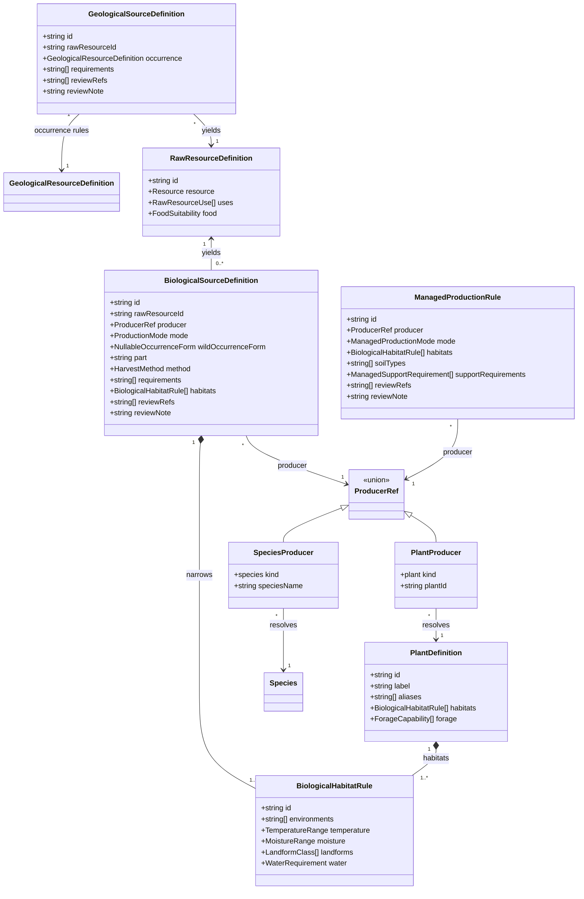
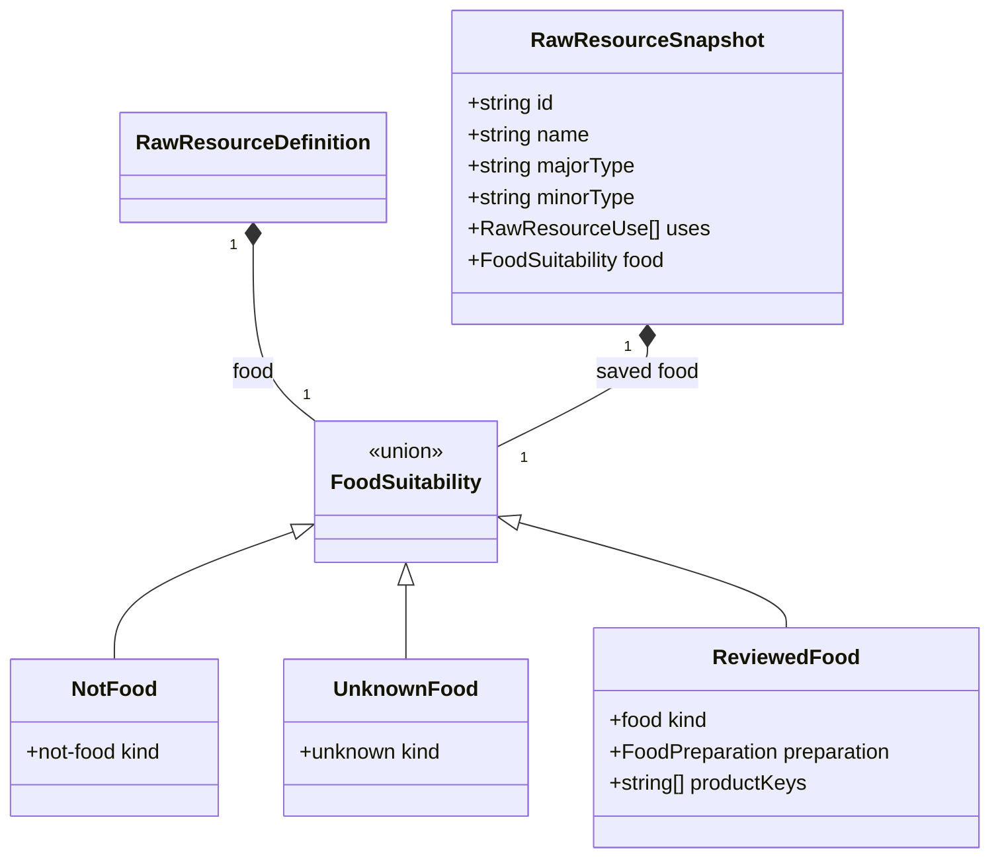
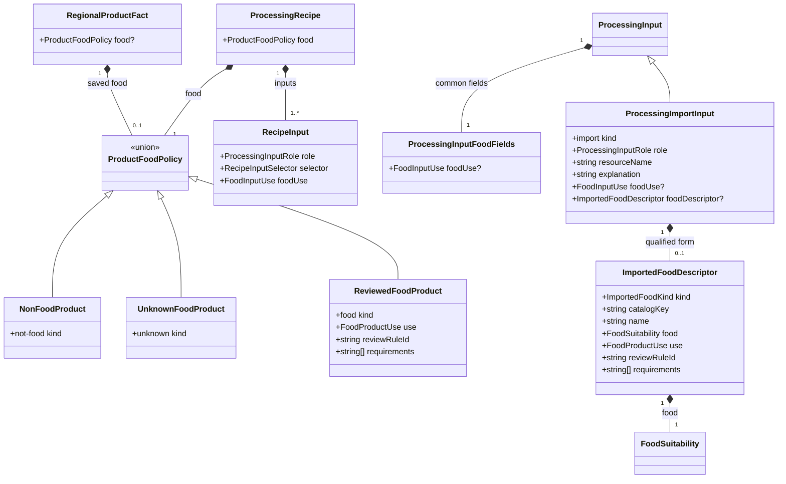
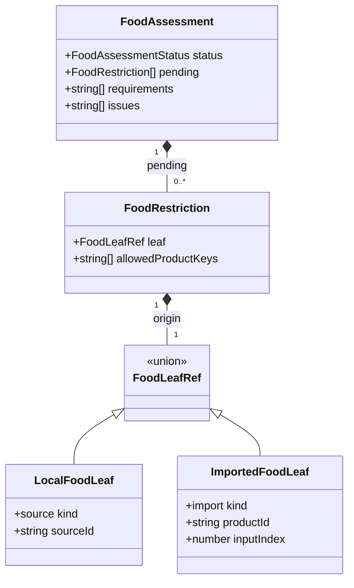
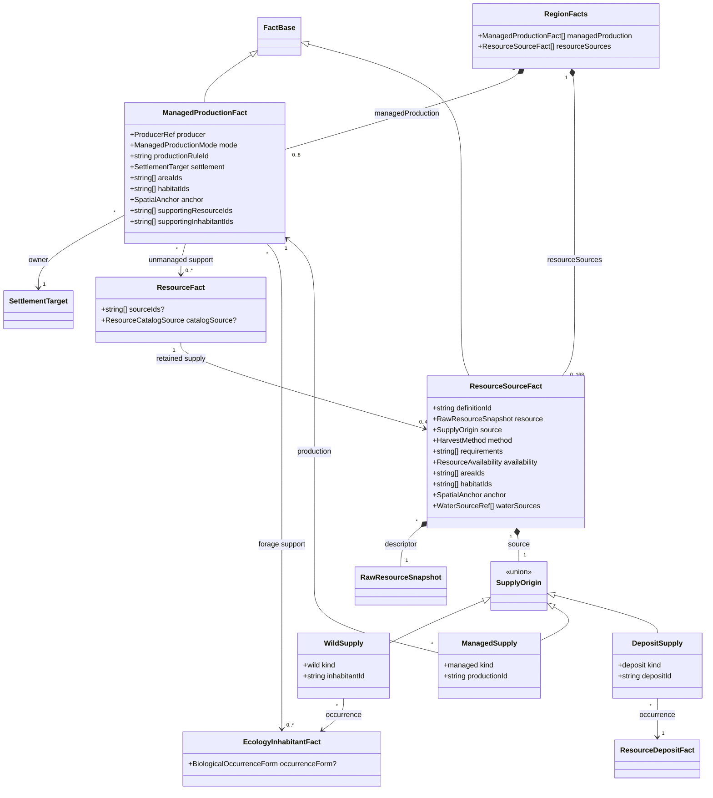
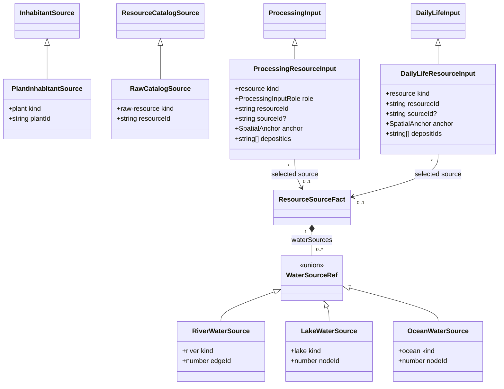

# Fantasy raw-resource sources

**Status:** implemented for [#364](https://github.com/ironarachne/ironarachne/issues/364).
The human reviewer explicitly approved the revised domain model and source ledger on 2026-10-14,
including food preparation across product chains and the documented initial exclusions.
The approved source catalogs, saved production/source records, qualified consumers, migrations,
editing and presentation are implemented. Finished-goods expansion remains #365.

## Problem and scope

The representative [resource inventory](region-resources.md) and
[processing chains](region-processing.md) establish useful boundaries: a catalog entry is a
possibility, an occurrence is local evidence, and a usable source still has access and processing
qualifications. Expanding the catalog must retain those boundaries.

Today plant products cover reeds, papyrus and flax. Plant identity otherwise often consists of a
curated ecology label. Animal products derive mainly from carcass body plans and physical traits;
that is useful for hide and horn but insufficient for edibility, milk, fleece or colony products.
Ecology currently samples land patches, including qualified freshwater and coastal margins. It
does not establish open-water communities. Geological rules cover a subset of the ore catalog.

Resources run before habitation. Ecology's settlement-use relations run later, and generated use
currently covers plant gathering. A generic `used-by: domestication` relation is possible in the
saved vocabulary but does not specify a herd, production activity or harvestable product.
Existing resource selection retains at most three entries per kind. Neither this cap nor the
ecology cap proves that an unselected commodity is absent.

This proposal adds reviewed biological source definitions, explicit managed production, more
qualified aquatic sources, and industrial occurrence metadata. It records how a raw input can be
obtained and consumed by the existing qualitative chains. It does not model acreage, head counts,
annual yields, breeding, prices, nutritional adequacy, irrigation networks or an agriculture
simulation. Finished goods and their new recipes remain
[#365](https://github.com/ironarachne/ironarachne/issues/365).

## Decisions

### 1. Separate commodity, producer, occurrence and acquisition

Use four distinct nouns:

| Concept                          | Meaning                                                             | Example                                              |
| -------------------------------- | ------------------------------------------------------------------- | ---------------------------------------------------- |
| Raw resource definition          | A reusable commodity and its reviewed uses                          | Raw sheep fleece                                     |
| Source definition                | A permitted producer, method and production mode for that commodity | Sheep, shearing, husbandry                           |
| Occurrence or managed production | A saved local organism or production activity                       | A flock kept by an embedded settlement               |
| Resource source fact             | A located, qualified potential supply from that occurrence          | Fleece from that flock, requiring shearing equipment |

A source fact means a modeled opportunity for acquisition. It does not assert that harvesting has
already occurred or that a named workshop exists. Managed production asserts that the settlement
keeps or cultivates the producer; its raw outputs remain potential supply with explicit methods.
For a wild source, ordinary eligible occurrence plus a reviewed harvest rule establishes potential
gathering or hunting, without claiming husbandry or a sustainable surplus.

Keep the existing `Resource` API and classification strings for older consumers. Add keyed raw
definitions beside it in `$lib/resources`, rather than assigning IDs to every existing finished
resource or replacing the quantitative refinement system. New keys identify the actual raw input:
`sheep-fleece`, `cotton-seed-fiber`, `oak-tannin-bark`, `silica-sand`, not broad groups such as
`fiber`, `plant` or `mineral`. Definition IDs are stable; source rule IDs are versioned.

Existing biological derivation remains a catalog API. Regions uses reviewed source definitions to
decide which derived entries can support new supply. A creature's fur is not sufficient evidence
for spinnable fleece, and a carcass product named meat is not by itself evidence of food suitability.

### 2. Keep the catalogs in their existing owners

Add a small keyed plant catalog to `$lib/environment`. It records canonical labels, explicit legacy
aliases and habitat/forage capabilities; it has no resource, settlement or regional dependencies.
Biomes and ecosystem plant labels resolve through that catalog. Unrecognized labels remain
described ecology with no automatic resource outputs. Reviewed plant definitions can also be
candidates in compatible habitat patches even when the old broad label lists omit them.

Species identity stays in `$lib/species`. Add ordinary species entries where required, including
an explicitly wool-bearing sheep archetype, honeybee and reviewed freshwater/coastal fish. The
ledger proposes managed goose eggs using the existing species and defers chicken feed modeling.
Do not use
giant bees as a stand-in for ordinary honeybees or infer commodity traits from editable prose.
Biological output rules in `$lib/resources` refer to canonical species names and plant IDs. They
reuse existing carcass names and geological resource definitions rather than duplicating those
catalogs.

Shared biological habitat rules belong to `$lib/environment`, using environment names, coarse
temperature/moisture bands, optional landforms and explicit water requirements. Species rules can
narrow an existing species' environment metadata. Regions owns evaluation against actual nodes,
water edges and saved habitat facts. Do not turn the existing `EcologyRule` into an import from
regions to another library.

Every source definition records review references and a review note identifying simplifications.
Reference URLs are catalog documentation, not runtime network dependencies. Review applies to a
specific producer, harvested part, method and proposed use; it does not certify every relative of
a plant or every animal with the same body plan. Habitat ranges and selection weights are authored
fictional-world rules rather than empirical distribution or yield estimates.

### 3. Managed sources are saved facts, not inferred occupations

Add `ManagedProductionFact` for `cultivation`, `husbandry` and `apiary`. Each records one producer,
an embedded settlement owner, a local land anchor, habitat links, a versioned production rule, and
the saved resource/inhabitant inputs supporting its placement. Multiple outputs may cite the same
production fact: a sheep flock can support reviewed fleece, milk and carcass products without
inventing separate flocks for each commodity.

A managed producer need not occur in the wild first. Seeded placement is an explicit fictional
world assertion that the settlement has established a crop, flock or colony. It requires a
reviewed managed-production rule, suitable reachable land and all modeled support. It does not
infer seed stock or livestock from wild presence, an occupation name, a settlement description,
cultural stereotypes or an import suggestion. Initial establishment history is outside the model.

Production rules state support requirements: cultivable ground, freshwater, grazing or flowering
forage as appropriate. Forage must come from current reviewed plant occurrences with explicit
capabilities, not the word `grass` or `flowers` found in prose. These are coarse support gates, not
feed balances. Cultivation does not require the crop itself as a feed or seed input. Support may
use only the earlier unmanaged inventory and ecology, so production cannot justify itself or
another managed producer through a dependency cycle.

Generate at most two production facts per embedded settlement and eight region-wide. Select
eligible pairs of production rule and connected site by stable identity, with an option to select
none. A sparse region can contain no managed production. Artifact-linked settlements remain
supported for authored facts using the existing `SettlementTarget`; automatic generation cannot
assume the contents of an unresolved external artifact.

Milk requires husbandry; reviewed live-harvest wool requires husbandry rather than arbitrary furred
wildlife. Wild eggs require a separate reviewed nesting/collection rule; bird presence alone does
not establish nesting supply. The first catalog supports managed eggs and defers wild nesting.
Honey and wax can have separate wild-colony and apiary rules. Ordinary pollinator presence is not
colony evidence: a honeybee wild occurrence must save `occurrenceForm: colony` under its reviewed
occurrence rule. Wild source definitions require a matching saved occurrence form. Generic
population occurrences cannot substitute for colonies. No generic pollinator or giant insect
yields honey.

### 4. Save each supply source before aggregating it

Add `ResourceSourceFact` for each retained acquisition opportunity. Its discriminated origin is a
saved wild inhabitant, managed production fact, or geological deposit. It saves the versioned source
definition ID, raw commodity descriptor, harvest method, required tools/facilities, availability,
locations and normal fact reasons. The saved descriptor includes reviewed uses and food
suitability so reopening does not reinterpret old supply using today's catalog.

Existing `ResourceFact` remains the inventory summary. Add optional `sourceIds` and a new
`raw-resource` catalog-source variant keyed by raw resource ID. New keyed summaries combine only
the same raw identity, never all products with the same display name. Their anchors and availability
summarize retained current sources; there is no stock quantity. Add `plant-material` to
`ResourceKind` for raw resins, dye/tannin plants and nonfood herbs. Keep edible grain/fruit/etc. as
`food`, spinnable raw inputs as `fiber`, animal wax/bone/fat as `animal-material`, and industrial
minerals as `geological-material`. Uses provide finer classification.

`available` and `limited` retain their qualitative meanings. A source starts limited; a rich
workable deposit can be available. Two independent retained sources can make an inventory summary
available, without implying sustainable yield. Two products of the same colony or two references
to one deposit do not count as independent support for one commodity. Stale sources never improve
availability.

Keep up to three inventory summaries per kind. Each retained summary keeps at most four compatible
sources in stable order; source selection never leaves a dangling summary. Sources are generated
only for retained summaries, and unused managed facts remain meaningful assertions of cultivation
or husbandry. Current fourteen kinds including the new plant kind permit at most 42 positive
summaries and 168 source facts. Existing category-level omission assessments remain separate.
Do not raise a cap just to make every catalog entry appear in one seed.

### 5. Qualify water and minerals at the source

Aquatic ecology uses reviewed freshwater-bank, freshwater-shore and coastal-margin niches. A
represented fish or shellfish source needs a compatible niche, actual saved river/lake/ocean
evidence and a reachable land access anchor. This expands qualified margin communities; it does
not introduce offshore fishing, boats, deep-water ecosystems or a water travel graph.

Save water references as river edge, non-ocean lake node or ocean node, together with land access
anchors. Water nodes never act as shortcuts through the existing dry-land access graph. The map's
non-ocean lake convention is the coarse freshwater proxy; no salinity, depth or water quality is
inferred. Coastal ocean references do not imply inland freshwater. A crab, oyster or mussel source
gets an explicit edible-part definition and collection method; carapace/body-plan derivation does
not turn it into insect meat. Fish classified as a food use can retain the existing inventory kind
`fish`; shellfish use `food` with explicit source metadata.

Extend geological definitions with stable raw identities and reviewed source IDs. Keep deposits,
host rocks/processes, concentration, exposure and extraction as the occurrence evidence. Generic
sand remains generic sand. Glassmaking-compatible silica sand is a distinct selected raw deposit,
not an automatic upgrade of every beach or sandstone province. Natron or another reviewed raw
flux source is distinct from common salt; finished soda ash and plant ash remain processing outputs.
Pigment earth, sulfur and tannin materials likewise require their own explicit identities.

Review every existing ore without an occurrence rule. A geologically supported ore can exist even
when no fantasy recipe can refine it; extraction and processing capability are different gates.
Do not relabel elemental metal properties as mineral composition, grade or smeltability. Entries
that cannot be modeled honestly with current geological vocabulary remain documented catalog-only
items, with an explicit reason rather than an invented biome rule.

### 6. Edibility and use are typed, conservative metadata

`RawResourceUse` is `food | textile | construction | fuel | dye | pigment | tanning | medicinal |
industrial | ornament`. More than one use may apply to one reviewed raw commodity.
`FoodSuitability` is a discriminated union:

- `not-food`: no modeled food use.
- `unknown`: no reviewed food claim; exclude from generated food consumers.
- `food`: `preparation` is `ordinary` or `recipe-required`, with explicit permitted
  `productKeys` for the latter.

`ordinary` means an ordinary modeled food ingredient requiring appropriate handling; it never
claims that raw milk, raw meat or gathered shellfish are safe to eat. `recipe-required` covers
inputs whose reviewed food use depends on a particular modeled transformation. A restriction
follows ingredient edges through intermediate products. Only a reviewed provision step with a
matching allowed product key can satisfy it; generic drying or smoking cannot clear every
constraint. Source and access evidence remains required after preparation.
No new detoxification recipe is part of #364. If preparation itself is unreviewed, keep any
independently reviewed material use and omit the food use or mark it unknown. A reviewed restricted
ingredient can precede its recipe implementation, but a planned allowed product key never
establishes an actual edible product. Decision 8 defines the revised product policy, ingredient
traversal and saved metadata that carry restrictions through intermediates.

Medicinal use records a material-culture association only. It does not assert efficacy, dosage or
a cure. Plant names such as generic mushroom, herb or berry never imply edible or medicinal
products. Seasonality, contamination, reproductive timing and harvest failure are recorded review
limitations rather than simulated clocks. Selection represents potential source activity, not
year-round food security.

### 7. Consumers select a source, not only a summary

Extend new resource leaves in `ProcessingInput` and `DailyLifeInput` with optional `sourceId`.
Fresh chains involving keyed supply require it; historical leaves can retain their existing shape.
The source must belong to the referenced summary. Its origin, reason, availability and supporting
facts must be current, with all required access evidence reachable. A producer owned by another
settlement is not a local source for generated chains: initial managed supply is owner-local.
Cross-settlement transfer would need explicit exchange evidence in a later design.

Reachability is necessary but not sufficient. Acquisition requirements remain explicit assumptions
in consumer output, like the existing processing tool/facility assumptions; an anchor does not
prove that a net, shears or mine exists. Source selection snapshots these requirements into the
generated product's requirements and carries them through resolved context. Food consumers also
check saved food suitability. Current unmanaged legacy inputs use the existing resolver until
explicitly rerolled; new raw definitions must not silently broaden historical interpretation.

Check individual selected sources before their aggregate summary's broad reason graph. Editing
one source makes consumers that cite it stale; other current sources can still support newly
generated context. For a keyed summary, a stale aggregate reason qualifies the displayed summary
but does not veto an independently current selected source. Nonpositive summary availability
remains a veto. Source-aware traversal replaces the summary's aggregate evidence with the chosen
source's evidence for these leaves; it must not recursively reintroduce all sibling sources
through `resourceId`. Legacy summary-only leaves retain their existing evidence behavior. This
requires a source-aware evidence helper, rather than relaxing `processingEvidenceCurrent`
globally for all existing facts.

[#339](https://github.com/ironarachne/ironarachne/issues/339) supplies complete chain machinery;
#364 adds source-qualified raw leaves and conservative matching. #365 adds the new transformations.
[#340](https://github.com/ironarachne/ironarachne/issues/340) livelihoods can use saved managed
production and retained local sources, without deriving production back from livelihoods.
[#341](https://github.com/ironarachne/ironarachne/issues/341) supply can report source qualifications
and missing recipe inputs; an omitted catalog item is not scarcity or an automatic import.
[#342](https://github.com/ironarachne/ironarachne/issues/342) context follows saved selected sources,
preserving limited supply, food restrictions and acquisition assumptions.

### 8. Carry preparation restrictions through ingredient edges

The ledger's wheat and olive examples expose two questions: can this input participate in a
transformation, and can the result be represented as food for consumption? Keep `FoodSuitability`
on raw descriptors. Add `ProductFoodPolicy` to recipes and snapshot it onto regional products.
Its variants are `not-food`, `unknown`, and `food`; the food variant declares
`use: ingredient | provision`, a versioned `reviewRuleId` and handling/preparation `requirements`.
Flour and dough are ingredient-purpose products; bread is provision-purpose. This is a qualitative
material-culture claim under the stated assumptions, not certification of an actual safe harvest
or recipe.

Add `foodUse: ingredient | process-water | support` to each recipe input and save it on each
processing input edge. These are separate from existing `material | fuel | water` roles. The
mapping is constrained rather than inferred from ingredient names:

| Existing role | Permitted food use in a food-policy recipe | Meaning                                                                                                   |
| ------------- | ------------------------------------------ | --------------------------------------------------------------------------------------------------------- |
| material      | ingredient                                 | Material entering food, including salts/additives; no hidden nonfood-material exemption                   |
| water         | ingredient or process-water                | Consumed water or water used in processing; qualified identity and explicit handling assumptions required |
| fuel          | support                                    | Fuel supports processing; its food status is not tested                                                   |

Nonfood recipes declare support on every input. Their outputs cannot become ingredients by
assigning a later recipe to the food family. The initial model does not represent chemical
processing aids, food-contact packaging, retained versus discarded brines, or nonfood additives
made edible through detoxification. Recipes needing those distinctions return to design review.
Salt entering food must be an ingredient with separately reviewed qualification; industrial mined
salt remains excluded.

Evaluate the saved product graph in dependency order. Every edge participates in normal source
identity, evidence, availability, ownership, reachability and complete-dependency checks. All
acquisition/processing assumptions remain. Food evaluation follows ingredient edges; support
branches cannot qualify ingredients or satisfy their restrictions. Initial process-water edges
must cite an existing local raw freshwater fact with actual water evidence and water-handling
assumptions. Processed/imported water needs separate review in #365. A material named water cannot
substitute for the structured freshwater identity.

Ingredient-role water requires explicit `FoodSuitability`, like any other ingredient. Existing
generic river/lake water has no food descriptor, so it can support a reviewed process-water edge
but cannot automatically supply consumed water for bread/beverages. #365 must review that
ingredient and any treatment/source shape before those recipes can generate. This is an explicit
initial limitation, not a drinking-water purity property invented on the map.

Raw ordinary food contributes no pending preparation restriction. Raw recipe-required food
contributes a `FoodRestriction` identified by its selected source or imported input, with its
saved allowed provision product keys. Raw unknown/not-food cannot support a newly generated
food-policy ingredient or provision. Ingredient-purpose products combine their ingredient
inputs' restrictions and keep them pending. They cannot satisfy restrictions even when their
product key happens to match an allowed provision. Wheat can become flour without flour becoming
a staple.

A food-policy provision step satisfies only restrictions explicitly allowing its saved product
key. It is eligible as a generated provision only when every ingredient is qualified and all
pending restrictions are satisfied. Its recipe review covers that exact input combination,
transformation and requirements. A familiar output name, editable family string, or technique
keyword such as cooking/smoking/drying cannot establish review. The entire chain must fit existing
bounded acyclic processing limits; a cap cannot truncate preparation.

Once bread has satisfied the wheat restriction, a later reviewed bread-based dish consumes its
prepared food state. It does not repeat the original wheat-to-bread permission against the dish's
different key. Adding another unprepared restricted ingredient introduces a new independent
restriction. Ingredient-purpose products remain ineligible as standalone provisions even with
no pending restrictions. Direct ordinary raw-food facts can still support a coarse statement of
local food supply under handling/acquisition assumptions; recipe-required raw facts cannot become
direct staples.

Return a derived `FoodAssessment`, not another saved fact. Its status is `eligible`,
`ingredient-only`, `requires-preparation`, `not-food`, `unknown`, or `invalid`, with pending
restriction origins/keys, accumulated requirements and issues. Invalid takes precedence for
missing/cyclic/stale/unavailable evidence. Otherwise a not-food ingredient takes precedence over
unknown qualification, either of which takes precedence over pending preparation. A matching key
cannot repair either. Pending restrictions yield requires-preparation; a qualified ingredient
with no pending restriction yields ingredient-only; a qualified provision or ordinary raw-food
source yields eligible. These statuses determine food claims, not the existence of nonfood
processing opportunities. Assessments never overwrite saved descriptors, rule IDs or prose.

Fresh generation requires recognized reviewed recipe/source definitions and permitted edge
mapping. Food-relevant metadata must match the immutable referenced review version; a familiar
rule ID pasted onto altered food permissions is insufficient. Compare semantic identity,
qualification and edge policy, never mutable names or prose. Generate ingredient-purpose products
only from qualified food inputs, allowing their
pending restrictions. Generate provisions only when eligible. Nonfood transformations remain
possible under their existing material rules without creating food claims. Resolution of saved
chains uses saved policies, edge uses and descriptors, without reapplying today's recipes.
Removed well-formed historical rule IDs remain readable under saved claims. Missing legacy
metadata means unknown for new food decisions; saved text and daily-life assertions remain
visible as legacy claims. Plain prose edits cannot add review rules or change food use. Custom
authored policies remain explicit authored claims and cannot feed automatic generation through
the recognized-rule gate.

Imports remain explicit and authored. Extend an import processing leaf with optional
`foodDescriptor: ImportedFoodDescriptor`: raw/product identity, name, suitability,
ingredient/provision use, review rule and requirements. New food-purpose use requires a
recognized descriptor reviewed for the imported form; an explanation saying edible flour is
insufficient. Imported restricted flour keeps its preparation permission. A reviewed imported
provision such as prepared bread can be used without inventing its overseas ingredient chain,
but its import explanation remains visible and creates no local crop supply. Missing descriptors
mean unknown qualification. The existing exclusion of imports from generated local daily-life
claims remains separate: food eligibility establishes neither local production nor trade.

The minimum metadata extension belongs to #364 because consumers must not misclassify new raw
sources. #365 supplies particular ingredient/provision policies and recipes. For fresh generation,
the existing ten nonfood recipes get explicit not-food/support metadata; the two preserved-food
recipes need provision and ingredient-versus-fuel metadata plus qualified food source selection.
Their qualitative descriptions still make no practical safety claim. Recipe-family membership
alone never implies an edible product.

## Domain model

These diagrams describe proposed additions and the existing fields they extend. `FactBase`,
`SpatialAnchor`, `SettlementTarget`, `Resource`, `ResourceAvailability`, `ResourceKind`,
`FactReason`, `GeologicalResourceDefinition` and `GeologicalProcess` remain existing types except
for the explicit extensions above. Optional fields are compatibility boundaries, not permission
for freshly generated keyed facts to omit their evidence.

### Shared producer and source catalogs

`TemperatureRange` and `MoistureRange` are `[number, number]`; both bounds are inclusive.
`landforms` may be empty for no restriction. `WaterRequirement` is `none | freshwater-bank |
freshwater-shore | coastal-margin`. `ForageCapability` is `grazing | flowering`.
`ProductionMode` is `wild | cultivation | husbandry | apiary`;
`ManagedProductionMode` excludes `wild`. `ManagedSupportRequirement` is `cultivable-ground |
freshwater | grazing | flowering-forage`.
`HarvestMethod` is `gathering | cutting | hunting | fishing | shellfish-collection | shearing |
milking | egg-collection | colony-harvest | slaughtering | quarrying | mining | drilling`.
Methods are acquisition operations, not processing techniques. `part` is a reviewed catalog label
such as seed fiber, stem, fruit, bark, flesh or comb; no generation behavior parses it.
`BiologicalOccurrenceForm` is `population | colony`; `NullableOccurrenceForm` is
`BiologicalOccurrenceForm | null`. Wild definitions require a value, while managed definitions
use null. Existing regional ecology rules
gain optional `occurrenceForm`; freshly generated reviewed biological occurrences save it, with
population as the explicit ordinary rule value. An absent legacy form never establishes a colony.

`FoodPreparation` is `ordinary | recipe-required`. Ordinary food has an empty `productKeys` list;
recipe-required food has at least one explicit allowed key. `food` use requires reviewed food
suitability, and reviewed food suitability requires `food` use. Unknown food never becomes a
generated staple. A snapshot is plain saved data copied at generation, not a live catalog lookup.

### Food policies, saved edges and derived assessment

`FoodProductUse` is `ingredient | provision`; `FoodInputUse` is `ingredient | process-water |
support`; `ImportedFoodKind` is `raw | product`. `catalogKey` is a raw resource ID for raw imports
and a product key for product imports. Raw imports use ingredient form; an imported provision
requires ordinary food suitability and no pending restrictions. Restricted product imports must
use ingredient form and preserve allowed keys. Descriptors are copied from reviewed definitions,
never invented from display names. They do not introduce automatic imports or validate foreign
production methods.

Shared food suitability, product policy, input-use and imported-form types/catalog entries belong
to `$lib/resources`. Reviewed import forms use the same `ImportedFoodDescriptor` plain-data shape
for catalog and snapshot, with versioned review IDs; no extra import-definition graph is needed.
`$lib/regions` owns `FoodLeafRef`, restrictions, assessments and saved-graph evaluation. It binds
local evidence to shared policies. Resources imports no regional IDs or fact types.

`ProcessingInputFoodFields` describes common optional fields on existing resource/product/import
union members: it is a TypeScript intersection, not a nested object in each input. Fresh food
chains require edge metadata on every input, product policy on every product and qualification
on every ingredient leaf. Optional saved fields accommodate legacy records. `DailyLifeInput`
needs no new food snapshot; its source/product references resolve the authoritative metadata.

`FoodAssessmentStatus` is `eligible | ingredient-only | requires-preparation | not-food | unknown |
invalid`. These are pure evaluator results, not additions to `RegionFacts` or saved product fields.
Imported leaf indices refer to saved input order; loading cannot reorder it. When combining
pending restrictions, deduplicate identical leaf/allowed-key pairs. Different paths from the same
source can have different preparation states: a prepared branch must not clear another branch
that still carries its restriction. Keep every distinct pending permission; a step must satisfy
the intersection of participating leaves' allowed outcomes, not their union. Requirements
accumulate across the full chain, including supporting fuel/water, even after preparation clears.

### Saved local sources and managed production

Every source belongs to exactly one inventory summary for its saved raw identity. Initial
generated `ResourceSourceFact.availability` is only `limited` or `available`; nonpositive values
are retained for authored edits or future evidence changes. Empty source arrays cannot support a
new positive keyed summary. Terrestrial sources have empty `waterSources` unless their rule
requires water evidence. Existing geological `depositIds` on summaries remain a projection of
the linked deposit sources, preserving old consumers without creating a second source of truth.

Plant ecology gains a new source variant; the existing species, described and creature-artifact
variants remain. The new raw catalog variant supplements existing building-material,
species-product, geological-resource and plant-product variants. Processing product/import leaves
and daily-life product leaves retain their current fields.

## Food chain review examples

Policies/keys below are design fixtures, not new live recipes. Positive bread examples assume
every additional ingredient is qualified; they do not clear the consumed-water gap.

| Saved chain or edit                                                             | Required result                                                                                    |
| ------------------------------------------------------------------------------- | -------------------------------------------------------------------------------------------------- |
| Restricted wheat → flour (ingredient) → dough (ingredient)                      | Wheat permission stays pending; neither intermediate can become a staple                           |
| That dough → wheat-bread (reviewed provision), with every other input qualified | Bread satisfies wheat permission and is eligible under saved requirements                          |
| Qualified wheat-bread → reviewed bread-based dish                               | Prepared bread does not repeat its original wheat-to-bread permission against a different dish key |
| Flour → unrelated smoked-provisions                                             | Wheat permission is not satisfied; omit the provision despite its plausible name                   |
| Two restricted ingredients; provision key permitted by only one                 | Requires-preparation; both independent permissions must be satisfied                               |
| Bread plus new restricted grain → dish not permitted for that grain             | Prepared bread cannot clear the new leaf's permission                                              |
| The same wheat source enters as bread and as unprepared flour                   | The flour branch still blocks an unrelated dish; deduplication must not erase its restriction      |
| Ordinary meat plus timber fuel → reviewed provision                             | Fuel food status does not block food; timber evidence/access/requirements still must pass          |
| Industrial salt entering a food recipe                                          | Not-food ingredient blocks it; labels or support flags cannot qualify it                           |
| Existing freshwater used as process-water                                       | Require water identity/access and handling assumptions; infer no measured purity                   |
| Unqualified freshwater used as consumed ingredient                              | Unknown qualification blocks the new food recipe                                                   |
| Flax → linen (not-food) → food-purpose recipe                                   | Linen's policy blocks ingredient use; family labels cannot turn it into food                       |
| Legacy flour/import missing food metadata                                       | Readable legacy claim; unknown for new food decisions                                              |
| Imported reviewed restricted flour → local preparation                          | Preserve its pending permission and explicit import explanation                                    |
| Imported reviewed bread → reviewed dish                                         | Food may qualify; no local wheat or local-only livelihood evidence is invented                     |
| Prepared food loses a selected source or fuel evidence becomes stale            | Invalid current assessment; preparation does not override missing/stale evidence                   |
| Ingredient product has an allowed provision key                                 | Ingredient policy still cannot satisfy preparation; key alone is insufficient                      |

## Generation and determinism

Preserve existing named seed derivation through `createRegionStageRng`. The inspected resource,
ecology and product derivation paths use caller-owned randomness; the intentional stage RNGs are
derived from root token plus stable stage name. This proposal is not a full audit of every composed
generator and makes no claim that unrelated helpers were verified.

The proposed dependency order is:

1. Physical geography, geology and habitats.
2. Wild ecology, then unmanaged raw-resource candidates and existing water/land assessments.
3. Habitation and ecology relationships.
4. New `managed-production` stream: supported production facts and their raw candidates.
5. New `resource-inventory` stream: finalize combined bounded summaries and source facts.
6. Existing processing, livelihoods, supply and later presentation passes.

The early unmanaged inventory remains available to habitation and managed support. Final selection
must pin any early resource summary used by habitation, a saved relationship or managed support,
including its source closure; otherwise late selection could delete its own evidence. Pinned
entries count against caps. Exclude a proposed managed activity when retaining its support and
outputs cannot fit; never evict existing required support or emit a dangling production fact.
The final phase can add managed outputs without resampling the already retained unmanaged subset.

Sort by stable definition/producer/site/source IDs before every draw. Do not depend on catalog
insertion order, editable display names, asynchronous completion, locale defaults, clock time or
module counters. Canonicalize arrays and deduplicate evidence before saving. The same seed and
equivalent catalogs/configuration reproduce the same snapshot; changing catalog content can
legitimately change ecology and downstream selection. Unrelated physical/map, affiliation and
habitation draws must remain isolated. Adding a new named stream does not consume sibling seeds.
Wording follows semantic selection and cannot change inventory contents.

## Proposed catalog coverage and review ledger

The table is a coverage target for design review. The accompanying
[per-resource review ledger](fantasy-raw-resource-ledger.md) now records proposed identities,
harvested parts, modes, methods, habitat/support gates, uses, food status, references, consumer
needs and explicit deferrals. Its numeric bands are authored game rules, not empirical ranges.
Its food-through-intermediates findings are resolved by proposed decision 8 and the additional
domain diagrams, including explicit ingredient, fuel and water boundaries. Family-level review
is insufficient. The approved scope is divided into the implementation work items below.

| Family               | Candidate entries to review                                                    | Supply distinction / consumer                                                           |
| -------------------- | ------------------------------------------------------------------------------ | --------------------------------------------------------------------------------------- |
| Plant fibers         | Existing reed/papyrus/flax; cotton, hemp, nettle                               | Seed fiber versus raw bast stems; cloth/cordage routes in #365                          |
| Grains and pulses    | Wheat, barley, oats, rye, lentil, pea, bean                                    | Managed harvested seed; explicit milling/cooking keys where required                    |
| Fruit                | Apple, pear, plum, olive, grape                                                | Cultivated orchard/vine sources distinct from reviewed wild gathering; oil is processed |
| Nuts                 | Hazelnut, walnut, chestnut; acorn as conditional candidate                     | Exact harvested part and reviewed preparation; generic oak does not imply edible nuts   |
| Vegetables and herbs | Turnip, carrot, cabbage, onion, mint, thyme                                    | Cultivated produce or specifically reviewed wild parts; no generic vegetable output     |
| Medicinal plants     | Willow bark, yarrow, calendula as review candidates                            | Material association without healing mechanics; food use reviewed separately            |
| Dye/resin/tannin     | Woad, madder, weld, pine resin, oak bark                                       | Source-specific harvested raw materials; dyes/pitch/tanned goods in #365                |
| Live animal products | Sheep fleece; reviewed goat/camel hair; cow/goat/sheep milk; managed bird eggs | Producer capability plus managed activity; neither mammal nor bird tags suffice         |
| Colony products      | Honeycomb with honey, wax-bearing comb                                         | Wild colony versus apiary; extracted honey/rendered wax are #365 transformations        |
| Carcass materials    | Existing hide/horn/feather/chitin; reviewed raw fat and bone                   | Species eligibility, hunting versus slaughter, food status separate from anatomy        |
| Aquatic food         | Reviewed freshwater fish, coastal fish, crab, crayfish, mussel, oyster         | Exact water niche, occurrence and reachable margin; no water-only fish supply           |
| Industrial minerals  | Sulfur, additional raw salts/flux minerals, ochre, silica sand                 | Selected compatible deposit; generic salt/sand never substitutes automatically          |
| Metal ores           | Existing supported seven plus the fourteen without rules                       | Per-entry occurrence review; fantasy refining capability remains a separate question    |

The fourteen existing ore entries requiring review are aluminum, platinum, titanium, nickel,
tungsten, molybdenum, chromium, vanadium, tantalum, zirconium, hafnium, rhenium, bismuth and indium.
Reviewed deferrals must explain whether the blocker is geological vocabulary, ore identity,
biological identity, support evidence, food review or processing capability. A missing recipe alone
does not prevent a reviewed raw source. Catalog-only items never enter regional supply by default.

Explicit initial exclusions are offshore/deep-water harvest, aquaculture, wild nesting/egg supply,
fantastical organism food inferred from anatomy, quantitative seasonal yields, hazardous-food
detoxification and medicinal efficacy. Other candidate exclusions remain open until the entry
ledger is reviewed. These exclusions do not silently remove the issue's requested review of a
resource family.

## Persistence, validation and editing

Current region payload version is 14 and `RegionFacts.version` is 9. If unchanged when implemented,
the proposal advances them to 15 and 10. Recheck actual head before assigning versions. Legacy
migration adds empty `managedProduction` and `resourceSources` lists and leaves historical
resource/source/input shapes intact. It does not invent cultivation, husbandry, colonies, food
review, stable raw keys or selected source links for old saves.

The same migration leaves optional product food policies, processing edge food uses and imported
food descriptors absent on historical data. Do not fill them from a recipe family, output name or
today's catalog. Read missing fields as unknown qualification only for new food decisions;
preserve all existing saved assertions and narrative. Derived `FoodAssessment` and pending
restrictions are never persisted, so there is no second preparation state to migrate or repair.

Fresh keyed facts validate IDs, plain snapshot descriptors, union variants, method/availability
enums, summary/source membership, map and habitat membership, settlement targets and same-snapshot
links. Managed support links can only cite unmanaged positive sources and current reviewed forage.
Food validation checks discriminants, enum/role mappings, review IDs, permission arrays and
plain imported descriptors without consulting live recipes. Ordinary food has no allowed keys;
restricted food has at least one. Process-water must reference a structurally qualified water
source; initially only a local raw freshwater input can serve as process-water. Ingredient water
without qualification stays unknown. Invalid edge mappings are
rejected, not converted to support. Ingredient-policy products cannot satisfy restrictions.
Fresh generated provision facts must pass the saved-policy evaluator when generated; staleness
after editing is a readable review state, not grounds for discarding a saved product on load.
Water references must identify actual water nodes or river edges adjoining saved land access;
deposit origins must match existing deposit identities and projections. Source IDs are globally
unique and use a new `resource-source:` prefix; managed facts use `managed-production:`. No origin
can refer to itself. Validate the full evidence graph for cycles, including authored support.

Validation checks saved structural consistency; it never reapplies today's ecological or
geological probability tables. Unknown well-formed historical definition IDs remain readable
using their saved descriptors and requirements. New recipe generation only uses recognized
compatible definitions; unknown catalog rules are not silently substituted.

Source/production edits stale their direct and transitive consumers. Editing summary prose does
not replace source identity or food metadata. Removing managed production removes its directly
dependent generated sources and selected consumer closure, protects authored inbound references,
and updates generated summaries. Removing a source does not delete independent surviving sources.
An empty generated keyed summary loses positive availability or is removed under the existing
removal policy. Settlement removal traverses owned production as well as existing products and
livelihoods. Editing graph-affecting metadata requires the existing explicit saved-edit workflow;
opening, resolving or exporting a save never rewrites saved food qualification or production.
Readers can derive current `FoodAssessment` from saved metadata to expose stale evidence; they
cannot requalify an ingredient against today's catalog or overwrite its saved claims. Editing
food policy, an edge's food use, an imported descriptor or source permission stales downstream
food/daily-life explanations. Changing only display prose cannot satisfy preparation.

Source-aware readers must cover inspectors, resource narratives, exports, factual assessments and
material-context projection. Show acquisition assumptions and the owner where relevant. Do not
present a potential source as finished cloth, refined metal, a working dairy, a food-security
guarantee or established trade. This proposal adds no tool route or farming-management screen.

## Verification contract

Every supported source rule needs a positive controlled fixture and meaningful omission cases:
wrong producer/part, incompatible habitat, missing actual water, missing management/forage/support,
inaccessible anchor, stale evidence, trace/deep/incompatible extraction, or unreviewed food use as
applicable. Include ordinary versus giant bee, wild cow versus managed milk, fur versus fleece,
generic sand versus silica sand, and raw source versus finished processing output.

Test equivalent reordered catalogs, repeated seeds, varying seeds, named-stream isolation,
selection bounds and independent-source aggregation. Verify that caps never sever support or
justify scarcity. Demonstrate each supported family in controlled fixtures and a bounded seed
survey; do not make a flaky assertion that one random region contains everything.

Persistence tests round-trip the new facts, source-qualified processing and daily-life leaves,
unknown definitions and edited prose. Exercise migration from all supported legacy versions,
owner removal, upstream staleness, independent surviving supply, invalid water links and evidence
cycles. Consumer tests reject missing, foreign-owned, stale or unknown new source definitions and
inappropriate food use while retaining existing valid representative chains.

Food tests cover every chain-review example, including pending restrictions through ingredients,
multiple independent permissions, prepared versus unprepared paths from the same source,
ingredient/provision distinction, fuel exclusion, process versus consumed water, industrial salt,
qualified/legacy imports, and stale evidence after preparation. Assert no live recipe lookup when
resolving saved food policies and no policy inference from editable names/families. Reordered
catalogs must preserve semantic food assessments; saved input order remains fixed for import IDs.

Implementation must pass `npm run verify`; never add coverage exemptions or weaken library
baselines. Changes to rendered source detail require relevant browser checks and `verify:all`
before merge. The design document itself changes no generation behavior.

## Reference basis and remaining review

### Alternatives considered

Keeping everything on `ResourceFact` would minimize the payload change, but an aggregate cannot
identify which flock or riverbank supports a consumer. It also makes one stale source invalidate
independent supply. Separate source facts add graph traversal and editing work in exchange for
precise saved evidence.

Reusing `used-by: domestication` as managed production would avoid a new fact list, but that relation
does not declare cultivation, producer support or acquisition method. It remains ecological
context; explicit managed production is the proposed source of truth for managed output.

Deferring all managed production would make the expansion smaller, but wool, milk and cultivated
staples would remain catalog-only. This proposal includes bounded production assertions to make
those families useful, while deliberately excluding yield and economy simulation.

Replacing all historical resources with keyed definitions would simplify new consumers but
reinterpret saved work. Additive shapes and source-aware compatibility paths preserve historical
evidence at the cost of supporting two generations of resource inputs.

### Reference basis

Initial references establish distinctions, not every catalog entry's eligibility:

- [Kew: cotton](https://www.kew.org/plants/cotton) identifies seed-associated fiber, supporting a
  separate raw identity from bast stems.
- [FAO: livestock diversity](https://www.fao.org/4/i4787e/i4787e00.pdf) provides background on
  domestication and livestock products; production mode is explicit world data here.
- [FAO: beekeeping and sustainable livelihoods](https://www.fao.org/4/y5110e/y5110e0b.htm)
  distinguishes wild-colony honey hunting and managed colonies. Both require specific source rules.
- [USGS: silica](https://www.usgs.gov/centers/national-minerals-information-center/silica-statistics-and-information)
  distinguishes industrial high-silica material uses, motivating an explicit glassmaking source.
- [USGS: mineral commodity summaries](https://www.usgs.gov/centers/national-minerals-information-center/mineral-commodity-summaries)
  and the existing geological design provide starting references for mineral-by-mineral review.

The human reviewer approved the managed-production boundary, saved source granularity,
conservative food metadata and initial family coverage. The completed first-pass
[source ledger](fantasy-raw-resource-ledger.md#model-pressure-exposed-by-concrete-entries) identifies
specific model pressure: final food permissions through intermediates, forage-supported wild
colonies, narrower fiber-producing identities, and poultry-feed gaps. Decision 8 and its domain
diagrams now resolve ingredient/provision semantics and import/legacy boundaries. Named forage
support, explicit wool-bearing identity and the ledger's deferrals address the other initial
design choices. Approval includes the consumed-water, food-grade-salt and processing-aid exclusions.
Any later entry needing a new persisted variant returns to design review before implementation.

## Implementation work items

Created after explicit model approval on 2026-10-14. These are dependent parts of #364, not
independent features to merge out of order. Each item is incomplete until its acceptance checks
pass. Keep the ledger's Propose/Baseline/Defer distinctions visible; approval of the plan does not
make a deferred source supported.

| Order | Responsibility and owning libraries                                                                                                                                                      | Dependency                | Acceptance                                                                                                                                                                                                                                                                                  |
| ----- | ---------------------------------------------------------------------------------------------------------------------------------------------------------------------------------------- | ------------------------- | ------------------------------------------------------------------------------------------------------------------------------------------------------------------------------------------------------------------------------------------------------------------------------------------- |
| 1     | Shared plant/habitat, raw-resource, source-definition and food-policy types/catalog APIs in `$lib/environment` and `$lib/resources`; reviewed ordinary species in `$lib/species_animals` | Approved model and ledger | Typed canonical identities and explicit aliases; no regional imports in shared libraries; reviewed forage identities; existing public resource/derivation APIs remain compatible; public exports and catalog consistency tests                                                              |
| 2     | Pure food-policy evaluation in `$lib/regions`, using shared types and controlled plain-data fixtures                                                                                     | 1                         | All 17 chain-review cases; restrictions survive intermediates and separate branches; supporting fuel does not become an ingredient; unknown/not-food inputs cannot become provisions; saved-policy resolution needs no live recipe lookup                                                   |
| 3     | Saved source/production types, optional food/input/import extensions, validation, snapshot migration and editing/removal traversal in `$lib/regions`                                     | 1–2                       | Recheck current payload/facts versions; every supported legacy migration preserves maps, authored text and old links; round trips and unknown historical IDs; no invented production/food permissions; cycle/link/role checks; source-specific staleness and authored dependency protection |
| 4     | Reviewed unmanaged plant, animal, aquatic and geological source rules in `$lib/environment`, `$lib/resources` and `$lib/regions`                                                         | 1, 3                      | Each supported mode/resource pair has positive and omission fixtures; all fourteen previously unsupported ores get the ledger's four added rules or ten explicit deferrals; aquatic supply requires actual water and accessible land; no catalog-only leakage                               |
| 5     | Managed production and final bounded inventory in `$lib/regions`                                                                                                                         | 3–4                       | Named streams and stable ordering; owned cultivation/husbandry/apiary facts; reviewed forage/freshwater support; no same-pass feed cycles; pinned early support survives selection caps; no unowned milk/eggs/fleece or unsupported colonies                                                |
| 6     | Source-aware processing, livelihoods, supply assessment and material context in `$lib/regions`; explicit metadata on existing recipes in `$lib/resources`                                | 2, 4–5                    | Selected source IDs and acquisition assumptions follow complete chains; independent current supply remains usable; prepared food retains evidence checks; no unknown food as a staple, invented imports or unrestricted new species food; existing valid legacy chains remain readable      |
| 7     | Source/production/food qualifications in regional inspectors, narratives, exports and assessments using existing presentation paths                                                      | 3, 5–6                    | Potential supply is distinguished from finished goods; managed ownership, pending preparation, limited supply, imports and stale evidence stay visible; saved prose is preserved; relevant browser/mobile and export checks                                                                 |
| 8     | Cross-family integration, deterministic seed survey, documentation and release checks                                                                                                    | 1–7                       | Same-seed and reordered-catalog fixtures; named-stream isolation and bounds; representative family coverage; ledger updated with actually supported rules and outstanding deferrals; `npm run verify` and rendering-related `verify:all` before merge                                       |

Item 1 may introduce the approved plain-data types and catalog foundations before a region save
uses them. Do not expose partially migrated new regional generation or a positive food claim before
its persistence, evidence and consumer checks are connected. Implementation may group adjacent
items into coherent reviewed changes, but each change must keep the verification gate green.

Particular finished-goods recipes remain #365. Its new recipe design must use the accepted food
policies and revisit consumed-water/food-grade-salt or processing-aid shapes when needed. The #364
integration does not implement those deferred recipes merely to make every ledger candidate a
finished regional product. Approval is not authorization to change those model boundaries.
