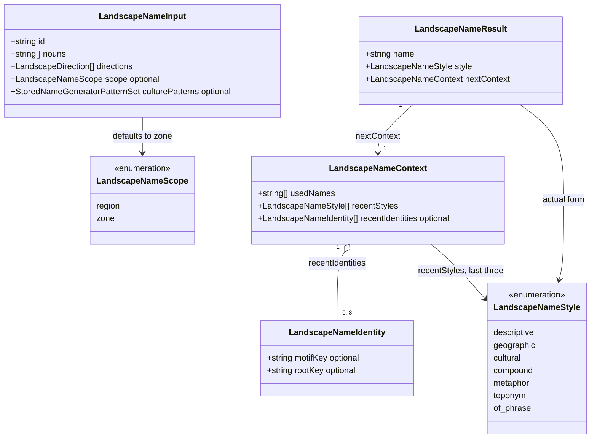
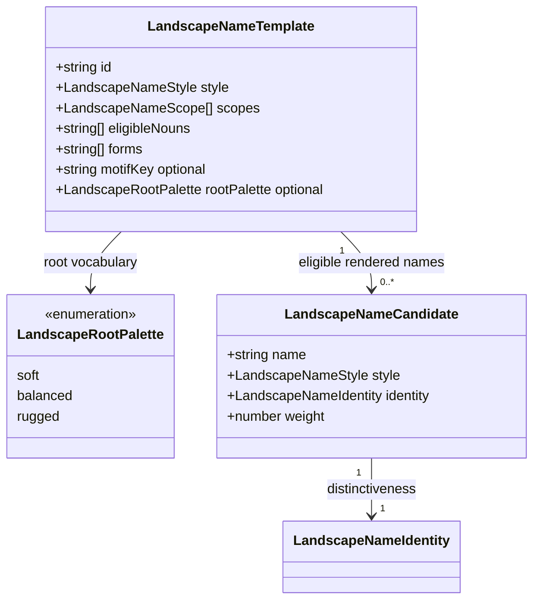

# Landscape name evolution

**Status:** implemented — domain model approved by Ben on 2026-10-12.

## Problem

The current shared landscape-name helper mostly produces adjective-plus-biome names. For an
unaffiliated whole region without a dominant culture, this is its only eligible form. Fourteen
gentle epithets give it a narrow emotional range, exact-name uniqueness still allows repeated
imagery, and exhausted choices receive parenthetical ordinals.

The [research corpus](fantasy-region-name-research.md) supplies a broader model: compact compounds,
concrete geographic metaphors, unfamiliar but pronounceable roots, and occasional longer names.
The priorities are **variation, pleasing sound, and distinct identity within a map**. Geographic
accuracy, reproducibility, and preservation of saved names remain requirements.

## Decisions proposed

### Repertoire and scope

Extend the shared names library, with an optional input scope of `region` or `zone`. Omission means
`zone`, keeping existing callers valid. The region adapter explicitly supplies `region` for a
whole-region name and `zone` for connected habitat areas. No new controls or settings are needed.

Retain `descriptive`, `geographic`, and `cultural` styles; add `compound`, `metaphor`, `toponym`, and
`of_phrase`. These labels describe forms, not separate generators or persistent categories.

| Style       | Character                                                        | Region base weight | Zone base weight |
| ----------- | ---------------------------------------------------------------- | -----------------: | ---------------: |
| compound    | Compact joined words, such as Gloamwood or Rimewaste             |                 30 |               20 |
| descriptive | A strong epithet with suitable terrain, such as the Ragged Weald |                 25 |               35 |
| metaphor    | A terrain-compatible image, such as the Broken Crown             |                 20 |               10 |
| toponym     | A pronounceable invented place root, alone or with terrain       |                 15 |               15 |
| of_phrase   | Terrain followed by a poetic image or place root                 |                 10 |                5 |
| geographic  | A supplied eligible direction with terrain                       |                  0 |               10 |
| cultural    | A name from supplied culture patterns with terrain               |                  5 |                5 |

Weights are relative, normalized over eligible choices; region culture is an optional accent, so
that column deliberately totals 105 when culture is available. Repetition penalties adjust the
weights. They are editorial starting points to audition, not frequencies measured from novels.

Whole-region names may use a bare geographic root. Zones retain an explicit terrain noun or a
recognizable terrain compound, so a list of zone headings remains legible. Metaphors for zones
include a terrain cue, such as the Crown Hills. A broad or unknown landscape uses neutral country
forms rather than pretending a particular biome dominates.

### Geography and imagery

The region adapter continues to select eligible literal nouns from observed biomes and landforms,
using its existing two-thirds support rules. The names library uses an explicit noun vocabulary
mapping, never substring inference. Unknown caller-supplied nouns remain usable in literal forms
but do not unlock terrain-specific compounds or metaphors.

Permit curated synonyms of supplied terrain: Woods/Forest can offer Wood/Weald; Hills can offer
Fells; flat open country can offer Plains; Marshes/Wetlands can offer Mire/Fen. Preserve distinctions:
Rainforest does not independently license a temperate plant, Mangroves does not become an upland,
Tundra does not imply an ice cap, and Heights alone does not establish mountain peaks. Wold is
restricted to open country; Downs remains restricted to supported open hills.

Metaphors are traditional names, not new facts: a Broken Crown does not create a ruined monarchy,
and a Giant's Stair does not add giants or constructed stairs. Accept a curated range of bodily,
architectural, weather, and folklore imagery, including sorrow and menace alongside gentler forms.
This explicitly supersedes the earlier restriction on evocative shape words **when used as
metaphors**. Literal shape, species, resources, named landmarks, ownership, and historical events
still require evidence. Exclude foxglove/pasture/resource claims and numbered geography from the
initial tables. Coast, river, valley, delta, cliff, and glacier forms are deferred unless already
licensed by an explicit caller noun; the region adapter will not add new eligibility rules here.

The research file is a reference, not a runtime dependency. Use reviewed original vocabulary and
compatible forms; do not copy published franchise names into output tables.

### Sound and length

Curate complete stems, endings, and proper roots by reading them aloud. Prefer one to four words,
with compounds generally short and roots usually two or three syllables. Keep spelling transparent:
no decorative apostrophes, unexplained diacritics, or arbitrary consonant clusters in invented
geographic roots. Cultural output retains its culture's orthography and possessive conventions.

Templates carry reviewed forms and an optional root palette (`soft`, `balanced`, or `rugged`).
Each palette contains curated complete roots, not an unrestricted syllable mixer. Word pairings
are reviewed for cadence and meaning, so expanding vocabulary does not produce every possible
adjective-noun combination. Reject awkward duplicated words and accidental repeated syllables at
joins. Avoid near-identical roots in one batch even when their full labels differ.

Use `the` for descriptive names and ordinary epithets, omit it for bare proper roots and most
compounds, and keep capitalization consistent with the current sentence-facing naming convention.
Do not globally title-case existing names.

Aesthetic rules are editorial aids. Tests can enforce shape, spelling, and diversity; they cannot
prove that a name sounds good. A saved fixed-seed sample is part of review.

### Distinctiveness and selection

Keep exact case/whitespace-normalized uniqueness across all used names, including authored names.
Also discourage reuse of a recent motif or root: changing a terrain noun should not turn one
identity into several apparently distinct places. Track the last eight naming identities and the
last three styles in caller-owned transient context.

An identity has optional `motifKey` and `rootKey`: templates assign canonical motif keys across
related forms, and root-bearing candidates use their normalized root. Direction and generic
terrain words do not count as identity. For preexisting names without identity metadata, use
normalized meaningful words and known compound splits to detect obvious overlap. Do not invent
metadata for saved results or mutate the supplied context.

Selection uses a bounded candidate pool, validates names before choosing, filters exact
duplicates, and weights survivors for style and identity variety. Prefer fresh roots and motifs;
relax aesthetic repetition penalties when needed, never exact uniqueness or geography rules.
Candidates report the style that actually produced them, including when cultural generation fails
and another form supplies the result.

Replace parenthetical ordinals with a new pronounceable geographic root combined with an eligible
noun. The exhaustion path deterministically enumerates an expanding set of reviewed phonetic
combinations until an unused result is found. This guarantees progress for finite used-name sets
without numbers, fact IDs, directions that were not supplied, or another random source. Very large
pathological histories may require longer roots; ordinary batches stay within the compact target.

### Reproducibility and compatibility

All choices use the supplied `RNG`; no clock seeds, global mutable history, or extra RNG owners.
Keep the existing `region-name` and `landscape-names` streams isolated. Rebuild cultural generators
from stored patterns using that stream, without consuming live culture generators.

The transient input/context model evolves, but the only persisted output remains the name string.
Existing callers can omit scope and identity history. Saved/authored names load verbatim. Fresh
generation with an old seed will have new names; saving and loading an old result will not rename
it. Fact IDs, footprints, ecological results, and descriptions do not change except where prose
already interpolates a newly generated name.

## Domain model

All types below live in `src/lib/names/landscape_name_types.ts`. `LandscapeNameTemplate` and
`LandscapeNameCandidate` are internal implementation data; they are not persisted or required from
callers. The existing direction and stored-pattern types are unchanged.

Optional fields mean TypeScript `?` properties. Template forms allow only `{noun}` and `{root}`
substitution; literal compound forms are reviewed complete strings. Empty `eligibleNouns` means a
neutral form that does not assert a terrain. A root-bearing form requires a root palette. Stable
template IDs identify vocabulary records, not generated geographic facts.

## Acceptance criteria

- An unaffiliated region without culture or eligible direction can use all five creative styles.
- A fixed-seed sample covers forests, open hills, flat plains, deserts, wetlands, tundra, icefields,
  mountains, unknown terrain, and broad mixed regions. Publish the sample for aesthetic review.
- Across 200 fresh names per landscape fixture, at least 90% of names are distinct, and no creative
  style eligible for the entire fixture exceeds 60% of selections. These are fixed-corpus regression
  thresholds, not guarantees about every small random batch.
- A 100-name batch has exact uniqueness, immutable context, bounded recent history, and no numbered
  qualifiers. A targeted exhaustion fixture exercises the root fallback.
- Controlled fixtures prove that fresh candidates avoid recent roots/motifs when alternatives
  exist, without banning harmless repeated generic terrain words.
- Meaningful unit tests cover geographic eligibility, cultural fallback, normalization, awkward
  joins, same-seed reproduction, different-seed variety, and selection at RNG boundaries.
- Region integration tests prove stable non-name facts, reordered-input reproduction, preservation
  of saved/authored names, and isolated culture RNG state. Existing output-shape tests must evolve
  to allow accurate compounds and metaphors rather than requiring every name to end in a biome.
- `npm run verify` passes, including the per-library coverage gate. Browser verification is required
  if implementation later touches routes, components, or rendering; this proposal changes neither.

## Implementation and review

The approved model is implemented in the existing `names` library, with reviewed vocabulary in
`landscape_name_data.ts`. The region adapter supplies the scope; no new persisted fields are added.
The selector draws up to 32 candidates for the selected form, favors unused recent identities, and
relaxes those preferences if necessary. Candidate pool generation is weighted by vocabulary capacity
so a small literal table does not crowd out the root-bearing repertoire.

Metaphors can use their shorter image noun with a root (for example, the Crown of Varneth); zones
use terrain followed by the full image, rather than stacking several modifiers in front of a noun.
Ambiguous compounds also gain a terrain noun in zone scope. Word joins reject runs of more than three consonants across
the join, without treating ordinary English spelling inside a word as a malformed boundary.
Similar roots differ by at most one letter insertion, deletion, or substitution. Existing compound
labels are decomposed using the reviewed vocabulary for comparison with new root-bearing forms.

See the [fixed-seed review sample](landscape-name-samples.md) for output and measured variety. The
ordinary root palettes hold complete spellings. Only the exhaustion path enumerates phonetic chunks;
it interleaves a consonant to avoid duplicated syllable boundaries and never uses visible numbers.
