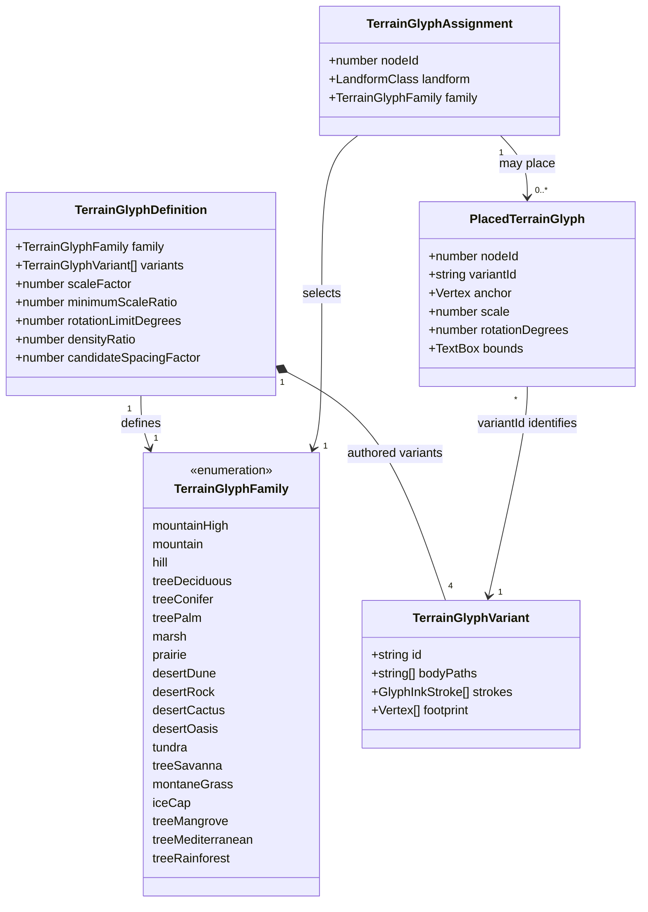

# Region biome glyph completion

**Status:** implemented — the human reviewer approved the domain model and visual direction on 2026-10-12.
See the [visual review and validation record](region-biome-glyphs-408-413/README.md).

Tracks [#408](https://github.com/ironarachne/ironarachne/issues/408),
[#409](https://github.com/ironarachne/ironarachne/issues/409),
[#410](https://github.com/ironarachne/ironarachne/issues/410),
[#411](https://github.com/ironarachne/ironarachne/issues/411),
[#412](https://github.com/ironarachne/ironarachne/issues/412), and
[#413](https://github.com/ironarachne/ironarachne/issues/413).
Extends [Region terrain glyphs](region-terrain-glyphs.md),
[Region desert display](region-desert-display.md), and
[Region tundra display](region-tundra-display.md).

## Problem

Plain tropical savanna, montane grassland, and ice cap cells have no biome-specific marks.
Mangrove forest shares palms with tropical forests, while Mediterranean woodland and
temperate rainforest share generic deciduous trees. Six existing biomes need recognizable
artwork that fits the region map's pen-and-ink vocabulary.

## Solution and decisions

Add six renderer-local families to the existing catalog, with four authored variants per
family. Keep the existing tapered cubic strokes, opaque local-tone body fills where needed,
and conservative footprints. The drawings use an oblique cartographic view, irregular
silhouettes, sparse interior detail, and open paper between marks.

| Exact normalized biome   | New family          | Visual direction                                                                                                                                         |
| ------------------------ | ------------------- | -------------------------------------------------------------------------------------------------------------------------------------------------------- |
| `tropical savanna`       | `treeSavanna`       | Three flat-topped acacia variants and one broad-trunked baobab, each with a few low grass blades; sparse trees preserve open country.                    |
| `montane grassland`      | `montaneGrass`      | Four compact tussock and low-scrub arrangements; shorter, more upright blades than prairie, without tundra snow contours.                                |
| `ice cap`                | `iceCap`            | Four low, angular ice shoulders with broken crevasse strokes; no vegetation, dune slip faces, water ripples, or pointed mountain peaks.                  |
| `mangrove forest`        | `treeMangrove`      | Four irregular leafy crowns with branching trunks and visible prop roots; roots remain inside the land footprint.                                        |
| `mediterranean woodland` | `treeMediterranean` | Four low, gnarled scrub-oak/olive-like silhouettes with uneven crowns and sparse shrub detail; more open than deciduous forest.                          |
| `temperate rainforest`   | `treeRainforest`    | Four tall, irregular redwood/cedar-like silhouettes with distinct branching tiers and narrow crowns; recognizable within the existing tree size ceiling. |

Family names beginning with `tree` intentionally use the existing forest candidate pass.
Savanna's density thinning makes that pass sparse rather than adding another scatter layer.
Grass details at tree bases belong to the same variant and footprint. Ice marks describe
the biome cartographically; they do not add glacier locations, seasonal snow records, or
environmental facts to generated prose.

### Matching and relief precedence

Trim and lowercase biome names, then match the six exact keys before the generic
forest/woodland fallback. Do not introduce broad grassland, ice, or rainforest substring
matches or new historical aliases. Other supported biomes retain their existing families.

Water and ocean remain ineligible. High mountains and mountains retain relief glyphs.
Existing desert and wetland rules retain their current precedence. Hills retain hill glyphs
in all six new biomes. Only plain land receives the new biome families. An ice-cap mountain
therefore remains a mountain; this proposal does not add a second ice layer or composite
icy peaks. Existing `classifyRegionLandforms` remains the sole relief classification.

### Placement, scale, and density

Reuse the shared candidate streams, fitting, water clearance, spacing, family containment,
label/furniture reservations, and painter ordering. Include all four new tree families in
`isTreeGlyph` so the existing 75% tree-to-relief size ceiling also applies to them. Treat
`montaneGrass` and `iceCap` as low open terrain alongside prairie, marsh, and tundra for
the renderer's minimum base size.

Initial catalog profiles below are tuning values to inspect in rendered maps. They do not
promise glyph counts or final density. All families start with a minimum scale ratio of
0.55 and a rotation limit of 5 degrees.

| Family              | Scale factor | Density ratio | Candidate spacing factor |
| ------------------- | ------------ | ------------- | ------------------------ |
| `treeSavanna`       | 0.25         | 0.25          | 0.55                     |
| `montaneGrass`      | 0.4          | 0.35          | 1.1                      |
| `iceCap`            | 0.4          | 0.3           | 1.1                      |
| `treeMangrove`      | 0.25         | 0.8           | 0.55                     |
| `treeMediterranean` | 0.25         | 0.45          | 0.55                     |
| `treeRainforest`    | 0.25         | 1.0           | 0.55                     |

Select variants before footprint fitting. A mangrove cell bordering water does not permit
roots to cross a coastline. Biome-family containment also prevents savanna trees from
spilling into prairie or dense forest. Each eligible cell has one assigned family, with
zero or more fitted marks, preserving the current single terrain layer.

Use existing renderer-owned `@ironarachne/rng` streams; no vertex distortion, additional
random family choice, or advancement of the shared candidate-generation stream is needed.
Identical saved maps must produce byte-identical SVG. Changed containment and shared spacing
may alter nearby accepted marks where these formerly blank or shared-family biomes occur.

## Domain model

The only type change is six additions to the `TerrainGlyphFamily` union in
`terrain_glyph_types.ts`. The diagram includes the complete proposed union. Existing
definition, assignment, variant, and placement interfaces retain their fields. Four
authored variants per new family add 24 catalog entries. All records are transient renderer
data; no persisted region, artifact, project, or IndexedDB schema changes.

No new geometry types are needed: variants reuse the existing `GlyphInkStroke`,
`CubicInkSegment`, `Vertex`, and `TextBox` declarations. Artwork remains vector-native
and uses existing SVG and image/PDF export paths.

## Validation and review

After approval, assignment tests must cover all six exact normalized keys, positive plain
land assignment, hill/mountain precedence, water/ocean exclusion, and unrelated/unknown
biomes. Replace intentional no-glyph expectations only for the three newly supported keys.
Retain the current tropical forest, temperate deciduous forest, boreal forest, prairie,
desert, marsh, and tundra mappings.

Catalog checks must cover four unique variants per family, finite tapered ink, conservative
footprints enclosing bodies and ribbons, and the tree size ceiling for each new tree family.
SVG tests must verify actual placement of all six families, repeated-render determinism,
input immutability, biome boundaries, water clearance, and label/furniture clearance.

Update the specimen renderer headings and map README. Render the entire glyph sheet plus
controlled fixtures containing all six biomes, neighboring existing families, relief, and
water. Inspect ordinary map size and enlarged silhouettes, with particular attention to
acacia versus deciduous trees, tall rainforest trees versus boreal conifers, tussocks versus
prairie/tundra, and ice shoulders versus dunes/hills/water. Record the visual findings and
before/after seeded maps in a review folder.

Run `npm run verify` and `npm run verify:all` for the completed rendering change; preserve
coverage thresholds. Compare representative SVG bytes, counts, and render timings against
the current renderer and investigate material growth using the existing glyph design's
2x byte-size and 25% median-time review thresholds.

## Approval record

The human reviewer approved this proposal on 2026-10-12: “I approve.” Per [AGENTS.md](../AGENTS.md), “Implementation does not start before
that approval.” This proposal settles the six new family names, the four-variant vocabulary,
exact biome matching, relief precedence, and unchanged transient rendering interfaces.

## Approved implementation work items

1. Author the 24 catalog variants and add the six family union members.
2. Wire exact biome assignment, tree sizing, low-terrain fitting, and specimen headings.
3. Expand assignment, geometry, sizing, placement, and clearance regression coverage.
4. Render review artifacts, compare performance, and complete the verification gates.

## Implementation record

All six families and their 24 variants are implemented in the renderer-local catalog.
Exact normalized matching precedes the generic forest fallback. New trees share the existing
candidate pass and size ceiling; grass and ice use the low-terrain fitting profile. The
approved initial density, scale, and spacing profiles were retained after visual review.
Assignment and SVG tests cover the new behavior, and existing geometry/size tests cover
all 76 catalog variants. The review record includes actual artwork, mixed-biome and seeded
before/after maps, and local rendering measurements. Full gate results are recorded there.
