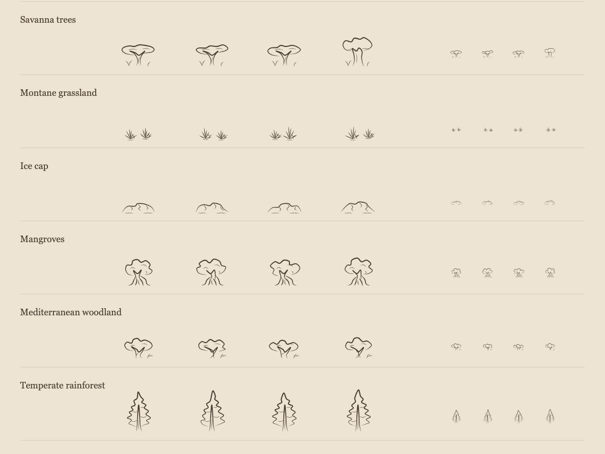
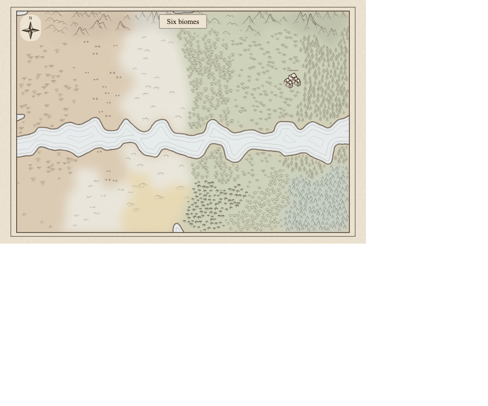

# Region biome glyph review (#408–#413)

The domain model and visual direction were approved on 2026-10-12. The implementation adds
six catalog families and 24 authored variants. The new glyphs reuse the existing vector
stroke expansion, placement streams, local biome fills, and clearance rules.

## Artwork

[Complete catalog sheet](glyphs.svg).

The savanna set has three flat-topped acacias and a baobab. Montane grass has upright
compact tussocks and low branching scrub. Ice caps have shallow shoulders and broken
crevasses. Mangroves have exposed prop roots; Mediterranean trees have low irregular crowns;
temperate rainforest has taller redwood/cedar-like branch tiers. Each family has four
variants, with differences in crown or shoulder shape and relative placement of details.

## Maps

[Mixed fixture before](mixed-before.svg) · [Mixed fixture after](mixed-after.svg).

The controlled Voronoi fixture has six columns, left to right: tropical savanna, montane
grassland, ice cap, mangrove forest, Mediterranean woodland, and temperate rainforest.
A lake band crosses them all. The top row includes hills, mountains, and high mountains;
the bottom row compares prairie, tundra, dunes, palms, deciduous trees, and boreal conifers.
The fixture includes a title, compass, and settlement. Savanna and Mediterranean woodland
remain open relative to mangrove and rainforest; roots clear the processed shore. Tall
rainforest silhouettes remain within the existing tree-to-relief size ceiling. At ordinary
map size the small grass and ice marks stay deliberately sparse. Existing relief retains
its original glyphs instead of acquiring a second vegetation/ice layer.

Seeded generated regions were reviewed at ordinary map size:

- alpha: [before](alpha-before.svg) · [after](alpha-after.svg).
- bravo: [before](bravo-before.svg) · [after](bravo-after.svg).
- charlie: [before](charlie-before.svg) · [after](charlie-after.svg).

These seeds exercise cold terrain, including the newly supported ice cap. The controlled
fixture guarantees coverage of the six families rather than relying on a random region
to contain all of them. Reproduce the fixture and the three seeded maps with
`npx vite-node scripts/render_region_biome_review.ts --out /tmp/region-biome-review`.
The script also writes five-render warm medians and terrain counts. Reproduce the catalog
sheet with `npx vite-node scripts/render_terrain_glyphs.ts --out /tmp/terrain-glyphs.svg`.

## Performance

Five warm renders per input on the same machine, with the median shown below. Generated
regions include their existing title, settlement, and fact presentation through
`regionToMapSvg`; the controlled fixture uses `buildRegionMapSvgString` with its furniture.
Terrain mark counts count placed, translated terrain uses, excluding water geometry uses.

| Input   | Placed terrain marks, before → after | SVG bytes, before → after | Median render ms, before → after |
| ------- | ------------------------------------ | ------------------------- | -------------------------------- |
| mixed   | 1372 → 1206                          | 407,502 → 552,589         | 107.1 → 102.5                    |
| alpha   | 185 → 285                            | 279,026 → 310,697         | 162.1 → 162.9                    |
| bravo   | 597 → 602                            | 356,576 → 368,230         | 168.3 → 157.9                    |
| charlie | 486 → 509                            | 356,269 → 375,132         | 147.1 → 146.8                    |

No input exceeds the existing 2x SVG-size or 25% median-time investigation thresholds.
Measurements are local diagnostics, not a benchmark guarantee. The mixed fixture gains
six distinct families but loses some formerly dense generic-tree placements to savanna
and woodland thinning. Only variants actually used by a map enter its SVG definitions.

## Validation

Targeted glyph and SVG tests passed: 81 tests. These cover the exact normalized biome keys,
relief precedence, water/ocean exclusion, unique variants, ribbon/body bounds, tree size
ceilings, deterministic repeated SVG, input immutability, family containment across adjacent
cells, lake clearance, and marker/compass reservations. Existing label halos and cartouche
behavior are preserved; settlement labels continue to be painted over terrain as designed.

`npm run verify:all` passed on 2026-10-12: type checking reported zero errors and warnings,
formatting/lint passed, 7,058 unit tests passed, and all 100 libraries met the coverage gate
with no baselined debt. The full browser run passed 664 tests with five skips, including
all configured phone widths (320, 360, 375, 390, and 430 pixels). The additional review
script was executed and its four SVG outputs matched the captured after maps byte for
byte; a final `npm run lint` also passed after adding the review script and artifacts.
