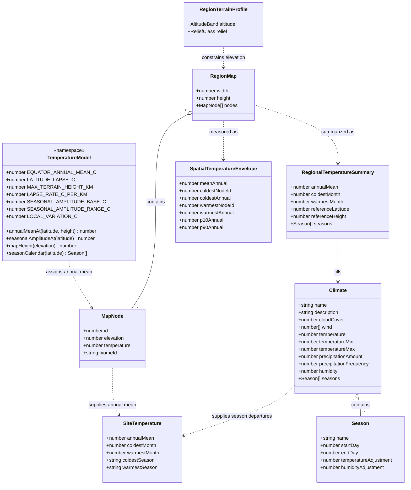
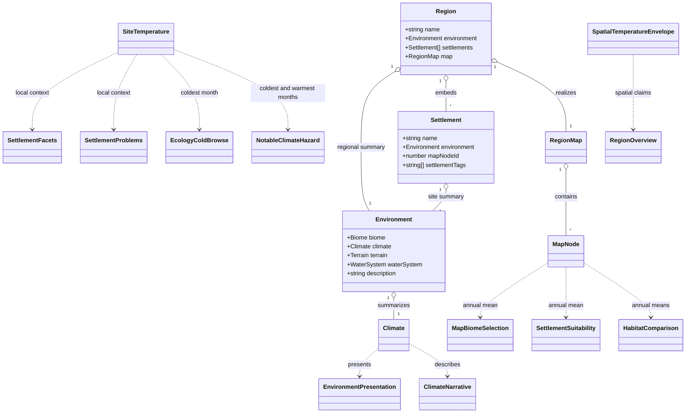

# Regional climate coherence

This document defines what the temperature numbers in a region mean, how the regional climate
summary relates to the realized map, and which consumers may use which measure. It is the design
work for [#442](https://github.com/ironarachne/ironarachne/issues/442), and it extends the terrain
contract accepted in [region environment coherence](region-environment-coherence.md) from
landform to temperature.

**Status:** accepted. The human reviewer approved the temperature contract, domain model and
implementation sequence on 2026-10-27. Implementation is tracked by
[#442](https://github.com/ironarachne/ironarachne/issues/442).

## Problem

Seed `5wyedz5q272fz` (The Woods of Belvorn) still reproduces the defect on current `main` after
#436, #437, #441 and the later region passes:

| Measurement                          | Value                   |
| ------------------------------------ | ----------------------- |
| `environment.climate.temperature`    | 13.87 °C                |
| `environment.climate.temperatureMin` | 3.99 °C                 |
| `environment.climate.temperatureMax` | 23.75 °C                |
| dry-land map annual mean             | 5.52 °C                 |
| dry-land map annual minimum          | −2.68 °C                |
| dry-land map annual maximum          | 15.33 °C                |
| dry-land map median elevation        | 0.139                   |
| environment terrain elevation span   | −0.03 to 0.08           |
| settlements sharing that summary     | 8 of 8, all at 13.87 °C |

The snapshot is deterministic and validates. The problem is that the snapshot contains two
different temperature models, and no consumer can tell which one is making a claim.

### Why the models disagree

1. **Different equatorial baselines.** `Climates.getTemperatureRange` starts at 35 °C
   (`temperatureAtEquator`), while `MapClimate.assignTemperature` starts at 30 °C (`baseTemp`).
2. **Different elevation models.** The environment subtracts heat _multiplicatively_:
   `midTemperature * (1 - elevation)`, where `elevation` is a value sampled from the environment's
   own terrain summary. The map subtracts an absolute lapse of
   `max(0, elevation) * 3 km * 6.5 °C/km`. In the seed the environment's terrain span is −0.03 to
   0.08 while the map's dry-land median is 0.139, so the two models are not even reading the same
   kind of number.
3. **An undefined range.** `Climate.temperatureMin` and `temperatureMax` are documented as the
   “base temperature at night” and “at midday”, but the presentation labels their pair simply
   “Temperature”, biome selection uses its midpoint, and `Climates.describe` picks heat adjectives
   from the maximum. Nothing says whether the pair is daily, seasonal or spatial.
4. **Season adjustments with no unit and no consumer.** `Season.temperatureAdjustment` is 0.1 or
   −0.1, which is neither a Celsius departure nor a fraction of anything defined.
   `getSeasons` accepts temperature and precipitation and ignores both. No code applies the
   adjustment to any temperature.
5. **One summary for every settlement.** `randomSettlements` passes the region's `environment`
   object to every settlement, so every embedded settlement stores the region's climate summary
   rather than the climate at its map node. The eight settlements in the seed all report 13.87 °C
   while their nodes range from 3.69 °C to 15.33 °C.
6. **Consumers read different representations.** Settlement facets use the regional mean; ecology
   cold-browse uses the local node's annual mean plus the region's seasons; notable places use the
   local annual mean as if it were a seasonal exposure hazard. Each is defensible alone and
   contradictory together.

## Scope

This design covers:

- the meaning of the regional temperature summary, map-node temperature, season adjustments and
  the temperature context of a settlement;
- one shared, coarse temperature model for the environment and map generators;
- the derivation of the regional summary from the realized map;
- the measures each consumer uses, so a local claim cannot be made from a regional summary or a
  seasonal claim from a single annual mean;
- deterministic fixtures for contrasting latitude, elevation and biome cases;
- legacy behaviour for saved climates and settlements.

## Non-goals

- A weather simulator, weather events, prevailing-wind time series, or monthly records. That is
  [the future weather tool](https://github.com/ironarachne/ironarachne/issues/18), not this issue.
- Reconciling precipitation, humidity, cloud cover or wind with the real map. Temperature is the
  first measure because it has the clearest mismatch and the most consumers. Moisture may follow
  the same pattern in a separate design.
- Fixing the dominant-biome override in `MapBiome.assignBiomes`. The known #348 limitation stands:
  a map cell's biome label can be a poor fit for its temperature. This design uses the label the
  map already carries and does not reclassify it.
- Re-running or remapping terrain (#249).
- Rewriting saved regions or settlements. Existing payloads keep their stored numbers and text.
- Real-world meteorology. The model is openly a coarse fantasy climate, and the fixtures pin its
  own constants rather than an Earth reference.

## Decisions

### 1. Each temperature measure has one name and one owner

The persisted `Climate` fields keep their names, but each is assigned one meaning and one owner.
The derived types are not persisted.

| Measure                        | Meaning                                                                                                     | Owner                                                   |
| ------------------------------ | ----------------------------------------------------------------------------------------------------------- | ------------------------------------------------------- |
| regional annual mean           | unweighted mean of dry-land node annual means; the region's typical year                                    | `Climate.temperature`                                   |
| regional coldest/warmest month | regional annual mean minus/plus the seasonal amplitude at the region's center latitude                      | `Climate.temperatureMin` / `temperatureMax`             |
| local annual mean              | shared model at the cell's latitude and normalized height, plus bounded local variation                     | `MapNode.temperature`                                   |
| local coldest/warmest month    | local annual mean plus the saved season departure for the coldest/warmest season                            | `SiteTemperature` (derived, never stored on the map)    |
| spatial envelope               | distribution of dry-land local annual means, including the coldest and warmest cells and robust percentiles | `SpatialTemperatureEnvelope` (derived, never persisted) |

There is deliberately no persisted diurnal range. The model does not simulate day and night, and
nothing in the product asks for a daily minimum. A climate that needs one would be a new design,
not a reinterpretation of this field.

### 2. One temperature model serves the environment and the map

A dependency-free module in `$lib/environment/climates` owns the constants and the pure functions.
The environment generator and `MapClimate.assignTemperature` both call it. No caller passes its own
equatorial baseline or lapse rate; the per-call `temperatureAtEquator`, `baseTemp` and
`elevationLapseRate` inputs are removed.

Proposed constants:

| Constant                     | Value | Meaning                                                |
| ---------------------------- | ----- | ------------------------------------------------------ |
| `EQUATOR_ANNUAL_MEAN_C`      | 30    | sea-level annual mean on the equator                   |
| `LATITUDE_LAPSE_C`           | 40    | total sea-level cooling from equator to pole           |
| `MAX_TERRAIN_HEIGHT_KM`      | 3.0   | the height at which normalized ground height reaches 1 |
| `LAPSE_RATE_C_PER_KM`        | 6.5   | temperature lost per kilometre of ground height        |
| `SEASONAL_AMPLITUDE_BASE_C`  | 1     | minimum seasonal half-range at the equator             |
| `SEASONAL_AMPLITUDE_RANGE_C` | 17    | additional seasonal half-range from equator to pole    |
| `LOCAL_VARIATION_C`          | 2     | bound on the map's seeded local temperature term       |

```text
annualMeanAt(latitude, height) =
    30 − 40 * (abs(latitude) / 90) − 6.5 * 3.0 * height

seasonalAmplitudeAt(latitude) =
    1 + 17 * (abs(latitude) / 90)

mapHeight(elevation) =
    clamp((elevation − seaLevel) / (maximumGroundElevation − seaLevel), 0, 1)
```

`height` is a normalized ground height in `[0, 1]`, not metres and not a map drawing unit. Both
generators use the same `0…1` elevation band and the same conversion; the map can exceed the band
and is clamped at the top. With sea level `−0.1` and maximum ground elevation `2.0`, an elevation
of `0.9` is about 1.4 km for either generator, and a map peak at `1.8` approaches 2.7 km.
Normalizing by a fixed scale rather than the realized maximum is deliberate: a low region and a
high region must not collapse to the same relative height.

The model is coarse on purpose. It is one linear latitude gradient, one linear lapse, one seasonal
amplitude and one bounded local term. It is not calibrated to Earth and does not claim to be.

### 3. The regional summary is a statistic of the realized map

The map is the spatial realization. The environment's climate summary is not a second independent
draw; it is what the realized land actually averages.

After the map has elevation, water and temperature:

1. `annualMean` is the unweighted mean of dry-land node annual means. The Voronoi mesh makes this
   approximately area-weighted. Ocean and lake cells are excluded, exactly as the terrain contract
   excludes them.
2. `amplitude` is `seasonalAmplitudeAt(referenceLatitude)`, where the reference latitude is the
   region's selected center latitude.
3. `coldestMonth` is `annualMean − amplitude`; `warmestMonth` is `annualMean + amplitude`.
4. The season list carries departures in Celsius whose extreme adjustments are
   `coldestMonth − annualMean` and `warmestMonth − annualMean`.
5. The spatial envelope is measured separately from the same dry-land nodes and is not written into
   `Climate`.

The result describes the region's typical land, not one privileged cell. The amplitude is
evaluated at the center latitude so it is a single regional value; the map's twenty-degree span
changes the amplitude by less than the model's resolution, and a per-node amplitude would require
persisting latitude.

When the region supplies this summary, the environment's climate elevation and biome altitude use
the summary's reference height (the median dry-land map height), so the overview biome and the
map's altitude scale agree. The environment's own terrain summary remains a separate realization,
as accepted in #289.

This gives one derivation with no tolerance and no mismatch fact: the summary cannot disagree with
the map because it is computed from it. The requested-versus-realized terrain mismatch that
`recordPhysicalFacts` already records is a separate contract and remains as it is.

The physical pass order changes to make this possible:

```text
profile and signed latitude
→ base map, elevation, water
→ map temperature (shared model)
→ regional temperature summary and spatial envelope
→ environment (climate summary, biome, terrain, water system, ecosystem)
→ map moisture and biomes
→ settlement sites and settlements
→ facts and prose
```

Environment generation moves to its own named `environment` RNG stage so that map draws cannot
shift it and unrelated environment draws cannot shift the map. The same seed and configuration
still reproduce the whole run; newly rolled regions will differ from today's because the order and
the model change. Saved snapshots are never regenerated on read.

### 4. Seasons are Celsius departures tied to the regional range

`Season.temperatureAdjustment` is degrees Celsius added to the local annual mean. It is not a
fraction and it is not a second random draw.

- Four-season climates: winter is `−amplitude`, summer is `+amplitude`, spring and autumn are `0`.
- Two-season tropical climates: dry is `+amplitude / 2`, wet is `−amplitude / 2`.
- Southern latitudes shift the 365-day season ranges by half a year, so the names still describe
  the right part of the year. The calendar remains 365 days and does not model leap years.
- The extreme departures must equal `temperatureMin − temperature` and
  `temperatureMax − temperature`, so the season list and the summary range are one derivation.
  This is a generation postcondition and a test.
- When two seasons share an extreme departure, the earlier `startDay` wins the name and lexical
  order breaks a full tie. `SiteTemperature` is therefore deterministic.
- Humidity adjustments keep their existing coarse values and are outside this design.

### 5. Map-node temperature is a local annual mean

`MapNode.temperature` answers “what is a typical year at this cell?”. It is not a daily low, a
daily high or a season.

- Map biome selection and settlement suitability continue to use it, because biome ranges and
  “temperate enough to settle” are annual questions.
- Local variation is the seeded noise term, bounded to `±LOCAL_VARIATION_C`. It is small enough
  that a cold cell is normally explained by latitude or elevation; noise can make a cold patch
  colder but cannot invent a regional climate class.
- The map's latitude span stays at ten degrees either side of its center, with north up. That span
  is part of the model, not a claim about a real-world distance.

### 6. Spatial claims and seasonal claims use different evidence

A consumer must name the measure it needs:

| Consumer                     | Question                                             | Measure                                                    |
| ---------------------------- | ---------------------------------------------------- | ---------------------------------------------------------- |
| environment presentation     | What is the region's typical climate?                | `Climate` summary                                          |
| `Climates.describe`          | What is the climate here?                            | `Climate` summary, with the annual mean as the main claim  |
| habitat comparisons          | Is this patch warmer or cooler than comparable land? | dry-land node annual means                                 |
| map biome selection          | Which biome fits this cell's year?                   | `MapNode.temperature`                                      |
| settlement suitability       | Is this site temperate enough to settle?             | `MapNode.temperature`                                      |
| settlement facets            | Is this settlement cold or hot year-round?           | `SiteTemperature.annualMean` (local)                       |
| settlement seasonal problems | Is winter fuel, exposure or summer water a problem?  | `SiteTemperature.coldestMonth` / `warmestMonth` (local)    |
| ecology cold-browse          | Is winter browse restricted here?                    | `SiteTemperature.coldestMonth` and the named cold season   |
| notable cold/heat hazard     | Is this a seasonal exposure or water risk?           | `SiteTemperature.coldestMonth` / `warmestMonth`            |
| regional spatial claim       | Is any part of the region freezing?                  | `SpatialTemperatureEnvelope` or explicit node observations |
| region overview prose        | May I say the region is cold?                        | summary for the typical year; envelope for “some parts”    |

The rules that follow from the table:

- A summary minimum is never a floor over the map. The coldest cell may be colder than
  `temperatureMin` because it is a different place with a different elevation. A local frost is
  not a contradiction; it is a spatial fact that the envelope must account for.
- A node annual mean is never a season. A settlement whose annual mean is 8 °C can still have a
  freezing winter, and only `SiteTemperature` may say so.
- A consumer may not infer a local value from the regional summary when a saved node, site
  temperature or envelope is available.
- `SiteTemperature` applies the saved season departures to the node annual mean. The amplitude is
  not re-derived from the node's latitude after load, because latitude is a generation-time input
  and is not persisted. Over the map's twenty-degree span this approximation is smaller than the
  model's own resolution and avoids adding a persisted field.

### 7. An embedded settlement carries its site environment

`Settlement.environment` means “the environment at this settlement”, not “the environment of the
region that contains it”. The type and the stored shape do not change.

Region generation selects sites before composing settlements. For a settlement placed on a map
node, the habitation pass builds a site environment from the region's environment:

- `climate` is a copy of the region climate with the site's temperature, coldest month and warmest
  month, the same season departures, and a climate name reclassified from the site values;
- `biome` is built from the classification already assigned to the node. A
  `Biomes.fromClassification` helper builds that existing classification with generated feature and
  description prose, so the site cannot silently re-select a different biome from the same climate
  values;
- `terrain`, `waterSystem` and `ecosystems` remain the region's, because they describe the
  surrounding country rather than the settlement itself;
- `description` is recomposed from the site climate, site biome and the copied terrain and water,
  so the settlement's environment panel does not repeat a regional sentence that contradicts its
  own winter.

The settlement's descriptive paragraph, facets, tags and problems are then generated from that site
environment. Year-round tags use the local annual mean; problems that describe a seasonal condition
use the local coldest or warmest month. Standalone settlement generation keeps its existing
environment, which is already local because it generates its own.

This changes newly rolled settlements, not saved ones. A settlement that is already stored keeps
its stored environment and authored text. The map's dominant-biome limitation still applies: the
site biome is the biome the map assigned to the node, not a fresh classification, so a poor #348
assignment remains visible rather than being silently corrected here.

### 8. Prose and presentation say which measure they are showing

- The environment climate section shows “Annual mean”, “Coldest month” and “Warmest month” instead
  of an unlabelled min-to-max “Temperature”. Seasons show their Celsius departures.
- `Climates.describe` chooses its main adjective from the annual mean, then mentions the seasonal
  range when it is meaningful. A warmest month above 30 °C no longer makes a mild region
  “scorching hot”; a coldest month below 0 °C may add a winter clause.
- A site climate uses the same description function, so “here” means the settlement.
- The region overview makes a climate claim only from a fact that cites the summary or the
  envelope. It does not turn a single warm month into a regional adjective, and it does not turn a
  summary minimum into a promise that the region never freezes.
- Habitat comparisons keep their existing conservative relative wording and their local node
  evidence. They are not replaced by the regional summary.

### 9. Persistence stays where it is

No field is added to `Climate`, `Season`, `MapNode`, `Environment`, `RegionSnapshot` or
`SettlementSnapshot`, and there is no payload version bump or migration.

- Existing saved climates keep their stored `temperature`, `temperatureMin`, `temperatureMax`,
  seasons and description. Reading one never recomputes it.
- The stored range is now read as the region's seasonal range, with the coldest and warmest month
  as its ends. This is a semantic clarification, not a stored value change. The old formula already
  behaved like a seasonal amplitude in its latitude dependence (it peaks in the mid-latitudes and
  falls toward the equator), so the reinterpretation is defensible; a legacy polar value may show a
  narrower range than a new roll, and that is recorded as a consequence of the old generator rather
  than a reason to rewrite saved work.
- Legacy seasons with tiny departures simply do not cross a cold or hot threshold, so they produce
  no seasonal claim. `SiteTemperature` falls back to the stored range's departures around the local
  annual mean only when the season list has no finite departures at all.
- Authored region and settlement descriptions are never regenerated on read. New generation writes
  site environments once, at generation time.

### 10. The model is the first of these contracts, not the last

Temperature is reconciled first because it has the clearest split and the most consumers. Moisture,
precipitation and wind still have a summary-to-map relationship that this document does not settle.
A later design may apply the same shape: one model, a realized summary, named measures, and no
persisted derived copies. Until then, no consumer may use this temperature contract to justify a
moisture claim it cannot support.

## Alternatives considered

- **Make the summary authoritative and remap the map to it.** Rejected. It needs either unbounded
  retries or a second remapping pass, and it contradicts the accepted #289 position that the
  realized map is payload truth. It would also make the summary the only place a local fact could
  come from, which is the defect this issue is about.
- **Keep the two models and define a tolerance.** Rejected. A multiplicative elevation term and an
  absolute lapse are different physical models, not two measurements with noise. A tolerance would
  hide a systematic bias and still leave consumers choosing between them.
- **Add a persisted diurnal range.** Rejected. No consumer asks for a daily minimum, and adding a
  field would require a payload version bump and a migration for a value the model does not
  simulate.
- **Store a per-node climate or a per-settlement climate on the map.** Rejected. The node already
  stores its annual mean; the site climate is derived from it and the saved seasons. Storing the
  derived copy would duplicate data and invite drift when either side is edited.
- **Reinterpret the saved range as spatial instead of seasonal.** Rejected. A spatial minimum would
  make every legitimate cold patch a payload contradiction. A seasonal range describes the region's
  typical land and leaves the spatial spread to the envelope, which is measured from the map.

## Domain model

The persisted types are unchanged. The derived types are generation-time or read-time values and
are never written into an artifact.



`Climate.temperature`, `temperatureMin` and `temperatureMax` are the persisted regional summary.
`RegionalTemperatureSummary`, `SiteTemperature` and `SpatialTemperatureEnvelope` live in
`$lib/environment/climates/climate_types.ts` as non-persisted types; the functions that derive
them may live in `$lib/environment/climates` or `$lib/map/climate.ts`, but no function writes them
into an artifact payload.

The second diagram shows the consumer contract. The same `Environment` type appears twice with
different roles: the region's environment is the regional summary, and an embedded settlement's
environment is its site environment.



## Verification contract

1. **Model boundaries.** Unit tests pin `annualMeanAt` at the equator, 40°, 65° and the pole, at
   sea level and at the top of the height scale; hemisphere symmetry; the amplitude curve; and the
   `mapHeight` clamp and sea-level handling.
2. **Map derivation.** A synthetic map with known elevations and latitudes produces exact node
   annual means from the shared model, with local variation bounded by `LOCAL_VARIATION_C`. For a
   fixed elevation map, two temperature seeds differ only in the bounded local term.
3. **Summary derivation.** On synthetic maps, `Climate.temperature` equals the dry-land mean,
   `temperatureMin`/`temperatureMax` equal the mean minus/plus the amplitude, and the extreme season
   departures match those fields. An empty season list falls back to the stored range's departures;
   legacy tiny departures do not cross a seasonal threshold.
4. **Contrasting fixtures.** A fixed bank covers at least:
   - equatorial lowland: warm annual mean, small seasonal range, no freezing month;
   - temperate midland: moderate annual mean, a winter month below 0 °C;
   - polar highland: cold annual mean, large seasonal range, a severe winter month;
   - arid basin: warm annual mean with a hot warmest month and a dry moisture value;
   - montane cold patch: a high-elevation cell whose annual mean is below the regional mean and
     whose coldest month is below 0 °C while the regional summary's warmest month is above it.

   Each fixture asserts the realized summary, the envelope, the node ordering and the season
   departures, not only that generation completed.

5. **Biome contrast.** The same bank includes at least three different dominant biomes and asserts
   that the regional summary and site temperatures are consistent across them. It does not assert
   that every dominant-biome cell fits its classification, because the known #348 override remains:
   the fixture records that limitation instead of weakening the temperature assertion.
6. **Settlement context.** Every embedded settlement with a node stores an environment whose
   climate `temperature`, `temperatureMin` and `temperatureMax` equal that node's
   `SiteTemperature`; its facets use the local annual mean and its seasonal problems use the local
   coldest/warmest month. A settlement at the montane cold patch does not report a warm-climate tag
   derived from the regional summary. Standalone settlements still use their own generated
   environment.
7. **Consumer routing.** Ecology cold-browse and notable climate hazards use
   `SiteTemperature.coldestMonth`/`warmestMonth` and cite the node and season evidence. A regional
   summary alone cannot produce either claim. No region-level sentence calls the whole region cold
   from one cold node, and no habitat sentence calls a patch warm from the regional summary.
8. **Determinism.** The same seed and configuration reproduce the entire snapshot under two clock
   values and an unrelated reopening RNG. Moving an unrelated environment draw does not change the
   map, and moving a map draw does not change the environment stage.
9. **Legacy and authored text.** A pre-change region and settlement snapshot loads, reopens, edits
   and exports with its stored climate values, seasons, descriptions and payload version unchanged.
   No migration is added. Authored prose survives a read/write cycle.
10. **Presentation.** The environment panel labels the annual mean and the coldest/warmest month;
    the season lines show Celsius departures; `Climates.describe` does not turn a single warm month
    into a regional heat claim. The page and export tests cover the region and settlement views,
    and `npm run verify:all` runs because the change is browser-visible.

## Implementation sequence

The domain model is approved, so the work divides without reopening its shape:

1. Add the pure model and its boundary tests. Change no caller yet.
2. Move `MapClimate.assignTemperature` onto the model, remove the per-call baselines and lapse,
   and update the map tests and the north-up fixture.
3. Add the realized-summary and envelope derivation with synthetic-map tests.
4. Reorder the region physical pass as in decision 3, add the `environment` stage, pass the
   realized summary into environment generation, and update the seeded region fixtures.
5. Add `SiteTemperature`, site environments, and site-first settlement composition; update
   settlement and habitation fixtures.
6. Route the consumers in decision 6 and update the climate prose and presentation labels.
7. Add the contrasting fixture bank, the determinism and legacy tests, and run `npm run verify:all`.
   Render the region environment and a settlement environment for visual review, because the
   change is visible in both panels.

## Approval record

On 2026-10-27 the human reviewer approved:

1. the measure table and its names, including the reinterpretation of
   `temperatureMin`/`temperatureMax` as the coldest and warmest month for the region's typical land;
2. the one shared model and its proposed constants;
3. the map-derived regional summary and the changed physical pass order;
4. site environments for embedded settlements, with no persisted shape change;
5. no payload version bump or migration, with legacy values left as stored.

The domain model is the accepted shape. Implementation follows the sequence above; it must not
reopen the model without a new review.
