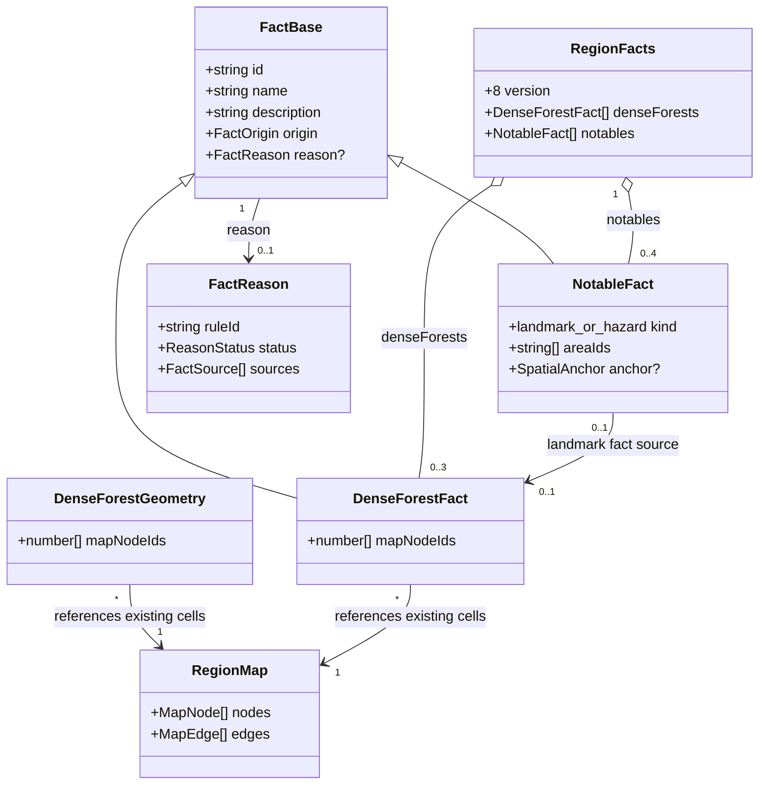
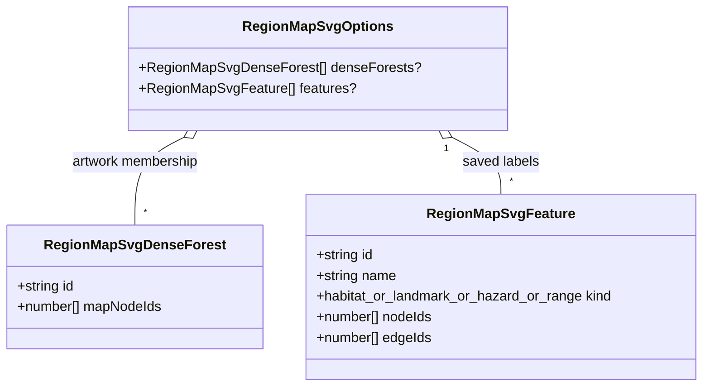

# Regional dense forests

**Status:** implemented — design and domain model approved on 2026-10-13; cloud-like brushwork refined and verified the same day.

Tracked by [#419](https://github.com/ironarachne/ironarachne/issues/419). Extends
[region cartography](region-cartography.md) and follows the separation of saved geography
and derived artwork in [regional mountain ranges](region-mountain-ranges.md).

## Problem

Forest biomes currently receive scattered individual tree glyphs. A separate, more densely
sampled tree stream improves their coverage, but it does not create recognizable masses of
trees. Regional facts also have no identity for a dense forest patch, so naming a renderer-only
cluster would disconnect map labels from saved landmarks and regional prose.

## Solution and decisions

### Identify patches within existing forest terrain

Add a pure `detectDenseForests(map): DenseForestGeometry[]` function in `src/lib/map`.
Only dry cells whose existing terrain assignment is a forest tree family are eligible.
Savanna trees are excluded. Preserve hill, mountain, wetland, and water precedence.
Never change the physical graph or infer additional timber, species, hazards, or access.

Use actual shared-edge adjacency, verified against both cells' neighbor and edge lists.
Resolve cells by ID rather than array position. Within each connected eligible component,
rank seed cells by moisture, distance from the component boundary, then node ID. Grow a
compact patch through eligible neighbors in deterministic distance order. Require at least
three cells; select at most three non-overlapping patches region-wide, ranked by area and
minimum node ID. Bound each patch to at most one-third of its parent component's cells,
rounding down: components smaller than nine cells remain scattered woodland. Leave at
least one unselected eligible neighbor around each patch, and do not merge patches across
different tree families. These are initial visual policies, not measurements of real canopy
density. Review their yield on fixed-seed maps before accepting the artwork.

Geometry detection consumes no RNG. Selection depends on the realized graph, not merely
the requested dominant biome. A region can legitimately contain no dense forest patch.

### Save geometry and promote selected patches to landmarks

Add `denseForests: DenseForestFact[]` to `RegionFacts`, and advance its version from 7 to 8.
Each fact extends `FactBase` with sorted `mapNodeIds`. Identity is
`forest:dense:<minimum-node-id>`. All patches receive a descriptive name and supported
description; proper names are reserved for patches selected as landmarks.

Add a dedicated `dense-forests` generation stage after mountain ranges and before ecology.
Record versioned reasons and the biome, moisture, water, ocean, and relief evidence used
to establish eligibility. Integrate forests into fact enumeration, dependency tracking,
validation, and review presentation. Persist membership, never SVG contours or tree positions.

When patches exist, choose one using an independent forest-landmark stream and reserve the
natural-place slot in the existing four-notable budget for it. Generate a culturally grounded
landscape name using the existing naming system, reserving area and range names. Assign that
name to both the forest fact and its `NotableFact`. The notable has kind `landmark`, anchors
covering the patch, area links, and a fact source referencing the forest. This relationship
uses existing `FactSource` and `NotableFact` types; no new notable variant is needed.
Other patches retain descriptive names and receive no map labels. Keep the other three
notable groups and their limits unchanged.

Upgrade older snapshots by adding an empty forest collection, following existing snapshot
migrations. Do not retroactively invent forest landmarks or rename stored places. Old maps
without saved patches retain their existing scattered-tree rendering. Imports reject invalid,
duplicate, overlapping, disconnected, or ineligible patch memberships. Changed evidence marks
generated forest facts and dependent landmarks stale through the existing review mechanism.

### Draw masses of trees

Extend `RegionMapSvgOptions` with optional `denseForests` drawing inputs containing IDs and
node memberships. The regions adapter supplies current generated facts and authored facts with valid geometry.
Text edits retain authored canopy artwork even when explanations need review. The renderer
builds a deterministic mass of broad, rounded cubic canopy lobes. Opaque bodies merge
into a cloud-like silhouette; overlapping tapered brush arcs describe the perimeter and
selected interior layers. Separate paired brush strokes suggest trunks along exposed lower
edges, with ground reserved below the canopy. Biome tones and surrounding scattered glyphs
retain the forest family. This artwork follows the user’s 2026-10-13 refinement of the initial
rendering: avoid jagged cell boundaries and use cloud-like brushwork. Increasing ordinary scatter
density alone does not satisfy this feature.

Fit the complete canopy and trunk envelope inside patch membership and enforce the
existing drawn-water clearance. Do not clip the silhouette to raw polygon edges. Retain
openings for settlement markers and mapped roads, and retain label halos and collision checks.
Suppress ordinary tree candidates beneath accepted canopy masses; retain scatter around
their margins and in narrow clearings. Discard isolated trial lobes instead of drawing oval
blobs disconnected from a forest mass.
Draw in the existing terrain layer with consistent base-y ordering. Use dedicated artwork
streams so introducing patches does not advance unrelated placement or style RNG streams.

The promoted forest uses its saved landmark name as an area label over the canopy mass.
Suppress its generic diamond marker and duplicate point label. Other landmarks continue to
use existing markers. Labels that cannot fit follow the existing omission policy.

## Domain model

The existing fact base, notable, source, map, and SVG options types are shown only with fields
needed to express the addition. `DenseForestGeometry`, `DenseForestFact`, and
`RegionMapSvgDenseForest` are the new types.

## Validation and acceptance

Use controlled graph fixtures to verify compact patches, component size thresholds, stable
ordering under permuted arrays, distinct tree families, missing adjacency, and exclusion of
water and relief cells. Verify stable seeded names, the four-notable cap, matching map/prose
identity, snapshot migration, invalid imports, and dependency staleness.

Render fixed-seed before/after SVG fixtures plus controlled deciduous, conifer, palm, mangrove,
Mediterranean, and rainforest patches. Inspect exported-size artwork for recognizable canopy
masses, surrounding scattered trees, readable landmark names, road openings, and water clearance.
Require `npm run verify`; run `npm run verify:all` for the browser-visible change before merging.

## Implementation work items

- Detect and validate compact forest memberships from the existing shared-edge graph.
- Save forest facts, select and name a landmark, and migrate historical payloads with empty lists.
- Draw overlapping canopies with a shared silhouette, upper foliage detail, and exposed edge trunks.
- Wire saved forests into regional prose, map labels, review dependencies, and editing controls.
- Verify controlled fixtures, seeded generation, snapshot compatibility, and browser rendering.

The geometry pass is pure and consumes no random draws. Proper names use the dedicated
`forest-landmark` stream. Canopy placement, variant, style, interior detail, and exposed edge
trunks use separately named deterministic renderer streams. The drawing uses a staggered
lattice with jitter at 0.55 map-scale spacing, broad cubic cloud lobes, a shared fine perimeter,
and overlapping tapered brush strokes. Only clusters of at least three overlapping lobes become
masses. Trunks are independent paired brush strokes beneath exposed lower canopies; their
footprints receive the same geography, water, route, and furniture clearance as the canopy.
The fill is shaded relative to surrounding woodland; raw cell edges never clip the illustration.

Run `npx vite-node scripts/render_dense_forests.ts [output-directory]` to produce controlled
fixtures for all six forest families and fixed-seed regional examples, including a no-forest
map. The default output directory is `/tmp/ironarachne-dense-forests`.

## Verification record

On 2026-10-13, `npm run verify:all` passed with 7,131 unit tests and 666 browser tests.
Five optional golden-image tests were skipped by their normal opt-in configuration. The coverage
gate checked 100 libraries, all above the required line and function thresholds. The cloud
artwork helper reached 100% line, function, and branch coverage. Visual review covered all six
forest families, fixed-seed regional maps, rounded overlapping edges, and independent base trunks.
