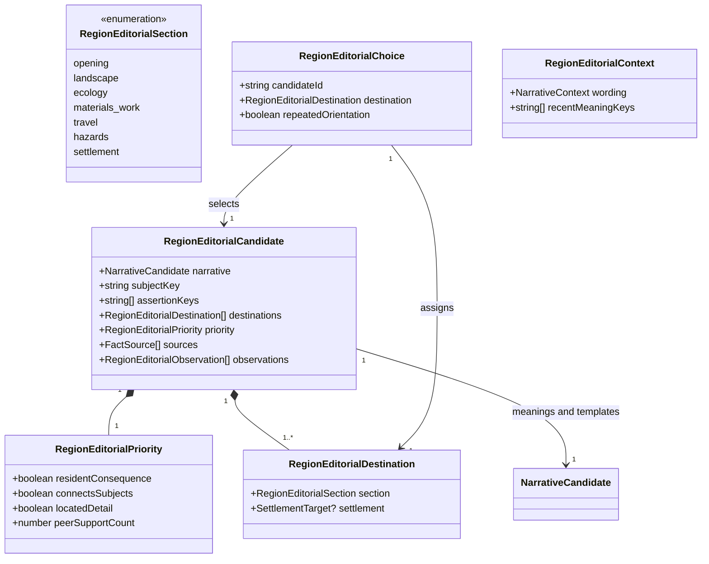
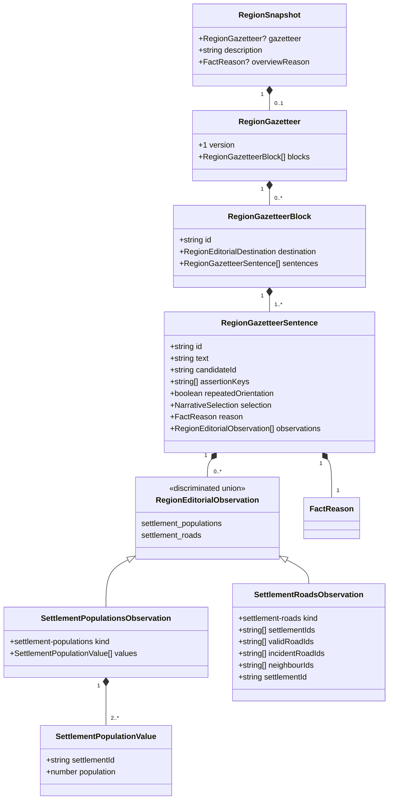

# Salient regional gazetteers

**Status:** implemented — editorial policy and domain model approved by Ben on 2026-10-29.

Issue: [#445](https://github.com/ironarachne/ironarachne/issues/445).

## Problem

A reproducible list is not an editorial ranking. `representativeFacts` in
`region_presentation.ts` keeps the first saved daily-life fact per settlement/category and the
first source opportunity per resource. The overview selects from fixed topic buckets before it
compares their significance. Ecology filters fantastical relationships through a one-in-ten draw.
These independent choices can repeat ordinary bear meat, basalt and wood while hiding supported
mineral opportunities, fantastical inhabitants and the settlement around which roads converge.

The reported seed `5wyedz5q272fz` (The Woods of Belvorn, at `1ffabf08`) motivates the design.
Its reported seven-road hub and diamond/copper opportunities are regression expectations to verify
against a captured snapshot, not facts to hardcode or infer from the region's name.

This specializes the accepted [narrative contract](narrative-prose.md),
[evidence contract](region-narrative-evidence.md) and [identity rules](region-identity.md).
It owns meaning selection and entry composition. Grammar repair is #444; factual activity
consistency is #443. A better sentence does not repair an unsupported practice.

## Editorial decisions

### Select propositions before sentences

Build a complete, current candidate pool before applying any narrative cap. Do not start from
previously selected identity or ecology sentences: their local caps may already have discarded the
best meaning. Reuse their evidence rules and templates as adapters over saved source facts.
Do not expand catalogs or generate new resources to improve a paragraph.

Each candidate expresses one coherent meaning and has:

- The shared defining, distinctive or supporting importance.
- A topic, subject, explicit assertion keys, source fact IDs and saved observations.
- Eligible destinations and a documented domain reason for its importance.
- Equivalent wording choices, selected only after the complete entry plan is settled.

Assertion keys describe propositions, not supporting objects. A road through a forest and a
settlement inside that forest can both be useful; sharing the forest ID does not make them duplicates.
A compound hub/woodland statement declares both assertion keys. Variants of the same proposition
share keys even when their IDs or words differ.

### Priorities and omission rules

Apply these tiers in order; a lower tier never displaces an eligible higher tier merely for variety.

| Importance  | Eligible meanings                                                                                                                                                                                                                                                                | Omission and qualification                                                                                                                                                                                                                                                               |
| ----------- | -------------------------------------------------------------------------------------------------------------------------------------------------------------------------------------------------------------------------------------------------------------------------------- | ---------------------------------------------------------------------------------------------------------------------------------------------------------------------------------------------------------------------------------------------------------------------------------------- |
| Defining    | Dominant realized landscape; a uniquely largest settlement; a uniquely most connected settlement with at least three distinct direct road neighbours; an established practice central to the entry's supported relationships; an explicit hazard affecting a supported local use | Landscape dominance uses the existing geography adapter. Largest requires at least two resolved embedded settlements with finite positive populations. Connectivity compares resolved embedded settlements and current valid roads. A practice is not defining merely because it exists. |
| Distinctive | Located material/source opportunities that differ from peers; supported fantastical presence or interactions; named landscape/road/site relationships; limited provision with a concrete consequence; established local work that distinguishes a settlement                     | Compare candidates of the same kind in this region. Preserve occurrence, opportunity, possible processing and established activity as different meanings. A rare name alone does not establish regional importance.                                                                      |
| Supporting  | Ordinary local foods, fuel, construction material and routine ecological interactions                                                                                                                                                                                            | Include only when they clarify a selected subject or supply its otherwise missing identity. Never use them solely to reach a sentence count.                                                                                                                                             |

Within a tier prefer, in order: an explicit consequence for inhabitants or travel; a supported
relationship connecting distinct subjects; a specific located detail over a generic example.
These are ordered categories, not additive rarity scores. Compare remaining equals using recent
semantic selections, then the caller's seeded RNG. Stable IDs canonicalize the input to that draw;
they do not choose the winner. Reading order is applied after selection, so a landscape sentence
can introduce a paragraph without winning every comparison by topic position.

Every adapter documents its rule and tests eligibility and omission. An established practice
outranks a _comparable_ opportunity; it does not make every routine practice stronger than every
fantastical relationship. Defining practice requires a saved link to another selected defining
subject, a supported local constraint, or a distinguishing input/source relationship.

For settlement comparisons, count distinct settlement subjects supporting each normalized
resource/use meaning. Prefer a meaning supported at fewer peer settlements when the preceding
criteria tie. Compare only saved eligible opportunities of the same kind; absence from a selected
list proves neither geological rarity nor absence from the world. Diamond is not automatically
more significant than copper. Its located opportunity can outrank repeated generic basalt because
it distinguishes that settlement in the saved evidence.

Fantastical candidates enter the same comparison without a probability gate. An explicit
owlbear/gatherer hazard can be defining; a supported owlbear occurrence is distinctive; a routine
feeding interaction remains supporting even if one organism is fantastical, unless the saved
relationship establishes a more consequential meaning. Presence alone never implies attacks,
danger or adventure hooks. If no relationship is available, a current inhabitant/habitat pair can
support a qualified presence sentence without inventing one.

### Relationships and the hub rule

Resolve relationships by IDs, valid endpoints and intersecting saved footprints, never matching
names or assuming proximity. Reuse the current road continuity and evidence checks. An incident
road must connect the settlement to a different resolved embedded settlement by a valid current
path. Multiple roads to the same neighbour count once for connectivity; literal road totals may
be stated separately only with the complete valid incident-road set as evidence.

A unique maximum of at least three neighbours permits “the region's most connected settlement”
or “a road hub”. A tied maximum permits a qualified shared distinction, ranked distinctive;
a graph with only one resolved settlement establishes neither. Largest means largest **among the
region's recorded settlements**, never a capital, market, political seat or regional dominance.
Ties do not produce a uniquely largest claim. Population and road claims need independent support;
being largest does not prove being a hub.

A hub/site/material paragraph may connect claims around the same settlement when each link is
supported. Forest membership establishes woodland setting; an accessible source establishes an
opportunity; only an activity establishes actual extraction. Never join these with “therefore”,
“exports” or “supports its economy” without evidence of that consequence. Do not call a geological
deposit a mine or a road a trade route.

### Whole-entry and section budgets

These are maximums for newly generated editorial prose, never targets. Count rendered sentences,
including deliberate repetition, across the complete gazetteer.

| Scope                                               | Budget                                                                                                     |
| --------------------------------------------------- | ---------------------------------------------------------------------------------------------------------- |
| Whole entry                                         | 24 generated sentences                                                                                     |
| Opening                                             | Up to four sentences in at most two paragraphs; at most two sentences per paragraph                        |
| Landscape, ecology, materials/work, travel, hazards | Up to three sentences and one paragraph per section                                                        |
| Each settlement                                     | Up to three sentences and one paragraph                                                                    |
| Each topic in the opening                           | One sentence                                                                                               |
| Each topic in a section or settlement               | One sentence                                                                                               |
| Same subject/topic across the entry                 | Two sentences, only when the second adds a different assertion or supplies the orientation exception below |

Topics are a bounded regional vocabulary: landscape, settlement-role, access, ecology,
material, practice, provision and hazard. Specific resource/population IDs are subjects, not new
topics that evade the budget. A combined sentence consumes all its topics; it cannot smuggle in
extra routine details. It is one candidate expressing a coherent relationship, not arbitrary
concatenation of several selected sentences. The 24-sentence cap includes generated ruler/culture
orientation when eligible, rather than allowing presentation to prepend unlimited prose.
Names, headings, map labels and structured statistics do not count as narrative sentences.

Select defining meanings globally first, then distinctive ones, then justified support. Reserve no
slot for a resource, climate, road or hazard merely because it exists. Offer each settlement one
best eligible sentence before allowing a second sentence for any settlement at the same importance
and comparison priority. All later choices still obey the global cap. Listing a settlement by name
requires no padding paragraph; many settlements may have no generated detail in a long entry.

The opening introduces landscape and the strongest connected inhabited/world detail where
supported. Group sentences around a shared subject; do not jump between an unrelated road, hide
and cold fragment just to fill buckets. If only one useful meaning survives, return one sentence.
Omit empty paragraphs and sections. Full saved facts remain available in inspection.

### Coordinate sections without making them depend on the opening

Allocate one entry plan before wording. Each assertion has one primary destination. Put broad
identity in the opening and local detail in its section; suppress generic fallback sentences that
only restate selected assertions. Do not repeat an identity section merely because identity claims
exist in the fact list.

A section must name its subject and location explicitly, avoiding “there”, “these” and references
to an earlier paragraph. One short orientation assertion from the opening may repeat per section
when needed to make that section understandable on its own. Mark it explicitly in the plan; it
consumes both local and global budgets. Sharing evidence alone never triggers suppression.
Standalone section views reuse the saved paragraph, without fresh composition or replenishing it
with previously omitted facts. When a supporting block becomes stale, omit it without choosing a
replacement on read.

## Domain model

Add `region_editorial_types.ts` within `regions`; no new shared library or changes to the shared
narrative contract are required. New transient candidates wrap `NarrativeCandidate` so the existing
composer can realize selected meanings without performing a second independent selection.
Diagrams show new types and relevant existing fields, not complete existing containers.

`section` uses kebab-case literals where needed (`materials-work`). Only `settlement` destinations
carry a settlement target, and they require one. Peer counts apply only to comparable resource/use
candidates; use zero elsewhere and exclude that criterion outside those comparisons.
`recentMeaningKeys` are rule/meaning families without object IDs, so repeated bear-meat examples
across settlements can be recognized; assertion keys retain the actual subject IDs for truth and
deduplication. Context is explicit and transient, with a window of the previous eight selected
sentences. Thread it through canonical settlement order and any caller-supplied regional batch.
Never consult other vault artifacts as implicit history.

Newly composed blocks must retain selection, text and support together. This requires an optional
saved gazetteer rather than ranking at render time or overwriting source fact descriptions.

The same optional field exists on runtime `Region` and round-trips through snapshot/rehydration.
All observation arrays are unique and canonically ordered. Population observations capture the
complete eligible comparison population; road observations capture the complete eligible settlement
and valid-road sets plus the subject's incident roads and neighbours. On read, recompute these sets
without RNG and require equality. Referenced road reasons retain path/endpoint/map support through
`FactReason`. This detects additions as well as removals: a newly added road or larger settlement
can invalidate a comparative assertion even if no cited old fact changed. These narrow observations
extend editorial provenance without pretending embedded population is an environment observation
or extending `FactSource` for every domain consumer.

Each sentence has its own reason, so a stale mineral claim does not hide an independent woodland
sentence. Reject missing, cyclic or stale transitive support and mismatched observations. Block IDs
encode destination and subject; sentence IDs use candidate IDs plus the explicit orientation suffix.
Reasons use a versioned editorial rule ID and cite every asserted relationship's inputs. A readable
sentence need not retain every competitor as evidence; comparative assertions do retain their
complete comparison observations. Store exact final sentence text, including punctuation.

## Generation, preservation and editing

Run the editorial planner after semantic activities, relationships, notables and identity inputs
exist. Replace independent ecology-summary/overview selection for newly generated regions with this
coordinated pass. Existing identity facts remain available for inspection; do not let their
previous one-per-family selection bound the editorial candidate pool. The planner may select
additional supported identity meanings without modifying those facts.

Use a named `gazetteer-editorial` stage stream via `createRegionStageRng`. Plan meanings first,
then realize them in canonical destination/subject order with explicit context. Separate seeded
selection from wording draws within the stage so adding a wording variant cannot change meanings.
Never alter upstream stage streams. The same input, policy version, seed and batch context must
produce identical plans, sentences and provenance; input array permutations must not change them.

Mirror the opening's text and union of support into existing `description`/`overviewReason` for
existing consumers. The saved gazetteer is the reading/export source when present; do not also
append the mirrored opening or old ecology claim. UI, Markdown, PDF and project publication use
one document adapter over these saved blocks. The adapter only validates evidence, applies authored
overrides and arranges saved text; it performs no editorial selection or wording draws.

Bump region payload version 17 to 18 for the optional `gazetteer`; leave facts version 12 unchanged.
Migration only updates the payload marker and leaves the field absent. Legacy snapshots use their
existing reading path and retain every saved word; loading, exporting or editing unrelated fields
never creates a plan. Round-trip validators check destinations, unique block IDs, sentence selection
shape, references, rule/source structure and observation shape. Historical policy versions retain
stored wording; generation uses the current policy.

Source facts and their prose are unchanged. Existing authored fact descriptions remain visible in
their destination, outside generated budgets, even if the generated plan omitted them. When a
source fact is edited to authored, omit any generated sentence expressing the same assertion and
show its authored text; conservatively omit dependent derived sentences when the edit cannot be
matched to assertion keys. Do not reinterpret authored text as evidence for a new claim. Preserve
intentional blanks under the existing editing contract. Editing the region description clears its
overview reason and overrides the opening only; later sections retain their independent support.
No second free-text editor for saved blocks is introduced here. Explicit region regeneration follows
the existing preservation rules for authored content; it never silently replaces authored prose.

## Design fixtures and verification contract

These fixtures specify editorial outcomes, not exact grammar or a requirement to generate missing
facts. Implementation must capture concrete saved fixtures and assert candidate/selection IDs,
provenance and omissions, in addition to final text.

| Fixture            | Supported candidate pool                                                                                                 | Required focus and omission                                                                                                                                                                                                                     |
| ------------------ | ------------------------------------------------------------------------------------------------------------------------ | ----------------------------------------------------------------------------------------------------------------------------------------------------------------------------------------------------------------------------------------------- |
| Coastal            | Dominant coast; a coastal settlement; current freshwater source; ordinary fuel; an explicit gathering hazard             | Coast and the consequential hazard lead; coastal location alone does not become shipping, fishing or a safe harbour. Fuel cannot displace them.                                                                                                 |
| Forest             | Named forest; settlement inside it; road through it; several routine wood-use relationships                              | Connected woodland/place identity leads; use one coherent wood relationship only when it adds meaning. Do not print multiple generic wood sentences.                                                                                            |
| Mineral            | Located diamond/copper opportunities and repeated basalt; one established practice with current support                  | The practice remains distinct from opportunities; settlement-specific minerals beat tied repeated construction texture. No automatic diamond-first ranking, mine or export claim.                                                               |
| Sparse             | One current landscape meaning; ordinary climate; missing/stale site and resource support                                 | One short opening, no forced section paragraphs, no invented isolation or scarcity.                                                                                                                                                             |
| Fantastical        | Supported owlbear presence and habitat; two ordinary wood-material uses; optional explicit gatherer hazard               | Presence competes as distinctive without a gate; explicit danger can rank defining only in the hazard variant. No unsupported attacks.                                                                                                          |
| Belvorn regression | Captured `5wyedz5q272fz` snapshot with verified road graph, settlement populations, woodland and extraction/source facts | If confirmed by the snapshot, Revilun's hub/size and connected woodland/material meanings lead. Diamond and copper opportunities remain eligible rather than being lost to first-item selection. No seven repeated bear-meat/basalt paragraphs. |

Also verify:

- Global/local sentence, paragraph and topic limits; no padding; scarce defining meanings cannot
  lose to routine details. Dense entries respect the 24-sentence cap and settlement fairness rule.
- Equal-priority semantic and wording variation with deterministic batch context; exhausted pools
  repeat truthfully. Permuted fact arrays and input ordering produce the same result.
- Exact assertion deduplication, compound assertions and the counted orientation exception;
  standalone sections remain intelligible with identical saved wording.
- Unique, tied, undersized and disconnected road graphs; parallel edges; unresolved endpoints;
  equal/invalid populations. Road/population additions invalidate comparisons, not just deletions.
- Stale, missing and cyclic dependencies omit only affected generated sentences; source additions
  do not trigger fresh selection. Selected assertions retain complete transitive provenance.
- Old snapshots, authored overrides including blanks, unrelated edits and every export preserve
  saved prose. UI/export outputs agree and repeated rendering consumes no RNG.
- Before/after snapshots preserve all non-prose source facts and upstream maps for the same seed.
  Reproducing the historical seed requires its recorded revision/options; do not silently bless
  today's different geography as the historical fixture.

Documentation-only review needs formatting validation. Future implementation must pass
`npm run verify`, with `npm run verify:all` before merging its rendering changes. Implementation
work items are deliberately deferred until a human approves this policy and domain model, as
required by the repository's design process.
