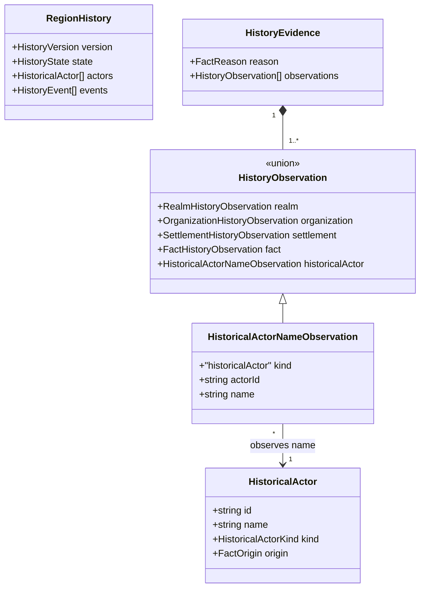

# Historical actor name evidence

**Status:** implemented — additive domain-model amendment approved by Ben on 2026-11-01 for #483.
Final acceptance evidence is recorded in [#485 acceptance](region-history-acceptance.md).

Parent design: [regional history](region-history.md). Issue:
[#483](https://github.com/ironarachne/ironarachne/issues/483).

## Problem

An event stores `HistoricalActor.id` in its participants and copies that actor's name into its saved
sentence. The version-1 evidence union observes current settlements, realms, organizations and
facts, but not historical actor names. The supported rename helper can mark dependent events
stale; an import that changes only `history.actors[0].name` leaves no recorded old name to compare.
It would therefore let stale text appear current, violating #483's import/read acceptance criterion.
Parsing prose cannot repair the missing observation and is outside the accepted evidence contract.

## Decision

Add a saved historical-actor name observation, captured after selected actors are named. New
histories use history version 2. Region payload version 26 accepts both history versions 1 and 2;
facts and gazetteer versions remain unchanged. No event, actor, date or prose is generated on load.

## Domain model

This diagram adds one variant to the existing evidence union; all other history fields retain
their accepted shapes.

Normative TypeScript addition (`HistoryVersion = 1 | 2`):

- `HistoricalActorNameObservation = { kind: 'historicalActor'; actorId: string; name: string }`.
- `HistoryObservation` includes that variant; `RegionHistory.version` is `1 | 2`.
- Every historical actor used by a version-2 event has a matching saved name observation.
  Current-entity and fact observations retain their existing checks. An actor observation alone
  cannot establish the required positive present support or a present consequence.

## Compatibility and read behavior

Migration from payload 25 preserves realm IDs, version-1 history and all saved words exactly.
Earlier migration paths still create empty, unrecorded history without inference. Validation accepts
version-1 histories under their existing shape; new generated histories record version 2 and the
additional observations. A legacy empty history needs no synthetic evidence.

A read considers an event current only when all its observations, causal prerequisites and historical
actor names can be checked. Version-1 events that mention historical actors lack the required name
witness and are shown as needing review; their text is retained. Authored text remains visible with
a review warning under the original design's presentation policy. No migration fabricates old name
observations from today's actor names. Whole-region regeneration is the existing way to obtain a
new fully evidenced history; no repair/partial-regeneration control is introduced.

Direct supported renames still persist stale status and retain event words. The read-time comparison
also catches imports and future editors that bypass that helper. Observation recording consumes no
RNG draws and changes no chosen actors, events, wording or upstream regional output.

## Verification

Tests must cover a version-2 actor rename through the helper and through a direct imported edit,
transitive dependent invalidation, unchanged unrelated events, version-1 missing-name review,
lossless migration of payload 25, malformed actor observations, and unchanged seeded choices apart
from new version/evidence fields. The normal `npm run verify` gate remains required.
