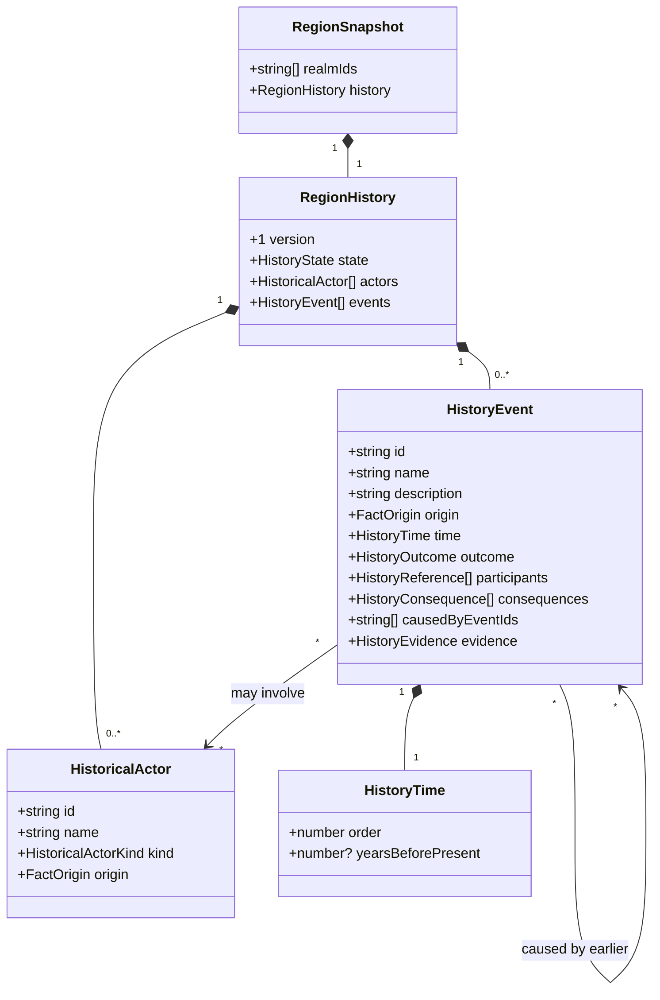
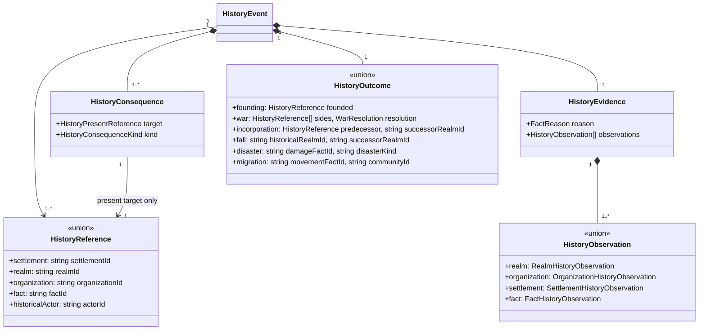

# A regional past that explains the present

**Status:** accepted — domain model and policy approved by Ben on 2026-11-01.
Foundation (#481) is merged. Generation (#482) is implemented for review; editing and
presentation remain pending in the linked work items below.

Issue: [#470](https://github.com/ironarachne/ironarachne/issues/470).
Related designs: [regional authoring](region-authoring.md),
[edit consistency](region-edit-consistency.md), [narrative evidence](region-narrative-evidence.md),
[gazetteer selection](region-gazetteer-salience.md), and
[organization reading](region-organization-reading.md).

## Problem and recommendation

A region has geography, settlements, realms and organizations but no account of how they came
to be. History should provide a small, connected sequence of events explaining selected present
facts. A border settlement, an inherited realm claim and a surviving rivalry should acquire a
past that a GM can use. A list of random calamities would not solve this problem.

Generate a **compatible fictional backstory after the present has been generated**. Save the
chronology, participants, consequences, supporting observations and selected words. Do not simulate
centuries forward and then overwrite the map to fit the simulation. The existing region is the
boundary condition, not an initial state that history may replace.

This is regional history, not a universal calendar, campaign journal, historical map engine,
population simulation or alternate-world generator. Keep the implementation in `src/lib/regions`
until a second consumer actually requires a shared history library. Separate modules within that
library own identity, evidence, chronology, event rules, editing and presentation.

## Verified starting point

The inspected checkout has region payload **24**, facts **12**, and gazetteer **6**. Some older
architecture documents still describe earlier versions; implementation must use current constants.

- `region_generation_passes.ts` derives RNGs by stage name from one root token. The orchestrator
  already separates habitation, notables, identity and gazetteer selection.
- `RegionFacts.claims` contains generic causal claims, including road connections. It is **not**
  interchangeable with political claims in `StoredRealm.claims`.
- Settlements have regional IDs; organizations have saved IDs. `Claim.claimantId`, realm parents
  and `mainRealm` use array positions. A realm name is editable and cannot serve as identity.
- `FactSource` covers environment, map observations and local facts. It does not observe realm
  membership, realm claims or organization relationships. History needs typed observations for these.
- Notables currently distinguish landmarks and hazards, not typed ruins. A picturesque name or
  free-text description cannot prove abandonment, destruction, a dungeon or previous ownership.
- Existing organization rivalry generation supplies a relationship, not a motive, war or date.
- Current gazetteer selection shares a 24-sentence budget. Adding history candidates to that pool
  would change other saved prose even with a separate history RNG.
- Saved editing and dependency traversal already protect authored work and preserve stale evidence.
  History must participate in those mechanisms, not rely only on a generic review banner.

The region already has a catalog entry, workshop panel, artifact codec and shared reading exports.
This adds no route, artifact kind, catalog entry or navigation destination. Standalone realm,
organization and settlement generators retain their existing behavior.

## What an event is allowed to assert

Evidence has two different roles:

1. **Present support:** exact saved facts that the event explains and constraints it must preserve.
2. **Historical invention:** the selected past occurrence, explicitly generated as fiction.

A present rivalry supports choosing a compatible origin story. It does not establish that a war
really occurred. The event's versioned rule records which fictional explanation was selected;
its observations record why that explanation remains compatible. Evidence UI labels these
“Explains” and “Compatibility checked against”, not “Proof that this happened”. Generated history
is canonical within the generated setting until edited; it is not a rumour or an uncertain claim.

Historical statements must be structured enough to check. Each event has a discriminated outcome,
participants and present consequences. Wording may express only those meanings. A war template
cannot casually add a destroyed capital, surviving heir, current tax, ethnic hatred or ruined fort.
No parsing of authored prose or invented name semantics establishes eligibility.

Present facts always win. History must never change current ownership, affiliation, population,
resource supply, geography, relationships or selected prose. Missing evidence is unknown, not
absence. A present hazard proves neither an earlier disaster nor that the hazard existed then.
A current ruler is not automatically the founder or combatant of an undated historical event.

### Event families and their limits

| Family        | Eligible present anchor                                                         | Historical addition and enforced limits                                                                                                                                                                                             |
| ------------- | ------------------------------------------------------------------------------- | ----------------------------------------------------------------------------------------------------------------------------------------------------------------------------------------------------------------------------------- |
| Founding      | Embedded settlement with a current site role; current organization or realm     | Establishment of that institution/place. A settlement's location may motivate settlement there; current production is not projected backward. No named founder unless separately recorded.                                          |
| War           | Current realm claim relationship or explicit organization rivalry               | A past conflict involving those institutions, with a typed settlement of the conflict compatible with the present. An unresolved rivalry stays unresolved; no inferred troop counts, casualties, territory transfer or ongoing war. |
| Incorporation | Current realm parent relationship or a supported current claim                  | A historical realm was incorporated into a current successor, or a current subordinate entered its existing parent relationship. “Absorbed” is distinct from “destroyed”; a surviving subordinate cannot be declared extinct.       |
| Fall          | Current realm continuity/claim anchor, or a typed abandoned site when available | A newly invented historical predecessor ceased to exist as a polity. Its successor is explicit. No existing realm is silently killed and no ruin is created.                                                                        |
| Disaster      | Typed saved damage/recovery evidence from a future site adapter                 | A past event and its recorded surviving consequence. Current river, volcano or hazard alone is insufficient. Initially unavailable without that adapter.                                                                            |
| Migration     | Typed saved population-origin/destination evidence from a future adapter        | Movement of a historical community. Dominant culture, language or species alone cannot establish displacement or an origin. Initially unavailable without that adapter.                                                             |

War is optional, not the default explanation for every border. A claim may support a charter or
incorporation account without declaring the claimant the uncontested owner. Claim adapters must
recognize an explicit allowlist of statuses and meanings; unknown saved statuses are ineligible.
Fall/incorporation rules may introduce a historical predecessor as fictional backstory, explicitly
identified as generated rather than inferred from the current claim. This is the bounded exception
to participants already existing in the present inventory. It creates no present actor or land.

This design covers all six families, but does not manufacture inputs for disaster or migration to
fill slots. Those rules remain disabled until their evidence contracts are separately approved.
No promise is made that every region contains a war, extinct realm or ruin.

## Domain model

These are proposed TypeScript shapes for `region_history_types.ts`. Existing types keep their
owning modules. Arrays in the diagrams mean ordered TypeScript arrays; string IDs are locally
scoped. The variant definitions below are normative alongside the diagrams.

`HistoryState = 'unrecorded' | 'generated' | 'authored'`. Unrecorded means no chronology was
supplied; generated with zero events means generation found no eligible account. Origin on each
actor/event still governs mixed authored/generated histories. Editing a generated history makes
its container authored without changing untouched event origins.

`HistoricalActorKind = 'realm' | 'community'`. Historical actors are not current realms or
organizations, have no current territorial claims, rulers or demographic totals, and do not enter
those directories. Only realms are generated initially. A fall/incorporation outcome must cite a
historical realm or a surviving realm as allowed above; it cannot infer extinction from omission.

`HistoryPresentReference` excludes `historicalActor`.
`HistoryConsequenceKind = 'existence' | 'claim-continuity' | 'subordination' | 'rivalry' |
'abandonment' | 'recovery' | 'population-origin'`.
`WarResolution = 'rivalry-persists' | 'claim-persists'`; neither implies active warfare today.
The outcome union uses `kind` as discriminant. Disaster kinds are adapter-defined allowlisted
keys, never arbitrary executable rules. Founding restricts its target to settlement, realm or
organization; war requires at least two distinct eligible institutional participants. Migration's
community ID resolves to a historical community. Outcome references must also appear in the
participant set, and consequences must match the outcome's supported family.

Observation records use a `kind` discriminant and the following exact projections:

| Record                         | Proposed fields beyond `kind`                                                                                                                  |
| ------------------------------ | ---------------------------------------------------------------------------------------------------------------------------------------------- |
| RealmHistoryObservation        | `realmId: string`, `name: string`, `parentRealmId: string \| null`, `tiles: number[]`, `claims: { claimantRealmId: string; status: string }[]` |
| OrganizationHistoryObservation | `organizationId: string`, `name: string`, `relationships: { relatedOrganizationId: string; kind: OrganizationRelationKind }[]`                 |
| SettlementHistoryObservation   | `settlementId: string`, `name: string`, `mapNodeId: number`                                                                                    |
| FactHistoryObservation         | `factId: string`, `observed: string`                                                                                                           |

`observed` is canonical JSON of the selected saved fact, excluding mutable review-status metadata;
it is compared as data, never executed or used as a hash-only proof. Linked fact support is also
checked transitively through existing evidence helpers. Arrays with set semantics are sorted before
recording/comparing. These deliberately conservative projections can stale more than one sentence;
precision can improve later without weakening validity. Observation names catch copied prose.
Historical actor edits invalidate their dependent events directly.

`HistoryEvidence.reason` reuses `FactReason.status` and rule IDs. Its `sources` cite applicable
existing facts and map/environment observations; it can be empty for an institutional founding
whose positive support is entirely in typed history observations. Generated events always require
nonempty present consequences and positive observations. Event-to-event dependencies use
`causedByEventIds`, not invented `FactSource` IDs masquerading as existing semantic facts.

### Stable realm identity bridge

Add `realmIds: string[]` parallel to the regional `realms` array, matching the runtime settlement
identity precedent. Allocate `realm:0`, `realm:1`, etc. once at generation/migration, without RNG;
these strings thereafter identify entities, not their current indexes. Never reconstruct them from
names or array positions on read. New additions use unused IDs, not the current array length.

A regional mutation that reorders/removes realms must move the ID with its realm and atomically
remap the existing positional `parent`, `mainRealm` and claim references. Validate equal lengths,
unique IDs and every converted claim target. No history code accesses a realm by a saved index.
A single regional adapter translates legacy claim positions to IDs. This avoids changing standalone
realm contracts or rewriting every pre-existing payload field. A future realm-wide identity
migration can replace the bridge without changing event references.

### Ordering and invariants

Default to **ordered events**, displayed “Earlier”, then ordinal entries, then “More recently”.
Do not invent a calendar epoch, absolute year or relationship to the user's wall clock. Optional
`yearsBeforePresent` is an authored nonnegative integer relative to the snapshot's narrative
present, not to today's date. Missing dates remain missing. Display approximate/ordinal chronology
without implying exact durations, biological lifespans or synchronized dates across regions.

Orders are unique nonnegative integers; gaps are allowed so removals preserve identities. Causal
edges must point to a lower order. Known relative dates must be nonincreasing along chronological
order. Event IDs survive reordering. Reject duplicate IDs, cycles, unresolved participants,
self-conflicts, impossible outcome/consequence combinations and backwards dates.

Track historical actor lifecycle: founding precedes participation, and dissolution follows it.
A generated predecessor used in a fall/incorporation has an earlier founding event; never use it
again as an active polity afterward. Current organizations and realms may act institutionally
without naming their present leaders. Current settlements cannot end in destruction or abandonment
unless separate saved recovery evidence restores their present existence. A realm cannot be both
an extinct historical actor and the same current realm under a renamed label.

## Generation and dependency direction

1. Finish all existing present-fact and gazetteer passes unchanged.
2. Resolve a read-only history context: stable entities, current evidence, recognized claims,
   relationships and eligible explanatory targets. Unresolved external artifacts are ineligible;
   do not fetch changing external state while generating or opening a saved region.
3. Enumerate rule candidates in canonical ID order. Prefer accounts connecting present subjects,
   with different meaningful consequences, over repeated founding filler.
4. Select up to **six events**, aiming for three to six only when evidence permits. Reserve the
   complete causal bundle before accepting a candidate: a predecessor's founding and fall consume
   two places. Empty or shorter histories are valid. Use bounded enumeration/backtracking and
   discard incompatible candidates; never loop until a requested count is filled.
5. Order the selected DAG, validate lifecycle and terminal compatibility, then choose wording.
   Save one concise sentence per generated event with its consequence and observations. Remove
   unused historical actors. No name, phrase or event is generated during presentation.
6. Validate the complete result before publishing it to the generator/editor.

Use `createRegionStageRng(rootToken, 'regional-history')`, derived by name without another draw from
an existing stream. Pass that owned RNG through selection, actor naming and wording helpers.
Version rule IDs such as `fantasy:region:history:claim-continuity:v1`. Candidate ordering and
validation must not depend on insertion order, asynchronous completion, locale collation or clocks.

History is not part of the old gazetteer candidate pool. Preserve its 24-sentence selection and
all saved blocks verbatim; append a separate History section of at most six generated sentences.
This explicitly revises the whole-document ceiling to at most 30 generated sentences when history
exists. Reallocating the old budget would violate #470's unchanged-output criterion. Authored prose
retains the existing exemption. A later editorial redesign would be a separate compatibility change.

### Integration with the related designs

| Owner                   | Contract with history                                                                                 | Dependency direction                                                                                                                                                      |
| ----------------------- | ----------------------------------------------------------------------------------------------------- | ------------------------------------------------------------------------------------------------------------------------------------------------------------------------- |
| #472 political tensions | Present relationships/claims are inputs; a tension's optional historical cause references an event ID | Generate current relationship facts first, history second, political explanation last. Do not let a historical explanation create the relationship that justified itself. |
| #476 adventure sites    | Typed site existence/damage/abandonment is input; site's origin text can reference history            | Place supported sites first, history second, origin/hook presentation last. History does not place ruins or generate dungeons.                                            |
| #474 rumours            | Read current events and their evidence through a history query adapter                                | Rumours consume history; they never become support for it. GM truth and player-safe disclosure remain #474's responsibility.                                              |

History can ship before these features. #472 and #476 need no history to establish their present
facts; enrichments are optional. Disaster/migration stay gated until suitable structured inputs
exist. Future consumers use `getCurrentHistoryEvents(snapshot)` and stable IDs, never scrape prose.
A view may explain a present fact from a historical event even though generation chose that event
from the present fact; the **evidence graph** remains one-way. Store downstream explanatory links
separately from upstream evidence to prevent cycles.

## Editing, staleness and removal

Extend the regional dependency service to include history observations and event edges, rather
than introducing an isolated second invalidation system. All saved mutations remain immutable.

- A changed observed name, claim, parent, relationship, site or supporting fact marks affected
  event reasons stale and propagates to dependent events and future consuming content. An unchanged
  value is a no-op. A newly conflicting relationship also invalidates observers of the complete
  relationship set; checking only removed positive links is insufficient.
- Recheck observations on load/read as well as at edit time. Imported payloads or future editors
  may bypass an edit helper. This check uses saved data without RNG, rewriting prose or applying
  live rule catalogs. Unsupported future schema variants are rejected, not interpreted loosely.
- Generated stale events remain saved and inspectable, with their original words. The reading
  chronology omits them and displays “History needs review; supporting information changed.”
  Authored events remain visible with an adjacent warning. Markdown, PDF and project publication
  apply the same policy; no consumer treats stale events as current historical support.
- Event text edits mark that event authored and retain its structured links and evidence. A blank
  description suppresses its text without deleting the event. Editing text does not clear review
  status. Free prose is not machine-verifiable; the editor explicitly asks for manual consistency
  review, as it already does for other authored descriptions.
- The first UI exposes text and optional date edits, reorder and removal of existing events, plus
  historical actor renaming. It does not expose arbitrary structured event creation. Reorders/date
  edits must pass causal/lifecycle validation. A richer history authoring tool is separate scope.
- Source removal computes the full generated dependency closure, including events and orphaned
  generated historical actors. Block the operation if it would damage an authored event/actor or
  authored dependent. Show the impact before confirmation; do not silently detach references.
- Removing an event uses the same policy. Events that merely share a present target are not causal
  dependents of each other. Removing all visible events is not permission to regenerate replacements.

Whole-region Roll again remains the only user regeneration operation and names history among
contents replaced. No “repair history” or partial reroll control is added. Legacy saves retain an
empty history until a deliberate whole-region reroll. No automatic repair occurs on opening,
saving, exporting or renaming a participant.

## Persistence, migration and presentation

Propose the next payload version (25 if still free), with required `realmIds` and `history` fields.
`RegionHistory.version` starts at 1. Facts version 12 and gazetteer version 6 need not change:
history is a separate aggregate, not a disguised resource/causal fact or an editorial sentence.
The runtime region and snapshot converters must carry the aggregate losslessly. Use the actual
next available payload version when implementing; parallel work may have consumed 25.

Every supported old migration path ends with deterministic realm ID allocation and
`{ version: 1, state: 'unrecorded', actors: [], events: [] }`. Add no dates, actors, events,
reasons or gazetteer sentences. Preserve old strings, intentional blanks, claims, map geometry
and existing gazetteer versions. Rehydration never generates. JSON round trips contain no RNG,
closures, maps with non-JSON keys or cross-artifact fetch results.

Use one history document adapter from `regionToDocument` and the editorial reading path, consumed
by the gazetteer page, workshop panel, saved editor, Markdown, text/PDF and project publication.
Place History after the opening/identity material and before the geographic sections. An unrecorded
or genuinely empty history hides the section. Stale-only content retains its review notice. The
editor may say “No history recorded” without asserting that nothing happened.

Each visible entry includes its order/date label, saved sentence and inspectable “Explains” links
resolved against live identities. Web links navigate to the relevant entry/evidence; plain-text
exports include readable names and review notices. No new map markers or historical border layer.
Saved sentences containing renamed actors become stale even though link labels use current names.
The fact/evidence inspector must expose event IDs, versioned rule, observed support, causal parents
and historical actors, clearly distinguishing historical actors from current inhabitants.

### Illustrative reading acceptance

Given a current riverside settlement, two explicitly rival organizations and an eligible realm
claim, a short account might contain the settlement's founding and a past conflict that left the
organizations rivals. The text must identify which present entries it explains. It must not add a
bridge, claim that the river was navigable, place both groups in that settlement, name the current
leader as founder or convert the rivalry into ongoing war. If the rivalry is removed, its conflict
entry becomes unavailable as current history while the independent founding remains readable.

For an unaffiliated region with one settlement and no usable relationships, one grounded founding
is better than six disconnected calamities. For a future typed ruin, an origin event may explain
its recorded abandonment; the generator cannot create that ruin merely to make history exciting.

## Verification and acceptance

The worktree was clean before this design was drafted. This design changes documentation only; no generator
behavior was executed or claimed verified. Implementation acceptance requires the following tests.

| Boundary           | Required evidence                                                                                                                                                                                                                                     |
| ------------------ | ----------------------------------------------------------------------------------------------------------------------------------------------------------------------------------------------------------------------------------------------------- |
| Identity           | Rename/reorder/remove realms without retargeting history; remap positional claims atomically; reject duplicate/missing realm IDs and malformed indexes.                                                                                               |
| Rules              | Positive and negative fixtures for each enabled family; unknown claim statuses, natural hazards without damage, culture without migration evidence, unresolved artifact references and stale evidence produce no unsupported event.                   |
| Chronology         | DAG/lifecycle invariants, stable IDs after reorder, optional dates, no future dates, bundle capacity, no actors acting after dissolution, no live realm silently extinguished.                                                                        |
| Compatibility      | Every event has positive present support and a compatible terminal outcome; word templates introduce no extra meanings. Hand-reviewed sparse, crowded, unaffiliated and conflicting-claim examples.                                                   |
| Determinism        | Same seed/config produces identical snapshots; another seed can vary eligible histories; canonicalized input ordering preserves selection; no clock or hidden naming RNG.                                                                             |
| Upstream isolation | Freeze representative pre-change snapshots. Project away only new history/realm ID fields and version metadata; deep-compare all old fields including gazetteer text and claims. Also prove adding history RNG draws leaves all old output unchanged. |
| Editing            | No-op edits, name/relationship/claim/fact edits, transitive staleness, stale-on-read imports, source removal closure, authored protection and blank overrides; unrelated events remain current.                                                       |
| Persistence        | All supported old payload versions migrate with empty unrecorded history; existing prose and gazetteers remain unchanged. Reject malformed variants/references; round-trip current/authored/stale histories.                                          |
| Reading            | Page, Markdown, text/PDF and publication agree; empty/stale-only/authored entries follow policy; no RNG or replacement wording on read.                                                                                                               |
| Browser            | Generate/save/reopen/edit/export in standalone and workshop; inspect support; remove a source; keyboard navigation and wrapping at existing mobile widths.                                                                                            |

Use focused suites such as `npm run test -- src/lib/regions/region_history` while implementing,
plus the affected editing, snapshot, migration and presentation suites. Run `npm run verify` for
completed code changes and `npm run verify:all` before merging components/routes/rendering work.
Meet the existing per-library coverage gate without exemptions or weakened baselines. Add editorial
review fixtures alongside mechanical tests: invariant tests alone cannot establish readable history.

## Accepted decisions and implementation tracking

The approved domain model includes these policy choices: backward generation from the
present; explicitly invented historical explanations; ordered rather than mandatory dated events;
stable regional realm IDs; a separate six-sentence history allowance; unsupported disaster/migration
rules remaining dormant; preservation and review of stale/authored work; and no partial regeneration.

Implementation is split across identity/persistence, generation, dependency/edit integration,
shared reading/UI/export, and final acceptance. The linked implementation issues below carry
explicit dependencies and acceptance criteria. Related political, site and rumour work retains
#472, #476 and #474; none is a prerequisite for the initial history implementation. #470 remains
the parent acceptance contract. Foundation and generation now implement this model; remaining work retains its linked ownership.

| Implementation issue                                                                                                                       | Depends on |
| ------------------------------------------------------------------------------------------------------------------------------------------ | ---------- |
| [#481 — Establish history storage, stable realm identities and evidence adapters](https://github.com/ironarachne/ironarachne/issues/481)   | None       |
| [#482 — Generate a compatible seeded chronology from present facts](https://github.com/ironarachne/ironarachne/issues/482)                 | #481       |
| [#483 — Integrate history editing, dependency invalidation and authored protection](https://github.com/ironarachne/ironarachne/issues/483) | #481       |
| [#484 — Present and edit history across gazetteer, workshop and exports](https://github.com/ironarachne/ironarachne/issues/484)            | #482, #483 |
| [#485 — Verify regional history coherence and release acceptance](https://github.com/ironarachne/ironarachne/issues/485)                   | #484       |

Dependency order: #481 → (#482 and #483) → #484 → #485. Each issue carries its own
acceptance criteria; #485 verifies the complete parent contract and human editorial acceptance.
