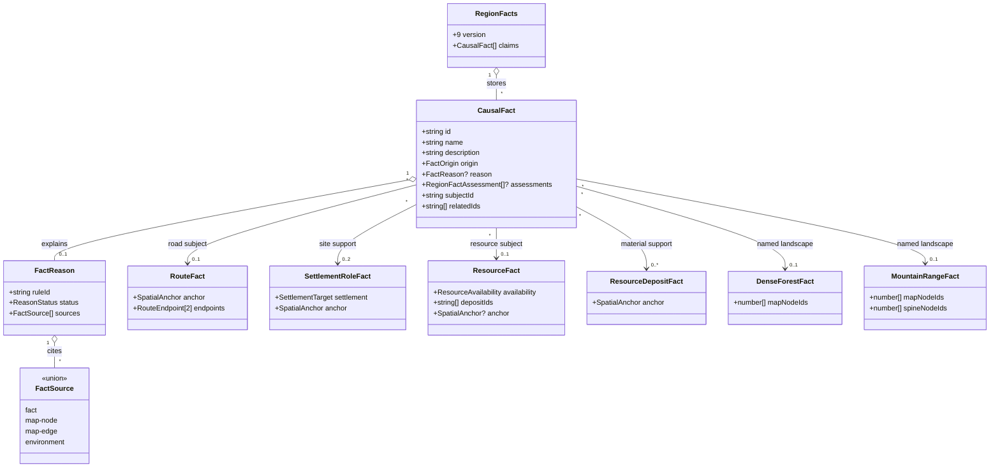

# Grounded regional identity

**Status:** implemented for [#424](https://github.com/ironarachne/ironarachne/issues/424).
Design and domain model explicitly approved on 2026-10-14. Identity claims use the existing
required `claim:` namespace (`claim:identity:`) to preserve payload validation.

## Problem

Region introductions already combine terrain, habitats, settlements, roads, resources and
hazards. Their individual sentences can still miss the specific relationships that distinguish
one region from another. The saved model now contains named dense forests and mountain ranges,
settlement sites, located resources and traced roads. Connect those existing facts rather than
inventing a history, conflict or economy.

## Decisions

### Store identity as existing causal facts

Use `RegionFacts.claims: CausalFact[]`, which already stores editable text, a subject, related
fact IDs and versioned evidence. Identity is a bounded family of causal facts, distinguished by
the `claim:identity:` ID prefix and the rules below. No new persisted type, array or schema version is
needed. Existing empty claims lists remain valid; loading old regions never generates identity.

Each generated claim records every supporting fact in `reason.sources`, as well as the saved
map observations used by its rule. `subjectId` identifies the principal route, settlement role
or resource; `relatedIds` identify the other supporting semantic facts. The claim's saved
description is the final selected wording, reused verbatim by reading and exports.

Spatial lookup follows the referenced facts' existing node/edge anchors and named landscape
footprints. There is no second map location model. Identity generation never modifies the map,
settlements, upstream facts or their names.

### Three conservative rule families

| Rule ID                                        | Required support                                                                                                                                                                             | Permitted meaning                                                                                |
| ---------------------------------------------- | -------------------------------------------------------------------------------------------------------------------------------------------------------------------------------------------- | ------------------------------------------------------------------------------------------------ |
| `fantasy:region:identity-road-landscape:v1`    | Current road with a continuous dry-land path between two resolved, named embedded settlements; at least one path node inside a current named dense forest or mountain range                  | A road connects the two named settlements through the named landscape.                           |
| `fantasy:region:identity-settlement-forest:v1` | Current settlement role resolving to a named embedded settlement on a dry-land node inside a current named dense forest                                                                      | The named settlement stands within the named forest.                                             |
| `fantasy:region:identity-resource-range:v1`    | Current located stone, ore, gemstone or geological-material resource with usable availability, a current supporting deposit and a shared dry-land node within a current named mountain range | The recorded material occurs in the named range, preserving limited availability qualifications. |

Reuse the existing road/site checks in `region_geography_narrative.ts` and the memoized current
evidence checker. Validate actual footprints; matching a display name is never spatial proof.
The generated fallback label `Dense forest` is not a proper name and cannot support a named
identity detail. Explicitly authored names remain eligible, including that same text.
Resource wording names a recorded material only when its supporting deposit establishes that
identity. Trace/unknown/not-observed availability, missing anchors and stale evidence omit the
candidate. Deep deposits may establish occurrence, never accessibility or extraction.

Forest membership does not establish timber work. A road through mountains does not establish
a pass, bridge, safety, traffic or trade. Mineral occurrence does not establish a mine. The
first pass excludes political connections, isolated settlements and named passes: current
fact sources do not directly record affiliation observations, absence of a road does not prove
isolation, and mountain/road overlap alone does not establish a pass.

### Optional, bounded deterministic enrichment

Expose a generation helper accepting the region and caller-supplied RNG. Run it after supporting
facts and notable places, before presentation, on a named `regional-identity` stage stream using
the existing `createRegionStageRng` contract. The helper is optional for callers; an omitted pass
or empty supported set keeps the current overview behavior. No new user-facing setting is
introduced in this issue.

Sort candidates by stable rule, subject and supporting fact IDs before seeded selection. Retain
at most one claim per rule family and three overall. Avoid selecting a road/forest relationship
and a settlement/forest relationship for the same settlement and forest. Rerunning the helper
must not duplicate or overwrite saved identity claims, including authored ones.

Compose each selected claim with the shared narrative composer and this caller-owned stream.
The introduction selects at most two current identity claims within its existing five-sentence
budget, after a defining terrain/landscape sentence and before generic site/resource alternatives.
Suppress fallback candidates whose meanings repeat the selected identity's supporting facts.
Record the selected claim IDs in `overviewReason`; transitive evidence leads back to the map.
Sparse regions retain the supported existing sentences without a fabricated identity fallback.

### Reading, editing and export

Use the existing claims validation, inspection, dependency traversal and text-editing contracts.
Unknown saved rule IDs retain readable stored text; live generation accepts only known rules.
Source edits/removals must stale or remove generated dependent claims and the overview under
the existing contract. Authored claim text remains saved and protected; it does not become
current generated evidence merely because it was edited.

Reuse saved claims for a concise identity section in region descriptions and Markdown/PDF
exports where those paths do not already expose claims. Omit empty sections and flag stale
claims consistently with other explanations. The introduction and map continue to describe
the same saved graph; no new map symbols are required. Inspect existing export behavior during
implementation to avoid duplicating claims already displayed.

## Domain model

The following are existing types, reused without modification. Identity is a semantic subset
of `CausalFact`, not a new TypeScript subtype. Diagram fields show the complete causal fact
shape and the relevant fields of its existing containers and sources.

The associations describe the three rule variants, not additional persisted fields. Road rules
can resolve endpoint settlements through `RouteFact.endpoints` without requiring a site role
for each endpoint. All subject/related references are region-local fact IDs; settlement targets
and map IDs retain their existing meanings.

## Verification

Use contrasting controlled fixtures: a road through a named forest, a settlement within a
different named forest, and a located mineral within a named range. Assert distinct concrete
introductions and exact source/footprint support. Test road continuity, wet nodes, unresolved
settlements, missing names/anchors/deposits, unsupported availability and stale/transitive
evidence. Assert that no pass, mine, trade, history or conflict is inferred.

Test same-seed repeatability, stable selection under reordered fact/map arrays, different-seed
selection with multiple eligible candidates, family and sentence caps, duplicate suppression,
idempotence and empty/disabled enrichment. Verify upstream map/facts remain unchanged and other
named streams produce identical results. Test stored claim/overview validation, save/load and
text-export round trips, authored edits and source removal. Check displayed and exported prose
against the same saved claims if presentation changes.

Run `npm run verify` for implementation and `npm run verify:all` before merging any rendering
changes. Do not change coverage baselines. Break the approved design into implementation work
items only after explicit human review.
