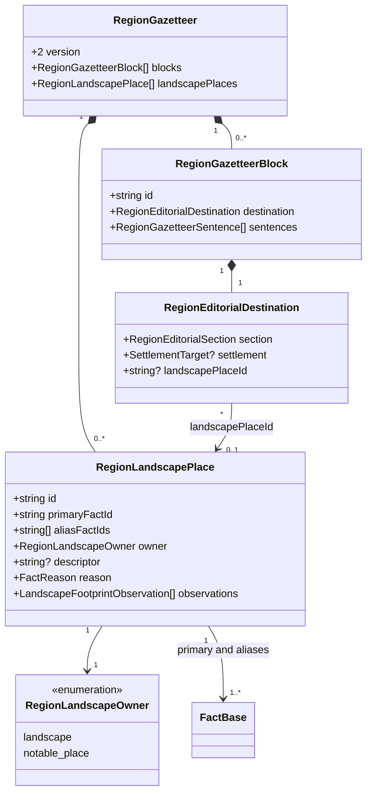
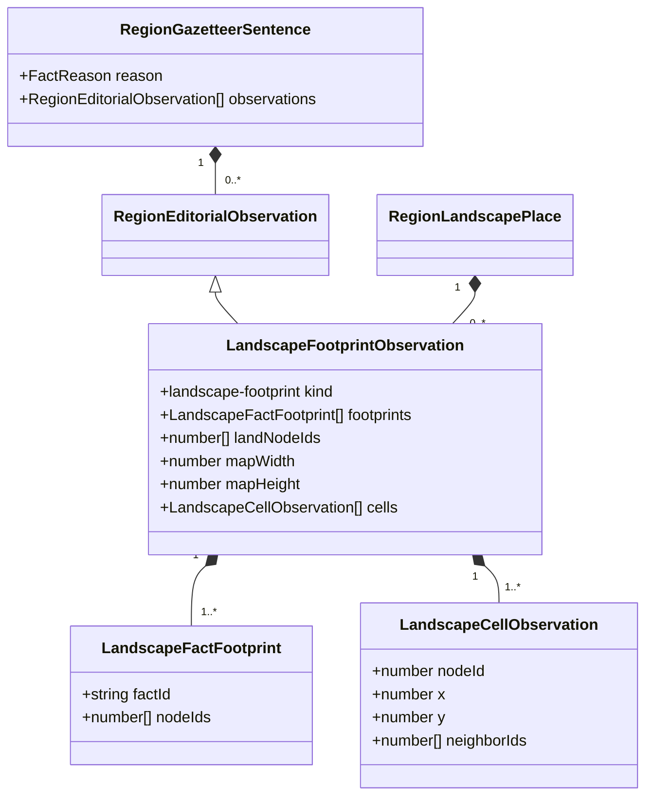

# Regional landscape reading hierarchy

**Status:** implemented — policy and domain model approved by Ben on 2026-10-30.

Issue: [#446](https://github.com/ironarachne/ironarachne/issues/446). Builds on the implemented
[#445 editorial design](region-gazetteer-salience.md), the
[evidence contract](region-narrative-evidence.md), [habitats](region-habitats.md), and
[dense forests](region-dense-forests.md).

## Problem and current behavior

The reported `5wyedz5q272fz` snapshot at `1ffabf08` has thirteen Landscape entries mixing
regional land, named habitat zones, dense forest patches and biome-wide summaries. The
Unquiet Forest repeats under Notable places, while repeated generic forest headings receive
ordinal suffixes. A centroid describes the Weald as central despite its reported footprint
covering 148 of 178 land cells. These reported counts need a captured historical fixture;
they are not assertions about today's output from the same seed.

The current code confirms the underlying responsibilities:

- The legacy `regionToDocument` flattens areas, ranges, forests and habitats into Landscape.
  `regionToUiDocument` separately applies heading uniqueness, including the fallback “Entry”.
- `generateHabitatFacts` computes connected patches but reserves named zones for the four most
  prevalent biomes without a minimum size. It locates each zone using its centroid.
- Dense-forest landmarks explicitly cite their forest fact and copy its description into a
  notable description. The supporting forest and landmark are two records for one place.
- Since #445, regions with a gazetteer take `regionEditorialDocument` instead. That path shares
  stored sentences between display and export, but has no place directory or primary landscape
  identity. Improving only the legacy list would miss newly generated regions.

This design extends the saved editorial plan. It does not change zone selection, forest detection,
geographic names, terrain, anchors, settlements, resources or the map. Grammar remains #444;
general notable-place layout, selection and hook redesign remain separate work.

## Reading hierarchy and section ownership

| Level                                | Primary destination                      | Selection and omission                                                                                                                                                                                |
| ------------------------------------ | ---------------------------------------- | ----------------------------------------------------------------------------------------------------------------------------------------------------------------------------------------------------- |
| Whole region                         | Opening                                  | One defining landscape sentence, combining realized dominant habitat and overall relief where useful. Do not append `area:land` or every biome summary afterward.                                     |
| Named habitat zone or mountain range | Landscape                                | Describe a distinctive location, extent or relationship when it earns the editorial budget. Otherwise retain a name-only directory entry. A proper name alone earns discoverability, not a paragraph. |
| Dense forest promoted to a landmark  | Notable places                           | One primary entry for the forest and its notable alias. Landscape can refer to this entry without repeating its description. Keep an existing supported hook at this owner only.                      |
| Significant unnamed patch            | Landscape                                | Eligible only with at least three land cells, at least 10% of regional land, and a supported distinction beyond ordinary biome identity. Use a spatial descriptor; otherwise leave it in inspection.  |
| Minor habitat or patch               | Inspection; optionally landscape texture | No independent generated paragraph. A short contrast can join another selected landscape sentence only when it adds a supported distinction. Do not list every biome to demonstrate completeness.     |

These thresholds are editorial conventions based on the existing cell-count prevalence measure,
not physical area measurements. They never delete or modify facts. Named tiny places remain
discoverable even when below the unnamed-patch threshold. Habitat-wide summaries supply context
and candidates; they are not additional named places. Regional land is not a directory entry.

Each place has one primary owner. A promoted forest is identified through its explicit notable
fact source referencing the dense-forest fact, not equal names, overlapping footprints or equal
text. A habitat zone containing that forest remains a different place. Containment may support
a useful relation such as a named forest within a wider named woodland, but never merges identities.
If malformed or ambiguous references cannot establish an alias, retain the records separately in
inspection and do not invent a shared identity. A non-forest notable continues through its existing
policy unless it has an explicit supported alias covered by this design.

Keep a compact **Named landscapes** directory in the Landscape section. Include every current named
zone, range and promoted forest once, with its primary destination. It is a list of names and
references, not a second set of descriptions. Unnamed selected patches can have entries at their
primary destination but do not enter this named directory. A named place without selected prose
has a name-only primary entry. Hide empty headings. An all-water or otherwise sparse region may
have only its opening and no Landscape section.

UI references target stable place IDs; Markdown uses document anchors; PDF/plain text names the
destination and place, for example “Unquiet Forest — Notable places”. A name-only primary entry
links to inspection in the UI; exported names remain useful without an interactive inspector.
Do not link a place to itself or reproduce a paragraph to make an export self-contained.

## Budgets and deduplication

Retain #445's 24-sentence whole-entry budget, opening limits, importance tiers and semantic
assertion keys. The region's defining landscape meaning belongs in the opening. Local extent,
canopy, access or supported relationships must contribute different assertions to earn space.
Sharing a river edge or forest ID does not alone make two meanings duplicates. Generic “a river
runs here” sentences do not earn additional entries for every overlapping habitat.

**Explicit amendment to #445:** replace Landscape's single three-sentence paragraph with at most
three generated sentences across Landscape and the geographic-place entries owned by Notable
places, together. Allow at most three descriptive entries, one sentence per entry. This permits
useful named features to have primary headings. Each entry has at most one sentence per topic;
the existing same-subject/topic limit and counted orientation exception still apply. Names and
reference labels consume no sentence budget and must not disguise additional narrative.

Any retained generated hook consumes the local and global sentence budgets too. Select the useful
description first; a hook is optional and cannot force padding or a second geographic sentence.
Other notable/hazard material continues to use its existing destination and applicable budgets;
this issue does not create an unbounded new notable prose allowance. Authored text stays outside
generated limits under the accepted contract.

Plan all landscape candidates before selecting meanings. Apply #445's importance and relationship
priorities; footprint size is an eligibility/orientation input, not a replacement salience score.
A small named place with a consequential supported relationship can outrank a large ordinary
patch. All members of an alias group share proposition identities for the same place/meaning.
Assign one primary destination before wording. A stale paragraph is omitted without selecting a
replacement or moving an alias's old description into its place on read.

## Spatial wording from observed extent

Use existing saved memberships, dry-land eligibility and map coordinates. Do not infer extent
from a name, requested biome or centroid. The following deterministic policy is independent of RNG:

1. Resolve unique dry-land node IDs, the complete regional dry-land set, and connected components
   using the existing habitat adjacency convention. Sort IDs and traversal explicitly. Empty,
   invalid or unresolved footprints cannot support a generated spatial assertion.
2. Partition node centers into a three-by-three compass grid using map width/height. A point
   exactly on an internal boundary belongs to the middle band. Use the complete footprint to
   determine occupied sectors and concentration; do not locate its average point.
3. Coverage of at least two thirds of regional land permits “covers much of the region”. A
   disconnected footprint qualifies the coverage with “in separate stretches”; it never becomes
   one continuous forest. “Throughout the region” is not supported merely by that fraction.
4. Otherwise, a compass phrase requires at least two thirds of footprint cells in the stated
   band or sector. Prefer a supported corner over a single axis. “Central” requires two thirds
   in the central sector, not separately central horizontal and vertical averages. Phrase this
   as concentration (“lies mainly in the north”), not confinement (“is confined to the north”).
5. If no concentration qualifies, adjacent occupied sectors can support a bounded span such as
   “extends from the west into the center” only for a connected footprint occupying that span.
   Use the smallest covering contiguous grid rectangle; when it has gaps, use “stretches across
   several parts of the region”. Disconnected footprints use “separate patches” and at most two
   leading occupied sectors, ranked by count then fixed compass order. Never claim a corridor
   between disconnected components. If two sectors would misrepresent the spread, omit directions.
6. Tiny footprints below the unnamed eligibility threshold use “a small patch” when a named or
   related candidate merits prose. Do not promote them to a region-wide biome description. Use
   ordinary biome identity as orientation only when needed to identify the place.

Coverage takes precedence over localized wording. Coast and river assertions keep their current
evidence rules and compete for space; extent alone does not establish travel, density or resources.
Cell count and grid classification remain inspection details, never pseudo-survey measurements
in prose. Equal counts use north, northeast, east, southeast, south, southwest, west, northwest,
center as fixed compass order.

Unnamed headings combine an observed direction/span with the existing kind, for example “Dense
forest in the northwest”. When two patches share that descriptor, prefer a supported relation to
an existing named parent. If no meaningful distinction remains, group their selected description
under “Dense forest patches” and cite both IDs. Grouping must still satisfy the one-sentence and
evidence rules; it does not claim connectedness. Do not generate ordinal suffixes or new place
names to make headings unique. Authored duplicate titles remain verbatim; DOM/export anchor IDs,
not visible suffixes, distinguish them.

## Domain model

Add `region_landscape_reading_types.ts` within `regions`. The following are saved editorial
metadata, not new geographic facts. Extend the existing destination and observation types rather
than creating an independent renderer selection engine. Diagrams show changed/relevant fields.

Add `'notable-place'` to `RegionEditorialSection`. Owner literals are `'landscape'` and
`'notable-place'`. Only these destinations may carry `landscapePlaceId`; geographic notable
blocks require one. Settlement destinations retain their existing settlement requirement.
Unlocated regional landscape blocks can omit the place ID. A place's blocks must agree with its
owner. Named places without prose need no empty block.

Place IDs derive from the canonical source ID. A promoted forest uses the forest's ID for place
identity, the notable as `primaryFactId`, and the forest in `aliasFactIds`. Ordinary zones/ranges
use themselves as primary facts. Grouped unnamed patches use the smallest source ID and retain
the other patch IDs as aliases for presentation only; they remain separate geographic records.
Each source belongs to at most one place group. Names always come from the current primary fact;
`descriptor` is optional saved generated heading text for unnamed patches only. It never overwrites
the fact's name. Authored names override generated descriptors, including intentional blanks.

The observation captures complete contributing footprints and all regional dry-land cells' centers
and neighbor IDs, so changed membership, denominator, dimensions, positions or connectivity can
invalidate extent and generated descriptors. All arrays are unique and canonically ordered;
coordinates/dimensions must be finite and dimensions positive. Recompute this narrow observation
on read and require equality, as with #445's population/road observations. Do not store derived
SVG geometry or computed centroids. Existing map-node/edge sources retain biome, water, coast and
river evidence; current transitive fact support and observations must both pass. Fact additions
that merely offer another editorial competitor do not invalidate a still-true selected sentence.

## Generation, compatibility and authored work

Build the place registry and extent candidates during the existing final editorial pass, after
notables and names exist. Use pure classification, then the dedicated editorial selection/wording
streams. New policy/rule IDs distinguish this revision. Changing phrase pools must not alter
membership, map labels, named geographic facts or upstream RNG streams. Store exact final prose
and unnamed descriptors; reading and exporting only validate and arrange that saved material.

Bump region payload 18 to 19; facts stay at 12. New gazetteers use version 2. Retain version 1 as a
supported union member with its existing behavior. Migration advances the payload marker only;
it neither adds a registry nor reconstructs sentences. Regions without a gazetteer retain their
legacy path. Do not silently remove old duplicate prose, fix old titles or regenerate descriptions
on load/export. The improved hierarchy applies to newly generated gazetteers or explicit
regeneration under the existing preservation contract. Historical wording remains reproducible
by its historical generator revision.

Use one document adapter for primary entries, directory references and authored overrides in UI,
Markdown, PDF and project publication. Extend `RegionDocument` with structured place IDs and
references as needed; do not parse labels or prose to reconstruct identities. Machine anchor IDs
must be distinct even for equal displayed headings. New geographic entries bypass the UI's
ordinal `uniqueHeading` fallback.

Authored source descriptions render once per authored record at that record's primary destination,
outside generated budgets. Two separately authored alias records remain distinct authored entries;
do not deduplicate their words or suppress one because they share a place. A generated alias cannot
repeat an authored description. Editing either alias conservatively suppresses dependent generated
sentences; intentional blank edits do not trigger fallback text. Keep authored names/text visible
when their evidence needs review, with review information in inspection. If a generated place's
spatial descriptor becomes stale, retain its current saved proper name where available and omit
the descriptor and dependent prose; never reclassify or generate a replacement heading on read.

Inspection lists all areas, habitats, forest patches, ranges and notables, including minor and
stale records, complete memberships, aliases and reasons. The raw artifact export round-trips
all of them. A concise gazetteer export is not a substitute for this complete fact export.

## Design fixtures and verification

| Fixture                                     | Required reading result                                                                                                                                                                                                                                                               |
| ------------------------------------------- | ------------------------------------------------------------------------------------------------------------------------------------------------------------------------------------------------------------------------------------------------------------------------------------- |
| Historical Belvorn                          | Capture the original revision/options separately from current generation. Verify reported memberships and alias evidence; the new plan has no repeated regional-land/forest description or generated “Entry” titles. Every named zone/range/promoted forest remains in the directory. |
| Broad connected woodland, 148/178 dry cells | Coverage wording takes precedence over a central centroid; no claim of confinement to the center.                                                                                                                                                                                     |
| Localized patch                             | Two-thirds concentration permits “mainly” in a supported band/corner. A few outlying cells do not become a confinement claim.                                                                                                                                                         |
| Disconnected north/south habitat            | Separate-patch wording; no fictitious central forest or connecting corridor. Permuting node/neighbor arrays leaves classification identical.                                                                                                                                          |
| Tiny minor biome                            | No standalone generated summary; a named tiny zone still has its directory entry.                                                                                                                                                                                                     |
| Equal unnamed forest descriptors            | Supported parent relation or one grouped entry; distinct machine IDs and no ordinal titles.                                                                                                                                                                                           |
| Named forest and notable alias              | One primary description at Notable places, a name/reference in Landscape, optional hook only at the primary owner. An overlapping zone stays independent.                                                                                                                             |
| Sparse/all-water region                     | No empty Landscape section, padded texture or invented land.                                                                                                                                                                                                                          |
| Authored aliases and blank edits            | Preserve each authored entry and intentional blank; suppress generated copies and keep UI/export text in agreement.                                                                                                                                                                   |

Also verify the amended local/global budgets, semantic assertion deduplication and deterministic
selection/prose under repeated seeds and canonicalized input order. Changing wording draws cannot
change source facts or map rendering. Mutating footprint membership, dry-land counts, centers,
dimensions, connectivity, alias references or supporting water/river facts must invalidate only
affected generated output. Stale output is not replenished on read. Test payload migration,
version-1 and legacy rendering, invalid imports, registry ownership/alias uniqueness and raw
round-trips. Browser checks cover directory navigation, name-only entries, equal headings, mobile
overflow and downloaded Markdown/PDF reading parity.

Implementation began after Ben explicitly approved this policy and domain model, per `AGENTS.md`.

## Verification record

On 2026-10-30, `npm run verify:all` passed with 7,573 unit tests and 676 browser tests.
Five optional golden-image tests were skipped by their normal opt-in configuration. All 100
libraries passed the line and function coverage gate. The browser run covered every mobile width,
named-place navigation, fact inspection, map-label consistency, saving/reopening and export parity.
Visual inspection covered the generated Landscape section; the captured historical Belvorn fixture
verified the 148/178-cell Weald, forest/notable alias and preservation of geographic facts.
