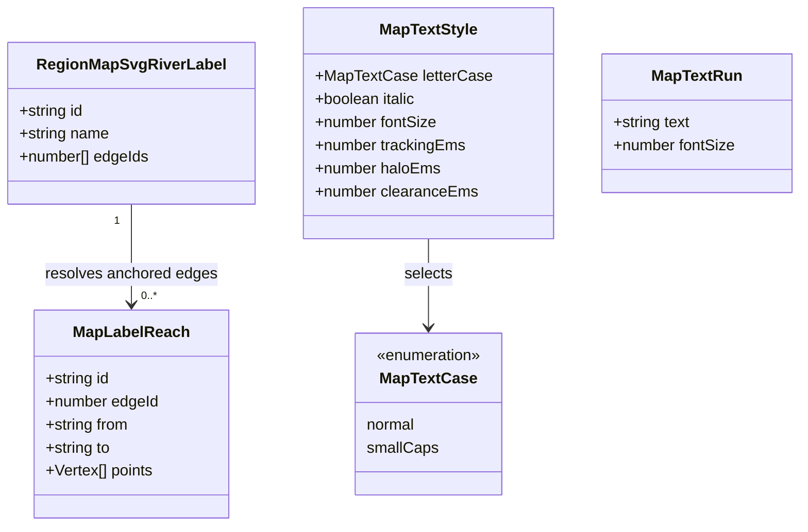
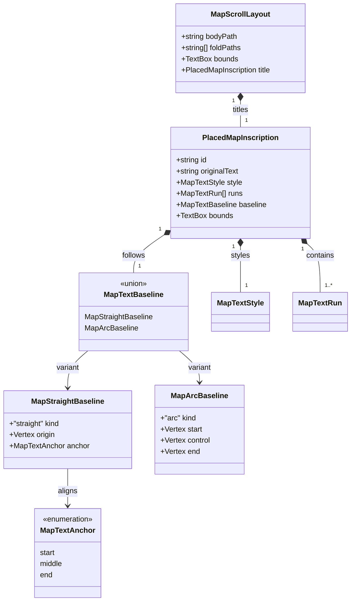

# Region map typography

**Status:** implemented — the human reviewer approved the model and visual direction on
2026-10-13 and supplied the visual refinements recorded below. `npm run verify:all` passed on
2026-10-13. The [revised comparisons](region-map-typography-418/README.md) await final human visual
review.

Tracked by [#418](https://github.com/ironarachne/ironarachne/issues/418). Extends
[Region Map Cartography](region-cartography.md),
[Region settlement icons](region-settlement-icons.md), and
[Region mountain ranges](region-mountain-ranges.md).

## Problem

The title sits on a rounded rectangle. All feature names are horizontal, including names for
elongated areas and mountain ranges. Landmarks use ordinary upright text, while settlement
importance is communicated only through label size and symbols. Labels already have parchment
halos and reserved bounds, but cramped placement still weakens the hierarchy and legibility.

The renderer currently reduces a feature's geography to one representative point. Its
settlement placer may accept the least overlapping candidate when every candidate is crowded.
Curved typography needs bounds for the whole curved inscription, and increased negative space
needs a placement rule that does not accept overlapping text as a successful result.

Named river route facts exist in the saved fact model, but `regionToMapSvg` does not pass them to
the renderer. The physical river network contains geometry and identities, not display names.
This change must use saved names and anchors rather than inventing names during rendering.

## Scope

Keep the work in the existing `map` library, with a small extension to the drawing inputs supplied
by `regions`. Add renderer-only typography records in `region_map_typography_types.ts` and
geometry, measurement, and serialization helpers in `region_map_typography.ts`. Integrate them
with `region_map_svg.ts`. No snapshot version, generation pass, new library, font download, or
dependency is needed. Saved names, geography, icon composition, and editor behavior stay the
source of truth.

The proposal defines the data and visual contract. Implementation work items will be broken out
after the human reviewer approves the model, as required by `AGENTS.md`.

## Decisions

### 1. A restrained scroll behind the title

Replace the rectangle with a parchment scroll: a broad central writing surface with a subtle
wave, small nicks and cuts on the long edges, and rolled ends projecting above and below the
writing surface. Fine fold lines and restrained shading give the rolls depth. Use the existing sepia
ink and parchment palette. Keep the title upright and centered, retaining the present title-size
hierarchy and long-title fitting behavior.

Compute the complete scroll footprint before placement, including both curls and the stroke.
Fit the writing surface to the measured title plus padding; never fit the text to a width that
includes the curls. All furniture and marker collision checks use the complete footprint.
Try the existing top positions and modest reductions. If no scroll fits, omit the title using
the current impossible-title behavior. Never clip a curl or place a settlement beneath it.

### 2. Typography identifies the kind of place

| Label                           | Treatment                                                |
| ------------------------------- | -------------------------------------------------------- |
| Region title                    | Upright serif, largest text, on the scroll               |
| Hamlet or village               | Upright serif, existing population-driven size           |
| Town, borough, city, metropolis | Small caps, existing population-driven size              |
| Capital of any category         | Small caps, existing capital size boost                  |
| Point landmark                  | Italic serif, initially 15% larger than its current size |
| Hazard                          | Upright serif, retain the existing size                  |
| Area, forest, mountain range    | One broad arc, restrained tracking                       |
| Named river route               | One broad arc following the river's local direction      |

“Major settlement” means town or larger in the existing six-category table. Resolve category
with the existing icon-category resolver, including its population fallback for direct callers.
Capital status comes from the existing saved-role logic. Small caps do not promote a settlement
or change its symbol.

Render small caps explicitly: uppercase source letters remain full height; lowercase source
letters become uppercase glyphs at approximately 80% height. Keep spaces, punctuation, accents,
and non-cased characters. Measure the actual transformed runs at their emitted sizes. Retain the
original name in accessible text and semantic metadata. Use the same runs in halo and ink passes. Preserve word spaces across size transitions with
nonbreaking display spaces and explicit word spacing; retain ordinary saved spaces in metadata.
Do not depend on an export renderer implementing `font-variant: small-caps`.

Use the existing Times New Roman/serif stack. Include italic overhang and tracking in conservative
measurements; italic and small caps must not escape their reserved bounds. Font metrics must be
safe for the existing fallback fonts and independent of browser canvas measurement.

### 3. A single shallow arc derived from saved geography

Represent each curved baseline as one quadratic Bézier segment. Do not lay letters along every
bend of a river or create an undulating baseline. Limit the bow to 15% of the chord length and
keep text upright, with the inscription reading left to right. Near-vertical candidates should
be tilted toward a readable diagonal or rejected, rather than producing upside-down text.

Use these geometric sources:

- **Mountain ranges:** their saved ordered spine, using a continuous local section long enough
  for the inscription.
- **Dense forests and general areas:** the largest connected anchored cell component. Its
  principal direction sets the chord; occupancy on either side chooses a gentle bow that stays
  within the area. Near-round areas use a shallow horizontal arc.
- **Rivers:** saved route edge IDs matched to the rendered river centerline samples. Join only
  physically connected reaches; choose the longest eligible continuous section, breaking ties
  by stable IDs. Do not bridge a confluence into an unrelated branch or span gaps in the anchor.

Forest landmarks receive the area treatment because they name an expanse rather than a point.
Other landmarks remain italic point labels. Only already-selected habitat-zone area names are
passed through; this change does not label every saved area or duplicate habitat facts.

Sample each candidate to check baseline length, direction, association with its geography, and
the full padded glyph envelope. Area inscriptions stay within their connected area. River
inscriptions sit beside their selected channel section, clear of channel ink; they may occupy
adjacent land. Range inscriptions stay associated with their selected spine section. Reject
candidates that cross unrelated water, leave the sheet, collide with reserved content, or are
too short for the measured inscription.

Use bounded candidates: at most three suitable geographic sections, two bow directions, and
three offset positions per label, with fixed sampling limits. Rank by geographic fit and
clearance, then stable IDs and candidate order. Do not use RNG. A missing, degenerate, or unusable
geometry falls back to a straight label near the feature using the same style and spacing rules.
If no readable position fits, omit the label; point symbols still require their visible label.

### 4. Pass named rivers as drawing inputs

Add optional `rivers?: RegionMapSvgRiverLabel[]` to `RegionMapSvgOptions`. Each record carries the
saved route ID, name, and anchored map-edge IDs. `regionToMapSvg` supplies nonblank `kind: 'river'`
route facts whose evidence is not stale. Authored facts without evidence remain eligible. Roads
are not included. No name is generated for an unnamed physical river.

Resolve geometry from the validated river network through its `drainageEdgeId` mapping. For
legacy maps without a network, reuse the visible river-path geometry rather than drawing a
separate approximation. An invalid or unrendered route cannot produce a floating river name.
Use stable route identity in escaped SVG metadata and baseline IDs. Existing callers may omit
the new option and receive no river labels.

### 5. Negative space belongs to placement and drawing

Initially increase the parchment halo from 0.12em to 0.34em for ordinary labels, and add a 0.20em
clearance outside the glyph-and-halo envelope. Use approximately 0.04em tracking for area and
river inscriptions and small caps; keep ordinary point labels at their natural spacing. These
values are initial visual tuning values, not an excuse to reduce text size until everything fits.

Use a conservative axis-aligned box enclosing the entire padded inscription as the shared
clearance primitive. For arcs, derive that box from conservative swept glyph bounds, including
ascenders, descenders, rotated corners, italic overhang, tracking, and halo stroke. Fixed sampling
must include a curvature error allowance so gaps between samples cannot escape the box.
Over-reservation is preferable to overlapping text.

Keep the current largest-settlement-first order, with capitals receiving priority when otherwise
tied. Title and markers remain hard obstacles. Settlement candidates must also clear previously
placed labels; remove the least-overlap acceptance. Try alternative nearby positions before
omitting an impossible label. Place ranges, areas, point features, and river labels after
settlements in deterministic order. The compass yields to the resulting reserved bounds.

Use those bounds for label collisions and water-hatching clearance. Forest, area, and mountain
range names overlay their terrain masses: their bounds must not remove terrain glyphs or canopy
artwork. A thicker parchment outline around the letters provides the negative space. Furniture
and point-marker footprints still reserve space in terrain fitting. Preserve the existing two-pass text paint order: every
halo before every ink copy. A label must never erase a neighboring label. The visible river and
road strokes remain intact; move an inscription instead of masking away its geographic subject.

The human reviewer refined the visual direction on 2026-10-13: preserve terrain beneath
geographic labels, strengthen text outlines, retain visible small-cap spaces, and use a waved,
nicked banner with projecting rolls. These refinements keep the approved drawing-data model.

## Domain model

These records are derived drawing data, never persisted. Existing `Vertex`, `TextBox`,
`RegionMapSvgSettlement`, and `RegionMapSvgFeature` records retain their current definitions.
`RegionMapSvgOptions` gains the optional river-label collection described above. The new
declarations belong in `region_map_typography_types.ts`; the public river drawing input belongs
in `region_map_svg_types.ts` and is exported through the map entry point.

`MapTextBaseline` is a TypeScript discriminated union. Run text is escaped only when serialized;
`originalText` preserves the saved spelling. A placed inscription exists only after its complete
bounds pass containment and collision checks. Serialization creates the shared baseline
definition and matched halo/ink markup from this single record; neither pass measures or places
text independently. The scroll's bounds include its title, curls, folds, and outline stroke.

## Validation and visual review

Render before/after Alpha, Bravo, and Charlie from identical saved inputs. Add controlled review
maps for a long title, crowded settlements, each settlement category, a village capital, a point
landmark, an elongated forest, a round area, a curved mountain range, and a named winding river
with a junction. Include an authored river route fixture if the reference seeds have no named
river routes. Do not regenerate geography to make a comparison look better.

Review the scroll, hierarchy, arc direction, negative space, and label retention at normal map
size and phone width, plus SVG export and the existing raster/PDF export paths. Confirm small
caps and curved halo/ink alignment in the browser and export renderer. The implementation uses
explicitly positioned and rotated graphemes along the quadratic baseline: librsvg omits
`textPath` labels in the initial export check. Halo and ink reuse identical glyph positions.
The current region PDF export contains prose rather than a map; it needs a regression check,
while map typography is verified in SVG, browser canvas rasterization, and librsvg output.

Unit checks must cover complete bounds, no label collisions or clipping, bounded failure on
degenerate geometry, missing and invalid anchors, connected river selection, escaping and unique
SVG IDs, capital/category styles, preservation of original names, and byte-identical output for
identical inputs. Geometry and tie-breaking checks should include reordered node, edge, and fact
arrays. Changes to a name may affect its placement and nearby label availability, but must not
alter geography or icon composition.

Run `npm run verify` during implementation and `npm run verify:all` before merging this rendering
change. Human approval of the rendered comparisons completes the visual contract; passing tests
alone cannot establish that the typography improves the maps.
