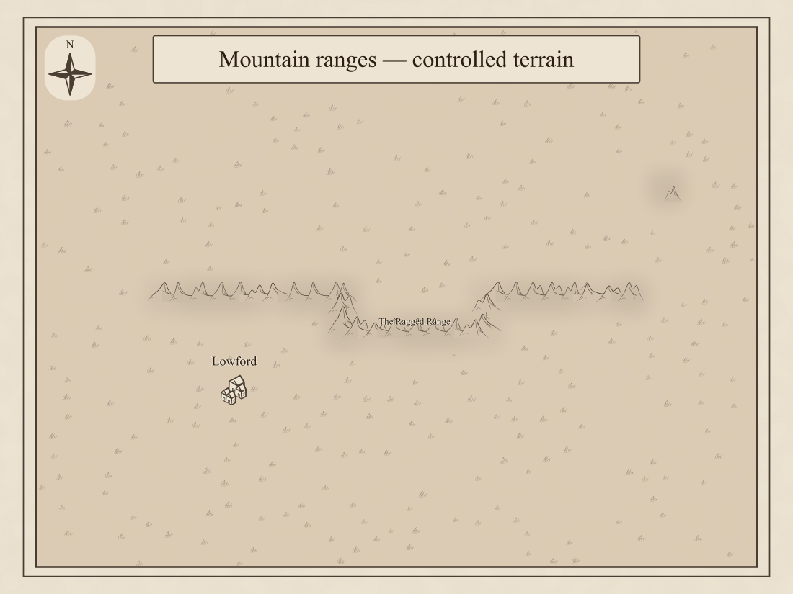
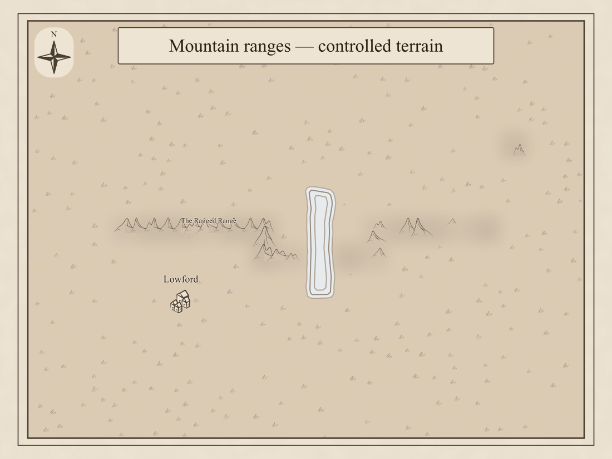
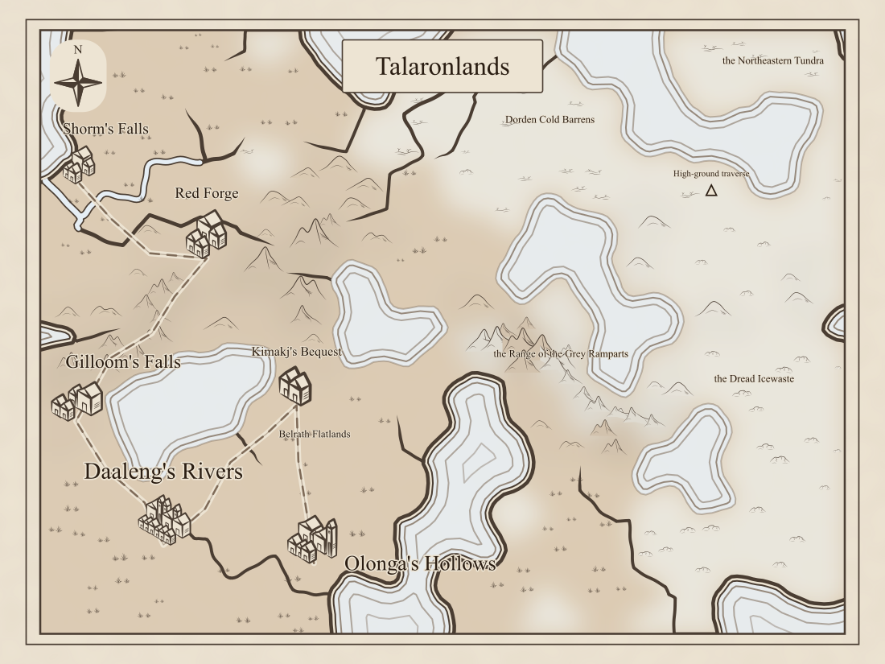
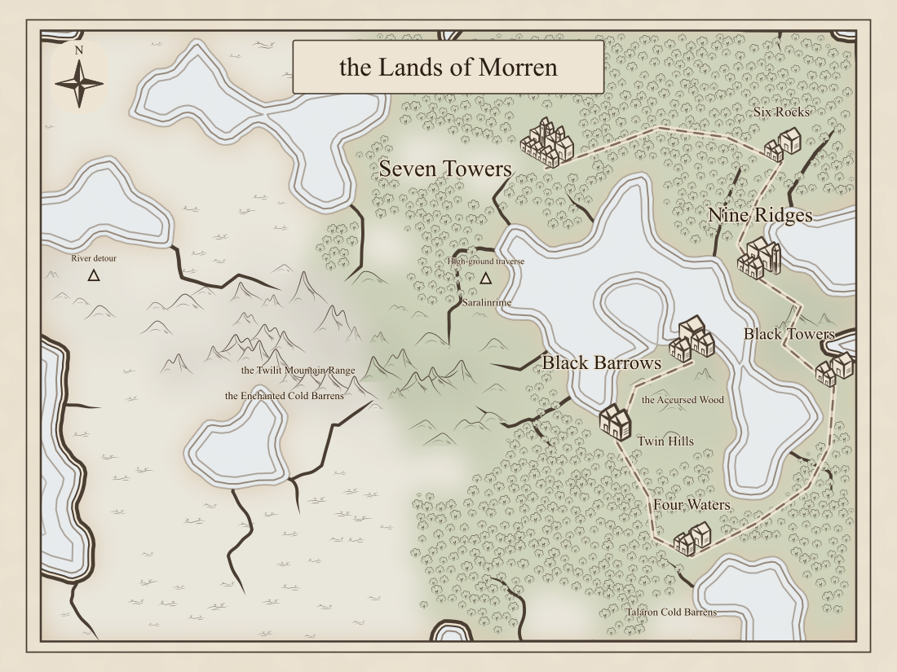
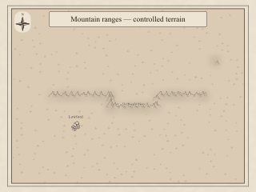

# Mountain-range visual review (#416)

The design, domain model, and sample renderings were approved on 2026-10-12.
The reviewer authorized the PR: “Yes, I approve. PR please.” These are SVGs from the implementation, rasterized for convenient
review. They use the actual map pipeline, vector mountain silhouettes, tapered saddle
strokes, biome fills, terrain fitting, water clearance, and saved labels.

## Controlled ridge

[Before](curved-before.svg) · [After](curved-after.svg) · [Straight ridge before](straight-before.svg) · [Straight ridge after](straight-after.svg).

The controlled graph has a bent mountain chain, mixed mountain/high-mountain relief,
one isolated peak to the northeast, and a settlement below the ridge. Connected range
artwork follows the saved spine; the isolated peak retains its individual silhouette.
The uniform cells make the bend deliberately angular so its relationship to geography
can be inspected. Randomly generated maps use irregular Voronoi cells.

## Lake interruption

[Before](lake-gap-before.svg) · [After](lake-gap-after.svg).

The lake removes mountain connectivity. The western segment still qualifies; the eastern
segment does not satisfy the ridge evidence rule and keeps individual peaks. No saddle
crosses the lake, and the renderer respects the processed shore rather than merely the
original cell boundary.

## Generated regions

Seed `mountain-range-9`: [Before](mountain-range-9-before.svg) · [After](mountain-range-9-after.svg) · [Saved sourcebook text](mountain-range-9.md).

The named range lies among the lakes east of the settlements. It has eleven placed range
peaks and eight connecting saddles. Water clearance can interrupt illustration without
changing the saved geographic range. Surrounding individual mountains remain visible.
The saved Landscape entry and overview reuse the map's name.

Seed `mountain-range-13`: [Before](mountain-range-13-before.svg) · [After](mountain-range-13-after.svg) · [Saved sourcebook text](mountain-range-13.md).

This range crosses the open mountain country west of the settlements and forests. Its
biome zones remain separate facts, with their own names and descriptions.

## Small-scale view

These are 320-pixel raster exports, rather than browser screenshots. Map inspection still
supports zooming and panning when a full map's small labels need magnification.

## Seed survey

The fixed seeds are `alpha`, `bravo`, `charlie`, and `mountain-range-1` through
`mountain-range-30`. All nine requested altitude/relief profile combinations are present.
Only seeds 9 and 13 meet all range eligibility requirements; ranges are not forced onto
other geography. [Survey data](survey.json) records requested profiles, realized metrics,
candidate memberships/spines and rejection reasons. Candidates shorter than five mountain
cells are excluded before spine extraction.

The fourteen candidates large enough for extraction include two accepted ranges, eight
rejected by ridge evidence, three with unsupported spine segments, and one with a spine
too short. Eligibility thresholds are unchanged from the approved design.

Reference maps are unchanged byte for byte when no range is detected:
[alpha before](alpha-before.svg) / [after](alpha-after.svg),
[bravo before](bravo-before.svg) / [after](bravo-after.svg), and
[charlie before](charlie-before.svg) / [after](charlie-after.svg).

## Rendering cost

Five warm-render medians on the same machine; these are local diagnostics, not benchmark
claims. Before/after reuse identical saved geography, settlement labels, and habitat facts.
The before view omits the saved range drawing input. Measurements taken under concurrent
test load initially exceeded the 25% investigation threshold, including an unchanged
reference map. Repeated measurements below did not reproduce those increases. The renderer
also reuses its node-ID lookup rather than rebuilding it for each neighborhood query.

| Input             | Range peaks / saddles | SVG bytes, before → after | Median ms, before → after |
| ----------------- | --------------------- | ------------------------- | ------------------------- |
| straight          | 26 / 25               | 151,577 → 176,362         | 27.7 → 25.1               |
| curved            | 29 / 28               | 147,958 → 179,064         | 22.8 → 19.3               |
| lake-gap          | 15 / 14               | 146,362 → 164,526         | 30.9 → 35.3               |
| alpha             | 0 / 0                 | 485,894 → 485,894         | 250.3 → 257.9             |
| bravo             | 0 / 0                 | 473,835 → 473,835         | 177.9 → 158.6             |
| charlie           | 0 / 0                 | 214,512 → 214,512         | 88.5 → 75.8               |
| mountain-range-9  | 11 / 8                | 251,832 → 260,929         | 77.7 → 78.0               |
| mountain-range-13 | 12 / 8                | 348,624 → 361,257         | 139.8 → 135.1             |

No repeated measurement exceeds 2x SVG size or 25% median time growth. Reproduce the
fixtures, seeds, SVGs, sourcebook text, survey and measurements with
`npx vite-node scripts/render_region_mountain_ranges.ts --out /tmp/region-mountain-ranges`.
Render PNGs with `rsvg-convert -w 1100 -o output.png input.svg`.

## Validation

`npm run verify` passed: zero type errors or warnings, formatting/lint, 7,095 unit tests,
and all 100 libraries above the coverage gate with no baselined debt. Nineteen focused
mountain-range tests passed after adding cap/ordering checks and refining the controlled
fixture's complete corner/edge topology. The dedicated browser test passed generation,
save/reopen, name and description edits, saved map-label reuse, and range removal.

The full browser run completed with 660 passes, five golden-image skips, and four
15-second timeouts while opening star/system preview controls. Region checks and all five
phone widths passed. The dedicated saved-range test also passed at 320 pixels. The four
preview tests all passed on an isolated one-worker rerun, together with the saved-range
test against a fresh build: five passes. The context-reuse test took about 90 seconds
and the system preview about 14 seconds, consistent with load-sensitive timeouts.
No preview source or timeout setting was changed.
