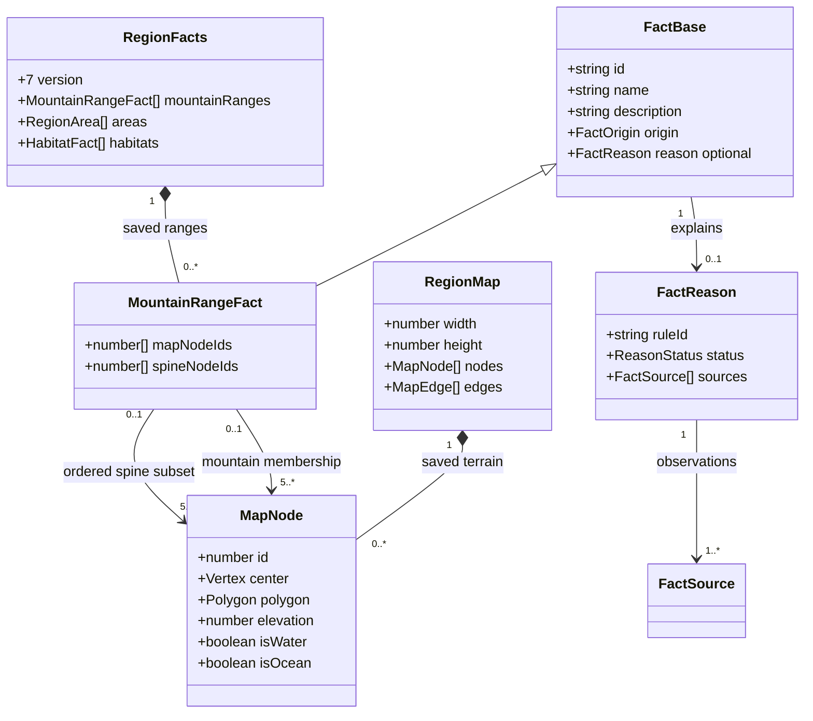
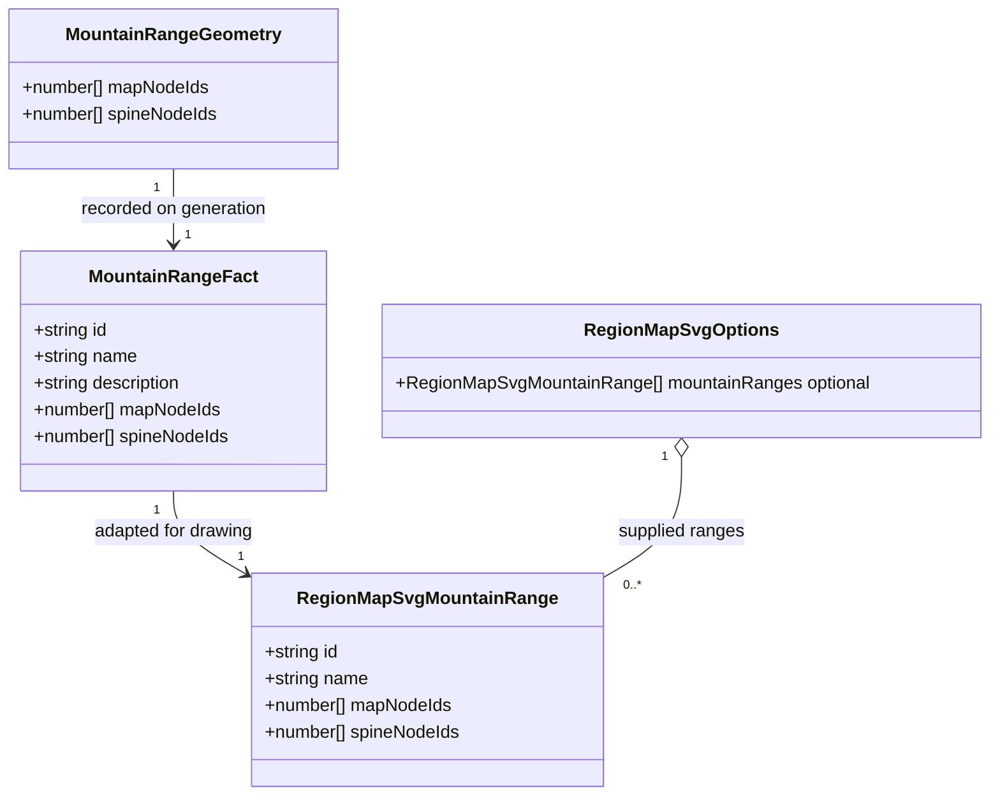

# Regional mountain ranges

**Status:** implemented — design, domain model, and sample renderings approved on 2026-10-12.

Tracked by [#416](https://github.com/ironarachne/ironarachne/issues/416). Extends
[region cartography](region-cartography.md),
[deterministic generation passes](region-generation-passes.md), and
[landscape names](region-landscape-names.md).

## Problem

Some regions should contain coherent mountain ranges, described in their landscape text
and illustrated differently from isolated mountains. Today, `buildRegionTerrain` already
sets `ElevationConfig.hasMountainRange` for mountainous profiles. `assignElevation` adds
a seeded, wavy raised spine before elevation constraints, water, and climate processing.
However, the finished map records only elevations: no range identity or ordered ridge
survives as a semantic feature. The renderer scatters individual mountain glyphs, and
landscape facts group cells by biome rather than mountain structure.

A requested mountainous profile is not evidence that the final graph contains a ridge.
Neither a solitary peak nor an arbitrary connected mountain mass should acquire a range
name simply because its cells are high. Text and illustration must share the same saved
geographic evidence.

## Solution and decisions

### 1. Recognize ranges in realized terrain

Retain the existing elevation generator and its profile-based spine policy. Add a pure
`detectMountainRanges(map): MountainRangeGeometry[]` function in `src/lib/map`, with types
in `mountain_range_types.ts`. It reads the completed physical graph without changing
elevations, water, biomes, corners, roads, or river drainage. It has no RNG parameter:
geographic eligibility and identity are deterministic calculations.

Use `classifyRegionLandforms` so prose and map agree about mountains. Eligible cells are
dry land classified as `mountain` or `highMountain`; hills and water cannot bridge gaps.
Build components from actual shared map edges, resolving nodes by ID rather than array
position. Ignore dangling edges and require adjacency to agree with the graph.

For each component, find a representative long spine using deterministic two-sweep
shortest-path traversal with center-to-center distance as the edge cost. Start at the
highest cell, breaking ties by node ID; sweep to the farthest reachable cell, then sweep
again and reconstruct that path. Equal distances and predecessor choices use node-ID
ordering. This is a bounded approximation of a graph diameter, not a claim to find the
longest simple path. Orient the result from the smaller endpoint ID.

Require all of the following before calling the component a range:

- At least five distinct spine cells, with consecutive cells sharing an edge.
- Spine length at least four times the component's median cell size, where cell size is
  the square root of its polygon area. Reject degenerate polygons and non-finite geometry.
- Length divided by effective width at least 2, with effective width defined as component
  polygon area divided by spine length. This rejects broad masses relative to their spine.
- Spine length no more than 1.8 times endpoint distance, rejecting paths whose repeated
  turns manufacture an apparent long ridge.
- At least two-thirds of interior spine cells have lower dry-land neighbors on both sides
  of the local spine tangent. Each side must offer a neighbor at least 0.1 elevation units
  lower. Side membership uses the signed cross product; collinear neighbors do not count.
  This provides local ridge evidence rather than interpreting an elongated plateau as a crest.
- Every center-to-center spine segment stays within the component's polygon union. Do not
  draw shortcuts through valleys, lakes, ocean, or missing cells.

These thresholds are explicit initial policy, not physical measurements in meters. Test
them on controlled fixtures and review their yield on generated maps before declaring the
implementation complete. Any substantive change to eligibility needs a recorded design
update. A coast can terminate a range, but missing dry-land flanks do not supply evidence.

Keep at most three qualifying components, ranked by spine length, then polygon area,
then minimum component node ID. Each component yields one main range; branches remain
ordinary mountains. There are no overlapping memberships, invented foothill corridors,
or forced ranges on unsuitable geography. Unselected components retain individual peaks.
The feature does not enforce mountain generation for every mountainous profile or model
tectonics, passes, barriers, navigability, mineral deposits, or settlement access.

### 2. Save a dedicated range fact

Add `MountainRangeFact[] mountainRanges` to `RegionFacts`. A range is not a biome zone,
notable-place slot, geological province, or route. It can cross biome boundaries and
overlap habitat zones without replacing them. The dedicated list avoids the four-zone
and four-notable caps and keeps ordered ridge membership distinct from unordered anchors.

Each fact extends `FactBase` with sorted `mapNodeIds` for its complete mountain component
and ordered `spineNodeIds` for its main ridge. Use `range:mountain:<minimum-node-id>` as
identity; names and presentation order never determine identity. Do not persist sampled
SVG points, orientation, lengths, widths, or glyph placements: derive these from the saved
graph and membership. No second copy of the range lives on `RegionMap`.

Use `fantasy:region:mountain-range:v1` reasons. Record elevation, water, and ocean
observations for all land cells used by classification and ridge tests, including the
regional median baseline and flank witnesses. Connectivity and geometry are validated
against the saved map; the current `FactSource` union need not gain a topology variant.
Add ranges to semantic fact enumeration, identity checking, dependency traversal, and
review presentation rather than leaving a list invisible to shared fact handling.

### 3. Isolate naming and prose

Add a `mountain-ranges` stage after habitat naming and before ecology/resource generation.
The detector uses no random draws; range names and descriptions use this stage's caller-owned
RNG. Keep habitat naming unchanged and reserve existing area names and earlier range names
in the range batch context. Later region-wide naming also reserves range names.

Reuse `generateLandscapeName` with zone scope and compatible mountain vocabulary. Add
`Range` and `Mountain Range` to explicitly eligible zone templates where needed; do not
fall back to forest, grassland, or flatland nouns. Reconstruct supplied cultural generators
from pattern sources on this stage, following `generateLandscapeNames`; never advance
the original live cultural generators. Compass adjectives retain the existing two-thirds
footprint rule. Names are toponyms, not evidence of owners or historical events.

Compose and save descriptions through `$lib/narrative`. A description states that linked
mountain ridges form a range, with supported location and predominantly high-mountain
relief as optional distinguishing facts. High relief wording requires at least two-thirds
of range cells to be classified `highMountain`. Do not infer snow, glaciers, impassable
terrain, caves, resources, or physical elevation units. Store final wording once.

Present the named ranges in Landscape alongside connected zones, retaining the unheaded
regional-land introduction and biome summaries. The overview may select a range as its
representative terrain fact instead of repeating a generic mountain sentence. Detail
entries remain available even when the overview omits them. The page, Markdown, standalone
PDF, and project publication reuse stored names and descriptions.

### 4. Illustrate a connected ridge

Add an optional `mountainRanges: RegionMapSvgMountainRange[]` drawing input to
`RegionMapSvgOptions`. `regionToMapSvg` adapts the saved facts into it; the renderer never
detects or names ranges on load. The standalone CLI must use the same region adapter when
rendering a complete saved/generated region. A bare graph without range options retains
its current individual mountain rendering.

Use an ordered chain of overlapping mountain silhouettes along the saved spine, with
joined saddle strokes and sparse flank hatching. The shared saddles make a visible ridge
instead of merely placing existing isolated symbols closer together. Preserve the
existing parchment fills, tapered vector ink, heavy structural outlines, and lighter
details. Use existing mountain/high-mountain silhouettes where appropriate; new saddle
and flank geometry belongs to `map`. Avoid a uniform stroked polyline, a road-like dashed
line, raster artwork, or strokes drawn across unrelated ground. Peaks remain upright in
the map's pictorial convention; the ground anchors follow the spine.

Fit the chain to the union of saved range cells, permitting transitions between mountain
and high-mountain cells. Respect existing water and river clearance and furniture and
marker reservations. Split visible artwork where clearance requires a gap; never bridge
the gap with a saddle. Segment identity refers to the original spine position so omitting
one part does not shift styling downstream. If a segment cannot fit at readable size,
omit it rather than projecting outside the range.

Place ranges before scattered terrain using the shared spacing index. Suppress ordinary
mountain candidates only where accepted range artwork reserves space; component side
peaks and unrenderable portions retain individual mountains. Preserve the original scatter
candidate streams and indexes. Range styling uses separate renderer seeds keyed by fact
ID and spine position. Existing relief precedence still applies to wooded mountains.
Paint range silhouettes and scattered terrain together in ground-anchor order, with
adjacent saddle geometry assigned to its corresponding placement, so foreground terrain
occludes backgrounds consistently. Rivers, roads, settlements, and labels retain their
existing layer policy.

Label each range from its saved name using the existing regional-feature collision and
halo conventions. Prefer a straight label near the ridge; omit it when no readable
placement fits. Use one label candidate per range and deterministic priority by spine
length and ID. A name must not require text following a curved path to be legible on
phone widths. The prose always retains names omitted from crowded maps. SVG and existing
image/PDF export use the same renderer.

### 5. Preserve saved and edited work

Increment `RegionFacts.version` from 6 to 7 and `REGION_PAYLOAD_VERSION` from 11 to 12.
Migrate previous payloads through the existing migrations and then add an empty
`mountainRanges` list. Never detect new ranges, generate names, or rewrite descriptions
when reading an older region. Its graph and existing individual peaks remain authoritative.
An empty list is valid for both migrated and freshly generated regions.

Validate nonempty unique range IDs, distinct dry-land mountain memberships, a simple
spine contained in membership, valid shared edges, finite contained segments, and disjoint
range components. Validate generated eligibility using the saved graph and rule version;
authored text does not waive structural geographic invariants. Reject malformed new payloads
rather than silently redetecting or dropping ranges. Avoid enforcing today's top-three
selection against saved authored work: the cap is a generation policy.

Support range name and description edits through the existing semantic fact text-edit
contract: mark text authored, preserve geometry and identity, stale dependent explanations,
and reuse edited names on the map and in exports. Removing a range follows existing
authored-dependent protection and generated-dependent removal rules. With its fact gone,
the renderer returns those cells to individual mountains. Geometry remains read-only;
different geography requires the existing whole-region reroll. No partial-regeneration
button, new route, catalog entry, dependency, or library is needed.

## Domain model

New persisted types belong in `src/lib/regions/region_mountain_range_types.ts`; new
geographic and drawing types belong in `src/lib/map/mountain_range_types.ts` and
`region_map_svg_types.ts`. Cross-library imports use public entry points. `FactBase`,
`FactReason`, `FactSource`, and `RegionMap` already exist; the diagram shows their relevant
relationships without redefining their complete models.

`MountainRangeFact = FactBase & { mapNodeIds: number[]; spineNodeIds: number[] }`.
The two associations are references by ID to the same graph, not embedded node copies.
Overlaps with habitat areas are permitted; overlaps between range memberships are not.
Five is the initial minimum accepted spine size. `reason` remains optional for authored
facts under the existing contract; generated ranges always supply it.

`MountainRangeGeometry` is transient detector output. Drawing inputs omit descriptions
and reasons. Length, width, flank witnesses, drawing bounds, and sampled saddle geometry
are derived computations rather than new persistent records.

## Determinism assessment

The inspected path is `rollRegion` → `generate` → `buildRegionTerrain` → `assignElevation`,
then existing habitat/naming passes and `regionToMapSvg` → `buildRegionMapSvgString`.
The physical pass already owns a named RNG boundary, elevation noise is keyed by seed,
and landscape naming accepts the caller's RNG and reconstructs cultural pattern sources.
The renderer owns deterministic candidate and styling streams separate from generation.

Detection adds no random source. The new named stage derives from the existing
`region-passes-v1` root token without taking a draw from sibling stages. Sort all graph
traversals, ties, output memberships, and naming batches explicitly. Do not use clock seeds,
module counters, live culture generators, or asynchronous completion order. Extra range
wording draws must leave range membership and unrelated generated facts unchanged.
Presentation and the later region name may change deliberately when offered range facts.

This is a design assessment of existing boundaries, not a completed audit or a claim that
the proposed implementation has passed tests. Full snapshot and SVG comparisons will
verify the complete new path after model approval.

## Validation and review criteria

- Controlled terrain fixtures: straight and curved ridges, mixed mountain heights, isolated
  peaks, disconnected peaks, broad masses, elongated plateaus, branches, water gaps,
  coastal terminations, narrow cells, invalid graph references, and degenerate polygons.
  Verify the explicit eligibility thresholds, disjoint membership, ordered adjacency,
  segment containment, cap ranking, stable identity, and input immutability.
- Graph-array and neighbor-order permutations must produce identical detection and saved
  facts. Repeat full generation with the same seed and equivalent cultural inputs, including
  advanced original culture generators. Compare differing seeds and inject extra draws in
  range naming/prose to demonstrate isolation from geography and sibling generation stages.
- Test payload 11 → 12 and earlier migrations, round trips, empty ranges, malformed facts,
  provenance, text edits, staleness propagation, removal protection, and saved authored
  wording. Historical graph/prose must remain unchanged and receive no inferred ranges.
- Verify shared names and membership across Landscape, overview, map, Markdown, standalone
  PDF, and project publication. Ensure range descriptions cannot invent unsupported claims.
- Inspect ridge artwork enlarged and at ordinary output size, plus isolated peaks beside
  ranges. Review straight, curved, partially obstructed, mixed-height, and coast-adjacent
  ridges. Check painter order, no double mountain layer, visible saddles, water/river
  clearance, marker/furniture exclusions, label collisions, and repeatable SVG bytes.
- Render `alpha`, `bravo`, and `charlie` before/after maps and a documented fixed seed set
  spanning all terrain profiles. Record accepted/rejected component counts and reasons;
  include controlled fixtures so random samples cannot hide missing ridge coverage. Review
  at full size and phone widths and inspect SVG and PDF/image exports. Record SVG bytes,
  placed marks, and warm median render times; investigate more than 2x size or 25% time growth.
- Run `npm run verify` for implementation and `npm run verify:all` before merging this
  rendering change. For the proposal, check Markdown formatting and review the domain model.

## Approval record

The human reviewer approved the design and domain model on 2026-10-12: “The design
looks good. I also want to see sample renderings before turning this into a PR.”
The reviewer approved the sample artwork and full-map renderings on 2026-10-12:
“Yes, I approve. PR please.”

## Approved implementation work items

1. Implement deterministic ridge detection and geographic validation.
2. Add saved range facts, isolated naming/prose, migration, editing, and exports.
3. Render connected vector ridges and labels through the region map pipeline.
4. Test generation, persistence, rendering, and determinism; prepare sample comparisons.
5. Present the samples for approval before opening a PR.

## Implementation record

The approved eligibility thresholds, saved fact model, isolated generation stage, shared
naming/narrative composition, payload migration, text editing, and connected vector
rendering are implemented. The detector also exposes candidate geometry for the review
script's rejection diagnostics. Renderer-local placements extend `PlacedTerrainGlyph`
with a range ID, stable spine position, and optional derived saddle body/ink/bounds;
none of this drawing data is saved.

[Sample artwork, full-map comparisons, seed survey, and verification](region-mountain-ranges-416/README.md)
were approved by the human reviewer on 2026-10-12. Previous regions migrate with an empty range list,
and the reference seeds without detected ranges retain byte-identical map output.
The implementation is on `codex/416-mountain-ranges`, approved for a PR against `main`.
