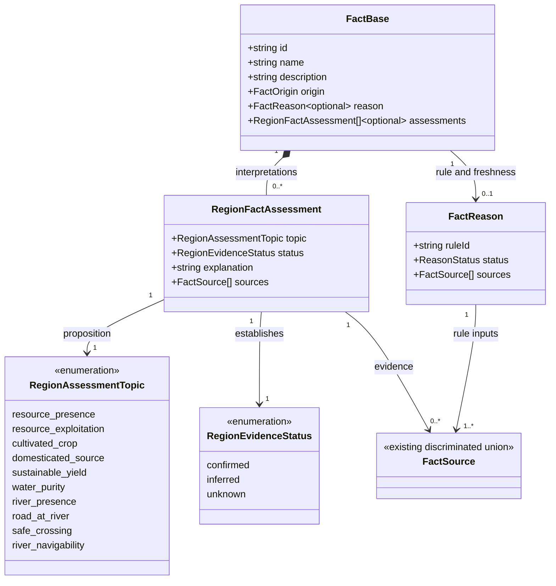
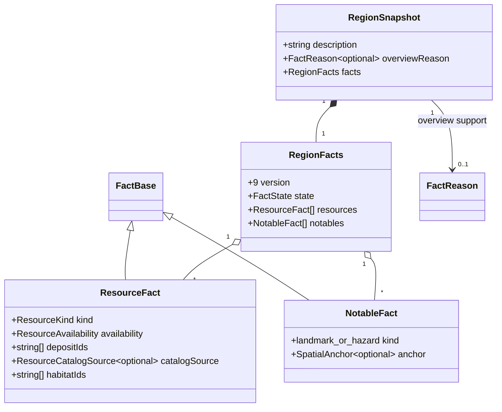

# Regional evidence and gazetteer prose

**Status:** implemented — domain model approved by Ben on 2026-10-13.

Issue: [#421](https://github.com/ironarachne/ironarachne/issues/421).

## Problem

Region descriptions mix world information with statements about what the generator cannot
establish. `region_resources.ts` saves qualifications such as “no cultivated crop, domestication
or sustainable yield is implied” in `ResourceFact.description`. `region_notables.ts` copies
resource descriptions into landmarks and adds crossing disclaimers to river hazards.
`region_overview.ts` then copies these descriptions into the introduction. Removing words at the
last renderer would hide the symptom without settling which assertions are justified.

The river rule also labels an edge without a mapped road “River detour”. An absent connection is
not evidence that travelers must detour, that a crossing is unsafe, or that the river is impassable.
Likewise, supported spruce trees establish a possible timber source, not a logging industry.

Existing facts already retain rule IDs, observed map/environment values, supporting fact IDs,
resource availability, deposit properties and processing inputs. These structures should remain
the source of evidence. The missing piece is an explicit interpretation of what that evidence
establishes, separate from readable prose.

## Decisions

1. **Keep evidence, interpretation and prose distinct.** Add optional `assessments` to `FactBase`.
   Each assessment identifies a specific positive proposition, its evidence status, its supporting
   `FactSource` records and a technical explanation. Existing `reason` retains the generating rule
   and current/stale status. `description` remains stored narrative, not a diagnostic channel.
   Assessments explain existing domain data; they do not replace availability, extraction,
   processing requirements or supply statuses.
2. **Use three evidence statuses.** `confirmed` means explicitly established in this generated
   world, not verified in the real world. `inferred` means a rule supports a possibility or
   qualitative consequence. `unknown` means the proposition is not established. Unknown is not
   false. For example, road value zero or an absent road property leaves `road-at-river` unknown;
   the source and explanation can record that no road was mapped. Evidence freshness is separate:
   an assessment cannot support prose when its parent or required supporting evidence is stale.
3. **Use a bounded topic vocabulary.** Initially assess resource presence/use and river travel,
   the two problematic rule families. Do not invent universal confidence scores or duplicate every
   ecological and economic field. Audit all regional prose producers and consumers for diagnostic
   leakage, but use their existing domain-specific statuses where those already express the
   distinction. Add topics only with a defined proposition, evidence rule and safe wording policy.
4. **Choose eligible meanings before wording.** Resource and river adapters build transient
   `$lib/narrative` candidates from current structured facts and assessments. Never extract a
   claim by stripping a disclaimer from a description. Confirmed candidates state only the
   confirmed proposition; inferred candidates use compatible possibility wording. Unknown
   propositions supply no candidate. Names and hooks follow the same rules as sentences.
5. **Store safe prose once.** Generation saves composed descriptions and the overview. The overview
   selects safe meanings rather than concatenating arbitrary generated resource/hazard descriptions.
   Resource landmarks reuse eligible resource meanings, not their technical explanations. Display,
   Markdown, PDF and project publication reuse stored prose without RNG draws or composition.
6. **Record overview support.** Add optional `overviewReason` to `Region` and `RegionSnapshot`,
   using the existing `FactReason` type and fact references for the selected meanings. Generated
   overviews use a versioned rule ID. Editing the region description clears `overviewReason`,
   making the edited description authored for this purpose. Dependency invalidation marks the
   overview reason stale when a selected supporting fact changes; unrelated changes do not.
7. **Separate reading from inspection.** Reading output includes safe, current generated prose and
   authored text. For newly assessed generated facts, unsupported or stale entries are omitted,
   including stale generated overviews. Do not append “[Supporting explanation needs review.]” or
   include a “Facts needing review” section in gazetteers. Put those messages in an expandable
   inspection section alongside assessment topics, statuses, explanations, rule IDs and raw sources.
   Keep the existing raw artifact export as the technical export; it must round-trip all assessments
   and overview provenance. The same reading policy must reach both `regionToDocument` and the UI
   adapter, which currently reconstructs bodies from raw fact descriptions.
8. **Preserve saved and authored work.** Bump facts version 8 to 9 and region payload version 13
   to 14. Migration changes version markers only and leaves new optional properties absent. Do not
   infer assessments, reroll, rewrite saved descriptions or treat old caveats as evidence. Legacy
   prose remains verbatim until the user explicitly regenerates; inspection identifies it as
   unassessed. Authored descriptions bypass generation and automatic omission. Editing a fact's
   description retains its evidence for inspection but changes its origin to authored under the
   existing editing contract. This preserves intentional blanks too.
9. **Keep evidence decisions deterministic.** Assessment construction uses stable source/topic
   ordering and no randomness. Narrative selection uses the caller-owned stage RNG and explicit
   composer context. New wording can change output for a historical seed; repeated generation with
   the same version, seed and facts must agree. Wording draws must not change maps, resources,
   deposits, settlements or other non-prose facts.

The no-disclaimer acceptance criterion applies to newly generated narrative and reading chrome.
Old saved or authored text may contain those words by design; silently rewriting it would violate
the accepted [prose contract](narrative-prose.md). This compatibility boundary is part of the
proposal to approve, rather than an implicit migration exception.

## Domain model

New persisted types belong in `src/lib/regions/region_assessment_types.ts`. Existing facts inherit
the optional array through `FactBase`. `FactSource`, `FactReason`, `FactOrigin` and all resource
fields retain their existing definitions.

Topic literals use kebab case (`'resource-presence'`, `'road-at-river'`, etc.); underscores in the
diagram only make enumeration members readable. Each topic occurs at most once per fact.
Confirmed and inferred assessments require at least one source. Unknown assessments may have no
sources when the needed evidence is absent, but must still explain the gap. Explanations are
nonempty technical text and never a narrative template. Current fact references must resolve in
the same snapshot; stale references follow the existing retention rules. Cyclic, missing or stale
support is ineligible for narrative, even when an assessment says `confirmed`.

This second diagram shows changed relationships and relevant existing fields, not the entire
region schema. `Region` receives the same optional `overviewReason` as its snapshot. No parallel
claim store, new library or new persisted narrative-selection type is introduced. Adapters reuse
the existing transient `NarrativeSubject`, `NarrativeCandidate` and `NarrativeResult` types.

## Safe wording rules

| Evidence                                                 | Interpretation                                               | Eligible narrative                                                          | Omit                                                              |
| -------------------------------------------------------- | ------------------------------------------------------------ | --------------------------------------------------------------------------- | ----------------------------------------------------------------- |
| Current spruce inhabitant and compatible catalog product | Trees confirmed; timber source inferred                      | “Spruce grows in these woods” or “The spruce woodland could provide timber” | Logging, sawmills, timber trade or sustainable output             |
| Current workable mineral deposit                         | Deposit confirmed; extraction requirement already structured | “Iron deposits lie beneath these hills” with grounded location              | Operating mines, equipment, profitability or a mining community   |
| Current fauna with a catalog product                     | Animal presence confirmed; obtaining material inferred       | Presence of the animal, or a potential source where distinctive             | Domestication, herds, reliable meat supply or established hunting |
| Suitable soil and terrain                                | Cultivation suitability inferred                             | “This ground could support cultivation”                                     | Fields, harvested crops or a farming industry                     |
| River edge, road absent or zero                          | River confirmed; crossing and navigation unknown             | “A river runs through this country”                                         | Detour, impassability, dangerous crossing or navigability         |
| River edge with a mapped road                            | River and road meeting confirmed; crossing safety unknown    | “The road meets the river here”                                             | A bridge, ford, ferry or safe passage                             |
| River/lake freshwater source                             | Source supported; purity unknown                             | A freshwater source, with no claim of drinkability                          | Safe drinking water or guaranteed supply                          |
| Missing/unknown resource assessment                      | Presence unestablished                                       | No resource sentence                                                        | “There is no timber/ore/food here”                                |
| Supported processing or daily-life fact                  | Existing rule establishes its own limited claim              | Its supported local use or possibility                                      | Promotion into regional commercial scale                          |

Use actual saved names and grounded positions in composed wording. Examples illustrate meanings,
not mandatory templates. Road endpoints elsewhere still support a connection sentence; that does
not prove a particular crossing structure or safety. Rename the generated “River detour” and
“River crossing obstacle” to neutral river/road-meeting features unless separate evidence supports
a hazard. A river alone does not qualify for the hazard slot. Scout/survey hooks may invite an
investigation without asserting that an unknown danger or resource industry exists.

## Pipeline audit boundary

Review resources, deposits, resource landmarks, river notables, overview site clauses, settlement
roles, ecology summaries, supply, processing and daily-life prose for claims that exceed their
evidence. In particular, site suitability must not become actual farming or coastal trade without
support. Check both direct UI descriptions and document/UI presentation adapters, explanatory
popovers, Markdown, text/PDF and project publication. Technical catalog/rule descriptions can
retain qualifications when they are not presented as gazetteer narrative.

Keep useful natural uncertainty in narrative (“could provide timber”) distinct from validation
disclaimers (“no industry is implied”). Do not solve the issue with a blacklist, regular-expression
cleanup or a generic replacement of “unknown” words. The domain rule must justify each candidate.

## Verification

- Resource availability without exploitation produces safe prose; supporting local-use facts do
  not imply industrial scale. Cover timber, species products, mineral deposits and suitable soil.
- Absent, zero and positive road values on river edges never invent impassability, crossing
  structures, navigability or safety. River presence alone produces no hazard claim.
- Unknown, missing, stale, cyclic and unresolved evidence supplies no newly generated assertion.
  Verify dependent landmarks and overviews, not just direct resource descriptions.
- Reading UI and exports contain no generated field names, technical qualifications or review
  disclaimers. Technical inspection and raw artifact export preserve all sources and explanations.
- Old snapshots migrate without text changes or inferred assessments. Authored edits and blank
  text survive reopening and exports; overview edits clear generated provenance.
- Repeated seeds/facts produce identical assessments and prose. Extra wording draws leave
  non-prose facts unchanged. Reading, inspection and export consume no RNG.
- Validation rejects invalid statuses/topics, duplicate topics and invalid source references.
  Editing invalidates affected support without mutating saved prose or unrelated facts.
- Run focused library tests while implementing, then `npm run verify`. Run `npm run verify:all`
  before merging the rendering changes, including mobile inspection controls and export parity.

## Approval boundary

Ben approved the optional per-fact assessment model, overview provenance, safe wording policy, and
preservation of old saved/authored prose on 2026-10-13 before implementation began, as required by
`AGENTS.md`.
