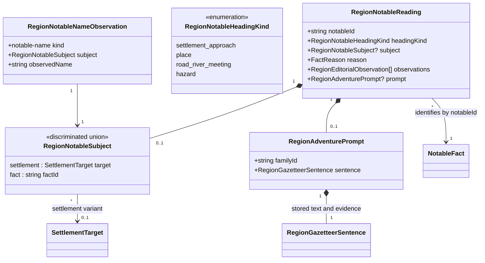
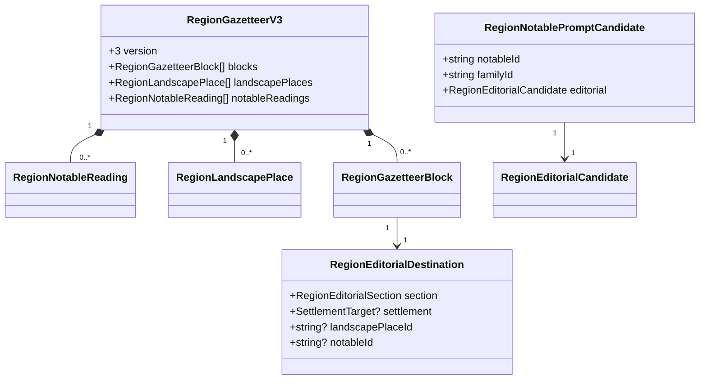

# Identifiable notable places and grounded adventure prompts

**Status:** implemented — policy and domain model approved by Ben on 2026-10-31.

Issue: [#447](https://github.com/ironarachne/ironarachne/issues/447). Builds on the implemented
[#445 editorial policy](region-gazetteer-salience.md),
[#446 landscape ownership](region-landscape-hierarchy.md),
[narrative contract](narrative-prose.md), and
[evidence contract](region-narrative-evidence.md).

## Problem and current behavior

The reported historical seed `5wyedz5q272fz`, at `1ffabf08`, connects a notable settlement approach
to Cilaamir through its saved site-role fact, but presents a generic role name. Its forest name
receives a cumbersome landmark prefix. Ordinary banks and forest density receive hooks without
establishing why a GM should use them.

`region_notables.ts` currently selects up to one candidate from each of four groups, including
ordinary habitat study sites and river banks. It appends survey, escort and provisioning hooks to
descriptions before comparing their usefulness. The legacy UI constructs category-prefixed
headings independently of text exports. Current gazetteers instead use saved editorial blocks;
their hazard adapter strips the hook marker, and #446 already gives promoted forests a single
named owner. Fixing only the legacy headings would miss current generation and export behavior.

The existing `test_fixtures/region_445_belvorn.json.gz`, documented by its companion Markdown as
default generation at `1ffabf08` (payload version 14), confirms the reported identity chain:
`landmark:settlement-approach:17:role:site:settlement:8` cites `role:site:settlement:8`, which targets
`settlement:8`, Cilaamir. The notable and role share node 17 and edge 35. These are fixture
observations, not generation rules or hardcoded identities. Current generation from the same seed
is a separate fixture.

## Decisions

### Resolve identity through relationships

Use one pure identity resolver for the page, Markdown, PDF and plain-text reading documents.
Resolve a settlement approach only through its recognized versioned generation rule, its single
current site-role source, and that role's `SettlementTarget`. An embedded target resolves by
settlement ID. Never choose the nearest settlement, match a name, parse an ID to recover a name,
or interpret arbitrary prose as a relationship.

The historical approach should read **Approach to Cilaamir**, with a location label such as
**Location: [saved compass location]; approach to Cilaamir**. The compass value must come from
the actual anchor, not this example. Use the notable's approach anchor, not the settlement's
center or an assumed river crossing. The reading entry retains the notable ID and links to the
settlement's stable identity in the UI. Renaming Cilaamir changes the identity label without
changing those links or rewriting saved prose.

An artifact settlement target resolves only through explicit caller-supplied resolved-reference
context, shared by display and export. A snapshot-only export without that context uses a neutral
“Settlement approach” label. Resolution must never fetch the vault implicitly or fall back to an
unrelated embedded settlement. Missing, ambiguous, cyclic or stale relationship support provides
no named settlement claim. Retain the original records and review information in inspection.

For geographic places, reuse #446's registry, primary owner and alias IDs. **Unquiet Forest** is
the heading once; Landscape retains its directory reference. This issue creates no second forest
registry. Other generated headings use a meaningful category or the saved proper name:
**Road–river meeting**, **High-ground traverse**, or a resource-specific place name when supported.
A road/river intersection establishes neither a crossing nor a bridge. Drop “The Landmark of”
and “The Hazard of” wrappers. Equal visible names remain distinguishable through stable anchors
and supported location labels, rather than invented ordinal place names.

Identity labels and compact location labels are structured presentation, not new narrative
composition. Reuse #446's footprint observations and extent wording for geographic features;
use the actual point/edge anchor for approaches and road meetings. Omit an unsupported location
label instead of guessing. A bare node or edge ID is not a useful reading label. Location labels
must not smuggle an extra narrative sentence past editorial budgets.

Authored names, descriptions, hooks and deliberate blanks override generated presentation.
Do not turn an authored name into “Approach to …” or normalize its case. Missing evidence may
require review but does not authorize altering authored text.

### Select worthwhile notables before writing hooks

Replace compulsory group filling for newly generated notables with a complete eligible candidate
pool and #445's defining/distinctive/supporting comparison. Keep a maximum of four newly generated
notable facts, with no minimum. Stable IDs canonicalize tie draws; they do not rank significance.
Source facts and map geometry are unchanged. Preserve authored notables outside this generated cap.

| Candidate                | Eligibility for a generated reading entry                                                                                                                              |
| ------------------------ | ---------------------------------------------------------------------------------------------------------------------------------------------------------------------- |
| Named geographic place   | Discoverable under #446 even without a paragraph or prompt; ordinary density alone earns no adventure prompt.                                                          |
| Settlement approach      | A current site role plus a supported consequential access relationship or local constraint. A role name or settlement existence alone earns no generated notable.      |
| Road–river meeting       | A saved incident road/river relationship with an actual route-planning consequence; ordinary banks without a road or other supported consequence remain in inspection. |
| Resource reach           | A located usable source plus a distinguishing access requirement, limitation or recorded hazard; ordinary resource presence is insufficient.                           |
| Terrain/climate obstacle | Current evidence supports the stated travel constraint; compare its local consequence with other hazards rather than filling a climate slot.                           |
| Ecological hazard        | A current explicit hazard relationship affecting a located activity/use; fantastical presence alone establishes no danger.                                             |

“Consequence” must be expressible from saved evidence under an explicit domain rule. For example,
an incident road and river permit uncertainty about planning a passage, not a claim that a flood
destroyed one. A forest name, numerical threshold, or rare material is not by itself a consequence.
Apply the same eligibility rules when adapting older facts into a newly requested editorial plan.
Do not delete old notables or silently reselect them when opening an artifact.

### Suggestions are a separate kind of output

A prompt is an optional **Suggested adventure**, separate from the established place description.
It is not an event, history claim, ecology relationship, settlement activity or world fact.
Persist its exact text, selected template and supporting evidence separately; never append new
`Hook:` strings to newly generated notable descriptions.

A candidate prompt requires all three of:

1. A specific resolved place or unambiguously located feature.
2. A recorded constraint, danger, requirement or motive that gives a choice practical weight.
3. A player action and decision/outcome framed as something the GM could run, without inventing
   a sponsor, resident need, completed event or world relationship.

Each prompt rule declares required sources, permitted implications and wording alternatives.
Select meanings before wording using #445's priorities and explicit repetition context. Survey
and escort are eligible only when the supported decision makes them useful; they are not default
fallback tasks. A prompt pool with no eligible meaning produces no prompt.

Examples below are conditional rule specimens, **not claims about Belvorn**:

| Recorded support                                                                | Eligible suggested situation                                                                                                         | Claims the rule must never introduce                                                                |
| ------------------------------------------------------------------------------- | ------------------------------------------------------------------------------------------------------------------------------------ | --------------------------------------------------------------------------------------------------- |
| Named settlement approach and an incident road–river meeting at its anchor      | “Before taking travelers toward [settlement], assess passage at this road–river meeting and decide whether to proceed or turn back.” | Existing bridge, ford, flood, stranded travelers or a commissioned escort.                          |
| Located harvest source and explicit dangerous-inhabitant gathering relationship | “Attempt a gathering trip at [place], deciding whether to risk the recorded [inhabitant] danger or abandon the harvest.”             | An attack already occurred, monster hostility inferred from presence, or villagers hired the party. |
| Located source opportunity with a recorded equipment/access requirement         | “Plan an expedition to [source] and decide whether meeting its [requirement] is worth attempting collection.”                        | A working mine, an owner, mineral trade, or a buyer offering payment.                               |
| Current freezing-exposure constraint on a located route/approach                | “Plan passage through [place] during [recorded cold season], choosing whether to prepare for exposure or postpone the journey.”      | A blizzard, missing caravan, available shelter or a guaranteed safe alternative.                    |

Names and requirements in brackets stand for validated inputs, never free-form invented details.
If the requirement cannot be expressed concretely from saved data, omit that rule. Outcomes are
open player decisions; do not promise rewards, successful harvesting or avoidance of all danger.
Do not add generic “explore the forest” when a named forest has no other relevant evidence.

This design introduces no generated patrons, ruins, conflicts, historical events or new semantic
connections. Such additions require a separate approved fact-generation model. A tempting
sentence cannot substitute for one. Authored adventure hooks retain their original wording and
remain visibly authored rather than acquiring generated provenance.

### Budgets, ownership and determinism

Keep #445's 24-sentence whole-entry cap and priority ordering. At most two generated prompts occur
in a region, at most one per primary place, each one sentence. Prefer different action/decision
families; allow fewer rather than filling both slots with equivalent survey tasks. Descriptive
meaning is selected first, and no prompt displaces a higher-priority defining description.

Retain #446's shared three-sentence budget across Landscape and geographic Notable places, and
its maximum of three descriptive entries. **Explicit amendment:** a geographic entry may use
two sentences, one description and one prompt, while the combined total remains three. A prompt
requires a selected descriptive sentence for its owner. A name-only forest therefore receives no
generated hook. Non-geographic Notable places receive at most three sentences across at most
three entries; Hazards retain their three-sentence cap. Both include prompts in those totals.
The four-fact generation cap is independent of which facts earn reading space.

One prompt has one primary owner. Forest aliases reuse the existing landscape owner. Other
prompts attach to a notable entry in Notable places or Hazards; an approach does not get a second
copy under its settlement. Explicit assertion keys deduplicate supporting descriptions against
Travel, ecology and settlement blocks. A suggested action is not a second assertion that an event
happened. Authored material remains outside generated budgets and suppresses generated substitutes
for that entry, including when its author intentionally removed a hook.

Use caller-owned RNG streams with stable ordering, separating fact selection, editorial meaning
selection and wording. Thread explicit narrative/recent-meaning context through the complete
entry; no hidden cross-artifact history. Distinct rule IDs identify prompt decision families.
Changing a wording pool must not change selected places or asserted relationships. Loading,
rendering and exporting validate stored selections without RNG, replacement prompts or padding.

## Domain model

Add `region_notable_reading_types.ts` within `regions`. Existing `NotableFact`, `SettlementTarget`,
`FactReason`, `SpatialAnchor` and `RegionLandscapePlace` remain unchanged. The new saved records
describe reading identity and suggestions, not world facts. Diagrams show additions and relevant
existing fields rather than complete containers.

Heading-kind literals use kebab case (`settlement-approach`, `road-river-meeting`). Settlement
approaches require the settlement subject; a place may reference its current supporting feature;
hazards and road meetings may stand on their notable's own identity. Subject references must be
supported by the record's current reason, not accepted merely because the target exists. A forest
record references its existing alias relationship and never changes the landscape registry owner.
`notableId` is unique within the plan and remains the inspector/entry identity.

Extend `RegionEditorialObservation` with `RegionNotableNameObservation`. Only sentences that
actually spell out a name record its exact observed value. A rename leaves the saved words intact
but invalidates that dependent generated sentence; other sentences and current identity labels
remain readable. Missing or unresolved referenced artifacts invalidate dependent named sentences.
This avoids silently substituting new names inside stored prose. Location observations reuse the
existing footprint model; do not add untracked coordinate-derived sentences.

Keep versions 1 and 2 readable. Version 3 retains all version-2 landscape semantics, and adds the
reading records. Non-geographic notable descriptions use a destination with `notableId`; geographic
descriptions keep `landscapePlaceId`. Never set both. Settlement destinations still require their
settlement target. Prompt candidates are transient wrappers over existing narrative candidates,
including importance, assertion keys, sources and observations; they do not enter the semantic fact
graph. Selected prompts store their own sentence evidence and versioned rule, independently of
the description. Count that stored sentence once in budgets, without duplicating it in `blocks`.

## Persistence, edits and legacy reading

New generation runs fact selection before editorial planning, then saves version 3. Round-trip it
through runtime regions, snapshots, artifact payloads and exports. Increment the region artifact
payload version using its migration registry when implementing; migration preserves old gazetteer
versions and text instead of generating version-3 content on load.

The shared identity resolver also supports known legacy approach rules and #446 aliases at read
time, using current references. This lets the existing captured approach resolve to Cilaamir
without rewriting its stored `name` or `description`. Keep old descriptions and `Hook:` wording
where the old reading contract exposed them, with hooks separated as saved suggestions. Do not
retroactively promote hooks hidden by an existing gazetteer into new reading entries. Unsupported
old generated prose follows the existing stale-evidence omission/review policy; inspection and
raw artifact export preserve the records. Unknown rules use the saved name without category
wrappers and never guess a subject.

An explicit editorial regeneration may produce new reading records from current facts; it does
not replace authored text, regenerate geography or silently revise source descriptions. A fact
regeneration is separately explicit. Editing a description/hook marks that source authored and
suppresses its generated reading substitutes. Existing reference removal and dependency traversal
must cover the new records; deleting or moving support invalidates only dependent descriptions,
locations and prompts. Name-only named landscapes retain #446's behavior. Stale prompt evidence
never authorizes moving its old words to another owner or asserting a nearby substitute.

All reading exports use the same identity resolution context and saved content as the UI. Raw
artifact export remains complete. Reject invalid new imports with duplicate reading IDs, invalid
destination combinations, dangling targets, inconsistent alias ownership, unsupported subject
bindings or malformed prompt evidence. Missing/stale support caused by legitimate edits is a
review state, not an excuse to invent a new relationship.

## Verification and review criteria

| Fixture                                         | Required result                                                                                                                                                                                                                                |
| ----------------------------------------------- | ---------------------------------------------------------------------------------------------------------------------------------------------------------------------------------------------------------------------------------------------- |
| Historical Belvorn                              | Verify the original approach → site-role → Cilaamir chain and anchor. UI and exports say “Approach to Cilaamir”, retain the notable/settlement IDs, and preserve saved wording. Verify the Unquiet Forest alias has one primary named heading. |
| Renamed, removed or ambiguous settlement target | Current heading/location label follows a valid rename; name-dependent generated sentences become stale. Missing/ambiguous targets never acquire a guessed name. Authored words remain unchanged.                                               |
| Referenced settlement                           | Explicit resolved context agrees across UI/export. Missing context gives a neutral label and no dependent named prompt, without hidden vault access.                                                                                           |
| Coastal road/river meeting                      | A supported passage decision can earn a prompt; ordinary banks cannot. No invented bridge, ford, navigability or disaster.                                                                                                                     |
| Forest with hazardous gathering                 | Only an explicit located use/danger relationship supports a concrete risk/harvest choice. Mere owlbear presence and forest density do not.                                                                                                     |
| Mineral opportunity                             | Recorded requirements can support a collection decision. The prompt never converts an opportunity into an operating mine or claims a sponsor.                                                                                                  |
| Cold route and sparse/all-water regions         | Exposure prompts require supported location/season. Sparse evidence yields fewer or no prompts and no compulsory notables.                                                                                                                     |
| Named forest alias and authored hooks           | One owner and one hook; no landscape/settlement copy. Authored text and intentional blanks survive regeneration, reopening and every export.                                                                                                   |

Test current and legacy reading paths, repeated seeds, canonical input permutations, semantic
family repetition, tie variation, all caps, source immutability and payload round-trips. Mutate
map anchors, role targets, source requirements, ecological support, alias relations and names to
verify narrow invalidation and absence of replacement composition. Negative tests reject invented
history and unsupported relationships by rule eligibility, not a blacklist of forbidden words.

Before completion, conduct a manual GM reading review of contrasting captured fixtures: can the
reader locate the place, identify a concrete player decision and understand its supported stakes?
Record the fixture provenance, selected text, omissions and review findings. Seed variation that
merely changes synonyms does not satisfy distinct actionable prompts. Run `npm run verify`; for
the eventual presentation changes run `npm run verify:all` before merging, including mobile
reading, saving/reopening and downloaded Markdown/PDF parity. This design-only change needs
format/document review, not a browser-suite run.

## Implementation verification

On 2026-10-31, `npm run verify:all` passed: 7,582 unit tests, all 100 libraries above the coverage
gate, and 677 browser tests across desktop and all configured mobile widths. Five optional
golden-image tests were skipped by their normal opt-in configuration. The browser checks include
saved suggestions, authored replacement hooks, reopening, landscape alias inspection and
Markdown/PDF reading parity. Additional focused coverage checks unresolved reference names,
including object-prototype property names, without resolving an inherited value as a place name.
The [reading review](region-notable-reading-review.md) records contrasting generated examples,
historical identity evidence and deliberate omissions.
