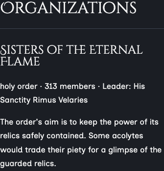

# Organization reading review for #450

**Status:** implementation specimens — awaiting human editorial review.

Generated on 2026-10-31 from the issue #450 worktree, based on revision `5036e59ccea7ededbc2fa24af9799d5b62e2d19a`. These examples are saved output, not a claim of human approval.

## Current default seed

Seed: `5wyedz5q272fz`, default seed-to-region options. Region: **the Grasslands of Belvorn**. The complete current document is retained in `/tmp/450-current-region.md` during this session. The organization section below is copied from the shared document adapter; its leader lines remain visible independently of prose selection.

### Sisters of the Eternal Flame

holy order · 313 members · Leader: His Sanctity Rimus Velaries

The order's aim is to keep the power of its relics safely contained. Some acolytes would trade their piety for a glimpse of the guarded relics.

## Browser specimen

The regional entry rendered at a 375px viewport, with its structured contact line and saved paragraph. The browser test also saves, reloads and reopens these words and checks that the Markdown export contains them.

## Historical Sisters comparison

The preserved fixture at `1ffabf08` records 27 members and leader Wolfraec Ermithiaun. Its original description remains unchanged on migration:

> Sisters of the Crimson Martyrs marches in glittering processions, collecting tithes and distributing alms in equal measure. They are widely seen as ceremonial in public and orderly in ledgers of mercy. They aim at saving face for the church and bread for the poor. Their most telling liability is pomp that distracts from rot in the vestry. In practice their work is tied to road networks carved between crown shade and undergrowth, slow in winter, slick in spring. It has 27 members. Public standing: beloved in market squares, analyzed in taverns.

The following specimen keeps those recorded identities and substitutes the current built-in alms profile for an explicit editorial comparison. It is neither the current-seed result nor a migration of old saved prose.

### Sisters of the Crimson Martyrs

holy order · 27 members · Leader: His Sanctity Wolfraec Ermithiaun

The order aims to protect the church's reputation and feed the poor. The order's ceremonial pomp distracts from decay within the institution.

The purpose and institutional weakness are explicit. The contact is named. No road, season, church sponsor, crime or settlement affiliation is added.

## Standalone examples

These use the same purpose/tension adapter with the default standalone budget. Profile facets and hooks remain inspectable in the UI and opt-in detail export.

### East Sea Trade Company

trading company · 68 members · Leader: Master Balkon Urdem

The company aims to keep premium prices for trusted goods. The company is slow to drop goods that have fallen out of fashion.

Merchant mark: two axes in saltire in #C9A227.

#### Master Balkon Urdem

They are led by Master Balkon Urdem. Balkon Urdem is a 181 cm (5'11") tall human adult. He is 21 years old. Balkon has black hair, bronzed skin, and blue eyes. He is unreliable.

#### Notable members

### Ooiolon Cngrur

Ooiolon is a human adult of 48 years. He is 175 cm (5'8") tall and weighs 73 kg (161 lb.). He has blonde hair, ebony skin, and blue eyes. He is loyal.

### Enli Aeaalmukdgl

Enli Aeaalmukdgl is a 167 cm (5'5") tall human adult. She is 54 years old. Enli has red hair, bronzed skin, and amber eyes. She is kind, serious, and aloof.

### Olntion Aegaugil

Olntion is a human adult of 21 years. He is 176 cm (5'9") tall and weighs 70 kg (154 lb.). He has brown hair, light skin, and dark eyes. He is unreliable, outgoing, and aloof.

### Trrae Eemeqr

Trrae Eemeqr is a 175 cm (5'8") tall human adult. He is 53 years old. Trrae has blonde hair, pale skin, and amber eyes. He is loyal.

### Brotherhood of the Sorrowful Martyrs

holy order · 98 members · Leader: His Sanctity Balkon Urdem

The order's aim is to make the palace answer for the suffering of the poor. Powerful opponents are quietly looking for a pretext to break the order.

Arms: per pall pean, barry tenné and sanguine and paly sanguine and tenné

#### His Sanctity Balkon Urdem

They are led by His Sanctity Balkon Urdem. Balkon Urdem is a 182 cm (5'11") tall human adult. He is 43 years old. Balkon has russet hair, pale skin, and amber eyes. He is loyal.

#### Notable members

### Templar Aegon Cngrur

Aegon Cngrur is a 162 cm (5'3") tall human adult. She is 23 years old. Aegon has light hair, ebony skin, and blue eyes. She is grumpy and thoughtful.

### Templar Enli Aeaalmukdgl

Enli is a human adult of 34 years. She is 167 cm (5'5") tall and weighs 64 kg (141 lb.). She has brown hair, light skin, and dark eyes. She is outgoing.

### Olntion Aegaugil

Olntion Aegaugil is a 175 cm (5'8") tall human adult. He is 40 years old. Olntion has brown hair, light skin, and green eyes. He is pessimistic.

### No. 53 Solar Squadron - 9th

starship squadron · 96 members · Leader: Wing Balkon Urdem

The squadron aims to keep its wing ready to launch and win even when exhausted. Poor funding decisions trade simulator practice against time in actual ships.

Arms: per pale vert and chequy sanguine and argent

#### Wing Balkon Urdem

They are led by Wing Balkon Urdem. Balkon is a human elder of 93 years. He is 173 cm (5'8") tall and weighs 66 kg (146 lb.). He has red hair, ebony skin, and blue eyes. He is unreliable.

#### Notable members

### Lead Aegon Cngrur

Aegon Cngrur is a 162 cm (5'3") tall human adult. She is 23 years old. Aegon has light hair, ebony skin, and blue eyes. She is grumpy and thoughtful.

### Lead Enli Aeaalmukdgl

Enli is a human adult of 34 years. She is 167 cm (5'5") tall and weighs 64 kg (141 lb.). She has brown hair, light skin, and dark eyes. She is outgoing.

### Lead Olntion Aegaugil

Olntion Aegaugil is a 170 cm (5'6") tall human elder. He is 80 years old. Olntion has brown hair, light skin, and green eyes. He is pessimistic.

### Lead Trae Eemeqr

Trae Eemeqr is a 160 cm (5'2") tall human elder. She is 81 years old. Trae has red hair, tan skin, and amber eyes. She is thoughtful.

### Pilot Uropn Urgaum

Uropn Urgaum is a 167 cm (5'5") tall human adult. She is 52 years old. Uropn has light hair, black skin, and blue eyes. She is friendly and grumpy.

## Dense and sparse checks

Thirty identical supported organization profiles produce 24 generated sentences for 30 directory entries. All contacts remain available. Twenty-four organizations receive a purpose sentence before any receives a second sentence; the other six retain structured identity only. Repetition is allowed because the facts are identical.

A profile with custom goal/weakness labels and an empty hook supplies 0 narrative candidates. Its structured identity remains available, and its custom detail is not paraphrased from recognized IDs.

## Review questions

- Can a GM identify whom to contact, what the group wants and what complicates it?
- Does the purpose/tension paragraph read naturally beside the contact line?
- Does any wording imply a location, affiliation or activity absent from the profile?
- Do repetitions or omitted details make the complete regional section harder to use?

Automated checks cover eligibility, budgets, shared UI/export text, determinism, authored overrides and old saved data. The editorial acceptance criterion remains for a human to assess from these specimens and the rendered page.
