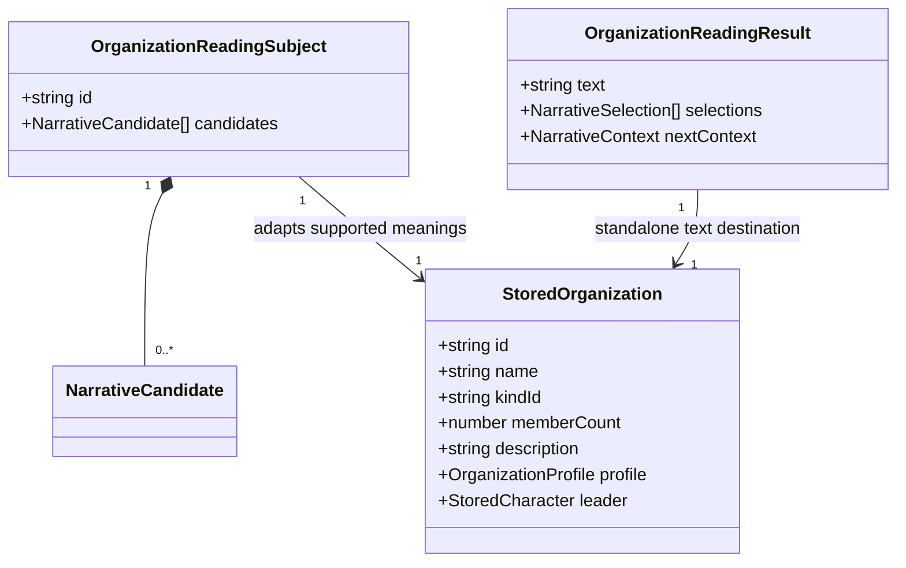
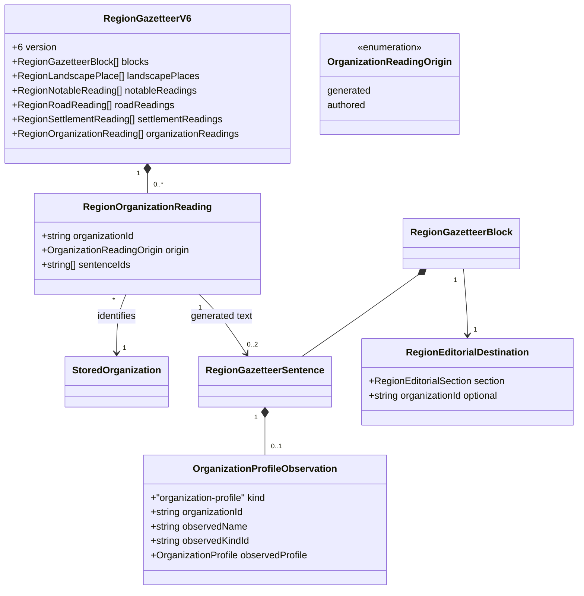

# Natural, usable organization entries

**Status:** implemented — editorial policy and domain model approved by Ben on 2026-10-31. Human editorial acceptance remains pending in [the reading review](region-organization-reading-review.md).

Issue: [#450](https://github.com/ironarachne/ironarachne/issues/450). Extends the accepted
[narrative contract](narrative-prose.md), [regional editorial plan](region-gazetteer-salience.md)
and [settlement reading](region-settlement-reading.md). Mechanical grammar work in #444 and
the broader UI-copy review in #284 remain separate.

## Problem and verified boundaries

The historical `5wyedz5q272fz` snapshot at `1ffabf08`, preserved in
`test_fixtures/region_445_belvorn.json.gz`, contains the Sisters of the Crimson Martyrs,
27 members led by Wolfraec Ermithiaun. Its `holy_order` profile supplies charitable aims,
ceremonial behavior and institutional weakness. The paragraph instead reads as a checklist,
switches from “They” to “It”, and starts “Sisters ... marches”. Its forest context asserts
winter and spring road conditions without a recorded route supporting those claims.

These are still owning-library problems: `organization_profile.ts` substitutes arbitrary names
into singular hooks, combines heterogeneous goal fragments after “aim at”, and appends every
facet. `organizationToDocument` then repeats the facets and hook beside that paragraph.
`generateOrganization` composes the description before generating the leader.

Regional presentation has also advanced beyond the issue's starting point. The legacy
`region_presentation.ts` path lists whole organization descriptions, and the legacy UI supplies
its own organization body. Snapshots with a gazetteer use `regionEditorialDocument`, which
currently has no organization destination or appended organization directory. A fix must add
organizations to that current reading path, not only polish the legacy formatter.

Existing contracts already supply seeded generation, structured profiles, leader characters,
stored organization snapshots, pure editing and standalone Markdown/text/PDF exports. Keep
those contracts; this is neither a new tool nor a new affiliation or activity simulation.

## Editorial decisions

### A contact, purpose and tension

Each regional organization gets a stable heading/anchor and a compact structured line naming
its kind, member count and leader when available. Format the leader through
`organizationPersonHeading`; a leader is a usable named contact, not proof that they are
friendly, available for hire or resident at a particular settlement. Missing identity fields
are omitted rather than invented. The directory remains complete even if no prose earns space.

Generated prose has at most two sentences per organization: one meaningful purpose or identity
and one distinctive weakness, internal conflict or public tension. A sentence may combine
compatible purpose and tension without merely enumerating traits. Hooks compete as meanings;
they are not appended again under a second label. Routine temperament, membership statistics
and abstract public-standing labels do not each receive a sentence.

Organization prose participates in the existing 24-sentence regional budget. A structured leader
line costs no sentence; prose naming that leader does count. Apply one-sentence-per-topic limits,
existing assertion ownership and the eight-selection repetition window. Among equally important
organization candidates, prefer an organization with no selected sentence before giving another
its second. Do not reserve additional prose outside the global plan. Meaningful organizations
with identical evidence may remain similar; variation never creates factions, sponsors or work.

Standalone organizations use the same domain-owned candidate builder and shared composer with
a three-sentence cap and empty batch context by default. Their structured profile, leader,
members, relationships and visual identity remain available as detail. The ordinary standalone
reading should not print the full facet checklist and duplicate hook immediately after the
paragraph; expose that existing data in detail/inspection. All standalone exports use that same
document adapter. Authored descriptions are shown whole, even when they deliberately repeat
structured detail or exceed generated budgets.

### Grammar belongs to compatible templates

Do not guess grammatical number from a name ending, infer it from kind, or repair final strings
with regular expressions. Names such as “Sisters”, “Company” and invented names all travel as
proper names in headings or explicit naming clauses. Domain templates use known subjects such
as “The order”, “The company”, or “Its members”, with matching verbs and pronouns. Prefer
repeating a short explicit subject when a pronoun could refer to the leader or another group.
No new persisted grammatical-number field is needed.

Revise all built-in fantasy and science-fiction archetypes, including the default fallback.
Use compatible whole sentences or explicitly typed fragment pools. Goals cannot mix nominal
and verbal phrases in one shared syntactic slot. For example, the alms aim becomes protecting
the church's reputation and feeding the poor, rather than “saving face ... and bread”. Replace
“analyzed in taverns” with a supported expression of suspicion, and express the existing pomp/
institutional-decay tension directly. Do not strengthen “rot in the vestry” into a specific
embezzlement, conspirator or crime without additional stored evidence.

Keep stable facet IDs where meanings remain the same; edit generated labels and templates
together. A goal or hook is an organization-level assertion already supplied by the generator,
not evidence of a regional settlement's industry or a new patron relationship. Unknown/custom
facets remain printable in detail but receive no generated paraphrase unless the adapter has
safe compatible wording for their current value. Matching an ID alone cannot overwrite an
edited label. Never parse authored prose to recover generator semantics.

### Context is optional, and evidence limits its scope

Remove transport, disease, infrastructure and seasonal-closure claims inferred solely from a
biome in `resolveEnvironmentNarrative`. A biome can justify a restrained terrain description;
it cannot establish roads, caravan wells, tolls, supply schedules or this organization's use of
them. Split cold and hot conditions where relevant; “cold desert” does not justify desert heat.
Omit ordinary environment texture when it adds nothing to the organization.

Explicit standalone presets remain caller-supplied fictional context, distinct from automatic
biome inference. Preserve their documented precedence and free-text hints without silently
treating them as verified regional facts. Neither hints nor old `environmentNarrative` strings
are evidence for new regional claims. They remain stored detail on old or authored objects.

For this issue, regional organization entries omit automatic environmental sentences. The region
does not currently record an organization-to-route or organization-to-settlement location.
Even a current road fact cannot prove that this organization operates there. A future contextual
adapter must cite both the environmental fact and an explicit relationship before describing
organizational effects; adding that relationship model is outside #450. This omission satisfies
the contextual acceptance criterion without inventing an affiliation system.

### Historical editorial specimen

With the historical fixture's recorded kind, count and leader as the structured identity line,
an acceptable purpose/tension paragraph is:

> The order seeks to protect the church's reputation and feed the poor. Its ceremonial pomp
> distracts from decay within the institution.

The heading remains “Sisters of the Crimson Martyrs”; the line names His Sanctity Wolfraec
Ermithiaun and 27 members. These illustrate supported meaning and reading order, not required
exact output or special handling of this seed. No new sponsor, church name, road, scandal or
recruitment offer is implied. Review the current seed separately from this historical specimen.

## Domain model

Reuse `StoredOrganization`, `NarrativeCandidate`, `NarrativeContext`, editorial candidates,
saved sentences and reasons. Add transient `organization_reading_types.ts` in `organizations`
and regional reading types in `regions`, exposed through their public APIs. The shared adapter
receives explicit candidates/context and caller-owned RNG; no library looks up the vault.

Extend gazetteer version 5 to version 6, retaining all landscape, notable, road and settlement
reading fields. Extend `RegionEditorialSection` with `organization` and destination with optional
`organizationId`; only that section may carry the ID, which must identify an embedded organization.

The one-to-two block cardinality above applies to organization blocks; other blocks retain
their existing limits. Every embedded organization has exactly one reading record, even when
`sentenceIds` is empty. Generated sentence IDs are unique, exhaust the organization's generated
sentences and refer only to blocks with its ID. Authored records have no generated sentence IDs;
their body is the existing `StoredOrganization.description`, including a deliberate blank.
No second text store is introduced for authored prose.

Extend `RegionEditorialObservation` with `OrganizationProfileObservation`. Capture a deep plain
copy of the current profile, name and kind when composing. Compare those values on read without
RNG; deletion, renaming, kind changes or edited profiles stale dependent generated sentences.
Capturing the whole profile is conservatively broader than each sentence's verbalized fields.
It does not prove that a hint or biome narrative is eligible. Each organization sentence requires
this observation; existing `FactReason` remains available for actual fact dependencies.

The directory reads the current leader, count and kind directly as structured data, using shared
formatters. Generated paragraph templates do not embed the leader, so a changed leader cannot
leave an obsolete contact in prose. No organization wrapper, relationship field, standalone
payload change or new regional fact family is needed.

## Composition, editing and compatibility

Build all eligible organization meanings before the coordinated regional selection pass. Reuse
the existing selection/wording separation, stable IDs and canonical organization-ID ordering.
Do not introduce prose draws before leader, members, emblem or organization-ID generation:
compose after the structural object exists using the established named-stage mechanism.
Wording changes must not change physical generation or organization membership. Keep the current
public standalone composer usable through a compatibility adapter where callers still use it;
normal generation moves to the shared candidate composer and stores final description once.

New regional prose lives only in gazetteer organization blocks. Do not append the embedded
standalone description as another generated paragraph. Embedded organizations retain their
standalone description for extraction and inspection; extracting one neither copies a regional
budget omission into it nor rerolls it. The region directory and paragraphs come from one document
adapter for UI, Markdown, text/PDF and project publication. Replace the UI's independent
organization-body reconstruction on the new path, and keep headings, anchors and bodies aligned
by organization ID rather than filtered array positions.

`setRegionPlaceText` marks that organization's reading as authored when its description changes;
renaming does not change origin. An explicit empty description suppresses generated fallback.
An authored body replaces the generated body whole and bypasses sentence/repetition budgets.
Leader/statistics remain structured data. Deleting an organization removes its reading metadata
and blocks without affecting other entries. Standalone editing keeps its existing independent
description/profile behavior: changing a facet never silently rewrites an authored description.

Only fresh generation or an explicitly requested regeneration creates version-6 prose. Do not
infer authorship by comparing strings, checking facet IDs, or assuming every old description was
generated. Existing gazetteer versions 1–5 and snapshots without a gazetteer retain their saved
wording and reading behavior. Migration does not populate organization readings or fix grammar
inside old text. Preserve the existing legacy path; restoring organization directories for older
gazetteers can be separate work rather than inventing verified text on load.

Bump the region artifact payload marker relative to the implementation checkout, preserving all
older payload migrations. Leave the facts marker and standalone organization payload marker
unchanged. Audit every explicit version-5 capability check so version 6 retains settlement,
road, notable and landscape reading, including source-override handling and validation. Validate
observation shapes, origins, target IDs and sentence ownership; reject malformed new metadata.

## Verification and review boundary

- Review every built-in archetype and fallback across fantasy and science fiction. Exercise
  plural, singular collective, article-bearing, punctuation-bearing and invented names; check
  subject/verb agreement, pronoun referents and every goal template's grammatical combinations.
  Check curated current facet labels before using built-in wording; custom/blank edits must not
  be silently paraphrased from stale IDs.
- Verify environment omission for forest roads, tropical disease/routes, cold-desert heat,
  mountain closures and tundra supply claims. Standalone explicit presets/hints retain precedence;
  regional composition ignores them as evidence. A route's mere presence never links an organization.
- Review the preserved Belvorn fixture and separately capture a current default
  `5wyedz5q272fz` snapshot with revision/options. Check the Sisters' supported charitable aim,
  leader and institutional weakness without requiring obsolete exact words or generated names.
- Cover zero/one/many organizations, exhausted wording pools, identical profiles, global and
  per-entry caps, fairness, complete identity directories and no duplicated abstract facet labels.
  Leader changes update the structured contact. Rename/profile edits stale generated prose;
  authored edits and blanks override it. Reordering/deletion must not attach text to another ID.
- Verify same-seed equality, save/load/export equality, extraction, standalone consumers, schema
  rejection and legacy migrations. Saving, loading, displaying and exporting must consume no RNG
  and must not repair, truncate or recompose old/authored descriptions.
- Focused commands after implementation: `npm run test -- src/lib/organizations`,
  `npm run test -- src/lib/regions`, and the organization/region publication tests that consume
  these adapters. Run `npm run verify`; rendering changes require `npm run verify:all` before merge.
  Preserve per-library coverage gates without exclusions or baseline reductions.
- Human editorial review reads complete organization entries in a regional document and
  standalone UI/export, including a dense region and a sparse profile. Record whether a GM can
  identify whom to contact, what the group wants and what complicates it, and whether repeated
  wording or an abstract checklist still obscures those answers. Automated assertions alone do
  not satisfy this acceptance criterion.

The approved prose budgets, structured contact directory, contextual omission, authored-override
policy and version-6 model are implemented. The [reading review](region-organization-reading-review.md)
provides current and historical specimens for human editorial acceptance.
