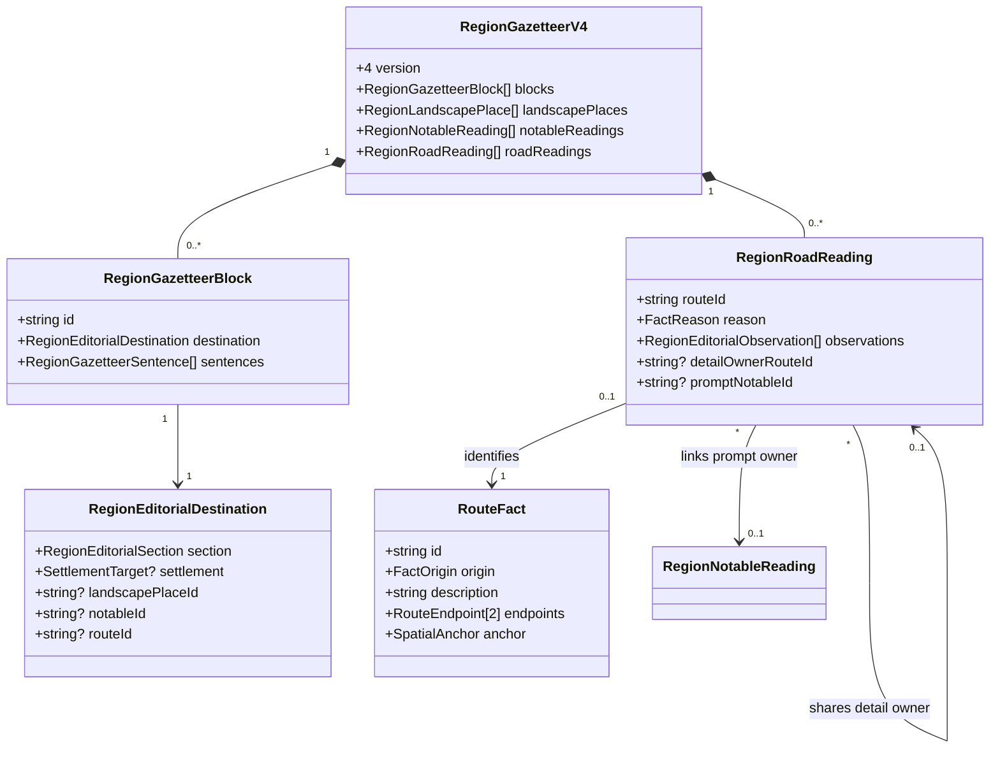
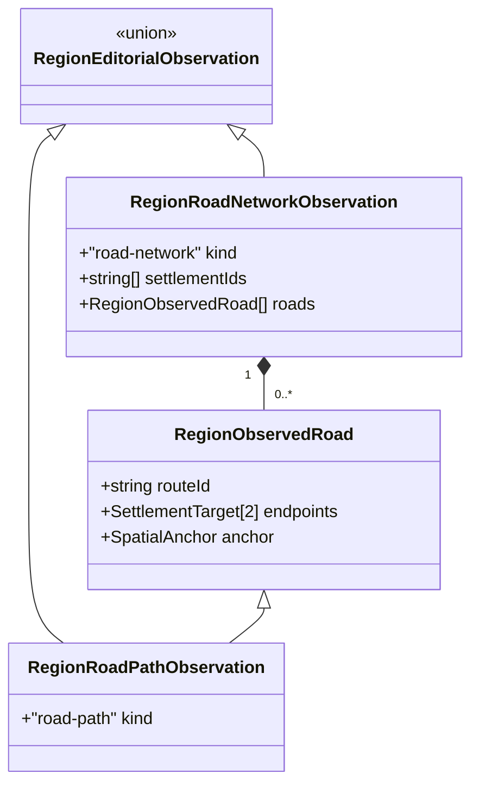

# Compact regional road networks

**Status:** implemented — policy and domain model approved by Ben on 2026-10-31.

Issue: [#448](https://github.com/ironarachne/ironarachne/issues/448). Extends the implemented
[editorial policy](region-gazetteer-salience.md) and
[notable reading contract](region-notable-reading.md). Uses the existing
[evidence contract](region-narrative-evidence.md); adds no road generation or transport simulation.

## Problem and current behavior

The historical seed `5wyedz5q272fz`, captured at `1ffabf08` in
`test_fixtures/region_445_belvorn.json.gz`, motivates this issue. Its eight settlements have seven
saved road routes with Revilun as one endpoint. The reported reading repeats woodland and
survey/escort hooks instead of explaining the network economically.

`addRoadRelationships` traces existing road edges from a stable root in each connected component.
Its saved root-to-settlement paths can share edges or pass through another settlement. Seven
Revilun endpoint relationships therefore do not establish seven separate physical roads radiating
from its center. `roadNarrative` currently writes connection, selected terrain and hook sentences
into every generated route description, even for ordinary woodland or an otherwise generic journey.

The current implementation has already moved beyond the reported reading: #445 saves an eligible
hub sentence, while the editorial document omits unselected generated source descriptions. It
still lacks a complete compact route directory. Fixing the old prose template alone would leave
that directory absent and would miss the current page/export path.

## Decisions

### Summarize the saved network, with explicit limits

Derive a transient graph from current, continuous saved road routes and resolved embedded
settlement endpoints, using the continuity checks behind `editorialRoads` and `overviewRoad`.
Deduplicate endpoint pairs for neighbour comparisons; retain all route IDs for inspection.
Do not add every mathematically reachable settlement pair as a route.

Reuse #445's uniquely most connected settlement rule (at least three distinct saved endpoint
neighbours) and its complete-set evidence. Describe **saved routes**, rather than implying direct
physical spokes: for historical Belvorn the intended meaning is “Saved road routes link Revilun
to seven other settlements.” This is conditional on fixture validation, not a seed-specific rule.
The directory gives the seven endpoint pairs and their saved paths. A route through an intermediate
settlement is still one saved itinerary; it proves neither a separate direct road nor a shortest path.

A tied maximum permits qualified wording under #445's existing tie policy. Never choose a sole hub
by ID order. The overview and Travel share assertion keys, so the hub proposition appears once.
Prefer the opening when it earns that space; Travel then starts with its directory.

Connected components describe only the recorded route graph. Say “The saved routes form two
separate groups” when supported, not “Travel between these settlements is impossible.” Count
settlements without an eligible saved route separately; absence of a saved route proves no physical
isolation. A singleton is not a road-bearing group. An empty network needs no generated filler.
Unresolved artifact endpoints remain inspectable and receive neutral directory labels, but do not
enter embedded-settlement rankings or component claims.

Connectivity establishes no distance, duration, road quality, safety, traffic, trade volume,
political control, navigability, bridge or ford. Map intersection alone never supplies these claims.
Authored prose can state more; preserve its authorship rather than presenting it as generated proof.

### Keep identities complete and prose selective

Travel contains a name-only directory entry for each current readable saved road route, even when
it earns no sentence. Use endpoint labels such as **Revilun to [destination]**, resolved through
`SettlementTarget`, and retain route ID, fact link and exact spatial anchor for inspection/map
selection. The label orders the saved endpoints; it does not mean one-way travel. Parallel routes
keep separate entries and selection targets; do not invent names or ordinal geography to distinguish
them. Use an authored route name verbatim where supplied.

Directory labels are structured presentation, as with settlement names and landscape directories;
they are not fresh narrative composition and do not consume sentence budgets. Referenced settlement
names use the same explicit resolution context as notable reading and exports, with a neutral
“Referenced settlement” fallback. Never fetch the vault implicitly or guess a nearby endpoint.

Generated route detail is optional. Build the complete supported meaning pool before choosing
wording. Retain distinct current river meetings, coastal stretches, freezing country and hot/dry
country, with evidence tied to the exact saved path. Distinguish a road/river meeting from a
confirmed crossing; reuse the stronger crossing rule only when its prerequisites hold. Cold exposure
and water-planning wording retain the existing temperature/moisture rules without asserting actual
weather, shelter availability or waterlessness.

Ordinary forest/open-country identity earns no repeated route paragraph. A shared terrain sentence
may be selected once when it adds useful network orientation. For example, “All seven saved routes
pass through woodland” requires woodland evidence on every eligible route and a complete eligible
route-set observation. It means some woodland occurs along each path, not that the entire path is
woodland. If woodland is already adequately established elsewhere, omit the sentence. Never
summarize a majority as all routes.

Use normalized assertion keys that distinguish network, individual path and supported geographic
feature. The same crossing shared by several routes receives one descriptive owner, with the other
route entries referencing that owner structurally. Distinct crossings keep their own supported
meaning. Named river identities require an explicit saved relationship; an intersecting river edge
alone receives a generic road/river label. Shared forest names follow #446's existing place registry.

New route details enter #445's common editorial comparison and Travel budget. The directory has no
minimum prose, and a sentence cap never hides route identities. Multiple genuinely different route
facts compete under that policy rather than a first-match terrain switch. The implementation must
record which supported details were omitted in its reading review; it must not pad the entry to a cap.
River-route presentation remains unchanged by this issue.

### Remove compulsory road hooks

New generated roads have no fallback survey, escort or messenger hook. Ordinary woodland, grassland,
connectivity, and generic journey identity alone earn no adventure prompt. A distinctive travel
concern may be a factual route detail without an adventure prompt.

A worthwhile suggested situation uses #447's three eligibility requirements and separate saved
prompt representation. Reuse a qualifying notable's prompt and owner, linked from the route entry;
do not create a second route prompt store or another prompt for the same crossing/constraint.
When no eligible notable prompt exists, show the supported travel concern alone. This issue does
not require inventing a notable to provide a hook. Authored route descriptions, embedded authored
hooks and deliberate blanks remain verbatim and suppress generated substitutes for that route.

## Domain model

Keep `RouteFact`, `RegionFacts`, endpoints and geometry unchanged. Add a version-4 gazetteer with
route reading records; preserve versions 1–3. These types belong in
`region_road_reading_types.ts`, with the union/destination extensions in
`region_editorial_types.ts`. Existing types below show only relevant fields.

A road reading record is identity/evidence metadata, not a second description. Its saved detail
sentences occur only in blocks with `section: travel` and `routeId`. Network overview sentences
remain ordinary opening/travel blocks without `routeId`. A route destination cannot also carry a
settlement, notable or landscape destination. `detailOwnerRouteId` is permitted only for the same
supported shared feature; ownership is acyclic, points directly to an owner and never suppresses
an unrelated unique detail on the referring route. `promptNotableId` references an existing current
notable reading with an independently eligible prompt and overlapping supported route concern.

Extend the existing observation union with this complete-set observation and a `road-path` variant
carrying one `RegionObservedRoad` for narrow path invalidation. Canonicalize settlement
IDs and road records by stable identity; preserve node/edge path order inside each anchor. Compare
full endpoint targets and anchors, not just counts, on read. Retain existing observed map-node and
map-edge values in sentence reasons, and existing name observations for any names embedded in saved
sentences. Directory labels resolve names structurally, without rewriting prose. The complete set
includes otherwise eligible embedded settlements with no incident route, so added settlements and
newly eligible roads invalidate affected whole-network claims. Per-route sentences depend on their
own route/path/feature evidence, not the entire network, unless they claim a network comparison.

## Composition, persistence and edits

Generate source facts first, then route reading candidates and the common editorial plan. Newly
generated `RouteFact.description` stops receiving the three-sentence narrative; leave it empty
unless explicitly authored. Connectivity and travel meaning are represented by endpoints, paths
and evidence, and composed once into gazetteer sentences. Do not parse old route prose to recover
terrain, crossings or relationships.

Save version 4 through runtime regions, snapshots, artifact payloads and exports. Advance the
region payload version through the existing migration registry when implementing. Migration
preserves previous gazetteer versions, route descriptions and hooks exactly; it does not compose
new text on opening, import or export. Keep previous reading behavior until explicit editorial
regeneration, including the old legacy Travel section where applicable. Inspection and raw artifact
export always retain old facts and their saved prose.

Explicit editorial regeneration can create version 4 from existing valid geometry and facts without
rerolling the map or replacing authored text. Generated old route prose becomes inspection material
under the new plan; it is never rewritten in place. Old compulsory hooks do not become newly
eligible suggestions merely because they contain `Hook:`.

For edits, use narrow evidence invalidation. Removing a route, changing an endpoint or path, or
adding an eligible road invalidates dependent network comparisons. Removing a crossing invalidates
its detail/prompt, not other routes' coastal or climate detail. A rename updates directory labels
but stales name-dependent saved sentences. Removing a detail owner leaves dependent links for review;
it never silently transfers the old sentence to a nearby route or composes a replacement on read.
Authored route text remains visible with review state where needed. A deliberate blank keeps the
identity row and suppresses generated prose. New explicit generation can select new owners.

Extend validation, dependency traversal and deletion handling for the new records and observations.
Reject duplicate route readings, non-road targets, malformed observation shapes, mixed destinations,
cyclic/unsupported detail ownership and invalid prompt ownership on import. Legitimate edits that
leave saved evidence stale are review states; stale generated details are omitted from reading and
retained in inspection. Do not reject the user's entire edited artifact for a stale sentence.

The UI, Markdown, plain text and PDF consume the same `RegionDocument` route rows and saved
sentences. Extend its existing heading/anchor/fact metadata as needed to expose route selection and
owner references without an independent UI narrative path. Render authored routes once, bypassing
the generic authored-fact append loop when a dedicated route entry owns them. Reading and export
must receive identical explicit reference-name context.

## Verification and review criteria

| Fixture                                                         | Required result                                                                                                                                                                                                                                                                  |
| --------------------------------------------------------------- | -------------------------------------------------------------------------------------------------------------------------------------------------------------------------------------------------------------------------------------------------------------------------------- |
| Historical Belvorn capture                                      | Confirm seven saved endpoint relationships to Revilun and eight settlements. Explicit editorial regeneration yields one supported hub proposition, seven identifiable route entries, no repeated woodland paragraphs or compulsory hooks. Preserve original facts byte-for-byte. |
| Current generation of the same seed                             | Record current provenance separately; repeat exactly. Do not assume the historical topology still holds.                                                                                                                                                                         |
| Shared path and intermediate settlement                         | Describe saved endpoint relationships without asserting independent spokes or direct physical adjacency. Parallel itineraries count once for neighbours but retain separate IDs/anchors.                                                                                         |
| River meetings, coast, cold and hot/dry country                 | Distinct supported details survive comparison when useful. Shared features have one owner. No bridge, ford, flood, distance, navigability or safety invented.                                                                                                                    |
| Disconnected graph, isolated settlement, tied hubs and no roads | Accurate saved-network qualification; no sole hub on ties, no physical isolation claim or empty-section filler.                                                                                                                                                                  |
| Missing/reference endpoints                                     | Neutral labels and inspection; explicit resolved context agrees across page and export; embedded-only ranking stays qualified.                                                                                                                                                   |
| Authored name, description, hook and blank                      | Exact words and intentional omission survive generation, reopening, edits and every export, with no duplicate appended entry.                                                                                                                                                    |
| Mutated path, road set, evidence, name or owner                 | Only dependent claims become stale; no replacement composition on read or transfer to an unrelated route.                                                                                                                                                                        |

Test seeded repeats, canonical input permutations, complete-set observations, semantic deduplication,
parallel routes, route-directory completeness, sentence budgets and legacy/payload round-trips.
Capture page/Markdown/PDF parity, anchors, map selection, authored overrides, saving and reopening.
Conduct a manual GM reading review of historical and current Belvorn plus contrasting small fixtures;
record selected text, omitted meanings and whether each entry adds a distinct travel fact. Validate
eligibility rules directly rather than relying on forbidden-word checks.

For implementation run `npm run verify` and `npm run verify:all` before merging the presentation
change, including all configured mobile widths. The proposal received formatting and document review before implementation. The policy and domain model were explicitly approved before implementation.

## Implementation verification

On 2026-10-31, `npm run verify` passed with 7,610 unit tests and all 100 libraries above the
coverage gate. The full `npm run verify:all` browser stage completed with 676 passes, five
normal optional golden-image skips and two action timeouts in existing WebGL preview tests.
Both timed-out tests passed an isolated rerun without code or timeout changes. The full run
included every configured mobile width (320, 360, 375, 390 and 430px), region saving/reopening,
route identities and downloaded Markdown/PDF coverage. The final region browser run rebuilds the
latest code after the review-status and inspection refinements.

The [reading review](region-road-reading-review.md) records the historical/current distinction,
selected route details, deliberate omissions and determinism audit. The implementation is in
[PR #469](https://github.com/ironarachne/ironarachne/pull/469).
