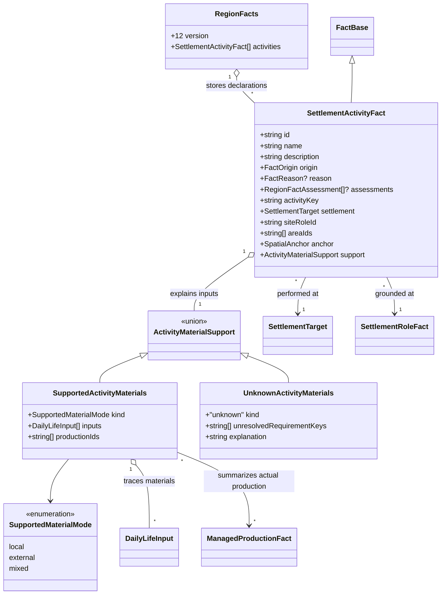
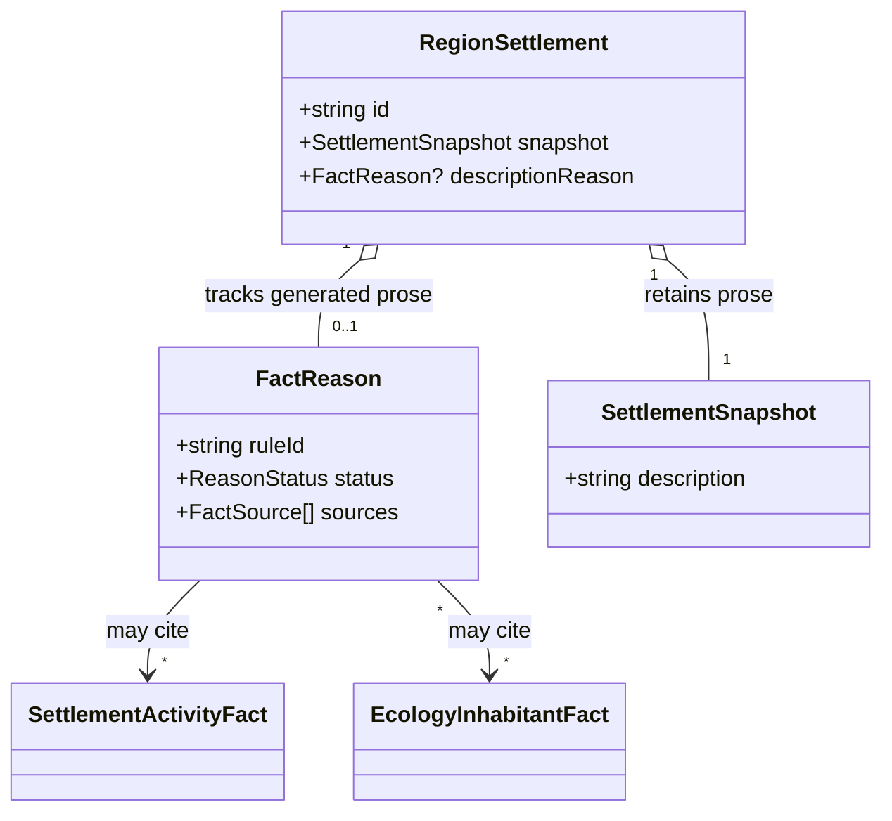
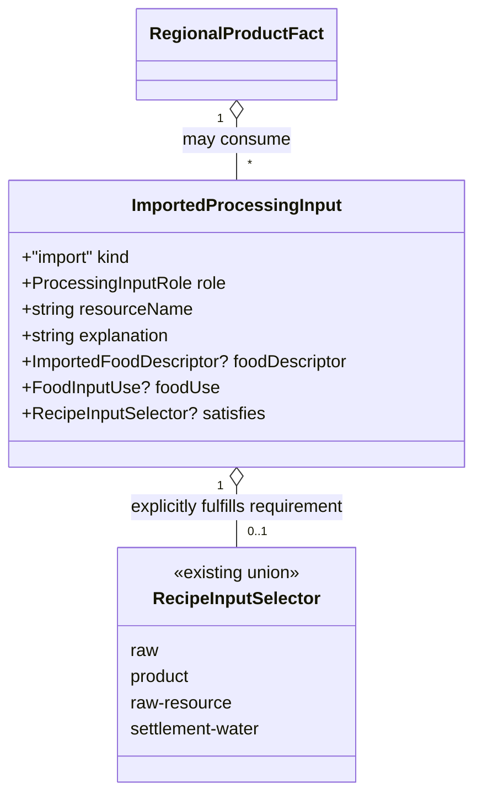

# Settlement activities and regional evidence

**Status:** implemented — Ben approved the decisions and domain model on 2026-10-29.

Issue: [#443](https://github.com/ironarachne/ironarachne/issues/443).

## Problem and scope

Settlement category blurbs and biome features can declare farms, weaving, woodwork or animal
populations independently of the region's saved facts. In `settlements.ts`, `randomDescription`
selects a category string and an arbitrary biome feature. `pickCategoryPlausibleLine` checks
law and order, but does not check materials, production or ecological occurrence. Regional
processing, daily life and supply are generated later and do not reconcile those strings.

The reported seed `5wyedz5q272fz` at `1ffabf08` therefore has a structurally valid, reproducible
snapshot whose descriptions disagree in meaning. Cilaamir's weavers lack an established input
chain; Maenas and Pelirgir describe farms without established cultivation. The issue's historical
seed report is the regression target, not a claim that the current checkout was reproduced here.

This proposal connects category choices to established activities, material explanations and
ecological evidence. It extends the existing regions library; it adds no economy simulation,
supplier network, crops, species or recipes. #364/#365 own catalog expansion. The closed repairs
#438/#439 own shellfish harvesting and wood-source eligibility; consume their corrected source
contracts rather than introducing another classification policy.

## Decisions

### 1. Separate established activity, opportunity and unknown inputs

Add `RegionFacts.activities: SettlementActivityFact[]`. An activity fact explicitly establishes
that people at a settlement perform an activity. Its stable `activityKey` identifies its meaning;
its saved text supplies the human description. Use `FactBase` for origin, assessments and reasons.

Existing `SettlementDailyLifeFact` and `RegionalProductFact` continue to represent supported
opportunities and possible production chains. Their existence alone does not establish a farm,
workshop, trade or industry. A generation rule may deliberately select an opportunity and create
an activity declaration, with its own provenance; that is an additional worldbuilding decision.
Rules state the scope of that decision, initially household work, never industrial scale or
year-round sufficiency. `ManagedProductionFact` already establishes managed production: activity
declarations for cultivation summarize that fact rather than creating a second independent farm.

| Evidence                                                      | May establish                                | Does not establish                                        |
| ------------------------------------------------------------- | -------------------------------------------- | --------------------------------------------------------- |
| Accessible arable land and freshwater                         | Cultivation opportunity                      | Actual farms, a named crop or bread                       |
| Current managed cultivation                                   | The recorded cultivation activity            | Unrecorded crops, acreage or yield                        |
| Complete compatible processing chain                          | A possible craft                             | An existing workshop or industry                          |
| Explicit selected activity declaration with that chain        | Household practice of that craft             | Commercial output or exports                              |
| Saved compatible import input in a complete chain             | Externally supported input for that activity | A named supplier, route or regular trade                  |
| Missing source, omitted candidate or `not-observed` inventory | Unresolved local provision                   | Physical absence or proof that the activity is impossible |

Material support has four interpretations: `local`, `external`, `mixed`, and `unknown`.
`external` means all represented material inputs are imported; `mixed` means the chain has both
local and imported inputs. These statuses say nothing about quantities. `unknown` preserves a
declaration whose complete input explanation is not established. Freshness is separate and uses
`FactReason.status`; a formerly supported declaration with stale evidence is not current support.

New generated material-dependent activities require complete current local or explicit external
support. Authored declarations may have unknown support and remain meaningful world facts.
An authored contradiction is preserved and flagged for inspection; it never licenses generated
dependents. Changing an activity's name or prose cannot change its semantic key or manufacture
new input evidence. Free prose edits are not parsed into activities.

### 2. Category choices declare meanings before sentences

Introduce a versioned, transient feature-rule catalog owned by settlements. Each rule has a
stable ID, compatible category names, wording alternatives and typed requirements. Requirements
refer to semantic activity keys, geographic predicates or flora/fauna identities; they are never
extracted from prose. The regional adapter supplies eligible meanings after evaluating saved
facts. Settlements remains independent of regions; pass plain eligibility values into the
composer rather than importing region types into the settlements library.

Keep `SettlementCategory.possibleDescriptions` readable in saved categories for compatibility.
New regional descriptions use the rule catalog instead of randomly sampling these raw strings.
Audit every category and biome-feature path that can claim material use, production, a geographic
position or a named organism. A mixed sentence is eligible only when all its claims are supported:
a farm, mill, wheat field and stream cannot share one unchecked requirement. Split such sentences
into independently eligible features or add their complete requirements.

Choosing a craft feature deliberately creates the corresponding activity fact, then composes its
sentence from that declaration. Other consumers use the fact, not the category string. A stone
dressing opportunity can become a household stone-working declaration; it cannot silently serve
as evidence for weaving. Generic fiber cannot stand in for textile cloth, and reed mats cannot
justify linen looms. Specific processes and goods follow their existing stable recipe/source keys.

Keep settlement character through varied social practices, street patterns, communal places and
supported local crafts. Maintain several distinctive alternatives for every size category when
material evidence is sparse. Do not turn every unsupported weaving feature into the same bland
fallback sentence. Preserve law-and-order compatibility alongside the new requirements.

This issue changes regional composition. Standalone settlement generation can reuse the catalog,
but has no regional placement evidence: it must not claim that a material-reference link establishes
access for the new settlement. The attributed reference behavior of #342 remains intact. Standalone
activity editing and transferring a regional activity into an independent settlement artifact are
outside this proposal; standalone payload version 4 does not change.

### 3. Resolve support from complete evidence, with explicit imports

An activity records a discriminated `ActivityMaterialSupport` value. Supported values reference
saved daily-life inputs and/or managed-production facts. Resource inputs retain their actual
source, anchor and geological subset through the existing `DailyLifeInput` representation.
Product inputs resolve the complete same-settlement processing graph, including fuel, water,
tools/facilities and imported inputs under the existing processing policy. Reasons cite every
direct supporting fact and the site role; transitive dependencies remain discoverable.

Do not use the three selected supply or daily-life entries as a complete inventory. Evaluate
eligibility against the full capability assessment used by supply. If a complete chain was omitted
only by a representative product cap, the activity stage may materialize that exact supported
chain with stable IDs and its existing provenance before declaring the activity. This uses the
same planner and access rules, consumes no upstream RNG and does not replace existing products.
At most one extra chain per selected craft is permitted; existing recipe depth bounds apply.
Supply must run afterwards so these new products cannot leave an obsolete shortage assertion.

An external explanation requires a saved `ProcessingInput` with `kind: 'import'` in a complete
compatible chain. Reuse that input's name and explanation; do not add a second import record.
An `ImportSuggestion`, narrative `primaryImports`, a port, road or river is insufficient.
Generation in this issue creates no imported inputs to rescue a feature. Existing explicitly
authored import-supported chains can support a generated declaration if their full evidence is
current. Validation must check the imported good against the activity/recipe requirement using
a new optional `satisfies: RecipeInputSelector` on the import variant of `ProcessingInput`.
This is an explicit authored assertion of which recipe requirement the imported good meets,
not an inference from its display name. Validate a nonempty, compatible selector against the
recipe slot and existing food descriptors where applicable; ambiguous or unmatched slots remain
unknown. For example, imported flax fiber can meet a flax requirement, while an imported timber
selector cannot. No supplier identity or route is implied. Older free-text imports remain readable
but cannot newly establish material compatibility until explicitly annotated.

For unknown support, save stable unresolved requirement keys and an inspection explanation.
An empty inventory is unknown, not incompatible. Explicit habitat, access or recipe conflicts
exclude generated candidates and are explained in inspection. Do not add a universal absence
flag or reinterpret `local-not-supported` as impossibility. Supply prose must distinguish local
provision from externally supported work: a village may weave imported thread while lacking a
local cloth-input source. It must not simultaneously claim that weaving itself is unsupported.

### 4. Ecological flavor uses occurrence evidence

Named flora/fauna sentences in new regional settlement prose require a current saved occurrence
with compatible habitat at the settlement's site. Presence elsewhere in the region does not
establish local occurrence. Use stable plant/species identities and existing habitat/access
policy, including the water distinctions from #438. An animal occurrence does not establish
harvestable food, domestication or usable materials.

Omission from the bounded occurrence selection means unknown. It supplies neither a presence
sentence nor an absence sentence. Do not add an organism to fill a flavor slot or reroll ecology.
Use a different eligible feature instead. A known habitat conflict also excludes the sentence,
but for a different reason visible in inspection. Preserve both cases in tests. Existing saved
authored animal/plant descriptions remain intact and do not create new occurrence facts.

### 5. Generate once and record description provenance

During habitation, generate settlement identity, placement, facets and non-economic description
ingredients without asserting regional farms, materials or organisms. Preserve the habitation
stream's draw budget with an explicit compatibility adapter during this change so deferring a
sentence does not move settlement placement, organizations or realm choices.

After processing and livelihoods, add the named `settlement-activities` stage, followed by supply.
It evaluates the typed feature candidates, saves at most two distinct activities per settlement,
materializes any necessary bounded supporting chains, and composes the final settlement description.
Use stable IDs and sorting by settlement ID, activity key and input IDs. Isolate selection and
wording with per-settlement child streams; extra wording draws cannot change selected declarations.
Downstream ecology narrative, identity, notables and overview can consume these declarations.
Do not let activities feed back into ecology, managed production or raw source generation.

Add optional `descriptionReason: FactReason` to `RegionSettlement`, alongside its snapshot.
Keep the analogous live-region metadata keyed by stable settlement ID so snapshot conversion
preserves it without adding region types to `Settlement`. The reason records a versioned composer
rule and all selected activity, occurrence and geographic support. Nonmaterial choices are encoded
by the composer rule and stored prose; they need no invented resource facts.

All reading surfaces reuse the stored description and activity prose. No reading, resolving a
material link, loading, exporting or publishing selects features or consumes RNG. Follow #421's
reading policy: stale generated descriptions are omitted from ordinary prose, remain available
in inspection, and do not gain diagnostic sentences in the gazetteer. Keep name/population and
other independent structured fields visible. Authored descriptions, including intentional blanks,
remain visible exactly as saved.

### 6. Preserve edits, dependencies and old saves

Register activities in semantic fact traversal, validation, editing and removal. Activity text
edits preserve identity, key and support, set origin authored and invalidate generated dependents.
Changing structured support must revalidate compatibility and freshness. Description editing
clears `descriptionReason`; it does not delete activity facts, infer declarations from the new
prose or silently reconcile authored assertions. Show the existing manual-review notice for
possible disagreement between authored prose and structured facts.

Source edits stale dependent explanations transitively, including settlement descriptions and
the overview. Adding inventory invalidates affected unknown-support explanations as well as
negative supply assessments. Source removal removes generated direct dependents and their closure;
block the operation if it would destroy authored activities or authored dependency chains. Retained
reason-only dependents become stale. Settlement removal uses the same authored-work protection.
No edit reruns generation, changes unrelated facts or updates authored prose automatically.

Bump facts version 11 to 12 and region payload version 16 to 17, relative to this checkout;
reconcile those numbers with any intervening merged migrations. Older regions gain `activities: []`
and omit description provenance. Preserve their existing category data and descriptions byte for
byte. Existing import inputs omit `satisfies`; migration never guesses it from names. Do not infer farms or weaving from old text, backfill imports, or label legacy prose as newly
verified. Legacy prose without provenance remains readable under the existing legacy policy.

Validate unique activity IDs, support discriminants, nonempty supported input sets, settlement/site
ownership, source/deposit subsets, complete chain references, provenance and acyclic dependencies.
Supported modes must agree with the chain's actual local/import composition. Unknown mode requires
an explanation and unresolved keys, and cannot support generated material claims. Unknown saved
activity keys remain inspectable through their saved text; they cannot authorize new feature rules.
Current generated declarations require current evidence; authored/stale entries retain structurally
valid evidence without being treated as verified support. Raw JSON export retains every field;
Markdown, text/PDF and publication share the same reading policy as the page.

## Domain model

New activity types live in `region_activity_types.ts`. The existing processing import variant
also gains optional `satisfies?: RecipeInputSelector` in `region_processing_types.ts`. `FactBase`, `FactReason`, `SettlementTarget`,
`SpatialAnchor` and `DailyLifeInput` retain their current shapes. Supported material modes require
at least one input or production reference; unknown support records a knowledge gap, not absence.

`inputs` uses the existing resource/product union. Imported inputs remain inside referenced
`RegionalProductFact.inputs`, reachable through the complete chain. No activity-to-activity input
is introduced. Existing daily-life and product facts retain their opportunity semantics.

The selector retains the existing union and its fields from `resources/processing_types.ts`.
It is a declared material specification, not proof of a local source. No new generated import
or catalog item is introduced. Existing food suitability restrictions continue to apply.

Feature-rule definitions are transient generation policy, not a second persisted fact catalog.
The proposed `SettlementFeatureRule` has `id: string`, `categoryNames: string[]`,
`requirements: SettlementFeatureRequirement[]`, and `wording: string[]`.
`SettlementFeatureRequirement` is the union `{ kind: 'activity'; activityKey: string }`,
`{ kind: 'geography'; predicateKey: string }`, and
`{ kind: 'organism'; source: { kind: 'plant'; plantId: string } | { kind: 'species'; speciesName: string } }`.
The regional adapter evaluates these rules; stored reasons cite the resulting facts/observations.

## Verification and approval boundary

- Reproduce seed `5wyedz5q272fz` with default seed-to-region settings. Assert semantic contracts,
  rather than permanently pinning every sentence or settlement name: every new weaving/farm/woodwork
  claim has a matching declaration and current compatible evidence. Do not copy historical claims
  into a golden fixture and assume they still describe the current generator.
- Contrast actual managed cultivation with arable/water opportunity and with `not-observed` land.
  The latter two never generate definite farms or named crops. An authored farm with unknown inputs
  survives and receives an inspection explanation without a fictional shortage.
- Test local linen, explicit imported-thread chains, incomplete imports and suggestions alone.
  Only complete compatible chains support weaving; stone dressing and mat weaving cannot substitute.
  Verify locally unsupported cloth inputs can coexist with explicitly externally supported weaving.
- Test woodwork on current accessible sources, limited timber, disconnected sources and unknown
  producer metadata using the #439 contract. Preserve scale and limitation qualifiers.
- Test an eligible but unselected recipe chain, representative caps and unknown inventories.
  Materialized supporting chains stay bounded and do not perturb preexisting products or RNG.
- Test selected local organisms, occurrences elsewhere, bounded omission and explicit habitat
  conflicts. No absent-list inference, invented presence, aquatic hunting regression or food claim
  from occurrence alone. Sparse fixtures retain several distinct nonmaterial feature choices.
- Test same-seed repeatability, input reordering, stable settlement targets, extra wording draws,
  stage isolation and unchanged physical geography/placement/realm choices. Record deliberate new
  activity/prose differences instead of claiming all seeded output remains identical.
- Test legacy migrations, unknown keys, invalid discriminants, foreign-settlement chains, stale
  evidence and cycles. Exercise save/load/raw export, authored blank descriptions, source edits,
  inventory additions, removal protection and transitive description/overview invalidation.
- Verify UI, Markdown, text/PDF and publication parity, including legacy, current, authored and
  stale prose. Keep material references visibly attributed to their actual source settlement.

Run `npm run verify` for implementation, plus `npm run verify:all` before merging rendering changes.

Ben explicitly approved this document and its domain model on 2026-10-29, satisfying the
`AGENTS.md` design-review requirement.

## Implementation notes

The initial declaration rules cover managed cultivation, linen weaving, mat weaving, construction
woodwork and stone dressing. They share saved processing plans and retain the existing global
24-product bound, with at most two declarations per settlement. Other existing recipe families
remain opportunities until a declaration/feature rule explicitly adopts them.

The habitation composer deliberately consumes its previous draws for compatibility; the new stage
replaces its unchecked category and biome sentences before returning the region. Standalone
settlements retain their existing payload and attributed material-reference behavior. Regional
reading and export use stored descriptions, while evidence inspection retains stale prose.

The activity editor exposes name/description edits and removal using existing dependency protection.
Structured declarations and import specifications are available through the library/payload contract;
this change does not add an import-authoring or structured activity editor.
