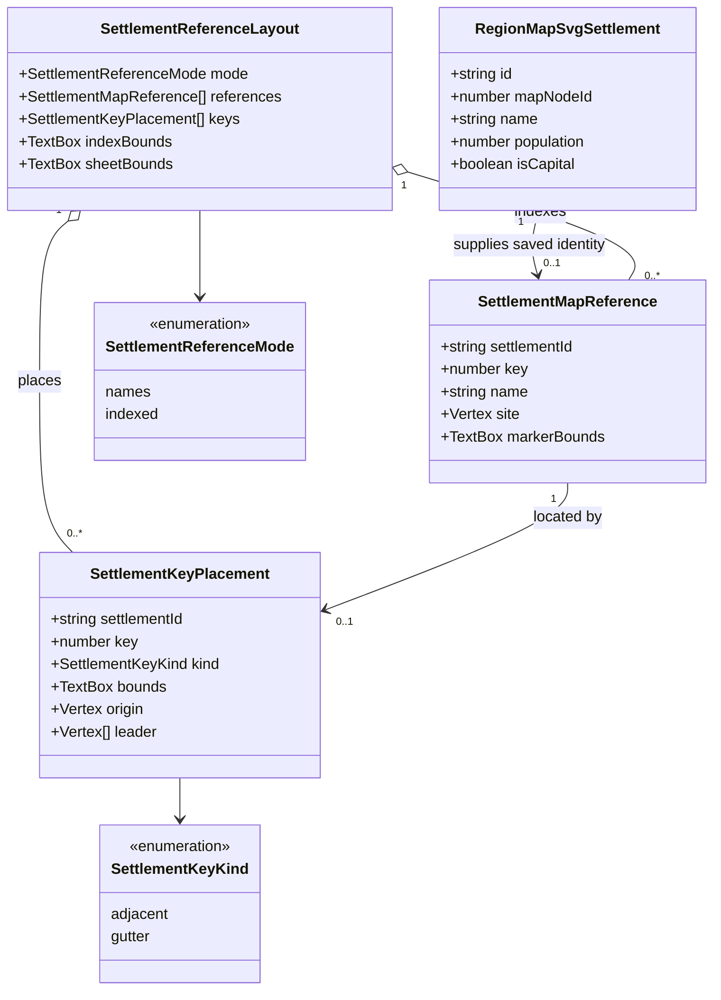

# Settlement references on regional maps

**Status:** implemented — the human reviewer approved the domain model on 2026-11-01.
The renderer, standalone export, and regression fixtures are implemented in
[PR #480](https://github.com/ironarachne/ironarachne/pull/480), which records final verification results.

Tracked by [#451](https://github.com/ironarachne/ironarachne/issues/451).

## Problem

`layoutSettlementLabels` sorts settlements by label size and population, tries bounded
placements, and silently skips names that cannot clear every reservation. That preserves
typography but leaves some gazetteer settlements impossible to identify on a standalone map.
Increasing the search space alone cannot guarantee that long names fit a crowded map.

The issue records Ilistair’s Folly and Maenas missing from seed `5wyedz5q272fz` at commit
`1ffabf08`. On the checkout inspected for this proposal (`f0c2164d`), that seed produces eight
different names, all of which receive labels. Do not change generation to recreate the old
names. Retain the reported names in explicit renderer fixtures, alongside current seeded cases.
The existing renderer test that expects impossible names to disappear confirms the general
failure mode remains.

## Behavior

Keep full settlement names on the map wherever they fit. If any named, mapped settlement
cannot receive its full name, render a numbered settlement index on additional parchment
below the map. Include every named, mapped settlement in that index, making it a complete
map-to-gazetteer reference rather than a list of unexplained exceptions.

In index mode, every settlement gets a compact visible numbered key associated with its
existing building cluster. Reserve keys before placing full names and optional geographic
labels. Keep full names where space remains; key-only settlements remain identifiable.
The index prints each key and its literal saved name. The key, building cluster, and index
entry all carry the same `data-feature-id` as the gazetteer and route endpoint.

Try keys adjacent to the cluster using the existing conservative text geometry. If a local
key cannot fit, put its key in an added side gutter and draw a leader to its actual saved
site. Gutter rows have disjoint text reservations; enlarge the gutter vertically when rows
run out. Leaders may cross terrain and roads, but must avoid other text, map furniture,
and unrelated settlement artwork. Leaders must remain traceable to their target: reject
ambiguous shared segments and crossings with other leaders. Placement must consider the
whole set of fallback leaders, rather than accepting a greedy route that strands a later
one. This routing constraint is part of the implementation, not permission to drop a key.

The additional gutters and index enlarge the exported sheet. Geography, building clusters,
roads, and route endpoints retain their existing map coordinates. The map viewport and
clip remain separate from the expanded sheet, so labels in the index are never cropped by
the geographical content clip. Preserve the existing readable font scale and enlarge the
export's natural dimensions to accommodate the added paper.

## Domain model

These are derived rendering types confined to `src/lib/map`; no snapshot or artifact schema
changes. Existing `RegionMapSvgSettlement` remains the renderer input.

`indexBounds` is absent in names mode; use a discriminated union in the implementation.
`leader` is empty for adjacent keys and ends at `site` for gutter keys. Names mode has no
keys or index. Indexed mode has exactly one key placement per reference.
The diagram shows the fields consumed by this layout; the existing renderer input's optional
fields and compatibility behavior remain intact.

## Decisions

1. **Saved identity owns the reference.** Sort by stable settlement ID before assigning
   one-based keys. Keys are display references for one snapshot, not new persisted IDs.
   Input reordering does not change keys. For legacy renderer inputs without an ID, derive
   a renderer-only identity from the map node ID; do not invent a snapshot settlement ID.
   Legacy inputs supplying several names for the same node share that locator key, with
   separate index rows retaining each literal name. Saved settlement IDs remain distinct.
2. **Use two deterministic layout passes.** Try the existing full-name layout first. When
   incomplete, restart with key reservations and the index. Do not retain accidental
   first-pass reservations. Capital/population priority still controls full-name placement.
3. **Preserve authored names.** Index text may wrap into measured lines, including unusually
   long tokens, but its stored name and accessible label remain the literal input. Never
   truncate, regenerate, abbreviate, or reduce text below the existing readable scale.
4. **Retain all existing collision guarantees.** Keys and index text use the shared text
   serializer, halo passes, and glyph bounds. Map names, compass, and optional facts clear
   key reservations. The index and gutters stay inside the expanded frame and paper rim.
5. **Standalone export is sufficient.** Identification cannot depend on hover, application
   state, links, or scripting. A future interactive lookup may reuse the saved IDs, but is
   outside this fix.
6. **Unmapped inputs stay unmapped.** A missing or invalid map node does not acquire a false
   site or index reference. Unnamed settlements retain their current marker-only behavior.
7. **The index explains identities, not symbol meanings.** This amends the earlier
   cartography decision to omit a legend only for settlement cross-references. It does not
   add a scale bar or a terrain-symbol glossary.

## Validation

- Explicitly named fixtures cover Ilistair’s Folly and Maenas, plus current default-option
  output for the reported seed. Every named mapped settlement has either its full name at
  the site or a visible key resolving to the same ID and literal name in the index.
- Dense fixtures, edge sites, long authored names, reordered inputs, and duplicate names
  with distinct IDs check deterministic SVG, unchanged artwork and site coordinates, glyph
  containment, disjoint reservations, grapheme-safe wrapping, and traceable gutter leaders.
- Browser tests measure real SVG text and exported image pixels, including the new paper
  extent, frame, index, and gutters. Both controlled fixtures are checked at desktop and all
  five mobile widths, with enlarged, scrollable inspection and complete screenshot review.
- Indexed exports use whole-pixel native dimensions and a bleeding paper background to
  avoid transparent edge pixels from fractional viewport clipping. Ordinary exports retain
  their existing aspect ratios and native dimensions.
- `npm run verify:all` is required before merging. PR #480 records its outcome.

Reproduce the controlled SVGs with
`npx vite-node scripts/render_region_typography_review.ts /tmp/settlement-references-451 after --controlled-only`.
The relevant outputs are `settlement-references-after.svg` and `settlement-gutter-after.svg`.

## Implementation

- `settlement_reference_types.ts` holds the derived model. `settlement_references.ts` owns
  stable keys, measured name wrapping, adjacent placements, and backtracking gutter routing.
- `region_map_svg.ts` integrates the second layout pass, measured index, expanded paper/frame,
  and export sizing without changing saved region data or settlement artwork.
- Co-located legacy inputs without IDs share a node locator but retain every supplied name
  in separate index rows. Normal snapshot IDs remain distinct even when names are identical.
