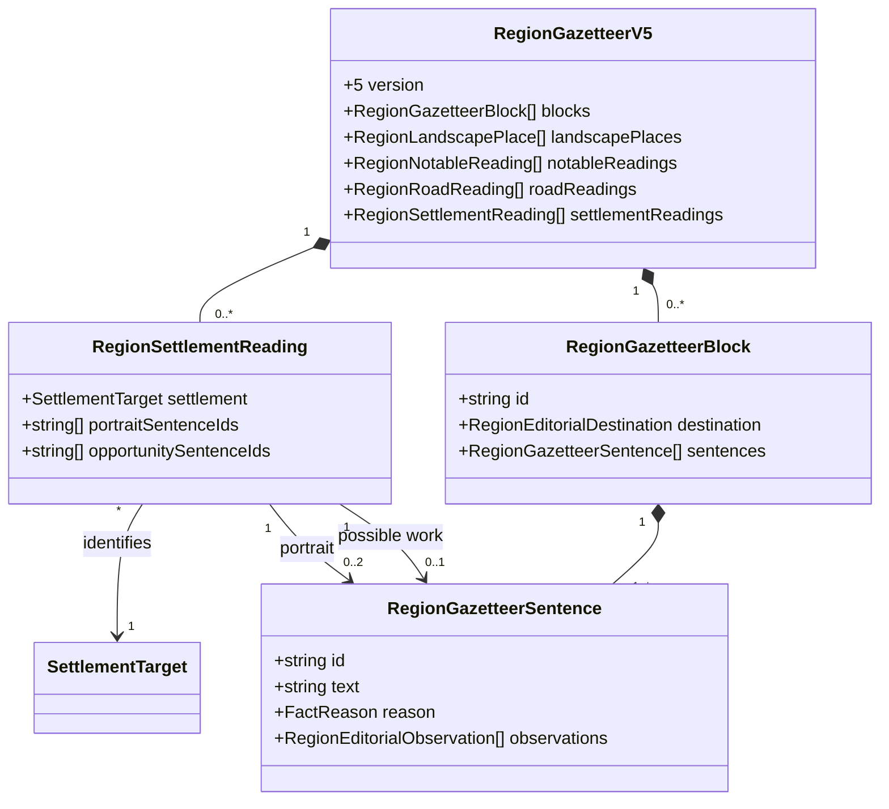
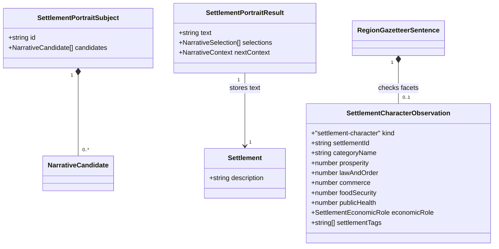

# Concise, distinctive settlement reading

**Status:** implemented — editorial policy and domain model approved by Ben on 2026-10-31.

Issue: [#449](https://github.com/ironarachne/ironarachne/issues/449). Extends the accepted
[narrative contract](narrative-prose.md), implemented [regional editorial plan](region-gazetteer-salience.md)
and [settlement activity contract](region-settlement-activities.md).

## Problem and current behavior

The historical `5wyedz5q272fz` snapshot at `1ffabf08`, preserved in
`test_fixtures/region_445_belvorn.json.gz`, contains eight checklist descriptions. Each introduces
name/category/population, a category blurb, prosperity, social reputation and a biome feature.
Several category features assert unsupported institutions or work. Those factual eligibility
problems belong to #443; preserving flavor does not authorize restoring them.

The checkout has advanced since that report. #443 gates regional character through features and
activity declarations. #445 selects daily-life, activity and supply meanings for saved gazetteer
blocks, and #448 adds compact road reading. `regionEditorialDocument` reads those blocks rather
than appending every original description. However, its local candidates still wrap complete fact
descriptions in another settlement-name prefix, character and opportunities lack an explicit shared
settlement reading structure, and standalone `settlements.ts:randomDescription` still uses the old
checklist. Fixing only those original descriptions would miss the regional reading path.

The historical fixture also confirms two useful chains: Maenas's dried provisions consume bison
meat and require covered drying racks; Cilaamir's dressed stone consumes basalt and requires
stoneworking tools. These are saved possibilities, not proof of installed equipment or livelihoods.
The current generator must be checked separately; historical names and recipes are regression
evidence, never special cases in selection.

## Editorial decisions

### Identity, portrait and opportunity have different jobs

Every regional settlement retains a heading, stable target/anchor and a compact structured line:
category, population, prosperity and economic role, reusing `settlementSummaryLine`. These are
scannable data, outside narrative sentence budgets. Facet numbers remain available in detail or
inspection; do not translate every score into a sentence. Referenced settlements receive only
identity/statistics explicitly available through the supplied reference context, never an implicit
vault lookup or a copied embedded settlement.

A **portrait** describes established character: an eligible category feature, supported social
texture, an actual declared practice, an established problem or a concrete site relationship.
It should give a GM something to portray, rather than repeat the statistics. Prefer one strong
image or relationship and, when useful, another facet that adds meaning. Sparse evidence permits
a short portrait or none; it never licenses a fabricated clock tower, weaving industry, market,
festival, local animal, magistrate or civic history.

An **opportunity** explains possible work from a current complete chain. Place it after the portrait
under “Possible work”, visibly separate from established character. It never becomes evidence for
a portrait or an activity declaration. Actual declared work belongs in the portrait and suppresses
an opportunity restating the same process/input relationship; a genuinely different possible chain
can still compete. A mineral occurrence alone is neither a mine nor a household craft.

Standalone settlement generation adopts the same portrait adapter and shared composer. It has no
regional batch by default and must be readable without one. Regional-only facts are unavailable
unless explicitly supplied by their owning adapter. The existing regional material reference on a
standalone settlement keeps its source attribution and disclaimer; it does not become possible
work at the destination settlement. Trade, problems, architecture and notables retain their
existing structured sections; this issue does not rewrite their independent prose generators.

### Preserve flavor without a compulsory facet checklist

Build all eligible meanings before selection. Reuse #443's feature requirements and #445's
defining/distinctive/supporting priorities. Category determines compatible imagery, not entitlement
to a feature. Standalone category pools must be split into safe character templates and
evidence-requiring features rather than trusting arbitrary `possibleDescriptions` strings.
Replace promotional language with concrete supported observations; do not merely substitute
synonyms for “unique character and flair” or “hustle and bustle”.

Social candidates describe only what the established facets support. Law/order can support a
qualified reputation for orderly dealings, not the existence of guards, courts or a particular
punishment. Mixed facets remain mixed: prosperity does not imply food security, public health or
safety. A low score alone does not establish an acute crisis. Numerical extremes need a meaningful
domain interpretation to earn prose; ordinary scores can remain entirely in structured data.

Offer compatible whole-sentence variants or grammatical fragment pools for each eligible meaning.
Prefer an actual distinctive practice, problem or site relationship over routine generic texture.
When only safe social/category texture exists, it may provide standalone identity without claiming
regional rarity. Avoid turning every portrait into a minimal resource inventory.

### Compose work from inputs and requirements

Resolve `RegionalProductFact` and its transitive inputs using the existing chain, food suitability,
access and freshness checks. Select an actual input and meaningful process, then compose a natural
conditional sentence from domain-owned recipe wording. For example, subject to current evidence:

- “With covered drying racks, Maenas could dry bison meat for provisions.”
- “With stoneworking tools, Cilaamir could dress basalt into building stone.”

These illustrate semantics, not required exact strings. Use a supported output label where a
recipe does not justify a more specific use. Never infer a verb by stripping words from a recipe
label. Unknown recipes without safe wording retain their saved inspectable description and do not
receive an invented generated paraphrase. “Food drying using drying” and “stone dressing using
stone dressing” are prohibited constructions for newly composed text.

Keep required equipment conditional even when its catalog name resembles a workshop. “With” or
“would require” does not assert ownership. Imported inputs remain explicit dependencies, not local
resources. Unresolved, inaccessible or stale chains cannot authorize new opportunities. Available
inputs imply neither sustainable yields nor capacity, trade, surplus, exports or full provisioning.

Limitations belong to the selected claim. Include the actual limited input or relevant acquisition
condition in its sentence, for example a qualified “using a limited supply of …”. Do not strip the
qualification to meet a cap, or repeat “Local sources are limited” after every category. A limitation
shared by several selected meanings can have one saved owner only if each dependent claim remains
intelligible and qualified on its own; otherwise repeat the necessary short qualifier. Unknown
supply is not a shortage. Access vocabulary follows #440; this design changes composition, not
access rules, source catalogs, recipe eligibility or yields (#364/#365).

### Budgets and standalone readability

| Scope                                       | Maximum for newly generated prose                                                     |
| ------------------------------------------- | ------------------------------------------------------------------------------------- |
| Standalone settlement portrait              | Three sentences, one paragraph; one sentence per topic                                |
| Each regional settlement, across both parts | Three sentences total: up to two portrait sentences and one opportunity sentence      |
| Whole regional document                     | Existing 24 sentences, including every portrait, opportunity and repeated orientation |
| Regional opening and other sections         | Existing #445 budgets remain in force                                                 |

These are caps, not required lengths. The structured identity line and labels cost no sentence.
Established practice and opportunity compete within the common plan; no work slot is reserved.
Retain #445's settlement fairness rule among candidates of equal importance and comparison
priority. A complete identity directory remains even when a settlement earns no prose under the
global cap. Dense regions do not get an additional portrait budget outside the shared plan.

Each saved regional sentence names its settlement or otherwise supplies an unambiguous subject
within its saved paragraph. Do not depend on “there”, “as above” or a previous settlement. A
standalone section uses exactly those saved words; it does not refill omitted topics. Avoid
another `Name:` prefix when the body already names the settlement. The heading supplies the name
for a standalone portrait; its description remains intelligible as a paragraph about that subject.
Do not repeat population/category in the first sentence merely because those fields exist.

Assertion ownership remains global. A selected size/hub meaning normally lives in the opening or
Travel; a settlement can link to that owner structurally. The existing counted orientation
exception allows a short repeat when independently reading the entry actually requires it.
Omitting repeated woodland does not omit a unique supported river relationship.

### Cross-settlement repetition is explicit and truthful

Thread `RegionEditorialContext` and shared `NarrativeContext` through canonical settlement target
order, with the existing eight-selection window. Normalize meaning families by actual
resource/process/use or character meaning, excluding settlement IDs. Keep assertion keys scoped
to the actual settlement and inputs. Compare peer support across the complete eligible pool,
not previously selected prose; absence from the pool is not proof of absence in the world.

Among equally important meanings with equal consequence/relationship priority, prefer a useful
unused meaning and then an unused compatible wording. Do not demote a distinctive fact to avoid
a repeated word. Repeated bear-meat, basalt or generic freshwater facts earn no slot solely as
examples; they can be omitted or stated once as a regional meaning when complete evidence supports
that scope. A collective statement must record its complete comparison set. If no safe collective
candidate exists, omit repetition rather than invent a shared regional claim.

Identical supported settlements may remain similar. Exhausted valid alternatives repeat; no
round-robin allocation of crafts, wildlife or personalities invents diversity. Authored words,
including deliberate blanks, bypass composition and repetition controls.

## Domain model

Reuse the existing facts, `NarrativeCandidate`, `RegionEditorialCandidate`, contexts, sentence
provenance and destination types. Add `region_settlement_reading_types.ts` in `regions` and
transient `settlement_reading_types.ts` in `settlements`; expose adapters through public APIs.
No new library, activity type or recipe model is required.

Add a version-5 gazetteer carrying settlement reading metadata alongside all version-4 fields.
The final sentences remain stored once in ordinary `settlement` blocks; metadata assigns their
reading role, rather than creating another text store.

One reading record exists for each represented settlement target, including entries with empty
sentence arrays. Sentence IDs must be unique, refer to that same settlement's block, have exactly
one role, and exhaust its generated settlement sentences. Metadata records the plan's chosen role;
renderers never classify sentences by matching their words. Other destinations cannot carry these
roles. Independent sentences retain independent reasons, so stale work does not hide character.

Standalone composition needs only a transient adapter input/result; final prose stays in the
existing `Settlement.description`. The regional adapter supplies eligible feature candidates from
current facts, while the standalone adapter supplies only meanings justified by its settlement.

`SettlementCharacterObservation` extends `RegionEditorialObservation` for generated regional
facet/category prose; tags are unique and sorted. Compare the captured fields on read without RNG.
It is deliberately conservative: a changed facet can stale the sentence even if not every field
was verbalized. Feature/activity/site meanings still cite their complete current fact and map
support. Comparative meanings additionally retain #445's complete peer observations; the new
observation alone cannot prove rarity, largest population or a collective claim. Authored text
needs no generated observation. No inspection-only diagnostic becomes narrative.

## Generation, saved text and compatibility

Perform candidate selection inside the coordinated editorial pass after activities and product
chains exist. Keep selection and wording RNG separate, stable candidate/template IDs and explicit
context. Standalone composition uses its caller-owned RNG. Regional composition uses the existing
named stage mechanism; reconcile the earlier #443 description stage so two independent composers
cannot select competing portraits. Changes to wording pools must not change selected meanings or
physical geography, placement, materials or activities.

For newly generated regions, mirror only the selected portrait into the embedded snapshot's
`description` and union its support into `descriptionReason`; possible work remains in its saved
block. The gazetteer is authoritative for regional reading, and the mirror is never appended again.
When no portrait earns space, save an empty generated mirror with generated provenance, rather
than exposing the old checklist as an apparently authored fallback. Ordinary regional reading
checks each sentence independently; consumers of the mirror respect its aggregate freshness.
Extracting an embedded settlement preserves that saved portrait and does not reroll or manufacture
regional work at a new location.

Editing a settlement description clears its reason under the existing authored override contract
and replaces only the portrait, including when blank. Independently supported possible work can
remain in its separate section. Editing a source fact suppresses generated restatements and shows
the authored source text once in the appropriate part, without budget truncation or paraphrase.
Authored activity text belongs with established character; authored opportunity text remains
qualified by its own authorship and placement, not recast as an established declaration. Existing
dependency protection and manual-review notices continue to apply. No new prose editor is added.

All regional UI, Markdown, text/PDF and project publication use one document adapter over the
saved plan. Standalone UI and exports use the stored description and common settlement document
adapter. Reading, saving, resolving references and exporting consume no RNG. Stale generated text
is omitted from ordinary reading and remains inspectable; no replacement is composed on read.

Bump the region payload marker for the version-5 gazetteer relative to the implementation checkout;
leave the facts version and standalone settlement payload unchanged. Retain gazetteer versions
1–4 and their existing reading paths. Migration does not add reading metadata, regenerate prose,
infer roles from strings or reclassify legacy descriptions as verified. Legacy and authored saved
text remains byte-for-byte intact. Update every version-4 road-reading capability check to include
version 5 so this extension does not silently remove road reading.

## Verification and review boundary

- Capture a current default `5wyedz5q272fz` snapshot with revision/options and compare it separately
  with the historical fixture. Review all eight historical entries and their supported chains;
  do not preserve the old unsupported farms or weavers as portrait requirements. Verify current
  Maenas/Cilaamir equivalents by their actual input chains, not hardcoded settlement names.
- Supply focused bison/drying and basalt/dressing fixtures. Assert input, output, requirements,
  limitation and opportunity status survive selection and wording. Include imported, limited,
  inaccessible, unresolved and stale transitive inputs; no installed equipment or sustainable
  production is asserted. Test an actual declared practice beside a different possible chain.
- Test sparse standalone and regional settlements, ordinary and extreme facets, prosperous but
  food-insecure settlements, safe category texture and feature prerequisites. Portraits remain
  flavorful where justified, without compulsory population/prosperity/reputation/biome sentences.
- Test identical peers, different inputs for the same process, exhausted wording pools, and
  authored descriptions including blanks. Diversity cannot change facts or authored words. Check
  normalized meaning keys, complete comparison evidence and absence of repeated generic padding.
- Assert every local/global/topic cap, fairness, portrait/opportunity role coverage, sentence
  provenance and unique ownership. Standalone regional entries reuse saved text and remain clear
  without the opening. Label/name/body duplication and technique tautologies are absent from new
  composition; raw counts of “could” alone are not a quality test.
- Exercise same-seed/context repeatability, reordered inputs, wording-pool changes, upstream stage
  isolation, migrations, save/load, source additions/removals, facet edits and authored overrides.
  No stale sentence is replaced on read and unaffected sentences remain visible.
- Compare UI, Markdown and PDF reading, including old/new gazetteers and standalone settlements;
  verify identity lines, explicit Possible work labels, long names, sparse entries and authored
  paragraphs at mobile widths. Check PDF wrapping/page breaks visually as well as text parity.
  Produce a before/after reading review showing selected and omitted meanings, every settlement's
  portrait and work status, and the reason for any remaining repetition.

Ben explicitly approved this editorial policy and domain model on 2026-10-31, satisfying the
`AGENTS.md` human-review requirement. Implementation uses region payload version 23 and gazetteer
version 5, retaining older reading paths. The transient editorial candidate carries optional
`settlementReadingRole: 'portrait' | 'opportunity'`; saved sentence-role metadata lives only in
`settlementReadings`. The earlier activity pass retains its isolated compatibility description, but
the coordinated editorial pass replaces that transient text with the selected final portrait.

Implementation verification requires `npm run verify` and `npm run verify:all` before merging
rendering changes. See [the reading review](region-settlement-reading-review.md) for the default-seed
comparison, historical chains, contrasting work fixture and verification evidence.
