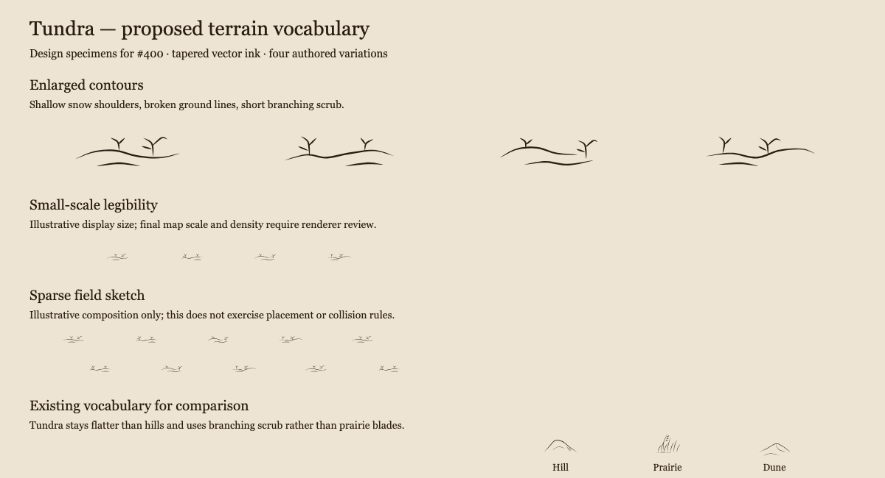
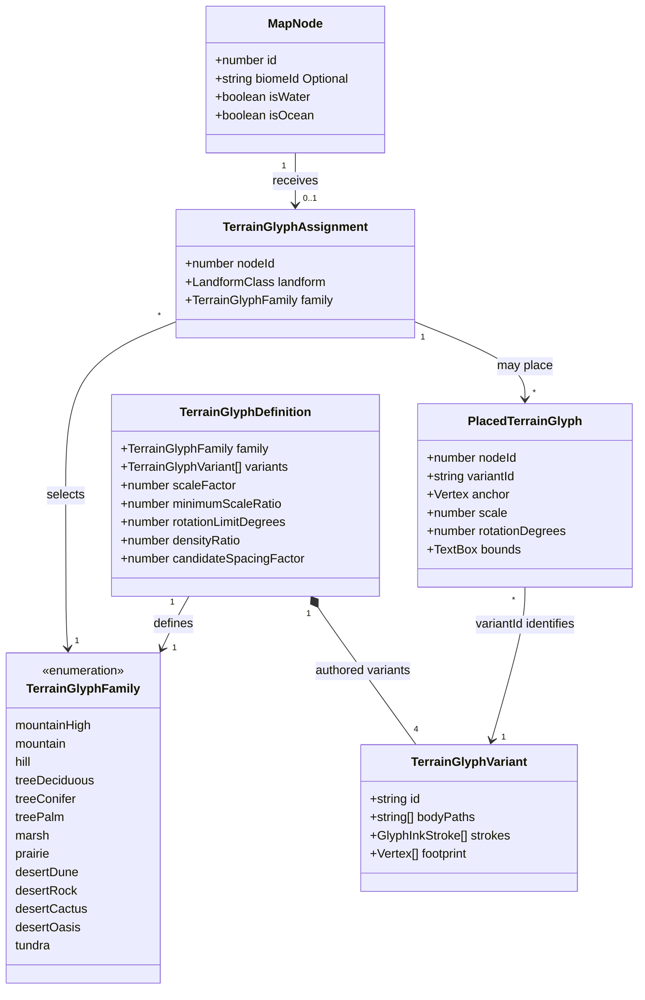

# Region tundra display

**Status:** implemented — the human reviewer approved the visual direction and domain model on 2026-10-12.
See the [visual review and validation record](region-tundra-display-400/README.md).

Tracked by [#400](https://github.com/ironarachne/ironarachne/issues/400). Extends
[Region terrain glyphs](region-terrain-glyphs.md) and
[Region terrain tones](region-terrain-tones.md).

## Problem

Tundra has a pale background wash but no terrain symbols on plain land. Mountain and hill
cells retain relief glyphs, leaving low-relief tundra visually empty. The issue requests
snow drifts and patchy shrubs. Existing assignment and SVG tests explicitly expect tundra
to remain unmarked; those expectations will change after approval.

## Solution and decisions

Extend the existing renderer-local catalog with one `tundra` family and four authored
variants. Each variant combines one or two shallow snow contours with one or two low scrub
patches. This keeps a single terrain layer and avoids separate snow and shrub scatter passes.
No new library, dependency, route, generator option, persisted field, or migration is needed.

### Biome matching and precedence

Normalize names by trimming and lowercasing; match exactly `tundra` and `alpine tundra`.
Do not extend matching to `ice cap`, `polar`, arbitrary names containing `ice`, or unknown
biomes. Sharing the tundra background tone does not imply sharing its vegetation marks.

Exclude ocean and water as today. Preserve `highMountain`, `mountain`, and `hill` relief
families ahead of tundra. Only plain tundra receives the new family. Reuse
`classifyRegionLandforms` without introducing elevation thresholds. Alpine tundra on a
plain plateau may receive tundra marks; alpine mountain slopes continue to show mountains.
All existing desert, wetland, forest, and prairie assignment rules remain unchanged.

### Visual direction

Keep warm sepia ink on parchment and the existing tapered vector strokes. Snow reads as
shallow, open, asymmetric shoulders with occasional broken ground contours. Avoid dune
slip faces, repeated parallel water lines, sharp peaks, snowflakes, and solid white patches.
Scrub stays short and irregular: a few branching stems rather than tall prairie blades,
reeds, or tree crowns. The marks also stand for low cushion vegetation on alpine plateaus;
they do not assert the presence of woody shrubs in each cell.

Each of the four variants contains both motifs, with different crest position, branch
arrangement, and balance of snow and vegetation. Leave abundant open paper. No new body
fill is initially needed for these open line drawings. Conservative footprints must enclose
all visible ribbons and ground marks.

[Vector specimen sheet](region-tundra-display-400/specimens.svg).

These are design specimens, including an illustrative sparse field and existing hill,
prairie, and dune comparisons. They are not output from map placement and do not demonstrate
collision handling or final density. Small specimens are illustrative display sizes rather
than a promise of exact exported glyph dimensions.

The map does not store seasonal snow cover. Snow contours are a cartographic convention,
not generated environmental facts. Do not infer permanent snow, snowfall, vegetation
populations, or new narrative claims from the artwork.

### Placement and reproducibility

Start with `scaleFactor = 0.4`, `densityRatio = 0.3`, `minimumScaleRatio = 0.55`,
`rotationLimitDegrees = 5`, and `candidateSpacingFactor = 1.1`. Treat tundra as low open
terrain alongside marsh and prairie for the renderer's `0.25 * mapScale` minimum base size.
These are initial tuning values; rendered review will establish readable final size and
density without changing biome or relief precedence.

Use the existing shared Poisson candidates, variant/style RNG streams, footprint fitting,
spacing index, water clearance, label and furniture reservations, and painter ordering.
Containment follows the union of cells assigned the tundra family, including both supported
biomes; it cannot extend into hills, mountains, other biomes, or water. Select a variant
before fitting and reject undersized fits as today.

No extra family-selection RNG is needed. Existing `@ironarachne/rng` streams select variants
and thin candidates deterministically without advancing the candidate-generation stream.
Identical saved maps must render byte-identical SVG. Existing SVG and image/PDF export
paths consume the same vector artwork.

## Domain model

The only type addition is `tundra` in `TerrainGlyphFamily` in
`terrain_glyph_types.ts`. Existing types below are reused without changing their fields;
only relevant fields of `MapNode` are shown. All glyph definitions, assignments, and placed
marks are transient renderer data.

The catalog uses four variants per family. `bodyPaths` is empty for the proposed tundra
artwork; the existing field remains available. No snow-cover or shrub-population types
are introduced.

## Validation and acceptance

After human approval, validate both normalized names, plain alpine plateaus, relief
precedence, water/ocean exclusion, and exclusion of ice caps, polar aliases, and unknown
biomes. Replace tests that require plain tundra to have no glyphs with positive assignment
and placement assertions; retain negative assertions for the other unsupported biomes.

Verify four unique variant IDs, finite tapered geometry bounded by conservative footprints,
deterministic repeated SVG, input immutability, containment across adjacent tundra cells,
and clearance from water, neighboring terrain, labels, and furniture. Update the specimen
renderer labels so the added catalog family has a readable heading.

Render controlled mixed-biome fixtures and pinned-seed before/after regions, including plain
tundra, alpine plateaus, tundra hills and mountains, and adjoining water. Review normal map
size and SVG exports for readable sparse scrub and snow contours that remain distinct from
dunes, hills, prairie, and water. Record actual seeds, tuning values, and visual findings.

Run `npm run verify` for implementation and `npm run verify:all` before merging this
rendering change. Preserve coverage gates. The human reviewer approved this proposal, its domain model, and the visual direction
before implementation began.
