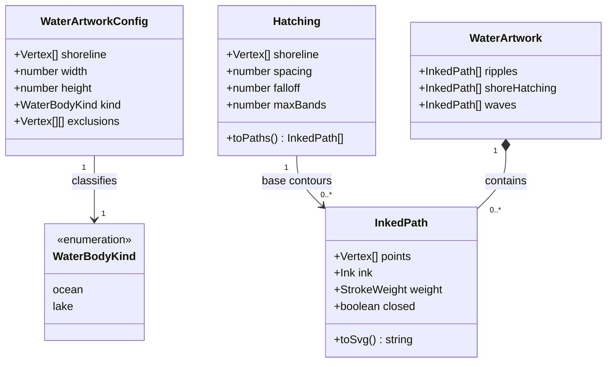

# Region map water rendering

**Status:** implemented — design and domain model approved on 2026-10-12.

Tracked by [#417](https://github.com/ironarachne/ironarachne/issues/417). Extends
[Region Map Cartography](region-cartography.md).

## Problem

Ocean coasts currently use a heavy body-ink stroke, but an inner parchment stroke
removes much of its visible width. Lakes use a faint hairline. Shoreline displacement
has a small, mostly broad noise profile. Water bands follow distance contours as
continuous, regular lines. There are no localized shore cross-hatches or open-sea
wave glyphs.

The requested result is a stronger dark shoreline with small inlets and projections,
occasional light cross-hatching near shore, irregular broken ripple lines, and sparse
wave symbols in seas and oceans.

## Solution and decisions

Keep the geometry and artwork in `src/lib/cartography`, with region-specific composition
in `src/lib/map`. Use vector paths and existing inks. All additions are derived during
rendering; saved map data and generation rules retain their existing shape. Previously
saved regions receive the revised appearance when rendered.

### Shoreline

Keep one processed outline per water boundary for the fill, masks, coastline, glyph
clearance, and river-mouth connections. Remove the ocean's inner parchment stroke and
use dark body ink for both ocean and lake boundaries. Start with the existing heavy
weight for oceans and medium weight for lakes, scaled by `mapScale = min(width, height) / 35`.
Adjust land glyph clearance for the complete visible stroke, including ink displacement.
Do not change shared stroke weights globally.

Retain canonical loop ordering, crop padding, uniform sampling, and Chaikin smoothing.
Add a stronger short-wavelength component to the existing periodic shoreline noise to
produce occasional small inlets and projections. Start with a maximum displacement of
`0.32 * mapScale` and retain the maximum segment length of `0.3 * mapScale`.
Reduce displacement locally near opposing boundary segments, and fall back to the
previous safe outline if the result intersects itself. Preserve narrow channels and
small lakes; artificial closing runs outside the viewport remain outside it.

### Ripples

Preserve the existing `Hatching` model and distance-contour construction as the base
geometry. A new artwork composer turns those contours into short, open runs separated
by unequal gaps. Resample runs before adding small, smooth normal displacement.
Bound that displacement by the distance to the shore and adjacent bands so it cannot
cross land or another ripple. Omit an unsafe run. Start with run lengths of
`1.2–3.5 * mapScale`, gaps of `0.3–1.0 * mapScale`, and displacement up to
`0.08 * mapScale`. Stagger breaks between bands.

Retain four ocean bands, two closer bands for sufficiently large lakes, and no bands
for small lakes. Opacity decreases offshore, leaving most open water empty.

### Shore cross-hatching

Draw intermittent patches just inside the water along the processed shoreline.
Each patch contains two sets of short oblique hairlines, forming light cross-hatching.
Use secondary ink at low opacity, with varying stroke lengths and patch gaps rather
than a repeating pattern. Start with patches spanning `0.8–1.8 * mapScale` and marks
extending no more than `0.35 * mapScale` into water. Omit patches that cannot fit, and
exclude crop closing edges. Apply to ocean and lake shores when there is enough room.
Clip artwork to the corresponding water body and paint the dark coast over it.

### Wave symbols

Use small groups of two or three open wave strokes with pointed peaks and curved troughs
in secondary ink, as requested during visual review on 2026-10-12. Vary
length and slight curvature while keeping the symbols mostly horizontal. Position
them on a sparse, deterministically jittered grid, initially spaced about
`4 * mapScale` apart. Require the entire stroked footprint to lie inside the processed
ocean boundary, beyond the outermost ripple band with additional clearance. Respect
reserved title, compass, settlement, and label bounds. Lakes receive no wave symbols.
Omit symbols in cramped water instead of shrinking them into unreadable marks.

Compute water artwork after label and furniture layout so it can use their reservations;
insert it into the existing water layer below routes, symbols, furniture, and text.
Decoration must not influence label placement or terrain generation.

### Determinism and ownership

Retain the cartography library's existing deterministic geometry hashes for visual
variation. Use canonical geometry and normalized spatial coordinates with distinct
salts for shore patches, ripple breaks, ripple displacement, and waves. Output must
not depend on graph IDs, source winding, loop starting vertex, render order, time, or
mutable counters. No random source or generator RNG consumption is introduced.

`cartography` accepts a processed water outline, map dimensions, its ocean/lake kind,
and generic exclusion polygons. It produces transient inked paths. `map` determines
water kind, converts existing reserved boxes to polygons, assigns SVG groups and clips,
and composes the result. It continues to own connected-water classification and
river-mouth alignment.

## Domain model

The existing `EdgeTreatment`, `Hatching`, and `InkedPath` types retain their shapes.
Add the following types to `src/lib/cartography/cartography_types.ts`; no persisted
types change. `WaterArtworkConfig.shoreline` is the already processed boundary, not
the raw graph polygon. `exclusions` contains closed footprints in map coordinates.

`createWaterArtwork(config: WaterArtworkConfig): WaterArtwork` is the public composer.
Empty or degenerate outlines produce empty artwork. Reject invalid dimensions and
nonfinite geometry. Repeated calls do not mutate input and return identical serialized
paths. Band settings, visual ranges, and wave density are internal style constants,
rather than additional public controls.

## Verification and acceptance

- Geometry tests cover narrow inlets, concave shores, small lakes, crop boundaries,
  finite coordinates, maximum segment lengths, self-intersections, and scale invariance.
- Artwork tests verify unequal ripple breaks, bounded displacement, safe water
  containment including stroke width, sparse separated waves, exclusion footprints,
  no lake waves, and omitted decorations in insufficient space.
- Determinism tests compare repeated SVG output, equivalent loop representations,
  and unchanged input maps. Existing reference coastline and river-mouth tests remain
  meaningful; update clearance expectations to account for the new coast width.
- Render before/after SVGs and image previews using the existing region renderer for
  pinned seeds `alpha`, `bravo`, and `charlie`, plus focused lake, narrow-inlet, and
  open-ocean fixtures. Inspect full maps and shore crops at normal display size.
  Confirm stronger coast ink, varied inlets, light patchy hatching, visibly broken
  squiggly ripples, and occasional legible waves without obscured labels.
- Measure SVG size and render time against the same baseline fixtures. Keep additions
  bounded by visible shore length and ocean area; reuse water definitions and clips.
  Do not relax existing size budgets without measured justification.
- Run `npm run verify` after implementation and `npm run verify:all` before merging
  this rendering change. Preserve the per-library coverage gate.

## Implementation and visual review

The approved work is implemented: shoreline detail and topology safeguards, a shared
water-artwork composer, renderer integration after furniture layout, footprint clearance,
compact SVG subpaths, and geometry/rendering regression tests.

Final styling retains the proposed coast widths, maximum shoreline displacement,
ripple displacement, hatch depth, and wave spacing. Ripple samples use a spacing of
`0.24 * mapScale` to retain visible curves without inflating SVG size. When added
shore detail would intersect itself, the renderer retains the rounded outline before
roughening. Both shore patches and waves honor the full exclusion polygons.
Wave profiles use sampled cubic troughs meeting at explicit cusped crests. SVG miter
joins retain the points with a limit of three; footprint checks include the maximum
tip extension of `1.5 * strokeWidth`.

The six before/after comparisons are in [the visual review](region-water-rendering-417/README.md).
They cover three generated regions and focused ocean, lake, and narrow-peninsula
fixtures. At normal output size, coasts are visibly darker and thicker, the outlines
have more fine variation, ripples have unequal breaks and curved runs, shore hatching
is light and intermittent, and ocean waves remain small and separated. Waves are
deliberately absent where the processed water is too narrow for an offshore footprint.

Verification results, including the full browser run and focused reruns following
visual review, are recorded in the visual review.
