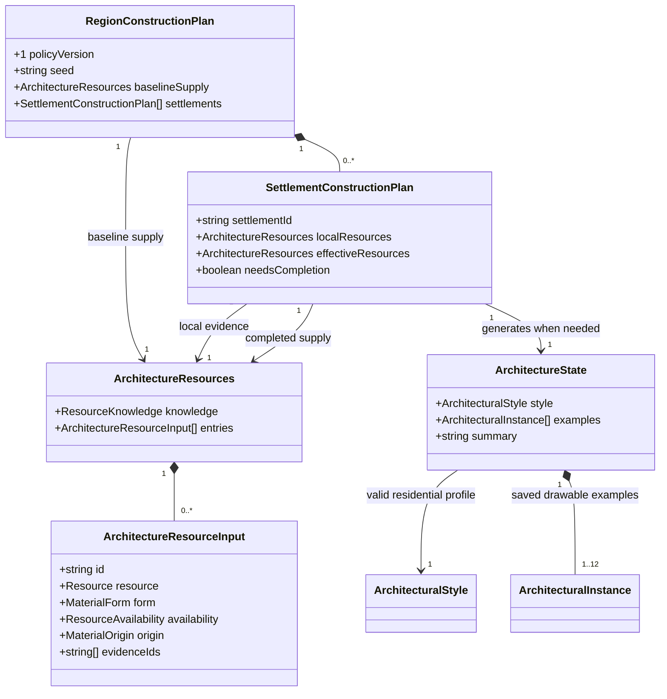

# Architectural coverage for inhabited regions

**Status:** Implemented — generation policy and domain model approved November 2, 2026.

## Problem

Settlement panoramas correctly draw saved architectural examples, but regional generation rarely
supplies a usable construction palette. Across seeds `alpha`, `bravo`, `charlie`, and
`architecture-materials`, only 2 of 28 settlements have building examples. `alpha` and `charlie`
have none. A non-null style alone is not sufficient: an unknown-resource result can have an empty
profile list and no examples.

Two separate causes need addressing:

- The resource adapter recognizes catalog names such as `pine timber`, but a structured timber
  source can arrive as a generic `wood` / `timber` resource and become form `unknown`.
- Valid building materials do not necessarily form a complete construction system. Dressed stone
  alone, for example, does not provide a supported roof covering. Possible processing products are
  sparse and are not guaranteed to supply every required form at every settlement.

The requested outcome is an inhabited region with architectural styles that actually produce
buildings in its settlement banners. The stronger invariant is that every newly generated
land settlement has a valid residential profile and at least one saved, drawable building example.
This necessarily gives an inhabited region at least one usable style. Existing per-settlement style
storage is sufficient; a new region-level style registry is unnecessary for this change.

## Policy

Preserve local evidence first, then deliberately generate the missing construction supply during
region creation. Do not let the illustration renderer fill the gap.

1. Keep `regionArchitectureResources` an evidence-only adapter. Correct recognized structural
   timber forms using typed resource metadata, not presentation text or species-name guessing.
   Raw stone remains raw; reeds do not become finished thatch without processing evidence.
2. Try the existing local palette. Preserve a successful style and its examples unchanged.
3. For an incomplete palette, complete it with a bounded, region-selected construction palette.
   Select a baseline building tradition once from the region seed, considering local construction
   opportunities and climate. Candidate complete systems include timber with boards, and masonry
   blocks/bricks with compatible roof tiles. Run the existing compatibility rules on the completed
   palette; do not assume that having material labels guarantees usable profiles.
4. Supplementary finished materials are generated construction-supply assumptions, explicitly
   recorded as `origin: 'imported'` in the saved architectural materials. They are not claimed as
   local resources, existing manufacturing, named trade partners, or proven transport routes.
   Imported entries have stable IDs and no fabricated regional evidence references. Reuse evidenced
   local entries for equivalent compatible forms before adding imports.
5. Generate each missing settlement's style and bounded examples from its actual saved environment
   and category, using the common regional supply palette where needed. This gives related material
   vocabulary without copying a warm village's roof proportions onto a cold mountain city.
6. Confirm that the result has supported surface residential examples before returning the newly
   generated region. Do not count an empty `partial` style as success or quietly return an image with
   no buildings when this generation invariant fails.

The deliberate new permission is step 4: habitation may imply construction supplies beyond the
resource simulation's currently enumerated opportunities. This supersedes the evidence-only policy
for **new regional generation**, while preserving evidence-only resource queries, stale-reference
behavior, standalone defaults, and saved-data reads. This policy was explicitly approved because
the earlier architectural design forbade a guessed palette.

No new resource, processing, daily-life, or trade facts are manufactured to make the old adapter
return a complete answer. Architectural materials are the record of what buildings use; geographical
resources remain the record of what is locally supported. Architectural prose can describe the
saved construction, but must not turn the imported supply assumption into a claim of local production.

## Domain model

All architecture/resource types below already exist. Only the plan types are new and transient,
owned by `src/lib/regions`; region and settlement snapshot shapes remain unchanged.

The diagram's non-null style and nonempty examples express the successful new-generation branch,
not a change to the existing `ArchitectureState` union. Legacy and unavailable states remain valid
for other callers and saved records. A region with no settlements has an empty plan and needs no
architectural style.

## Placement, persistence, and reproducibility

Ordinary generated settlements must occupy land sites and use their resolved local environment.
An aquatic biome is currently unsupported by architecture generation. Do not simply clear
`isAquatic` or borrow a different biome to force a style through validation. Validate the land-site
invariant in the seed corpus; fix any incorrect land-site classification at its generation owner.
Explicitly authored aquatic settlements and imported legacy settlements retain their existing
unsupported/legacy behavior. This change does not introduce floating or underwater architecture.

Run construction completion in the existing regional architecture phase, after supply generation
and before gazetteer composition. Keep the region's existing non-architectural RNG streams intact.
Derive a versioned construction-policy seed from the region root; derive per-settlement operations
from stable settlement IDs. Candidate ordering is deterministic, and random selection uses
`@ironarachne/rng`. Adding the guarantee must not reroll geography, names, placements, resources,
organizations, or history inputs unrelated to architecture.

Persist the final style, material origins, examples, and architectural summary through the existing
settlement snapshot. Reopening, exporting, and rendering use those records without new generation.
Do not rewrite older saved regions or stale linked settlements implicitly. A fresh regional roll
uses the new policy; a migration that manufactures missing styles is outside this change.

## Acceptance

- New inhabited region fixtures, including the four failing/partial seeds above, have at least one
  usable style and drawable examples for every generated land settlement. Test profile/variant
  references and actual panorama building counts, not merely `style !== null`.
- Existing complete local palettes produce the same architecture as before. Completion retains
  local evidence references, marks supplements imported, and leaves regional resource/trade facts
  unchanged. Test raw rock, generic typed timber, missing roofing, unknown resources, and stale
  evidence independently.
- Same seed/config gives identical saved styles and SVGs; a second seed provides variation.
  Save/reopen preserves architecture and banner equality. Empty regions remain valid.
- Verify local climate/site consistency, partial-generation handling, zero invalid styles, and no
  changes to unrelated generation outputs across a representative coastal, forest, dry, wetland,
  cold, and mountain corpus.
- Run `npm run verify` and the relevant browser checks, including the full rendering suite before
  merge. The PR description must embed before/after settlement-banner samples from actual region
  generation, with their seeds/settings. A curated-material-only specimen is insufficient evidence
  for this particular fix.

Actual generated before/after banners and reproduction instructions are in
[the construction review](regional-construction-review/README.md).
