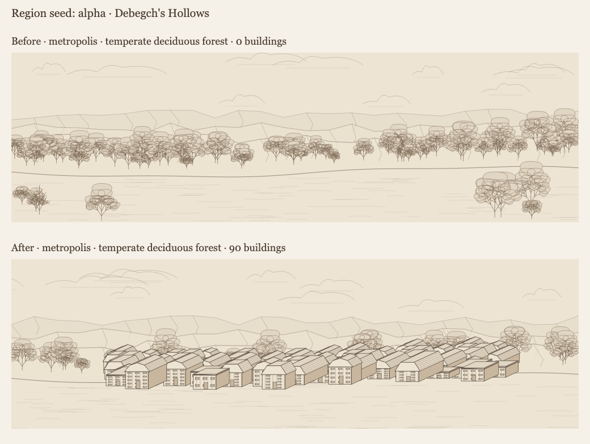
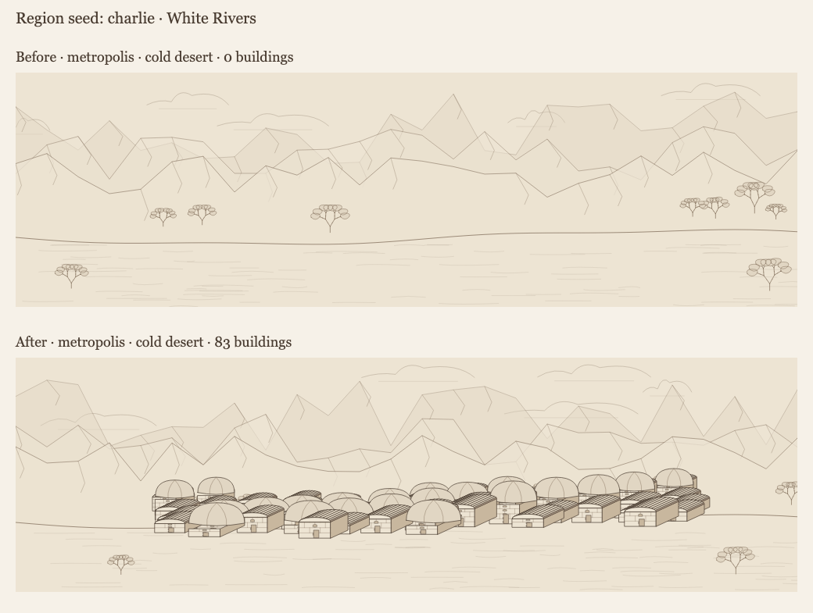

# Regional construction review

These samples use the first embedded settlement from actual region generation, with default
configuration and the indicated root seed. No curated architectural palette is supplied.
The before snapshots were generated at `fd16a5b3`, before construction completion was added.

## Seed `alpha`

The sampled forest metropolis goes from zero buildings to 90. All seven settlements in the region
now have saved architectural examples.

## Seed `charlie`

The sampled cold-desert metropolis goes from zero buildings to 83. All six settlements in the
region now have saved architectural examples.

## Reproduction and coverage

Run `npx vite-node scripts/render_region_construction_review.ts --seed alpha --out /tmp/construction-review`
to render the current generated region's first settlement. Add `--before /path/to/alpha.json` to
compare it with a serialized `rollRegionSnapshot('alpha')` captured from the baseline commit.
Repeat with `charlie`. The script emits standalone SVGs and a comparison sheet; the checked-in PNGs
are Chromium screenshots of those sheets at 1040 × 785, device scale 1.

The four original problem seeds (`alpha`, `bravo`, `charlie`, `architecture-materials`) improved
from 2/28 to 28/28 settlements with drawable examples. The two previously complete styles remain
identical, and the comparison found no changes to other top-level region fields.

A separate audit of `construction-corpus-0` through `construction-corpus-49` covered 352 settlements
across 11 biomes. All had architectural examples and valid land sites. Automated regression tests
check deterministic saved output, valid examples and references, actual panorama buildings,
save/reopen equality, evidence preservation, missing roofing, stale links, and unchanged legacy reads.
