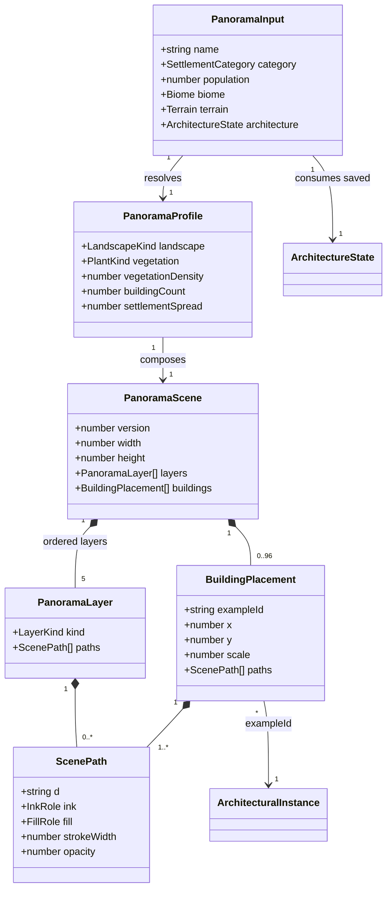
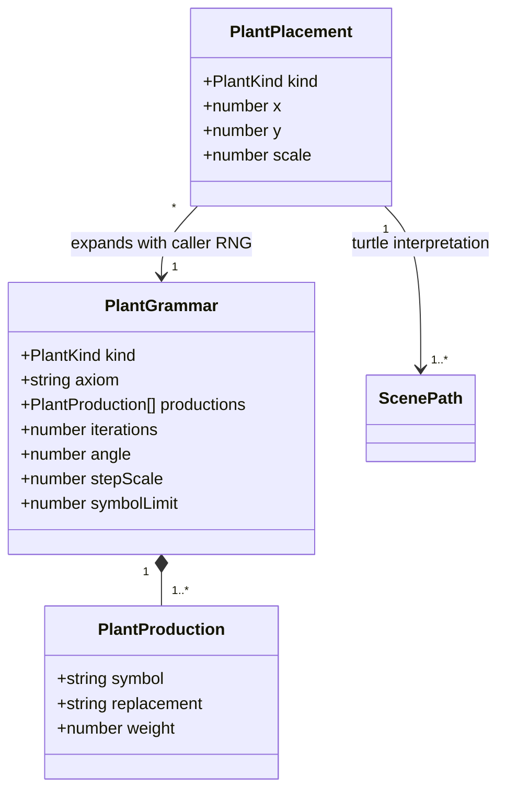

# Procedural settlement panorama banners

**Status:** Implemented — domain model approved November 2, 2026. See the
[visual review and validation record](settlement-panoramas-250/README.md).

Addresses [#250](https://github.com/ironarachne/ironarachne/issues/250).

## Problem and scope

Settlement results need illustrations that express their scale, environment, and saved architecture.
The user's November 2, 2026 direction is panoramic banners with procedurally generated sky,
background, terrain, and buildings. Use 10:3 banners in both the standalone settlement view and the
regional gazetteer. This supersedes the issue's original square regional thumbnails and the earlier
panorama/thumbnail references in `architectural-styles.md`.

The image sits immediately below each settlement heading, above its prose. Keep the heading outside
the image so its readability does not depend on generated scenery. Retain illustrative sepia line
art on parchment, matching the region map. Generate vector geometry at runtime; no stock landscape,
prepainted building sprites, AI image service, or remote assets supply the scene.

This proposal does not change persisted settlement or architecture schemas. Exports, vault editors,
and the region map itself are outside this issue. Landscape and weather are illustrative compositions,
not new geographical or current-weather facts written back into the settlement.

## Existing contracts

- `Settlement` already supplies category, population, environment, and `ArchitectureState`.
- Architecture supplies saved profiles, variants, materials, and up to twelve building examples.
  `docs/architectural-styles.md` requires illustrations to reuse those examples. Repeating an example
  may change its position or projection scale, never its architectural traits.
- Legacy/unavailable architecture has no trustworthy building specification. Render landscape only;
  do not invent a style or silently regenerate architecture. Partial styles depict supported examples.
- The current region view is `RegionGazetteer.svelte`, driven by a snapshot-derived UI document;
  the old issue description's direct list in `RegionGenerator` is no longer the insertion point.
- Use a settlement's own saved environment. Do not infer a second biome from a map node at render time.

## Ownership and public interface

Add a pure `$lib/settlement_illustration` library, with public types in
`settlement_illustration_types.ts` and exports through `index.ts`. It owns biome visual profiles,
scene composition, bounded plant L-systems, architectural projection, and SVG serialization.
Reuse `$lib/cartography`'s public palette and line-work vocabulary where suitable, without changing
map output or importing map settlement sprites.

`buildSettlementPanorama(input)` returns a typed scene; `renderSettlementPanorama(scene)` returns
SVG. Separating those operations makes semantic agreement and geometry testable before serialization.
The component adapter selects only required semantic inputs from a live settlement or snapshot;
it must not hydrate an entire generator merely to draw a banner.

A shared `SettlementPanorama.svelte` in `src/components/locations` owns the decorative image surface.
Both consumers pass equivalent inputs. Regional entries resolve settlements by stable identity,
never name, heading text, or array position. Use the existing presentation identity where available;
if it is insufficient, add an optional settlement reference to the UI document entry, not a saved
snapshot field. It must not leak into Markdown/PDF prose.

## Domain model

All new types below are derived and transient. Referenced `Biome`, `Terrain`, and architecture types
are existing public types, not copies. The literal canvas is 1000 by 300 logical units.

`LandscapeKind` is `woodland | grassland | desert | wetland | coastal | cold | highland | neutral`.
`PlantKind` is `broadleaf | conifer | tropical | grass | reed | cactus | palm | scrub | none`.
These classify drawing grammars, not new environment facts. `LayerKind` is
`sky | background | terrain | settlement | foreground`; building paths belong in the settlement
layer in depth order, while placements retain the source-example relationship for verification.
`InkRole` is `body | secondary | water | none`; `FillRole` is `paper | light | shade | none`.
The serializer resolves those roles through one sepia palette.

## Composition and procedural vocabulary

Use an elevated, oblique landscape view with a continuous horizon, layered distance, and a settlement
cluster grounded in the middle distance. Keep the sky roughly the upper third, distant relief behind
the skyline, and foreground contours below it. Distant objects use finer, lighter ink. Foreground
vegetation can frame the ends but must not obscure the central architectural silhouette.

Every layer has generated geometry:

- **Sky:** seeded cloud bands, broken contours, and sparse hatching; humidity influences cloud cover.
  Keep light direction consistent across clouds, terrain, and buildings. This is an artistic sky,
  not a simulated date, season, or weather report.
- **Background:** displaced ridge curves, foothills, or distant vegetation silhouettes. Mountains
  use overlapping angular ridgelines and slope hatching, not plant grammars. Terrain relief and
  biome jointly determine prominence; a mountain forest can have both ridges and trees.
- **Terrain:** continuous ground contours, slope lines, and biome-appropriate texture. Ground building
  footprints on the terrain envelope. Water appears only with supporting aquatic/coastal/wetland
  evidence, never because an arbitrary composition wants a river or harbour.
- **Vegetation:** bounded stochastic L-systems produce forest branches and crowns; distinct grammars
  produce conifers, tropical foliage, grasses/reeds, and desert scrub/cacti. Palm eligibility requires
  a suitable warm biome; no automatic desert oasis. Vary branching and placement, not just scaling a
  fixed tree icon. Cold and unknown environments may have little or no vegetation.
- **Buildings:** procedurally project walls, roof planes, openings, and material hatch from saved
  examples and their referenced profiles/variants/materials. Support all existing roof forms,
  pitch/eaves, proportions/storeys, portal and window forms, and defining visible features. Tiny
  ornament can disappear at distance; a different roof or material cannot substitute for it.

Resolve recognized biome names through an explicit table, using numeric climate/altitude properties
to refine density and relief. Unknown names get restrained neutral terrain, using explicit numeric
and aquatic facts without inventing species or cultural motifs.

Category sets bounded building-count bands: hamlet 3–7, village 8–15, town 16–28, borough 29–44,
city 45–68, metropolis 69–96. Population selects within the category's existing population range;
avoid duplicating its thresholds. Larger settlements occupy more of the frame and have denser rows.
They do not acquire walls, spires, castles, extra storeys, or stone construction merely from size.
Those require saved architectural evidence. Unknown categories use a conservative small cluster
only when supported building examples exist.

## Reproducibility and budgets

Canonicalize the consumed semantic fields into a versioned seed payload. Include name, category,
population, biome/terrain drawing facts, and saved architecture used by the renderer; exclude prose,
runtime metadata, and unrelated enrichment. Instantiate one local `RNG` at the public scene-builder
boundary and pass it through all composition and L-system helpers in fixed layer order. Rendering
does not consume a page's RNG, mutate the settlement, or generate new architecture.

Identical inputs produce identical scenes and byte-identical SVG within a renderer version, including
after save/reopen and across the two views. Changes to defining inputs intentionally redraw the image.
No clocks, browser randomness, global counters, network calls, or unseeded noise affect output.

Cap buildings at 96, visible plants at 120, grammar expansion at 2048 symbols per plant and four
iterations, and the final drawing at 20000 path segments. Reduce distant hatching and vegetation
detail first when approaching the budget; never truncate a required roof or wall mid-path. Validate
finite coordinates and escape XML. SVG contains no scripts, external links, or embedded user markup.

## Presentation and acceptance

Use an SVG data URL in an image with empty alt text, explicit dimensions, `width: 100%`, and automatic
height. Preserve 10:3 at 320px; do not crop, stretch, or force a desktop minimum width. Reserve image
space to avoid layout jumps and lazily load regional images below the fold. Derive images only when
their semantic input changes, not on unrelated component updates.

Acceptance requires a reviewed matrix of all six settlement categories and representative forest,
grassland, desert, wetland/coastal, cold, highland, and unknown biomes. Include identical settlements
in both views, generated/partial/legacy/unavailable architecture, every roof form, mixed materials,
multiple seeds, and a dense regional list. Inspect desktop and 320px output for depth, clear banner
composition, grounded buildings, architectural fidelity, excessive repetition, and text overflow.

Unit checks cover same-input equality, seed variation, semantic references, grammar limits, finite
geometry, valid XML, all scale/biome branches, fallback behavior, and strict complexity bounds.
Measure complete-region generation time and SVG size before accepting the budgets; report measured
results rather than assuming lazy image loading eliminates synchronous scene-generation work.
Provide `scripts/render_settlement_panoramas.ts` for reproducible specimen sheets and visual review.
Run `npm run verify` and `npm run verify:all` before merging implementation. Maintain the per-library
coverage gate without exemptions. No implementation work-item breakdown is made until this model
has human approval.

Implementation uses the existing category record (including its population bounds) as input, avoiding a second size table or a runtime dependency on settlement generation. The regional consumer resolves the existing stable settlement anchor directly; no presentation or snapshot schema addition is needed.
