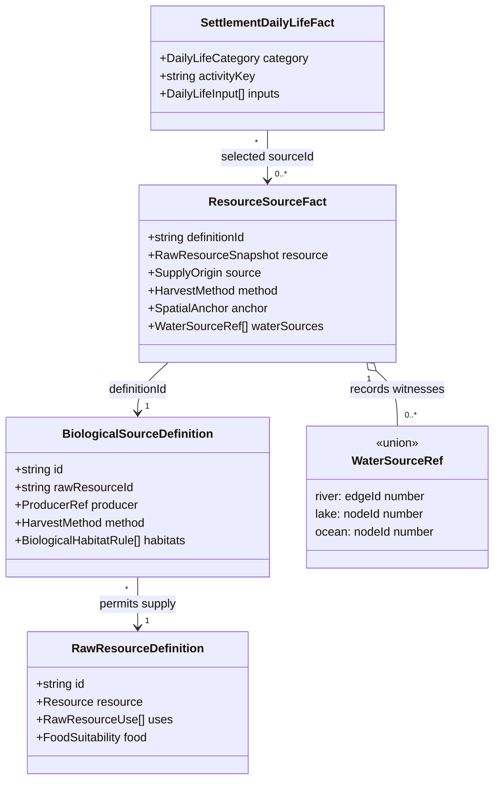

# Shellfish harvesting and food classification

**Status:** implemented for [#438](https://github.com/ironarachne/ironarachne/issues/438);
the human reviewer approved the design and domain model on 2026-10-15.

## Problem

After #364 and #365, reviewed aquatic sources already carry harvest methods, water
witnesses, food policies and stable identities. The older generic `crayfish` species
still derives `organic/insect_meat` solely from its chitinous body plan. It is distinct
from the reviewed `noble crayfish` producer. Default regional generation uses reviewed
sources, so generic crayfish currently lacks a qualified food source; older catalog
callers can still obtain misleading insect meat.

The access adapter recognizes reviewed definitions by ID, but does not recheck their
water requirements against the current map before supplying processing consumers.
Its recursive evidence checker follows fact references and stale markers, rather than
comparing stored water witnesses with current river/lake/ocean geometry. Shellfish
inventory classification also depends on a list of commodity minor types that omits
the existing `bivalve` type. These paths should agree on the source's acquisition
method and habitat requirements.

## Decisions

1. Reuse the approved [raw-source model](fantasy-raw-resource-sources.md). Add no
   persisted fields, enum members, migration version or new resource kind. Anatomy,
   commodity classification and acquisition remain separate existing concepts.
2. Add a narrowly scoped reviewed source definition for canonical species `crayfish`,
   with its own raw key `crayfish-flesh`, method `shellfish-collection`, food policy
   requiring ordinary handling/preparation, and classification `animal-food/crayfish`.
   Reuse the existing freshwater-crayfish habitat profile. Keep this producer distinct
   from `noble crayfish`; never infer a species identity from a displayed name.
3. For species with explicit reviewed aquatic food definitions, the public species
   resource derivation uses those food products instead of anatomy-inferred meat.
   Retain eligible non-food carcass products and the existing behavior of terrestrial
   species. Generic unreviewed crustaceans do not acquire food permission from anatomy
   alone. Review generic crab alongside crayfish to prevent the same insect-meat
   fallback, without treating it as Dungeness crab or expanding its food catalog.
4. Use reviewed source methods `fishing` and `shellfish-collection` to classify
   aquatic food inventory as the existing `fish` resource kind. This is the existing
   aquatic access bucket, including shellfish; commodity types remain specific.
   Other food sources retain `food`. Include bivalves without parsing names or
   maintaining a separate minor-type list.
5. Centralize current aquatic-source qualification in Regions. Require a recognized
   definition matching the saved producer, raw key and method; current occurrence and
   habitat evidence; compatible habitat conditions; and a saved water witness that
   still adjoins the selected land anchor and satisfies the definition's freshwater
   or coastal requirement. A river must still carry water; a lake must be non-ocean
   water; an ocean witness must still support a coastal margin. An unrelated water
   body cannot replace a removed witness implicitly. Check each selected anchor,
   rather than accepting water beside some other anchor in a grouped source.
6. Apply that qualification before offering raw supply to processing or daily life,
   including new claims derived from retained products.
   Keep the current settlement shore-access restriction for aquatic livelihoods and
   the current reachable-land rule for processing collection. A reachable inland
   settlement may process material collected at an accessible bank, but does not gain
   a local shore livelihood there. Missing, stale, dry, wrong-salinity or inaccessible
   support omits the opportunity. Water alone never establishes an animal source.
7. Livelihoods use the saved qualified harvest method and source input; staples use
   saved food policy. Retain source IDs, requirements and water witnesses. Do not add
   shellfish to generic meat smoking/drying recipes: food eligibility does not review
   a preservation process. Existing recipes may consume it only when their selectors
   explicitly permit its reviewed raw key.
8. Preserve authored and legacy saved content on read, export and round trip. Apply
   stronger live-catalog/map checks when deriving new opportunities, without rewriting
   saved activity names, food policies or provenance. Saved-only validation remains
   independent of the live catalog. Regeneration follows the existing explicit edit
   and regeneration mechanisms.
9. Keep caller-owned RNG, stable source ordering and existing selection caps. Same
   seed and equivalent inputs must repeat exactly after the correction; historical
   seeds may produce different newly generated output because eligible inputs change.

## Domain model

These are projections of existing approved types, not replacement declarations.
Unshown fields, FactBase inheritance and existing union alternatives remain intact.
`HarvestMethod` already includes `shellfish-collection`; `WaterSourceRef` already
distinguishes `river`, `lake` and `ocean`.

The live qualification result is computed, not persisted. The cardinalities describe
recognized sources during new generation; historical saves do not require a surviving
live definition to remain readable.

## Fit within region generation

The region pipeline establishes physical geography, habitats and ecology before raw
resources; habitation then precedes managed production, processing, livelihoods and
supply assessment. This correction belongs at the existing source-to-resource
boundary and its shared consumer adapter. It should make those stages tell a
compatible story without relocating settlements, manufacturing occurrences or
introducing a parallel shellfish subsystem.

The useful regional distinction is occurrence versus usable supply versus a selected
way of living. A crayfish population can exist without a retained resource summary;
a retained shellfish source can exist without a selected collection livelihood.
Resource selection keeps at most three entries per kind, and daily life has its own
caps. Putting bivalves into the aquatic bucket changes which aquatic resources
compete for those slots. Tests must distinguish ineligible sources from eligible but
unselected opportunities; this issue does not promise a shellfish livelihood at every
suitable settlement or justify changing the global caps.

Keep intrinsic source validity separate from consumer access. Freshwater/coastal
compatibility and surviving water witnesses apply to every new use of a source.
Whether a settlement can use that valid source is a separate policy. Share the
validity predicate through the raw-resource adapter so processing, livelihoods and
supply capability assessment cannot each interpret the same shellfish differently.
Do not make the persisted resource kind or carcass minor type the authority for
harvesting method, edibility or salinity.

There is an existing access-policy limitation to account for: processing accepts
reachable collection anchors, but daily-life and supply product checks recursively
apply settlement-site aquatic access to their raw leaves. Consequently, a product
generated from a distant reachable shore may be omitted from settlement daily life
or supply support. Decision 6 preserves these current policies; it does not claim
that every generated product becomes a usable daily-life input. Characterize this
case in tests and flag it separately rather than silently changing collection,
processing and consumption access rules inside a shellfish correction. A subsequent
access-policy design could distinguish direct harvesting from using a locally made
product, without presuming boats, travel distances or trade.

Public carcass derivation is a compatibility boundary, not the authority that grants
regional food opportunities. Its correction must avoid turning every reviewed
species into an anatomy-derived food source, bypassing managed production, or
dropping unrelated hide/chitin products. The regression matrix must verify both the
public catalog result and the independently qualified regional source.

Shellfish need no new finished recipe to be useful: the approved raw-food policy
already permits representative collection and food opportunities with handling
qualifications. Preserved provisions remain a separate reviewed capability. Supply
assessment must continue to describe an incomplete food picture rather than treating
raw shellfish as evidence of stored provisions or a sufficient diet.

## Validation required after approval

Cover generic crayfish and reviewed freshwater/coastal shellfish, including bivalves,
alongside terrestrial deer and terrestrial chitinous fixtures. Assert correct resource
types, collection activities, staple policies, provenance and recipe compatibility.
Exercise river and lake positives, ocean-only rejection for crayfish, freshwater-only
rejection for coastal shellfish, missing occurrence, stale habitat/source evidence,
removed or changed water witnesses, disconnected collection anchors and an inland
settlement connected to a distant shore. Rename displayed facts to prove selection
uses stable source metadata.

Include supply-capability regressions, selection-cap behavior and the existing
distant-shore product-access limitation described above. Prove that correcting an
aquatic source does not grant unrelated recipes, management modes or stored-food
capabilities.

Verify authored/legacy snapshot round trips, repeated-seed generation and the reported
`5wyedz5q272fz` scenario using current generation options. Run focused library tests
while implementing, then `npm run verify`. No rendering changes are proposed.
