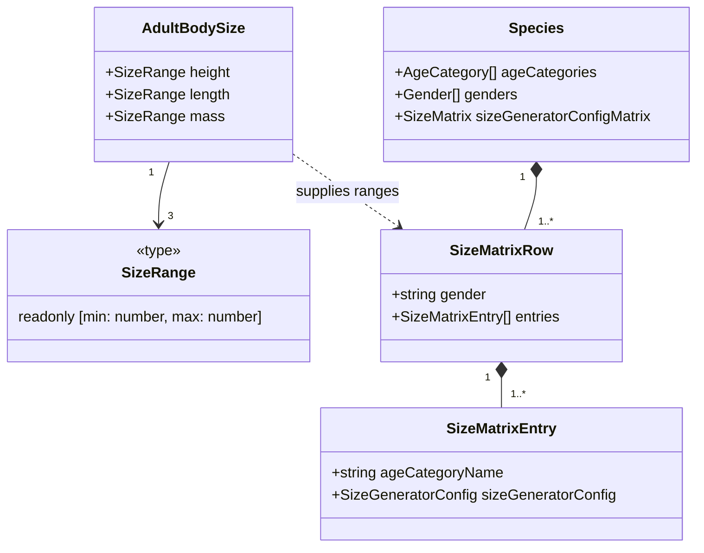

# Species size ranges

**Status:** Implemented for [issue #25](https://github.com/ironarachne/vastways/issues/25).

The roster has 182 animals and monsters whose size matrices copy human measurements. Those
matrices also omit life stages such as kitten, puppy, and hatchling, which makes valid age
selections fail at generation time.

## Decisions

- Store a representative adult range in each affected species definition. Generic animals use
  a familiar representative or a practical range across related animals and breeds. Fantasy
  dimensions are setting estimates based on body plan and relative scale. Sexes share the
  authored ranges.
- Use centimeters for standing or shoulder height and for body length. Body length follows the
  main axis, normally head to tail, or the greatest shell/body dimension for animals such as
  crabs and terrapins. Bird length runs from bill to tail. A measurement without a useful
  physical meaning is zero.
- Author mass in kilograms and use the same bounds for weight, which is the field creature
  generation already reads. Incorporeal forms have zero physical mass. Measurements with
  fractional bounds use the same seeded RNG as whole-number measurements.
- Build a matrix from each species' declared age and gender names. The first pre-adult stage
  uses 35–60% of adult linear dimensions and 8–25% of adult mass. The second pre-adult stage,
  where present, uses 65–90% and 30–75%. Adult and elderly stages share bounds. These are generic
  growth estimates, independent of the existing lifespan years.
- The existing SizeMatrix and stored creature shape carry these values. Previously saved creatures
  retain their recorded dimensions, and newly generated creatures use the new bounds. The species
  picker in #19 remains separate.

## Domain model

## Reference points

- The rat uses the brown rat as its reference. [University of Michigan BioKIDS](https://www.biokids.umich.edu/critters/Rattus_norvegicus/)
- The crow uses American crow length and mass. [Cornell Lab of Ornithology](https://www.allaboutbirds.org/guide/American_Crow/id)
- The horse represents a riding horse, with height measured at the withers. [University of Minnesota Extension](https://extension.umn.edu/agriculture/animals-and-livestock/horse/estimating-horse-bodyweight)
