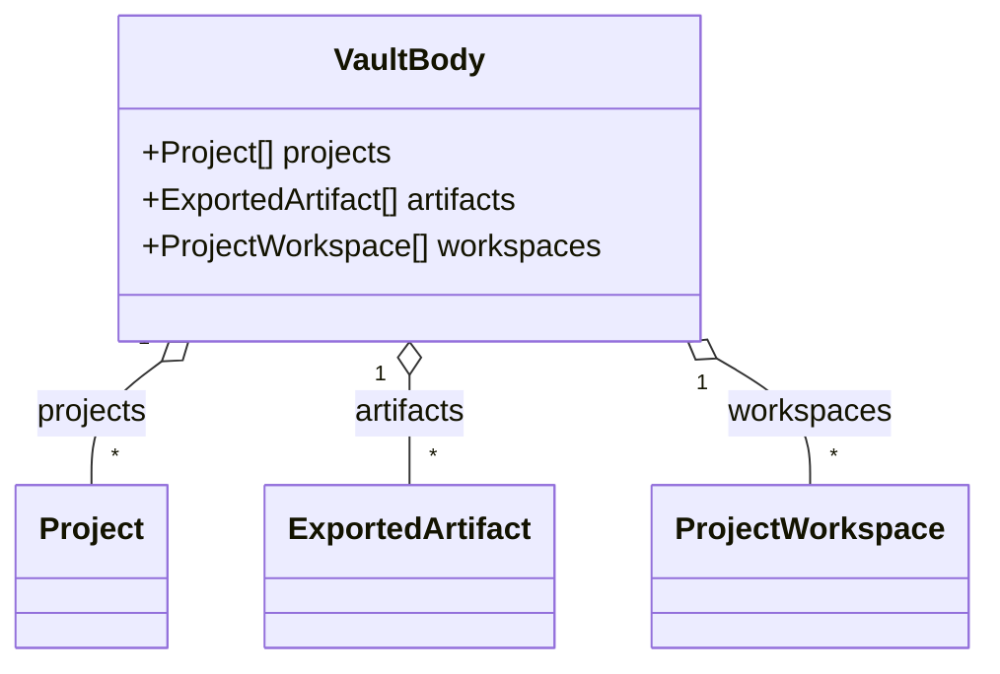

# Vastways domain and hosting rollout

**Status:** proposal for review. Tracks [#510](https://github.com/ironarachne/vastways/issues/510).

Move the three Vastways environments to their new domains and Bunny Storage. The cutover must keep
old tool links usable and give returning users a way to bring their work across from the old
production hostname. The studio site links to the new production address once it is ready.

## Environment inventory

| Environment | Current hostname          | Current pull zone | New hostname           | New pull zone | Bunny storage zone |
| ----------- | ------------------------- | ----------------: | ---------------------- | ------------: | ------------------ |
| Dev         | `dev.ironarachne.com`     |           6245647 | `dev.vastways.app`     |       6974932 | `vastways-dev`     |
| Staging     | `staging.ironarachne.com` |           6245673 | `staging.vastways.app` |       6974950 | `vastways-staging` |
| Production  | `app.ironarachne.com`     |           6245674 | `vastways.app`         |       6974897 | `vastways-app`     |

On November 9, 2026, HTTPS reached Bunny at all six hostnames. The current homepages returned 200
and all three new homepages returned 404. The pull zone IDs above came from the public
`cdn-pullzone` response header. Before uploading, check the storage IDs, primary regions, origin
attachments, and certificate settings against the authenticated Bunny configuration. Public HTTP
responses do not establish which storage zones are attached or what has been uploaded.

## Publishing and infrastructure

- Adopt the provisioned pull zones, custom hostnames, and repository-managed DNS records into the
  corresponding OpenTofu environment states. Reference the existing storage zones by ID, as the
  studio stack does. Give the new resources separate addresses in state so the old pull zones,
  hostnames, and Scaleway origins can serve redirects, recovery, and rollback. Review each plan for
  unintended replacements or deletions before applying. The Scaleway state backend has a separate
  lifecycle from the former website origins.
- Keep the [versioned artifact contract](deployment.md). Dev publishes the unpacked build archive
  from `main`. Staging and production fetch the same release archive and verify its published
  SHA-256. Add an explicit way to seed each new origin with the environment's pinned release so a
  cutover does not require changing `deploy/staging.version` or `deploy/prod.version` to force a
  publish. Serialize all writes to an environment, including bootstrap and rollback.
- Reuse the studio's Bunny HTTP upload pattern. Resolve the storage zone from the expected pull
  zone and require the expected ID and name before writing. The existing `BUNNYNET_API_KEY` can
  look up the zone upload credential and purge its CDN cache if it has the required access. Check
  this in dev before planning any secret changes. Use the region-specific storage endpoint and
  upload checksums. [Bunny Storage HTTP API](https://bunny.net/docs/storage/http) ·
  [Bunny cache purge API](https://bunny.net/docs/api-reference/core/pull-zone/purge-cache)
- Upload `/_app/immutable/` first and retain previous hashes for cached shells, open tabs, and
  rollback. Publish mutable files after all required assets are available. Remove stale mutable
  files only after a successful upload, then purge only the target pull zone. Verify through the
  public hostname that hashed assets receive `public, max-age=31536000, immutable` and mutable
  files require revalidation. Use Bunny response/cache rules if the Storage API cannot set the
  required headers. Keep the matching prior artifact available for rollback.
- Preserve the [static hosting contract](static-hosting.md). Serve directory `index.html` files on
  cold loads and use `/404.html` with HTTP 404 for missing pages and assets. Test slashless known
  routes with query strings. If Bunny does not normalize those URLs with the full query intact,
  add a CDN redirect for known page paths from the route manifest. Recheck the directory and 404
  behavior through the public hostname even when a local preview passes.

## Old links and browser-local saves

### Redirects

On the legacy pull zones, redirect each old hostname to its matching new hostname. Use temporary
redirects with a no-store policy while checking the cutover, then switch to permanent 301s when
the live checks pass. Use Bunny's documented `https://<new-host>{{path}}` form to carry the path
and query into the target, and match only the corresponding legacy hostname. Let the new host
handle slash normalization. Keep legacy `/_app/immutable/` requests on the old host while the
fallback is available so already-open tabs can finish loading. Keep the pinned recovery assets
available until the recovery page closes. [Bunny redirect variables](https://bunny.net/docs/cdn/edge-rules/dynamic-variables)

Verify the raw `Location` header as well as the final browser URL and tool output. On the current
Scaleway-backed host, `/culture?seed=bright%20moon%2B7&view=a%26b` returned `Location: /culture/`,
dropping both parameters. Include slashless and slashed tool URLs, nested routes, `/saved-data/`,
fragment links, repeated query parameters, and percent-encoded seeds in the redirect checks. Check
old HTTP and HTTPS links, the cache headers on temporary redirects, and that dev and staging never
redirect into production.

### Recovery on the old production hostname

Browser storage is scoped to the origin. The old and new hostnames have separate IndexedDB and
local storage, even in the same browser profile. A backup file is the bridge between them.
[Browser origin and storage rules](https://developer.mozilla.org/en-US/docs/Web/Security/Defenses/Same-origin_policy)

Before switching production links, publish a small `/recover/` page on `app.ironarachne.com`.
Reuse the existing whole-vault exporter, including the normal legacy save adoption that runs on the
old origin. Offer export and help on that page, and send editing and import links to the new app.
Keep the recovery page, its static dependencies, and any requests it needs outside the legacy
redirect rule. Account for SvelteKit's client-side navigation when testing those exceptions. Keep
the old hostname and certificate, and pin the tested recovery build and its assets there. Show
the old-host recovery link on the new app and in the release announcement. Before cutover, post a
notice on the old app with the move date and backup instructions. Keep the recovery page out of
search results.

Keep the exporter available for **one week** after production cutover and include the closing date
in the move notice. Check for outstanding recovery requests before removing the page. Keep the
legacy hostname redirects active after the exporter closes so bookmarks and shared links still work.

The user-facing instructions should use the app's existing control labels:

1. On the same device and in the same browser profile that holds the work, visit
   `https://app.ironarachne.com/recover/` and choose **Export everything**. Save the resulting file
   locally. Before cutover, the same export is available under **Storage** on the old Projects page.
2. Go to `https://vastways.app/projects/#storage`, choose **Import from file…**, and select the
   backup. Use the default **adds to what is here** to keep any work already on the new site.
   Import the vault once. The **replaces everything (restore)** option is for intentionally replacing
   the destination vault.
3. Open an imported project and confirm its artifacts and workshop panels. Keep the backup and
   use the new address for new work. Repeat on any other device or profile with separate saves.

### Domain model

The transfer uses the existing `VaultBody` in
[`vault_file_types.ts`](../src/lib/vault_file/vault_file_types.ts). The rollout changes where each
browser stores its copy. The file format and persisted record types stay the same.

## Rollout order and gates

| Step                 | Work                                                                                                                                                                                                | Gate before advancing                                                                                                                                      |
| -------------------- | --------------------------------------------------------------------------------------------------------------------------------------------------------------------------------------------------- | ---------------------------------------------------------------------------------------------------------------------------------------------------------- |
| Prepare              | Record old and new config, origin attachments, version pins, archive checksums, and rollback access. Keep new hostnames out of search until ready.                                                  | OpenTofu plans preserve legacy resources. A release archive and its checksum can be fetched.                                                               |
| Dev                  | Bootstrap the dev storage zone and enable publishing from `main`. Once the new endpoint passes smoke checks, enable the old dev redirect.                                                           | Verify a publish reaches the right zone, along with cache headers, old hashed assets, a cold nested route, HTTP 404, and a rollback rehearsal.             |
| Staging              | Publish a pinned release through the staging promotion path. Rehearse the redirect and recovery rules on the two staging hostnames using synthetic saves.                                           | Verify artifact checksum, same seed result, exact redirect destinations, and a two-origin backup and import rehearsal. Repeat on a narrow mobile viewport. |
| Production rehearsal | Publish the tested release to `vastways-app` while the old production site still serves traffic. Publish and check the old-origin recovery page and leave its dependencies available.               | Confirm the intended build, TLS, cold route and cache behavior, and recovery from a browser profile with synthetic work created on the real old origin.    |
| Production cutover   | Enable temporary legacy redirects and the recovery exceptions. Change the studio links and publish the move notice. Enable production indexing once the new canonical URLs and sitemap are correct. | Check the old bookmarks, backup flow, studio link, and intended release from the live hostnames. Make the redirects permanent when those checks pass.      |
| Wrap up              | Record the cutover result, fallback version, and recovery closing date in #510. Remove the recovery page after the announced window and leave the legacy redirects active.                          | Confirm the old links still resolve after cleanup.                                                                                                         |

Verify backup import with whole-vault JSON and a ZIP with saved images. Include multiple projects,
workshop panels, artifact references, and an adopted legacy save. Check a clean destination and a
destination with existing work. Confirm existing work survives the default add mode and the source
vault still opens on the old origin. Run `npm run verify:all` for app route and UI changes, then run
the HTTP and browser checks against the real CDN, where slash handling and caching can differ.

Audit canonical URLs, sitemap, social metadata, and deployment summaries. The production social
image currently names `app.ironarachne.com` in `src/app.html`. Generate public metadata for
`vastways.app` while keeping one promotable build. Use `X-Robots-Tag: noindex` at the CDN for the
old recovery page, production preview, and the dev and staging hosts if approved. The old dev and
staging homepages returned no `X-Robots-Tag` in the baseline check.
Update Studio Website's `extra.vastways_url` after the new production endpoint passes the gates.

## Rollback

- Stop at the current environment on TLS errors, an unexpected release or origin, failed deep
  links, missing assets, or failed recovery. Hold higher environments until the failed gate passes.
- Before permanent redirects, disable the affected legacy redirect, purge its pull zone, and
  verify the old hostname serves the pinned fallback. Revert public links if production is
  affected. Leave old-origin recovery reachable.
- Once users can save on the new hostname, prioritize restoring a known-good build at that same
  hostname. Republish the prior checked archive to its Bunny zone, or repoint that pull zone to
  the Scaleway origin if it is still available and the storage service is the failure. Purge and
  test again.
  Keep the new host reachable for users who have already saved there. A browser may retain a
  permanent redirect, so reversing it can create a loop and does not move saved data back.
- Keep each Scaleway website origin until the corresponding cutover checks pass. Keep the old
  production origin available through the recovery week if it serves the exporter. Once recovery
  closes, keep the previous release archive and checksum as the fallback.

Review the recovery-page approach and the new environment indexing policy before implementation.
Record the exact cutover and fallback versions and the Bunny resource IDs during the dev rehearsal.
