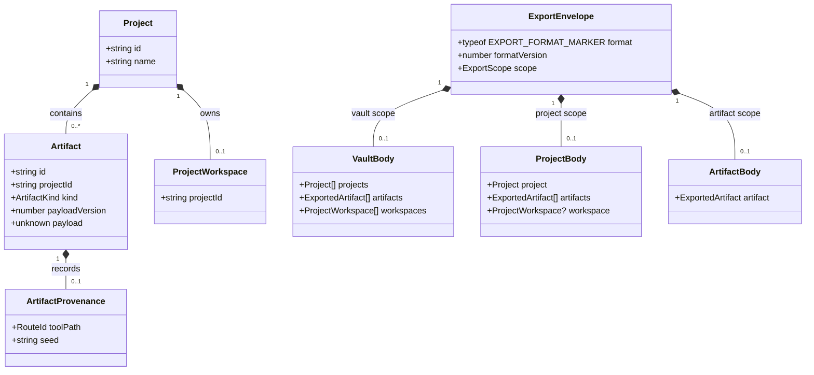

# Vastways app rebrand

**Status:** implemented. The app design was approved on November 8, 2026. The name, celestial-bloom
logo direction, and primary palette were approved on October 28, 2026. This covers the app scope of
[#460](https://github.com/ironarachne/ironarachne/issues/460).

Implementation is tracked in [#502](https://github.com/ironarachne/ironarachne/issues/502)
for the brand assets and [#503](https://github.com/ironarachne/ironarachne/issues/503) for
the app and exports.

## Product and studio

Vastways is the browser-based workshop for building tabletop role-playing worlds. Use Vastways for
the app, its pages, and the documents it produces. Use “By Iron Arachne” as the studio byline in
the app footer, linked to `www.ironarachne.com`. Keep Ben's author credit and the source link.

Use “Build worlds for the table.” in the home hero in place of “Weave Your Universe”. Use
“A browser-based workshop for building tabletop role-playing worlds.” as the short description.
Home can expand on how to generate, edit, and save results in projects, with the existing links
to the workshop and backups.

Keep Inclusive Sans for body text and controls and Cinzel Decorative for the existing display
headings. Use the outlined Fenwick Woodtype Regular lettering in the logo SVGs. The app will
load those outlines as images. PDFs keep their existing document typography.

## Logo

Use the approved vector geometry already checked in under `branding/logo/`. Use the stacked
lockup in the home hero, the compact horizontal lockup in the top bar, and the simplified bloom
at favicon and app-icon sizes. Keep the curves and proportions when cropping the prototype
viewboxes for production. Review the [approved logo sheet](../branding/logo/vastways-review.png).

Use plum lettering and copper ornament on ivory. On the dark app surfaces, use the reversed
lockup with ivory lettering and copper ornament. Keep plum and ivory one-colour variants for
single-ink use. Give the visible artwork clear space on every side of at least half the height
of the central star in that variant. Use flat backgrounds.

Start with a minimum visible wordmark height of 20 CSS pixels in the header and a minimum
visible width of 180 CSS pixels for the stacked hero. If the narrow header cannot fit the
horizontal lockup at that size alongside the menu and current project, use the simplified mark
and keep “Vastways” as the home link's accessible name. Keep the 44px touch target. Check the
smallest favicon at 16 pixels and use the ivory mark on a plum tile where the browser controls
the surrounding background.

## Colour roles

Keep the app's dark surfaces and component geometry. Use plum for raised surfaces, ivory for
primary text, and copper for ornament and emphasis. Copper has 3.62:1 contrast on plum and
3.87:1 on ivory. Use lighter copper for links and readable accent text on dark surfaces.

| Role                     | Proposed value                  | Contrast on raised plum |
| ------------------------ | ------------------------------- | ----------------------: |
| Page, raised, inset      | `#241827`, `#352038`, `#1D1320` |                         |
| Primary text             | `#FCF8F0`                       |                 14.01:1 |
| Secondary text           | `#D5BFD3`                       |                  8.64:1 |
| Labels and quiet text    | `#BAA3B9`                       |                  6.38:1 |
| Link and accent text     | `#F3B788`                       |                  8.44:1 |
| Hovered link             | `#FFD7B9`                       |                 11.08:1 |
| Keyboard focus           | `#FFCA74`                       |                  9.86:1 |
| Essential control border | `#957592`                       |                  3.70:1 |
| Decorative divider       | `#5D425D`                       |                  1.70:1 |
| Success                  | `#9FD6A8`                       |                  8.95:1 |
| Warning                  | `#FFD58C`                       |                 10.70:1 |
| Error                    | `#F6A5B4`                       |                  7.74:1 |
| Information              | `#B8CEF4`                       |                  9.31:1 |

These ratios are for flat swatches. Measure text and control states against the surfaces they
actually sit on, including gradients, dialogs, and genre panels. Require 4.5:1 for text and 3:1
for essential control boundaries and focus indicators. Keep inline links underlined and keep
the 2px keyboard focus indicator. Use visible text or icons alongside status colours.
Use plum ink on ivory panels if an app surface needs a light treatment. Retain the fantasy,
science-fiction, cyberpunk, and horror accents and panel shapes. Retune their mixes against the
new base so text remains readable and decorative panel edges stay in their 1.3:1 to 2.2:1 band.
The colour treatment applies to the UI, with each generator retaining its own artwork palette.

## Asset ownership

Publish the production Vastways lockups, icon family, social card, palette, and usage guidance
under a dedicated `vastways/` tree in `ironarachne/ironarachne_branding`. Use the approved
prototype as the source for the outlined logos and derive the web exports there. Include the
shared OFL typefaces and their notices in the Vastways distribution. Ship the outlined artwork
as the logo asset.

Keep two independent commit pins using the existing manifest structure. The Vastways pin maps
only the Vastways distribution to app paths. The studio pin keeps the current landing mappings
and existing studio commit. Extend the existing sync script to select a pin explicitly and
support the current sync, drift check, and offline local-clone modes for both. Verify each pin
by comparing the vendored bytes to its source commit. Remove retired app copies after replacing
their references and mappings. Keep the studio mappings available for the landing-site handoff.
Update [the asset workflow](brand-assets.md) with ownership and commands.

## App surface audit

- **Shell and home.** Replace the lockups and alternative text in `TopBar.svelte` and
  `HomePage.svelte`. Apply the new copy and update `Footer.svelte`. Check the shell on loading
  and error pages and update the named tab warning in `VaultTransferControls.svelte`.
- **Browser and social.** Update titles across app routes and add a Vastways title to the error
  page. Use the short description for home and accurate tool descriptions where present. Publish
  Vastways Open Graph site, title, description, and image metadata with a preview image hosted at
  the production origin. Wire the manifest, favicon, touch icon, and theme colour through
  `src/app.html`. Replace referenced browser tiles and retire unreferenced studio icons.
- **PDFs.** Update the project-book cover and document properties in `project_book_layout.ts`
  and the shared science-fiction sheet masthead in `scifi_sheet_layout.ts`. Set the creator
  and meaningful document titles across character and text PDF entry points. Preserve project
  names, legal credits, and print layouts.
- **Downloads and imports.** Use `vastways-…` for newly generated vault, project, and artifact
  backup filenames in `vault_file_export.ts`. Keep filenames based on the generated work where
  they already describe it. Update transfer messages to name Vastways and explain that files
  from Iron Arachne are supported.
- **Documentation and release.** Update the README, contributor and deployment guides, and
  current brand guidance. Publish a new release announcement that explains the app name, studio
  relationship, and continued access to saved work. Keep dated release entries and original
  attribution accurate.

Keep the GitHub repository, `@ironarachne/*` packages, release archive names, legal attribution,
and the Iron Arachne ruleset under their existing names. The ruleset name identifies the studio's
mechanics and appears as such in the app.

## Domain model

The diagram shows the existing records the rebrand must preserve. The rollout uses the same
data types and versions.

An envelope has exactly one body, selected by its scope. JSON and ZIP backups continue to use
the existing envelope and binary asset handling. Keep the IndexedDB database
`ironarachne.vault`, the `ironarachne.save.v1.` storage prefix and active-project pointer, the
tab coordination channel, and renderer preferences. Keep the `ironarachne.export` marker and
the legacy `ironarachneExport` reader. Import compatibility depends on the file's contents.

## Rollout and verification

Launch the rebrand at `https://app.ironarachne.com`. Existing routes, seeds in query strings,
and links from the studio site keep their destinations. Browser data stays on the origin where
users saved it. The release announcement can say “Iron Arachne is now Vastways. Your projects
and saved results are still here in this browser.” Reserve `vastways.app` for a separate rollout
decision. The studio landing repository and publishing handoff belong to the studio-site scope
of #460. [Domain purchase note](https://github.com/ironarachne/ironarachne/issues/460#issuecomment-6471199833)

If `vastways.app` later becomes the app origin, first test exporting a vault on the old site and
importing it on the new one, including workspaces, saved images, legacy data, and references.
Agree on an old-origin recovery period and keep the backup tools reachable there. Validate
redirects with their paths and query strings intact before switching public links. Confirm any
handles intended for that public rollout.

Before merge, run `npm run verify:all`. Review the desktop shell and home hero, all five phone
widths with a long project name, keyboard focus in navigation and dialogs, the rendered contrast
of all genre skins, browser icons, and representative PDF pages and metadata. Check pre-rebrand
JSON and ZIP backups, including legacy JSON imports. Use a browser profile with pre-rebrand
projects, workspaces, and artifacts.
Open an existing seeded link and check its result. Compare affected visual baselines and attach
representative before-and-after output to the PR where generated output changes.

Promote the same versioned build through staging to production using the existing deployment
workflow. Use staging to verify the metadata and browser assets, then smoke-test the same-origin
release on production with existing saved work. Rollback uses the previous versioned build and
the same storage identifiers.
